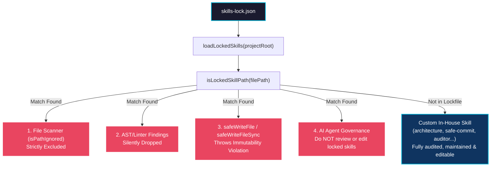

# Official Locked Skills Architecture & Isolation Guide

> **Module**: `.agents/skills/architecture/references/skills-lock.md`  
> **Auditor Engine Core**: `src/core/auditorBase.ts` & `src/core/safePath.ts`  
> **Test Coverage**: [`tests/locked_skills.test.ts`](../../../../tests/locked_skills.test.ts)

---

## 1. Overview & Architectural Motivation

In modern agentic software development, repositories frequently import official, upstream-curated **agent skills** from external vendor repositories (such as `antfu/skills`, `anthropics/skills`, `greensock/gsap-skills`, `fallow-rs/fallow-skills`, `vuejs-ai/skills`, `obra/superpowers`, etc.).

Without formal architectural boundaries, two critical hazards emerge:

1. **Agent Over-Auditing & False Positives**: Static analysis engines and AI agents mistakenly treat third-party vendor skills as project application code, attempting to enforce local naming conventions, CSS guidelines, or TypeScript types on immutable vendor assets.
2. **Accidental Vendor Mutation & Drift**: AI agents perform unauthorized refactorings, style tweaks, or "fixes" inside imported vendor skills, corrupting upstream integrity and diverging from upstream releases.

To eliminate these hazards, the framework establishes **Official Locked Skills Isolation** powered by `skills-lock.json`.

---

## 2. The `skills-lock.json` Manifest

Vendor skills are tracked declaratively in `skills-lock.json`. The framework searches candidate locations in strict order of precedence:

1. Custom path declared via `config.paths.skillsLockFile` in `.auditor/audit.config.ts`.
2. `skills-lock.json` (Project root)
3. `.auditor/skills-lock.json` (Auditor directory)
4. `.agents/skills-lock.json` (Agents directory)
5. `node_modules/@francogp/auditor/skills-lock.json` (Inherited from upstream framework)

### 2.1 Manifest Structure Example

```json
{
  "version": 1,
  "skills": {
    "grill-with-docs": {
      "source": "mattpocock/skills",
      "sourceType": "github",
      "skillPath": "skills/engineering/grill-with-docs/SKILL.md",
      "computedHash": "8341c12d5250aed474553f4a864a93fbd51bc4d01b4a839b1a477193cc163a50"
    },
    "gsap-core": {
      "source": "greensock/gsap-skills",
      "sourceType": "github",
      "skillPath": "skills/gsap-core/SKILL.md",
      "computedHash": "c4a01101d9e1aafbf4b49f75d74f9349790d8741981ba0237c990093863035a6"
    },
    "vitest": {
      "source": "antfu/skills",
      "sourceType": "github",
      "skillPath": "skills/vitest/SKILL.md",
      "computedHash": "21af2b13d47d31f3094b61c0f41abc8d6a7eed0df3c9a4029ea671f6978b7209"
    },
    "vue-best-practices": {
      "source": "vuejs-ai/skills",
      "sourceType": "github",
      "skillPath": "skills/vue-best-practices/SKILL.md",
      "computedHash": "3df585ad31aec78fe55c56c1411262737e6b231677a3153dec512a882fde80cd"
    }
  }
}
```

---

## 3. Four Core Architectural Guarantees



### 3.1 Immutability & Write Protection (`src/core/safePath.ts`)

The framework wraps all file write operations with `assertNotLockedSkill()`:

```typescript
function assertNotLockedSkill(filePath: string): string {
  const resolved = safeResolve(filePath);
  const root = path.resolve(process.cwd());
  if (isLockedSkillPath(resolved, root)) {
    throw new Error(`Security / Immutability Violation: Cannot write to official locked skill: '${resolved}'`);
  }
  return resolved;
}
```

Any attempt by a tool, subagent, or auto-fixer to mutate files under `.agents/skills/<lockedSkill>`, `skills/<lockedSkill>`, or `.skills/<lockedSkill>` fails immediately and loudly.

### 3.2 File Scanner Exclusion (`src/core/auditorBase.ts`)

During repository audits, `isPathIgnored()` checks `isLockedSkillPath()`. Files belonging to locked skills are cleanly skipped during file collection, preventing wasteful I/O and false positives.

### 3.3 Finding & Violation Suppression (`BaseAuditor.ts`)

If an external tool or holistic AST scanner processes a file that resolves into a locked skill directory, `BaseAuditor` drops the finding before recording metrics:

```typescript
// Findings belonging to official locked skills are discarded
if (this.isLockedSkillPath(finding.file)) {
  return;
}
```

This guarantees that project metrics (e.g., Fallow health score, linter error count) reflect **only** first-party workspace code.

### 3.4 AI Agent Governance & Review Scope

When an AI agent is instructed to audit skills, review governance rules, or check for conflicting directives:

- **Locked Skills**: **NEVER review or modify**. They are third-party external specifications.
- **Custom In-House Skills**: **Fully actionable**. Review, maintain, and refine according to repository standards.

---

## 4. Custom In-House Skills vs. Official Locked Skills

| Attribute | Official Locked Skills | Custom In-House Skills |
| :--- | :--- | :--- |
| **Tracked in** | `skills-lock.json` | Not in `skills-lock.json` |
| **Examples** | `gsap-*`, `vitest`, `fallow`, `vue-*`, `grill-with-docs`, `to-spec` | `architecture`, `auditor`, `safe-commit`, `dox-navigator`, `learn-with-docs` |
| **Ownership** | External vendor / upstream ecosystem | Repository authors & tooling engineers |
| **Immutability** | Strictly immutable (write protected) | Maintainable, editable, and evolvable |
| **Audit Status** | Skipped by scanners, findings dropped | 100% audited by `@francogp/auditor` |
| **Governance** | Upstream upstream maintainer rules | Local repository DOX & contracts |

---

## 5. Developer & Agent Guidelines

1. **Checking Skill Status**:
   To determine whether a skill is locked or custom, inspect `skills-lock.json` or call `loadLockedSkills()`:

   ```typescript
   import { loadLockedSkills, isLockedSkillPath } from '@francogp/auditor';
   
   const locked = loadLockedSkills();
   const isLocked = locked.has('gsap-core'); // true
   const isCustom = !locked.has('safe-commit'); // true
   ```

2. **Promoting a Skill to Locked Status**:
   When importing an external skill, add its entry to `skills-lock.json` with `source`, `sourceType`, `skillPath`, and `computedHash`. The framework will automatically activate immutability and scan exclusions across all tools.

3. **Editing Custom Skills**:
   When editing skills like `safe-commit` or `learn-with-docs`, do so freely using standard tools; they are first-class codebase assets not restricted by `skills-lock.json`.

---

## 6. Official Locked Skills Update Protocol & Project Ownership Boundary

### 6.0 Strict Project-Scoped Skill Ownership Boundary (Provider vs. Consumer Projects)

1. **Each Project Only Manages Its Own Local Skills**: A repository may ONLY execute `skills update` or maintain `skills-lock.json` entries for skills that **exclusively belong to that repository** and reside inside its own `.agents/skills/` directory.
2. **Prohibition on Updating or Suggesting Sync of `@francogp/auditor` Skills in Consumer Projects**: All shared framework and ecosystem skills packaged by `@francogp/auditor` (`fallow`, `fallow-review`, `fallow-setup`, `gsap-*`, `vue-*`, `vitest`, `vite`, `valibot`, `pinia`, `playwright-cli`, `architecture`, `auditor`, etc.) are owned 100% by `@francogp/auditor` and consumed read-only from `node_modules/@francogp/auditor/.agents/skills`.
   - Consumer host projects (`!isSelfProviderProject`) are **STRICTLY PROHIBITED** from running `skills update` on auditor-owned skills, cloning them into the host's `.agents/skills/`, adding them to a host `skills-lock.json`, or proposing to the user to synchronize them locally (enforced by `host-duplicate-auditor-skill` in `validate_agent_plugin`).
   - When a consumer host project upgrades a library whose skill belongs to `@francogp/auditor`, the AI agent MUST NOT modify or offer to sync the skill in the host project; it may **ONLY suggest to the user to ask the `@francogp/auditor` programmer to update the skills in the `@francogp/auditor` repository**.

When developers or users request to update, upgrade, or sync project-owned external skills inside the owner repository (e.g. inside `@francogp/auditor` for shared skills, or inside a host project ONLY for domain-specific skills owned by that host project), execute this deterministic zero-guesswork workflow:

### 6.1 Canonical Command Execution

Use the official Skills CLI (`skills`) via `npm exec` (never invoke `npx`):

```bash
# Update ALL project-scoped skills non-interactively
npm exec --yes -- skills update -p -y

# Or update a specific locked skill by name
npm exec --yes -- skills update <skill-name> -p -y
```

**Key Flags Explained**:

- `-p` / `--project`: Restricts update strictly to the project repository scope (`.agents/skills/`), avoiding global user-level contamination.
- `-y` / `--yes`: Skips interactive confirmation prompts, enabling non-blocking execution.

### 6.2 Automated Manifest Synchronization

Running `skills update` automatically:

1. Fetches the latest revisions from the upstream Git repositories configured in `skills-lock.json` (`obra/superpowers`, `greensock/gsap-skills`, `fallow-rs/fallow-skills`, `DietrichGebert/ponytail`, `mattpocock/skills`, `vuejs-ai/skills`, etc.).
2. Re-computes and overwrites cryptographic `computedHash` SHA-256 signatures directly in `skills-lock.json`.
3. Overwrites skill definition files in `.agents/skills/<skill-name>/`.

### 6.3 Post-Update Verification Pipeline

Immediately following command completion, verify the changes and validate isolation integrity:

```bash
# 1. Review lockfile and skill changes
git status --short skills-lock.json .agents/skills

# 2. Inspect modified skill hashes
git diff skills-lock.json

# 3. Verify framework isolation tests pass 100%
vp test tests/locked_skills.test.ts
```

### 6.4 Reporting Template

Deliver a consolidated final report detailing:

- Total skills audited vs. updated vs. already up-to-date.
- Per-skill change breakdown (modified files, added/removed features, upstream version upgrades).
- Confirmation of updated `skills-lock.json` hashes and 100% passing test status.

---

## 7. Mandatory Dependency-to-Skill Synchronization Matrix (Owner-Scoped)

When upgrading, bumping, or adding libraries in `package.json`, developers and AI agents must check whether the dependency has a corresponding official agent skill **owned by the current repository**:

- **Inside `@francogp/auditor` (Provider Repository)**: The skills in the matrix below are owned by `@francogp/auditor` and **must be updated simultaneously** via `npm exec --yes -- skills update <skill-name> -p -y` when their corresponding library is bumped in `@francogp/auditor`.
- **Inside Consumer Host Projects**: Because the skills in the matrix below belong to `@francogp/auditor` (not the host project), the agent in the host project **MUST NEVER update, lock, or propose synchronizing them locally**. Only `vp config` (for `vite-plus` directives in the host's `AGENTS.md`) or skills exclusively owned by the host project's own `.agents/skills/` may be updated in the host project. For any `@francogp/auditor` skill, the agent may only inform the user to request the `@francogp/auditor` programmer to update the skills upstream.

### 7.1 Dependency-to-Skill Mapping Matrix (`@francogp/auditor` Owned Catalog)

| Library / Package (`package.json`) | Associated Agent Skill(s) | Upstream Repository Source |
| :--- | :--- | :--- |
| `vite-plus`, `@voidzero-dev/vite-plus-core` | Packaged `node_modules/vite-plus/AGENTS.md` (injected into `AGENTS.md` via `vp config`), [`vite`](../../vite/SKILL.md), [`vitest`](../../vitest/SKILL.md) | `voidzero-dev/vite-plus` (`https://viteplus.dev/llms-full.txt`), `antfu/skills` |
| `fallow` | [`fallow`](../../fallow/SKILL.md), [`fallow-review`](../../fallow-review/SKILL.md), [`fallow-setup`](../../fallow-setup/SKILL.md) | `fallow-rs/fallow-skills` |
| `vitest`, `@vitest/*` | [`vitest`](../../vitest/SKILL.md) | `antfu/skills` |
| `vite`, `rolldown` | [`vite`](../../vite/SKILL.md) | `antfu/skills` |
| `valibot` | [`valibot`](../../valibot/SKILL.md) | `open-circle/agent-skills` |
| `pinia` | [`pinia`](../../pinia/SKILL.md), [`vue-pinia-best-practices`](../../vue-pinia-best-practices/SKILL.md) | `antfu/skills`, `vuejs-ai/skills` |
| `vue`, `vue-router` | [`vue-best-practices`](../../vue-best-practices/SKILL.md), [`vue-debug-guides`](../../vue-debug-guides/SKILL.md), [`vue-jsx-best-practices`](../../vue-jsx-best-practices/SKILL.md), [`vue-options-api-best-practices`](../../vue-options-api-best-practices/SKILL.md), [`vue-router-best-practices`](../../vue-router-best-practices/SKILL.md), [`vue-testing-best-practices`](../../vue-testing-best-practices/SKILL.md), [`create-adaptable-composable`](../../create-adaptable-composable/SKILL.md) | `vuejs-ai/skills` |
| `gsap` | [`gsap-core`](../../gsap-core/SKILL.md), [`gsap-frameworks`](../../gsap-frameworks/SKILL.md), [`gsap-performance`](../../gsap-performance/SKILL.md), [`gsap-plugins`](../../gsap-plugins/SKILL.md), [`gsap-react`](../../gsap-react/SKILL.md), [`gsap-scrolltrigger`](../../gsap-scrolltrigger/SKILL.md), [`gsap-timeline`](../../gsap-timeline/SKILL.md), [`gsap-utils`](../../gsap-utils/SKILL.md) | `greensock/gsap-skills` |
| `@playwright/test`, `playwright` | [`playwright-cli`](../../playwright-cli/SKILL.md) | `microsoft/playwright-cli` |
| `@vueuse/core`, `vueuse` | [`vueuse-functions`](../../vueuse-functions/SKILL.md) | `vueuse/skills` |

### 7.2 Coupled Update Protocol

When the user asks to update dependencies (e.g. *"actualizar dependencias"*, *"update fallow"*, *"upgrade vitest"*, *"upgrade vite-plus"*):

1. **Update Library**: Bump the package version in `package.json` and install dependencies.
2. **Check Skill Ownership Scope**:
   - If running in **`@francogp/auditor`** (or if the upgraded dependency corresponds to a skill owned locally by the current project's `.agents/skills/`): run `npm exec --yes -- skills update <skill-name> -p -y` and verify `skills-lock.json`.
   - If running in a **consumer host project** and the skill belongs to `@francogp/auditor`: **DO NOT run `skills update` and DO NOT propose syncing the skill locally**. If relevant, mention that the user can ask the `@francogp/auditor` programmer to update the skill in `@francogp/auditor`.
3. **Verify Lockfile & Tests**: Ensure `skills-lock.json` (in the owner repository) reflects the new hashes and run `vp test`.
