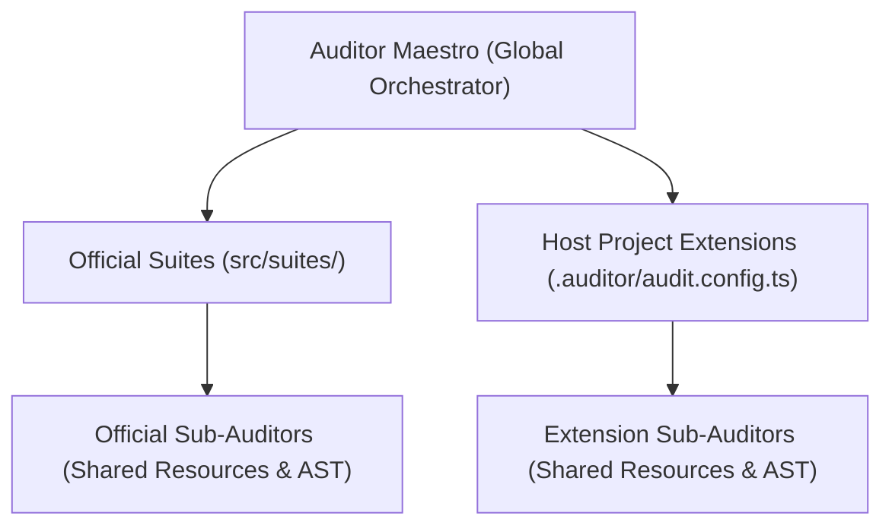
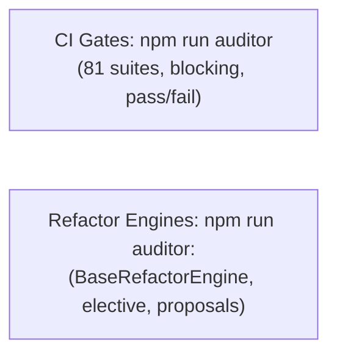

# Auditor: Architecture, Verification & Governance Engine

This skill defines the immutable standard and architectural contract for creating, administering, refactoring, and maintaining all sub-auditors, reporting scripts, and the `@francogp/auditor` engine across the repository.

Every sub-auditor and reporter is part of a unified static analysis and verification system orchestrated by `npm run auditor`.

---

## 🏗️ 3-Tier Hierarchical Architecture & Atomic Console Mandate

The framework enforces a universal, 3-tier hierarchical and symmetric architecture where official suites and host project extensions share identical OOP abstractions:



1. **Global Orchestrator (`npm run auditor`)**: Discovers suites dynamically, manages CPU worker pools, and coordinates atomic console output.
2. **Symmetric OOP Model**: Both official suites and host extensions inherit from `BaseAuditor` or `FileScanAuditor`, implementing identical interfaces, capability declarations, and error handling.
3. **Resource Sharing (`SharedAstContext`)**: Multi-rule sub-auditors share cached resources (filesystem reads, preheated ASTs, external tool passes) to maximize performance.
4. **Atomic Console Mandate**: Multi-rule suites MUST wait for all sub-checks to finish before rendering step reports (`│  🔍 [X/Y] ...`), preventing mixed output across concurrent workers.
5. **Mandatory Construction Contract (`ruleRemediations`, `ruleRemediationPhases`, `requiredPermissions`)**: `AuditorOptions` strictly requires: `id`, `name`, `description`, `family`, `packageName`, `icon`, `ruleDescriptions`, `ruleRemediations`, `ruleRemediationPhases`, `requiredPermissions`, `ruleCapabilities`, `configKey`, `defaultConfig`, and `criticalConfig`. Omitting any field, lacking a remediation guide, omitting `ruleRemediationPhases`, or omitting `requiredPermissions` throws an immediate loud runtime error.
6. **Strategic Remediation Order (7 Canonical Phases) & Sequential Focus (`npm run auditor:next`)**: Findings are deterministically mapped to 7 canonical phases (`setup` -> `prune` -> `dedup` -> `contracts` -> `behavior` -> `hygiene` -> `polish`). Developers and AI agents MUST execute `npm run auditor:next` to focus strictly on the earliest phase containing unresolved errors, postponing downstream findings to eradicate wasted effort. Host extension failures fall under `phase: 'setup'` (`audit-config-invalid-extension`), activating Imperative Setup Blocking and suppressing application findings until infrastructure is healthy. See [remediation-order-guide.md](./references/remediation-order-guide.md).
7. **On-Demand Diagnostic Guides (`auditor guide`)**: Any diagnostic and remediation manual can be rendered on-demand in the terminal via `npm run auditor guide <ruleId>`, `auditor guide suite=<suiteId>`, or `auditor guide family=<family>` with zero truncation and Box-Drawing formatting.
8. **Compiled Artifact Verification (`npm run auditor:post-build`)**: Rules declaring `phase: 'post-build'` (`capabilities.phase === 'post-build'`) are excluded from pre-build source audit and execute post-build against `dist/` via `npm run auditor:post-build` (`auditor phase=post-build`).

---

## 🏛️ Core Principles & Tooling Mandates

### 1. Absolute Prohibition on Backward-Compatible Code & Strict 3-Layer Interface Protection

- Writing backward-compatible shims, deprecated aliases (e.g. `count()` on registries), or legacy fallback wrappers is **STRICTLY PROHIBITED**. Outdated calls MUST fail loudly with immediate, blocking errors (`throw new Error(...)`).
- **Strict 3-Layer Interface Protection**: Registries and engines implement strict TypeScript interfaces (`IBaseEntityRegistry<TItem>`, `IRefactorEngine`). Singletons are exported masked with interfaces (`SuiteIgnoreRegistry: ISuiteIgnoreRegistry`), compile-time exact type invariance is proven via `VerifyExact` in test canaries, and runtime prototype purity is verified against `REGISTRY_ALLOWED_PROTO_METHODS`.

### 2. Prohibition on Modifying Configurations & Auditor Exclusive SSoT Sovereignty

- **Auditor Exclusive SSoT Sovereignty & Zero Manual Satellite Edits**: `.auditor/audit.config.ts` is the SOLE Single Source of Truth (SSoT). All satellite configurations (`.fallowrc.json`, `vite.config.ts`, `.stylelintrc.json`, `tsconfig.json`, `.htmlvalidate.json`, `.markdownlint.json`) are derived artifacts owned exclusively by `@francogp/auditor`. The Auditor is the **ONLY authorized entity** to generate, mutate, and synchronize them via official setup suites (`phase: 'setup'`) in `npm run auditor:fix`.
- **Categorical Prohibition on Manual Config Plans**: AI agents and developers are **STRICTLY PROHIBITED** from proposing in work plans (`/plan`, `/brainstorming`, walkthroughs) or executing manual edits (`write_file`, `edit_file`) on satellite configuration files. Whenever an audit flags satellite config diagnostics (such as `fallow-workspace-diagnostic`, `*-undeclared-config-entry`), the ONLY canonical action is running `npm run auditor:fix`.
- **PreToolUse Hook Invariance & Modular Vite Plugins (`vite.plugins.ts`)**: AI agents and developers are **STRICTLY PROHIBITED** from bypassing or evading PreToolUse safety hooks (such as `prevent_destructive_git.js`) through proxy scripts in `scratch/`, brain directories, or temporary paths. When an operation on a satellite config is blocked, the action is intentionally forbidden. For Vite plugins specifically, application plugins are delegated to `vite.plugins.ts` (100% developer/AI-owned and directly editable); running `npm run auditor:fix` automatically migrates inline plugins from `vite.config.ts` into `vite.plugins.ts` and resolves TypeScript recursion depth issues (`TS2321`).
- **Zero Config Tampering Without Prior Consultation**: NEVER turn off, relax, or alter `.auditor/audit.config.ts` to silence errors. If an agent genuinely believes a configuration requires adjustment, it **MUST HALT AND CONSULT THE HUMAN PROGRAMMER** via `ask_question` with explicit pros, cons, and trade-offs. Once approved, declare changes strictly in `.auditor/audit.config.ts` and sync with `npm run auditor:fix`. See [satellite-configs-sovereignty-guide.md](./references/satellite-configs-sovereignty-guide.md) and [satellite-tool-integration-manual.md](./references/satellite-tool-integration-manual.md).
- **Auto-Fix First Mandate (`auditor fix` Prior to Manual Edits)**: Whenever an audit reports auto-fixable findings (`(N auto-fixable)`), developers and AI agents MUST invoke `npm run auditor:fix` FIRST before touching any code.
- **Oxlint Linter Ownership & Zero Redundant Auditor Rules**: Oxlint (`vp lint` / `validate_oxlint`) is the sole owner of code hygiene, syntax rules, and `: any` eradication. The Auditor audits architecture and domain boundaries.

### 3. Absolute Prohibition on Suppressing Audit Rules & Zero-Tolerance Fake Pass Mandate

- Suppressing, silencing, or bypassing rules (e.g., setting `"rule": null`, `"rule": "off"`, passing arbitrary skip flags) to achieve a fake pass is considered critical architectural sabotage.
- **Dependency Immutability (`node_modules/`) & Upstream Bug Reporting**: Modifying, editing, patching, or writing files inside `node_modules/` under ANY circumstances is **STRICTLY AND CATEGORICALLY PROHIBITED**. Reading and inspecting dependency source code or type definitions (`.d.ts`) is completely permitted, but installed dependencies are immutable runtime artifacts. If an agent suspects a bug or false positive in `@francogp/auditor` or any installed dependency, it **MUST HALT AND REPORT IT TO THE HUMAN PROGRAMMER** so it is legitimately resolved in the upstream source repository—never hot-patch or mutate `node_modules/`.

### 4. Node.js 26+ Native Engine & Prohibition of NPX / Third-Party Runners

- Executes strictly under Node.js 26+ native engine with native TypeScript (`node --experimental-strip-types`).
- Compiles with baseline `compilerOptions.target: 'ES2025'` (or `'ESNext'`), enforced strictly by `validate_tsconfig` and auto-repaired via `auditor fix`. Outdated targets (`ES2022` or lower) fail loudly.
- Invoking or recommending npx runners (such as tsx, legacy auditor, or vitest via npx) or third-party runners is **STRICTLY PROHIBITED**. Use native Node.js or canonical npm scripts (`npm run <script>`, `npm test`).

### 5. Strict OOP Inheritance Mandate

- Every sub-auditor MUST extend `BaseAuditor<TRuleId>` or `FileScanAuditor<TRuleId>`.
- Procedural scripts, custom CLI loggers, and ad-hoc result printers are **STRICTLY FORBIDDEN**.

### 6. AI-Friendly Compact Output by Default & Box-Drawing Human Mode

- By default, all executions operate in AI-friendly compact mode (concise 3-line status in English: status, counts, latest_audit.json path).
- Interactive human inspections and full Box-Drawing progress tables (80-col limit, zero wrapping) are rendered on demand via `human`, `--human`, or dedicated package scripts (`npm run auditor:human`, `npm run auditor:lint:human`, `npm run auditor:full:human`). Multi-row summary tables include `TOTAL CONSOLIDADO`.
- Node.js intrinsic `--permission` warnings (`PERM0002`) are cleanly suppressed via `--disable-warning=PERM0002` while preserving 100% of actionable warnings.

### 7. Universal Empirical Individual Timing Mandate

- 100% of declared sub-auditors and rules must record real empirical execution runtime badges (`(X ms)` or `(<0,1 ms)`). Suites taking seconds or hundreds of ms must NEVER show `(0 ms)` on child rules.
- **Prohibition of Synthetic Division**: Multi-rule suites must NEVER synthetically divide suite duration or stamp batch durations identically onto rules.
- **Superclass Wrappers**: Wrap rule checks with `this.runSubAuditorSync(ruleId, () => T)` or `await this.runSubAuditor(ruleId, async () => T)`. These helpers invoke `markRuleEvaluated(ruleId)` internally.
- **Deconstruction of External Tools**: Execute the shared tool pass, then aggregate findings per rule inside dedicated `this.runSubAuditorSync(ruleId, () => { ... })` blocks.
- **Explicit Non-Applicability (`markRuleNotApplicable`)**: When a subsystem or directory does not exist, call `this.runSubAuditorSync(ruleId, () => this.markRuleNotApplicable(ruleId, 'reason'))`.

### 8. Atomic Console Streaming & Completion-Ordered Output (`streamingRunner.ts`)

- Master audit executes suites concurrently across CPU workers (`Math.max(1, Math.floor(availableCpus / 2))`).
- **Completion Order**: Suites appear in console strictly in the order they **FINISH** ($T_{\text{finish}} = T_{\text{start}} + \text{durationMs}$). The printed duration reflects active child runtime (`performance.now() - taskStart`), not global wall-clock time. Short suites queued later display after earlier heavy suites.
- **`printLock` Mutex**: Guarantees each suite's output block renders as an unbroken atomic unit.

### 9. Execution Lifecycle Phases (`phase: 'setup' | 'normal' | 'post-run' | 'post-build'`)

- **`phase: 'setup'` (ABSOLUTE PRIORITY & IMPERATIVE BLOCKING)**: Project infrastructure, configuration, runtime environment, dependency, and package script suites (`validate_audit_config`, `validate_tsconfig`, `validate_vite_plus_config`, `validate_stylelint_config`, etc.). When errors exist in setup suites, the auditor activates **Imperative Setup Blocking**: downstream application and stylesheet findings are postponed in console to eradicate induced false positives, mandating setup remediation first (e.g. `npm run auditor:fix`). In auto-fix mode (`auditor fix`), setup suites execute strictly before any code mutations or third-party linters (`resolveFixOrderWeight < 200`). Developers and AI agents are PROHIBITED from refactoring application code or styling while setup errors remain.
- **`phase: 'normal'`**: Standard source code and architecture suites dispatched across concurrent worker pools once setup is clean.
- **`phase: 'post-run'` (`validate_audit_coverage`)**: Completely excluded from concurrent worker pools; executes sequentially ONLY AFTER 100% of preceding suites finish and flush coverage ledgers to `scratch/audits/coverage/<suiteId>.json`, eliminating false `coverage-missing-ledger` alarms.
- **`phase: 'post-build'` (`npm run auditor:post-build` / `auditor phase=post-build`)**: Verifies compiled distribution artifacts in `dist/` after compilation completes.

### 10. Shared AST Engine & Zero Duplicate Parse Mandate (`SharedAstContext`)

- Suites requiring AST or Vue SFC `<script>` parsing declare `requiresAst: true` (and `ast: true` in `ruleCapabilities`).
- NEVER call `ts.createProgram` or `ts.createSourceFile` in file loops. Consume `SharedAstContext` preheated by the orchestrator.

### 11. Centralized Directory Scanning & In-RAM File Cache (`WorkspaceFileCache`, `scanFilesSinglePass`)

- Sub-auditors MUST NEVER implement custom recursive directory traversals (`fs.readdir` loops, `walkDir`, `getAllFiles`). Use `this.context.collectFiles(roots, extensions)` or `collectRepositoryFiles()`.
- Multi-rule suites scanning the same file set MUST use `await this.scanFilesSinglePass(files, handlers)` backed by the in-RAM `WorkspaceFileCache`, reading each file once and prohibiting nested rule-over-files disk loops (`auditor-inefficient-file-scan`).

### 12. Mandatory Modular Identity & Human-Friendly Description Standard

- `packageName`: Mandatory package/technology scope (e.g. `'Oxlint'`, `'TypeScript'`, `'Config'`, `'Styles'`).
- `description`: Suite purpose in English, max 60 characters (`MAX_AUDITOR_SUITE_DESCRIPTION_LENGTH = 60`).
- `ruleDescriptions`: Concise English explanation for each rule ID. Composed `${packageName}: ${ruleDescription}` MUST be `<= 50` characters (`MAX_AUDITOR_DESCRIPTION_LENGTH = 50`) without newlines.
- Positive health phrasing for active checks (e.g. `'Similar-code engine health'`), reserving error phrasing for violation messages.

### 13. Single Source of Truth Directory Ignores & Canonical Registry (`SuiteIgnoreRegistry`, `isPathIgnored`)

- **Canonical Ignore Registry (`SuiteIgnoreRegistry`)**: Centralized Single Source of Truth (`src/core/canonicalIgnoreRegistry.ts`) for universal directory ignores (`ALWAYS_IGNORE_DIRS`), binary extensions (`CANONICAL_BINARY_EXTENSIONS`), dynamic caches, and configuration unignore resolution.
- **Strict Ignore Isolation & Prohibition of Hardcoding Ignores**: Sub-auditors are fully sovereign to configure their own ignores voluntarily if desired (`subsystem.ignoreGlobs`, `paths.ignoreGlobs`). However, HARDCODING IGNORES IN SOURCE CODE OR CROSS-POLLUTING IGNORES ACROSS SUBAUDITORS WITHOUT EXPLICIT DECLARATION IS STRICTLY PROHIBITED. Subsystem-specific paths (`dataRoots`, `testRoots`, `coverage.exemptGlobs`) MUST NEVER leak into other sub-auditors or satellite configurations (`vite.config.ts.lint.ignorePatterns`).
- **Mandatory Default Auditing for `vite.plugins.ts`**: `vite.plugins.ts` is developer-owned application code and MUST ALWAYS be audited, linted, and formatted by default across all static analyzers. Placing `vite.plugins.ts` in any default ignore list is strictly prohibited.
- **Auditor AST Automated Strong Typing on Governed Satellites (`vite.config.ts`)**: Since `vite.config.ts` is an auditor-owned satellite configuration, the AST synchronization engine (`synchronizeViteConfigAst`, `applyViteConfigAstTransformations`) automatically constructs and injects explicit TypeScript return types on all standard Vite/Rollup functions (`onwarn(warning, warn): void`, `bypass: (req): string | undefined =>`, `manualChunks(id): string | undefined`, `outExtensions: (): { js: string; dts: string } =>`), ensuring 100% compliance with strict Java-style typing (`@typescript-eslint/explicit-function-return-type`) without manual developer intervention.
- **Binary Governance for Ignored Paths**:
  1. **Universal Dirs**: `.git`, `node_modules`, `scratch`, `tmp`, `volumes`, `.vscode`, `.github`, `.gemini`, `.auditor` belong strictly to `ALWAYS_IGNORE_DIRS`. Hardcoding application code roots is strictly prohibited.
  2. **Tool Caches (`cachePaths`)**: Declared by governing sub-auditors in constructor (`.fallow`, `.oxlintcache`, etc.) and registered dynamically.
  3. **Section-Isolated Ignores (`subsystem.ignoreGlobs`)**: Each sub-auditor isolates ignores in its own section without leaking across other suites.
  4. **Universal Formula**: $\text{UNION}(\text{ALWAYS\_IGNORE\_DIRS}, \text{DynamicCaches}, \text{LockedSkills}, \text{paths.ignoreGlobs}, \text{subsystem.ignoreGlobs})$.
  5. **Additive AST Defaults**: Defaults are injected additively by `auditor fix`, strictly preserving user configurations.
- `FileScanAuditor` natively accepts `exemptPaths` in constructor options and evaluates `isPathExempt(relPath, this.exemptPaths)`, cleanly ignoring configured files or patterns.

### 14. Universal Ephemeral Scratch (`scratch/`) & Build Output (`dist/`) Isolation

- `scratch/`: All temporary files, AI drafts, testing dumps, and raw audit outputs (`scratch/audits/`). Must be in `.gitignore`.
- `dist/`: All compiled outputs and production bundles. Must be in `.gitignore`.

### 15. Dynamic Auto-Discovery & Zero Hardcoded Suite Maps

- Generic suites in `src/suites/<family>/` and host extensions in `.auditor/audit.config.ts` are discovered dynamically. Never hardcode static suite arrays.

### 16. Pure Configuration-Driven Resolution, Zero Hardcoded Paths & Single Options Object

- **Zero Hardcoded Paths Mandate**: `@francogp/auditor` MUST remain 100% domain-agnostic with ZERO hardcoded paths, candidate file arrays, or literal fallback lists (`?? ['src']`, `?? ['scripts']`). Roots resolve dynamically via `resolveFileScanRoots(options, selector)` from `config.paths` or `DEFAULT_AUDIT_CONFIG.paths`. Probed by `tests/all_auditors_zero_hardcoded_paths.test.ts`.
- **Single Options Object Mandate**: Sub-auditor constructors strictly accept a single typed options object (`options: FileScanRootsOptions = {}` or extended interface). Positional constructor parameters are strictly prohibited.
- **Anti-Hardcoding Hygiene (`auditor-hardcoded-config`)**: Enforced at build and audit time by `validate_auditor_hygiene`, which flags hardcoded candidate arrays and fallback path lists with `severity: 'error'`.

### 17. Active by Default Subsystem Mandate ("All Defaults ON")

- All subsystems in `@francogp/auditor` are ACTIVATED BY DEFAULT (`enabled: true`). Host configurations declare customizations or explicit deactivations (`enabled: false`, `engine: 'none'`).

### 18. Mandatory GSAP UI Animation Governance & Anti-Destruction of CSS Transitions

- UI animations and delays must use GSAP standard primitives (`gsapSleep`, `delayedCall`, `gsap.to`).
- Deleting or stripping CSS transitions (`transition: ...`) to pass audits is **STRICTLY FORBIDDEN**. Transitions must be cleanly migrated to GSAP tweens.

### 19. Vector Semantic Duplication Architecture (`validate_similar_code`)

- Detects semantic clones via Fallow embeddings (`jina-embeddings-v2-base-code`) on **Candle CPU** (CPU-only, no GPU/CUDA) with `--threads ${os.availableParallelism()}`.
- Caches persist in `%LOCALAPPDATA%\fallow\similar-code` (Windows) or `~/.cache/fallow/similar-code` (Linux).
- Bypassed cleanly in `speed=light` (`npm run auditor:lint`) and production deployment builds (`AUDITOR_ENV=production` via `npm run build:deploy`). Skipping vector analysis in local development is strictly prohibited.

### 20. Fallow 100% Error Severity & Holistic Refactoring Targets

- All Fallow findings map strictly to `severity: 'error'`. Downgrading to warning is prohibited.
- Governed by holistic Fallow Refactoring Targets (`fallow-refactoring-targets`, `config.fallow.enforceTargets: true`), eliminating artificial function fragmentation.

### 21. Orthogonal Rule Capabilities Contract (`AuditorRuleCapabilities`)

- Every sub-auditor declares capabilities on each rule individually via `ruleCapabilities: Record<TRuleId, AuditorRuleCapabilities>`.
- Passing suite-level `capabilities` directly in constructor options is prohibited (`capabilities?: never`).
- Each rule capability defines orthogonal properties (`speed`, `phase`, `md`, `ast`, `changedOnly`, `critical`), while `fix` is computed automatically by `BaseAuditor`:
  - `speed`: `'light' | 'heavy' | 'full' | readonly AuditExecutionSpeed[]` (`🐇` `'light'`, `🐢` `'heavy'`, `🐘` `'full'`, or array `['light', 'full']` for multi-tier CLI tools).
  - `phase`: `'normal' | 'post-run' | 'post-build'`.
  - `fix`: `'none' | 'normal' | 'priority'` (dynamically computed from registered fixers/patterns; manual declaration is optional and never required).
  - `md`: `boolean` (included in `auditor preset=md` / `npm run auditor:md`).
  - `ast`: `boolean` (preheats `SharedAstContext`).
  - `changedOnly`: `boolean` (supports differential scoping via `--changed-since`).
  - `critical`: `boolean` (indispensable for code correctness, typing, and syntax; bypasses speed ceiling in `auditor:lint` and `auditor:critical`).
- Canonical templates export `LINT_RULE_CAPABILITIES` and `AST_RULE_CAPABILITIES`, or accept uniform presets via `createUniformRuleCapabilities(RULES, { ... })` / `createRuleCapabilities(RULES, baseCapabilities, fixableRuleIdsOrFixers)`.

### 21.3 Contract-Driven Auto-Fix Protocol & Function Deduplication Mandate

- **Contract-Driven Zero False-Fix Protocol**: Auto-fix is 100% contract-driven. If a rule lacks an automated deterministic repair algorithm, it is strictly NOT fixable (`fix: 'none'`). Suites register repair functions via `ruleFixers` in `AuditorOptions` or via sub-auditors (`declareFileSubAuditor({ audit, fix })`, `declarePatternSubAuditor({ regex, replace })`, or `configFiles`). Manual boolean/string declarations in capabilities are prohibited; `BaseAuditor` dynamically derives `fixableRuleIds` and `capabilities.fix`. Violations without registered fixers unconditionally report `fixable: false`.
- **Function Identity Deduplication Mandate (`Set<Function>`)**: When multiple sub-auditors share the exact same `audit` or `fix` function across rules, the engine executes it strictly ONCE per document, eliminating redundant passes. When `audit === fix`, running in `--fix` mode executes the function strictly ONCE instead of running audit and fix sequentially. Similarly, shared `ruleFixers` execute strictly once per run.

### 21.1 Speed Engine & Execution Tiers (`AuditExecutionSpeed`)

- **3 Canonical Tiers**: `'light'` (`🐇`, fast static lint/AST with unified type-check), `'heavy'` (`🐢`, default workspace ceiling), `'full'` (`🐘`, exhaustive pre-build ceiling with heavy operations such as cascade expansion and vector deduplication).
- **Execution Modes**: Cumulative Ceiling (`speed=light|heavy|full`) vs. Exact Isolation (`only-speed=tier`).
- **LPT Task Scheduler & Multithreading**: Longest Processing Time first in `audit_full`; permanent cache & multithreading (`--threads ${os.availableParallelism()}`).
- 📘 **Full Speed Engine & Build Chaining Guide**: See [speed-and-execution-tiers-guide.md](./references/speed-and-execution-tiers-guide.md).

### 22. Strict Vite+ (`vp`) Unified Configuration & Code Hygiene Governance (`validate_vite_plus_config`, `validate_oxlint`, `validate_oxfmt`)

- Eradicates standalone `eslint.config.*`, `vitest.config.*`, `tsdown.config.*`, `tsconfig.build.json`, and `.nvmrc` across all projects in favor of unified **Vite+ (`vite-plus` / CLI `vp`)**.
- Governs `vite.config.ts` (`defineConfig` from `'vite-plus'`) enforcing:
  1. `lint`: Oxlint + type-aware rules (`options: { typeAware: true, typeCheck: true }`), JS plugin `@francogp/auditor/domain-type-plugin` enforcing the `/domain-type-first` rules, `@typescript-eslint/no-unused-vars: 'error'`, `@typescript-eslint/no-explicit-any: 'error'`, `@typescript-eslint/ban-ts-comment: 'error'`, `@typescript-eslint/consistent-type-assertions: ['error', { assertionStyle: 'as', objectLiteralTypeAssertions: 'never' }]`, and banning double casting `as unknown as T` or uncoordinated `Date` constructors without explicit domain wrappers.
  2. `test`: Vitest runner importing from `'vite-plus/test'`, supporting workspace projects (SSoT via `vitePlusConfig.test.projects`) with strict runner isolation (prohibiting root `include` contamination) and V8 coverage.
  3. `fmt`: Oxfmt formatting (`singleQuote: true`, `semi: true`, `trailingComma: 'none'`, `printWidth: 100`), audited and validated by `validate_oxfmt`.
  4. `staged`: Native git hooks (`{ '*': 'vp check --fix' }`).
  5. `pack`: Tsdown library packaging when `packageDistribution.enabled: true`.
  6. `dynamic exclusion sync`: `syncViteConfigWithAuditConfig` dynamically projects `config.paths.ignoreGlobs` into `lint.ignorePatterns` and `fmt.ignorePatterns`.
  7. `dynamic lint overrides`: `resolveEffectiveLintOverrides` automatically projects dynamic file-scoped overrides into `lint.overrides` of `vite.config.ts` derived 100% dynamically from `paths` in `.auditor/audit.config.ts` with zero hardcoding:
     - **Test Overrides** (derived dynamically from `paths.testRoots`, `paths.e2eRoots`, `paths.integrationRoots`): Relaxes strict production assertions in test suites (`unicorn/prefer-global-this: 'off'`, `vue/require-typed-ref: 'off'`, `no-console: 'off'`, `@typescript-eslint/explicit-function-return-type: 'off'`, `vitest/*: 'off'`, `max-depth: 'off'`, `no-script-url: 'off'`, `typescript/no-implied-eval: 'off'`, `no-new-func: 'off'`, `no-unused-expressions: 'off'`, `@francogp/domain-type/unsafe-path-concat: 'off'`, `@francogp/domain-type/hardcoded-slash-path: 'off'`, `@francogp/domain-type/no-raw-local-storage: 'off'`, `@francogp/domain-type/no-insecure-random: 'off'`, `@francogp/domain-type/no-select-star-in-queries: 'off'`, `@francogp/domain-type/require-paginated-queries: 'off'`, `@francogp/domain-type/no-untyped-string-set-map: 'off'`, `@francogp/domain-type/no-hardcoded-secrets: 'off'`).
     - **Script/CLI Overrides** (derived dynamically from `paths.scriptsRoots`, `paths.cliRoots`): Relaxes console output, unpaginated queries, PRNG, nesting limits, and floating promise checks for Node CLI, fuzzers, seeds, simulations, and maintenance scripts (`no-console: 'off'`, `unicorn/prefer-global-this: 'off'`, `@typescript-eslint/no-floating-promises: 'off'`, `@typescript-eslint/explicit-function-return-type: 'off'`, `max-depth: 'off'`, `@francogp/domain-type/unsafe-path-concat: 'off'`, `@francogp/domain-type/hardcoded-slash-path: 'off'`, `@francogp/domain-type/no-insecure-random: 'off'`, `@francogp/domain-type/no-broad-string-array: 'off'`, `@francogp/domain-type/no-raw-local-storage: 'off'`, `@francogp/domain-type/no-select-star-in-queries: 'off'`, `@francogp/domain-type/require-paginated-queries: 'off'`, `@francogp/domain-type/no-untyped-string-set-map: 'off'`, `@francogp/domain-type/no-direct-database-instantiation: 'off'`, `@francogp/domain-type/require-storage-try-catch: 'off'`).
     - **Demo/Prototype Overrides** (derived dynamically from `paths.demoRoots`): Relaxes console and return types for UI sandboxes and interactive prototypes (`no-console: 'off'`, `@typescript-eslint/explicit-function-return-type: 'off'`, `@francogp/domain-type/no-insecure-random: 'off'`, `@francogp/domain-type/no-broad-string-array: 'off'`).
     - **Coverage vs Linter Exemption Distinction Mandate**: AI agents and developers MUST NOT confuse `coverage.acknowledgedDegradations` with linter exemptions. `coverage.acknowledgedDegradations` is EXCLUSIVELY evaluated by `validate_test_coverage` for test line coverage gating and HAS ZERO EFFECT on Oxlint, Vite+, or static analysis linters. To exempt legitimate non-production files from linters, configure `paths.scriptsRoots`, `paths.cliRoots`, `paths.testRoots`, or `paths.demoRoots` so dynamic overrides apply, or use `paths.ignoreGlobs` / `paths.ignoredDirs` in `.auditor/audit.config.ts`.
     - **Path Taxonomy and Overrides Specification**: See [path-taxonomy-and-overrides-guide.md](./references/path-taxonomy-and-overrides-guide.md) for full mapping matrix and consumer diagnostic workflows.
     - **Custom Project Overrides**: Host projects declare custom module overrides in `.auditor/audit.config.ts` (`vitePlusConfig.lint.overrides`). The auditor synchronizes them automatically via AST on `npm run auditor:fix`. Manually editing `vite.config.ts` is strictly prohibited.
     - **Explicit Return Types Standard**: `@typescript-eslint/explicit-function-return-type` enforces strict Java-style return types on declared functions, class methods, and exported functions (`allowExpressions: true`), while allowing inferred inline callbacks in method expressions (`items.map(x => x.id)`).
- **Mandatory Injected Rule & Configuration Canary Verification**:
  Every rule injected or mandated by Vite+ (Oxlint, Oxfmt, domain-types) must have active automated canary tests asserting positive failure detection, clean compliance, and auto-fix behavior. Furthermore, all auditor configuration options must have canaries verifying both active state and disabled state (`enabled: false`).
- **Non-Destructive Auto-Fix Migration Workflow (`auditor fix`)**:
  When migrating a legacy project, `auditor fix` executes the strict 5-stage non-destructive protocol:
  1. **Preserve & Merge Configs**: Reads existing `vitest.config.*` (extracting `test: { ... }` blocks, projects, and custom pools) and merges them into `vite.config.ts`, preserving 100% of existing application plugins, aliases, and server configs.
  2. **Rewrite Imports**: Rewrites test imports from `'vitest'` to `'vite-plus/test'`.
  3. **Migrate Node Runtime**: Migrates `.nvmrc` to `.node-version` (canonical for `vp env`).
  4. **Synchronize `package.json`**: Adds `"vite-plus": "^1.2.0"` to `devDependencies`, strips obsolete `eslint*` packages, and modernizes scripts to `vp check`.
  5. **Clean Legacy Artifacts**: Purges obsolete config files (`vitest.config.*`, `eslint.config.*`, `.nvmrc`) ONLY AFTER all preceding migration steps have succeeded.

### 23. Authentic Documented Commands Governance (`validate_documented_commands`)

- Every documented command in Markdown files and AI skills (`.agents/skills/**`) is validated against executable truth (`package.json.scripts`, `node_modules/.bin`).

### 24. Executable Script & Pipeline Commands Governance (`validate_script_commands`)

- Audits all executable scripts (`.sh`, `.bash`, `.zsh`, `.ps1`, `.bat`, `.cmd`), Dockerfiles, GitHub Actions workflows (`.github/workflows/*.yml`), and maintenance scripts (`scripts/**/*.{ts,js,mjs}`).
- Uses AST parsers (`unbash` for Shell, `yaml` for CI workflows, TypeScript Compiler AST for maintenance scripts) rather than fragile regex line scanners.
- Inspects both process runner calls (`execSync`, `spawn`, `execa`) and CLI diagnostic help guidance (`console.log`, `throw new Error(...)`), verifying scripts exist in `package.json.scripts` while ignoring generic syntax placeholders (`<comando>`, `[...]`, `$...`).
- All rules enforce `severity: 'error'` and `fix: 'none'` with zero backwards-compatibility shims.

### 25. Single Source of Truth Configuration Layout & Mandatory AST Structural Integrity (`.auditor/`, `auditConfigAstValidator`)

- All auditor-owned configuration and warning baselines live in `.auditor/` (`audit.config.ts`, `audit-baseline.json`). Root-level `audit.config.ts` fails loudly.
- **Mandatory AST Structural Integrity, Duplicate Prevention & Schema Validation Mandate (`auditConfigAstValidator`, `validate_audit_config`)**: `.auditor/audit.config.ts` is parsed and structurally verified via native TypeScript Compiler AST (`auditConfigAstValidator.ts`) prior to dynamic import in `loadAuditConfig()` and during `validate_audit_config` (`phase: 'setup'`).
  - **Duplicate Object Keys (`audit-config-duplicate-key`)**: Duplicate property keys in object literals are strictly prohibited (`severity: 'error'`), reporting the exact line and column numbers of both original and duplicate declarations to prevent JavaScript/V8 silent memory overwrite.
  - **Duplicate Array Entries (`audit-config-duplicate-entry`)**: Duplicate elements in unique array sets (such as `ignoredDirs`, `bannedWords`, `allowedNumericPrefixes`, `knownValidAbstractPaths`) are strictly flagged with line and column numbers.
  - **Mandatory Explicit Enabled Flag (`audit-config-missing-enabled`)**: All declared toggleable subsystems in `.auditor/audit.config.ts` MUST explicitly declare `enabled: true` or `enabled: false` (`severity: 'error'`) to prevent silent drift or accidental omissions.
  - **Dynamic SQLite Migrations Directory Resolution**: `paths.migrationsDir` automatically defaults to `'database/migrations'` whenever `persistence.engine === 'sqlite'`, while preserving sovereign developer overrides.

### 26. Warning Ratchet & Baseline Governance (`ratchet`)

- Full audit (`npm run auditor` / `npm run auditor:full`) enforces **0 errors AND 0 new warnings** comparing fingerprints against `.auditor/audit-baseline.json`. Resolving existing warnings monotonically shrinks the baseline.

### 27. Canonical DOX Hierarchy Governance (`validate_dox_integrity`)

- Every `AGENTS.md` MUST contain all 6 mandatory sections in order: `# Purpose` ➔ `## Ownership` ➔ `## Local Contracts` ➔ `## Work Guidance` ➔ `## Verification` ➔ `## Child DOX Index`.
- Source code files in governed directories MUST be indexed under `## Key Files`.

### 28. Test Execution Code Coverage Ratcheting (`validate_test_coverage`)

- Istanbul/C8 coverage (`coverage/coverage-final.json`) evaluated against `config.testCoverage.thresholds` (default 80%). Untested files detected as shadow code.

### 29. Universal Dynamic Language Governance

- `config.documentation.language`: Governs repository documentation, Markdown files, DOX (`AGENTS.md`), code comments, commit messages, and release notes (default: `'en'`).
- `config.documentation.chatLanguage`: Governs conversational chat communication and `ask_question` dialogs with the human programmer (default: `'es'`). Never conflate the two.

### 30. Sub-Auditor & Extension Hygiene Governance (`validate_auditor_hygiene`)

- Enforces 17 strict hygiene rules eradicating homebrew utilities, hardcoded configurations, and inefficient I/O:
  1. `auditor-manual-package-json` (`getPackageJson()`)
  2. `auditor-manual-vue-sfc-regex` (`parseVueSfc()`)
  3. `auditor-isolated-ts-ast` (`SharedAstContext`)
  4. `auditor-manual-path-normalization` (`normalizePosixPath` / `toPosixRelative`)
  5. `auditor-direct-console-call` (`BaseAuditor` / `UnifiedTheme`)
  6. `auditor-manual-comment-stripping` (`stripComments` / `stripCommentsAndStrings`)
  7. `auditor-manual-brace-counting` (`scanBalancedDelimiter`)
  8. `auditor-manual-cwe22-path-check` (`isPathInside` / `isInsideRoot`)
  9. `auditor-manual-dir-walk` (`collectFiles` / `collectRepositoryFiles`)
  10. `auditor-manual-path-predicate` (`isTestPath` / `isTestFileForCodeAudit`)
  11. `auditor-manual-timing` (`runSubAuditorSync` / `runSubAuditor`)
  12. `auditor-hardcoded-config` (`hardcodedConfigDetector.ts` - prohibits hardcoded candidate paths, fallback filenames, or local ignore arrays)
  13. `auditor-manual-step-logging` (prohibits `this.context.logStep(...)`)
  14. `auditor-unmeasured-rule` (prohibits `addViolation` outside timing wrappers)
  15. `auditor-redundant-rule-evaluated` (prohibits manual `markRuleEvaluated` before timing wrappers)
  16. `auditor-third-party-tool-contract` (enforces `usesThirdPartyTool` and `thirdPartyToolPolicy`)
  17. `auditor-inefficient-file-scan` (prohibits nested rule-over-files loops and blind wildcards; requires `scanFilesSinglePass` and `WorkspaceFileCache`)

### 31. Grounded Fixability Contract (`fixable: boolean`)

- A finding reports `fixable: true` ONLY when a programmatic automated fixer exists for that exact violation.
- Aggregated via `BaseAuditor.countFixableFindings()` and `BaseAuditor.computeFixableViolations()`.

### 32. Mandatory Safe-Commit Pipeline Protocol

- Manual `git commit`, `git tag`, or `git push` without running `/safe-commit` is strictly forbidden.

> [!NOTE]
> 📘 **Deep Technical Subsystem Specifications**: For detailed rules on Dart Sass collision casing, mixin block ordering, sentinels, by-file grouping, monospace emoji variation selectors, idempotent AGENTS.md auto-repairs, script extensions migration, and Mermaid syntax, see [subsystem-rules-reference.md](./references/subsystem-rules-reference.md).

---

## 📂 Canonical Architecture: Built-in Suites & Host Extensions

Official suites are discovered dynamically across 6 architectural families (`architecture/`, `domain_data/`, `performance/`, `security/`, `persistence/`, `documentation/`). Domain-specific extensions reside in `scripts/auditors/` extending `BaseAuditor`.

📘 **Complete Catalog & Blueprints**: See [built-in-suites-catalog.md](./references/built-in-suites-catalog.md), [blueprints.md](./references/blueprints.md), [audit.config.enterprise.example.ts](./references/audit.config.enterprise.example.ts), and [audit.config.gaming.example.ts](./references/audit.config.gaming.example.ts).

---

## 🛠️ Scaffolding & Code Templates (`assets/templates/`)

Pre-formatted, production-ready templates conforming to all project standards:

- **Line-by-Line Scanner (`FileScanAuditor`)**: [`assets/templates/file_scan_auditor_template.ts`](./assets/templates/file_scan_auditor_template.ts)
- **Composite / Database / Asset Auditor (`BaseAuditor`)**: [`assets/templates/base_auditor_template.ts`](./assets/templates/base_auditor_template.ts)
- **AST-Driven Sub-Auditor (`requiresAst: true` & `SharedAstContext`)**: [`assets/templates/ast_auditor_template.ts`](./assets/templates/ast_auditor_template.ts)
- **Dedicated Vitest Unit Test**: [`assets/templates/auditor_unit_test_template.test.ts`](./assets/templates/auditor_unit_test_template.test.ts)
- **Unified Vite+ Configuration (`vite.config.ts`)**: [`assets/templates/vite_plus_config_template.ts`](./assets/templates/vite_plus_config_template.ts)
- **Vite+ Test Coverage Blueprint**: [`assets/templates/vite_coverage_config_template.ts`](./assets/templates/vite_coverage_config_template.ts)

📘 **Step-by-Step Authoring Walkthrough**: See [sub-auditor-authoring-guide.md](./references/sub-auditor-authoring-guide.md) and [extension-helpers-guide.md](./references/extension-helpers-guide.md).

---

## 🚀 Host Installation, Updates & Governance

`@francogp/auditor` is consumed across host projects as a pinned GitHub npm package with an exact release tag (`github:francogp/auditor#vX.Y.Z`). Floating ranges (`#semver:*`) and branches (`#main`) are strictly prohibited because SemVer prerelease suffixes (`-build.TIMESTAMP`) cause `npm ci` to fail with `EUSAGE` in clean clones and CI/CD deployments.

- **Installation (`npm install -D github:francogp/auditor#vX.Y.Z --allow-git=all`)**: Direct npm dependency declaration referencing GitHub repository with an exact release tag. The `--allow-git=all` flag is required only for the very first install on npm 12+ (default `allow-git=none` raises `EALLOWGIT`); afterwards the pre-flight bootstrap persists `allow-git=all` in `.npmrc`.
- **Zero-Setup Pre-Flight Auto-Bootstrap (`ensureProjectBootstrapped`)**: Runs transparently on `auditor` or `npm run auditor`. Scaffolds `.auditor/audit.config.ts` on virgin projects, automatically injects missing sub-auditor configuration sections on legacy/updated projects via AST, registers Antigravity skills in `.agents/`, and synchronizes `.gitignore` without relying on npm install scripts. It also persists `allow-git=all` in the host `.npmrc` (`ensureNpmrcAllowGit`).
- **Conditional Minimum Library Versions (`auditor-dependencies` / `validate_dependency_minimums`, `validate_cli_contracts`)**: The auditor exposes a non-negotiable version floor for shared libraries (`citty`, `typescript`, `vite-plus`, `vue`, `vue-router`, `pinia`, `gsap`, `valibot`, `sass`, `html-validate`, `markdownlint-cli`, `fallow`, `@playwright/test`) as optional `peerDependencies` of its own `package.json` (SSoT, read by `getAuditorMinimumVersions()`; zero hardcoded versions). Furthermore, `validate_cli_contracts` mandates `"citty": "^0.2.2"` in `devDependencies` across all host projects executing CLI commands.
  - **Inspection & Diagnosis Tool**: Always inspect via `auditor-dependencies` (or `npm run auditor:dependencies` / `auditor dependencies`). Use `auditor-dependencies --commands` to output ready-to-run grouped `npm install` and `npm install -D` commands.
  - **Conditional Scope**: Only libraries the host already declares are checked (declared range floor + `package-lock.json` version, `severity: 'error'`, lint-only); absent libraries are ignored.
  - **Prohibition on Ad-Hoc Discovery**: Writing ad-hoc `node -e` scripts or running manual `npm view` queries on arbitrary host dependencies is STRICTLY PROHIBITED; always use `auditor-dependencies`. To raise a floor upstream, edit the auditor `peerDependencies` and release a new `vX.Y.Z` tag.
- **Updates (`auditor-update` / `npm run auditor:update [-- targetVersion]`)**: Pull upstream changes strictly via the official native CLI binary `auditor-update` (or `npm run auditor:update`). By default it resolves the latest tag upstream (including major version jumps like `v9.0.0`), or accepts an explicit version parameter (`npm run auditor:update -- v10.7.3`). It installs the pinned tag in `package.json`, updates `package-lock.json`, synchronizes `.agents/skills/`, updates setup scripts (`setup-windows.ps1`, `setup-linux.sh`), and runs `auditor fix`.
  - **Mandatory Post-Update Minimum Library Check & Upgrade**: Whenever the user asks to update the auditor, immediately AFTER `npm run auditor:update` completes, the AI agent MUST verify the new minimum library requirements via `npm run auditor:dependencies` (and `npm run auditor:dependencies -- commands`). If any project libraries fail to meet the new minimum floors (`dependency-below-minimum-range` or `dependency-below-minimum-installed`), the agent MUST immediately upgrade them using the exact `npm install` / `npm install -D` commands emitted by `auditor-dependencies --commands` before proceeding with downstream checks.
  - **Read-Only Version Checks vs. Prohibited Diagnostic Updating**: When analyzing dependencies, inspecting versions, or conducting read-only investigations, AI agents and developers are **STRICTLY PROHIBITED** from executing `auditor-update` or `npm run auditor:update`. To inspect current package or framework versions, use `npm run auditor:version` or `auditor --version`. To check if an update is available without modifying any files or running npm install, use `npm run auditor:update -- check` (or `auditor-update --check`). Safe CLI usage manual can be viewed with `auditor-update help`.
- **Native Vite+/Oxlint Linter Plugins & Health Governance (`vitePlusConfig.lint.plugins`, `fallow.health`)**: All Vite+/Oxlint native plugins (`vitest`, `node`, `promise`, `unicorn`, `typescript`, `vue`, `import`, `jsx-a11y`) are governed strictly from the SSoT (`.auditor/audit.config.ts`). In all Node.js 26+, Vitest, and Vue repositories under `@francogp/auditor`, `plugins: ['vitest', 'node', 'promise', 'unicorn', 'typescript', 'vue', 'import', 'jsx-a11y']` is the mandatory canonical default, automatically configured in `DEFAULT_AUDIT_CONFIG.vitePlusConfig.lint` and synchronized via AST into `vite.config.ts`. For complexity, `fallow.health` governs thresholds (`maxCognitive: 20`, `maxCyclomatic: 25`) with `exemptPaths` for procedural generators.
- **Migration-First, Delete-Last Gate**: When migrating host configurations to unified Vite+ (`vite.config.ts`), `cleanLegacyConfigFiles` will NEVER delete legacy configuration files (`vitest.config.ts`, `eslint.config.js`, `tsdown.config.ts`) unless `vite.config.ts` actively contains verified `test:`, `lint:` and `pack:` blocks.
- **Deployment Builds (`AUDITOR_ENV=production` / `CI=true`) & CI Top 10 Errors**: In production deployments, Docker containers, or CI pipelines, run `npm run build:deploy` (`auditor-build-deploy`) under `AUDITOR_ENV=production` to cleanly skip Candle CPU vector duplication and test coverage checks. In CI/deploy mode, the auditor automatically suppresses local AI remediation hints and outputs the **Top 10 errors** (`DEPLOY_TOP_ERRORS_LIMIT = 10`) for immediate headless log diagnosis. Executing `build:deploy` or full builds locally in consumer applications is strictly prohibited.

📘 **Detailed Governance Guide**: See [host-package-governance.md](./references/host-package-governance.md).

---

## 🎯 Remote Project Execution & Cross-Repository Testing (`--project` / `-p`)

Test new suites, fixes, and analyzers against local host applications without intermediate commits:

```bash
npm run auditor -- project="../PokeBorrador"
npm run auditor:lint -- project="../PokeBorrador"
npm run auditor:fix -- project="../PokeBorrador"
npm run auditor:findings -- project="../PokeBorrador"
```

📘 **Detailed Architecture & CLI Guide**: See [cross-repo-testing-guide.md](./references/cross-repo-testing-guide.md).

---

## 🛡️ Testing & Conformance Verification

Every sub-auditor and host extension MUST adhere to the **5-Point Conformance Contract**:

1. Instantiation & Metadata verification (`validateAuditorConstruction(auditor)`).
2. Clean Workspace / Negative Verification (`errors === 0`, `status === 'passed'`).
3. Violation Detection (`errors > 0`, `status === 'failed'`).
4. Warning Verification (where warnings are declared).
5. 100% of declared rule IDs tested.

Hermetic test isolation requires using `testScanFile` + `finishAudit()` for snippets, or passing a temporary sandbox directory via `projectRoot`. Live repository scanning in unit tests is strictly prohibited.

📘 **Comprehensive Testing Guide**: See [auditor-testing-guide.md](./references/auditor-testing-guide.md).

---

## 🔍 Interactive Findings Reporter (`report_findings.ts`) & CLI Tools

- `npm run auditor:next`: Focus immediately on the most critical unresolved remediation phase (`setup` -> `prune` -> `dedup` -> `contracts` -> `behavior` -> `hygiene` -> `polish`), hiding and postponing findings from downstream phases.
- `npm run auditor:help`: Interactive catalog of commands, general options, and specialized tools.
- `npm run auditor:guide -- <ruleId>`: Direct inspection of step-by-step diagnostic and remediation manuals.
- `npm run auditor:findings`: Multi-dimensional findings reporter (`rule=<id>`, `file=<a,b>`, `flat`, `search=...`, `phase=next`).
- `npm run auditor:rules` / `npm run auditor:by-rule`: Consolidated Box-Drawing breakdown of violations sorted by `ruleId` with `TOTAL CONSOLIDADO`.
- `npm run auditor:errors` / `npm run auditor:warnings` / `npm run auditor:summary`: Severity presets.
- `npm run auditor:by-file`: Hierarchical Box-Drawing tree inspection of findings grouped by file and line.
- `npm run auditor:test-coverage`: Test execution code coverage analysis, directory aggregates, and uncovered line ranges.
- `npm run auditor:complexity`: Code complexity hotspots and Fallow refactoring targets.
- `npm run auditor:similar`: Semantic and structural clone detection using Fallow ML vector embeddings.
- `npm run auditor:review`: Graph-grounded architectural review brief for changed code.
- `npm run auditor:config`: Interactive configuration hardening advisor (`auditor-config`) comparing `.auditor/audit.config.ts` against canonical defaults and subauditor contracts under the Unidirectional Config Ratchet principle. Supports `human`, `diff`, `apply`, `subsystem=<name>`, `json`.
- **Mandatory `latest_audit.json` Analysis via Official Auditor Tools**: Whenever analyzing, querying, or inspecting `scratch/audits/latest_audit.json` or `latest_audit.json`, AI agents and developers MUST activate `/auditor` and MUST use the canonical inspection suite designed to consume `latest_audit.json` (`npm run auditor:next`, `npm run auditor:findings` with `rule=<id>`, `file=<path>`, `flat`, `search=<term>`, `npm run auditor:rules` / `npm run auditor:by-rule`, `npm run auditor:by-file`, `npm run auditor:errors`, `npm run auditor:warnings`, `npm run auditor:summary`, `npm run auditor:guide -- <ruleId>`). Reading raw JSON directly, running manual shell greps, or creating ad-hoc parsing scripts (`scratch/analyze_*.ts`, `node -e`) to inspect `latest_audit.json` is STRICTLY PROHIBITED.
- **Mandatory Official Tools Priority & Zero Premature Scratch Scripts**: Developers and AI agents MUST ALWAYS prioritize and use the official CLI tools provided by the framework (`npm run auditor:next`, `npm run auditor:findings`, `npm run auditor:rules`, `npm run auditor:by-rule`, `npm run auditor:by-file`, `npm run auditor:dupes`, `npm run auditor:magic`, `npm run auditor:motion`, `npm run auditor:o1`, `npm run auditor:types`, `npm run auditor:domain`, `npm run auditor:dependencies`, `npm run auditor:config`, `npm run auditor:version`, `auditor guide <ruleId>`, `vp check`) before attempting manual inspection or writing code. Creating ad-hoc scripts in `scratch/` or running `node -e` one-liners for tasks already covered by official tools is **STRICTLY PROHIBITED**. Temporary scratch scripts are permitted ONLY as an exceptional last resort when no official tool exists for the specific diagnostic or verification task.
- **Dependency Immutability & Zero Reverse Engineering Mandate**: AI agents and developers are STRICTLY AND CATEGORICALLY PROHIBITED from modifying, editing, patching, or creating files inside `node_modules/` under ANY circumstances, and from using search tools (`Select-String`, `grep`, `Get-ChildItem`) or reading internal source files in `node_modules/@francogp/auditor/` to figure out rules, configs, or commands. All commands and rules are 100% documented and queryable via `npm run auditor:help`, `npm run auditor:guide -- <regla>`, `npm run auditor -- info <suiteId>`, and `npm run auditor:<tool> help`. Reverse-engineering dependency internals is a critical anti-pattern. If a tool exhibits a bug, report it upstream or update via `npm run auditor:update`, NEVER tamper with or disassemble `node_modules/`.
- **Npm Arguments Passing Rule & Prohibition of NPX**: To consult help on any refactor tool, ALWAYS use the `help` subcommand: `npm run auditor:types help`, `npm run auditor:motion help`, `npm run auditor:domain help`. DO NOT use `--help` with npm because npm's argument parser traps `--help` even after `--` and renders npm's own manual instead of the tool. For other options or key-value arguments, pass them cleanly with `--` (e.g. `npm run auditor:guide -- <regla>`, `npm run auditor:types -- project=<ruta>`, `npm run auditor -- suite=<suiteId>`) or invoke the binary directly (`auditor-motion help`). Jumping to `npx` is **STRICTLY AND CATEGORICALLY FORBIDDEN**.
- **BaseRefactorEngine Canonical Inheritance & Configuration Parity**: All refactor CLI tools inherit from `BaseRefactorEngine`, enforcing 1:1 parity with audit configurations via `getScannableFiles()`, respecting `codeRoots`, `dataRoots`, `includeTestsInCodeAudit`, global ignore patterns, and tool-specific exclusions.
- **Non-blocking Partial Inspection**: Inspecting partial audit runs (`latest_audit.json` from a single suite) renders immediately without requiring full audit reruns.

### Canonical Configuration Advisor Protocol (`auditor:config` & Config Ratchet)

The configuration advisor (`auditor-config` / `npm run auditor:config`) compares `.auditor/audit.config.ts` dynamically against canonical defaults and subauditor contracts discovered via `discoverAuditors()`.

- **Config Ratchet Mandate**: Stricter project settings (`maxCognitive: 12`, `threshold: 95`) are PRESERVED and honored under `🛡️ PREEXISTING STRICT RULES`; the agent **MUST NEVER RECOMMEND RELAXING THEM**. Only permissive or missing settings are recommended for hardening.
- **Canonical Invocations**: `npm run auditor:config` (compact), `--human` (Box-Drawing tables), `--diff` (safe TypeScript patch preview), `--apply` (additive AST write via `appendMissingSectionsToConfigFile`), `--subsystem=<name>` (scoped inspection).
- **Agent Workflow**: Run `--diff` first, present hardening opportunities in Spanish (`'es'`), and obtain explicit human confirmation before executing `--apply`. See [config-advisor-guide.md](./references/config-advisor-guide.md).

📘 **Full CLI Diagnostics Reference**: See [cli-reporters-guide.md](./references/cli-reporters-guide.md), [config-advisor-guide.md](./references/config-advisor-guide.md), and [test-coverage-guide.md](./references/test-coverage-guide.md).

---

## 🛠️ Master Environment Setup & Update Scripts Governance

Root environment lifecycle scripts belong canonically to `@francogp/auditor`:

- `setup-linux.sh` & `setup-windows.ps1`: Core setup engine locking declared versions (`.node-version` / `package.json`).
- `update-linux.sh` & `update-windows.ps1`: Parameterless wrappers delegating with `--update-version` / `-UpdateVersion`.
- Local patches in host projects are strictly prohibited; fixes must be synchronized upstream via `syncEnvScripts`.

📘 **Setup Extension & Plugin Architecture**: See [setup-extension-guide.md](./references/setup-extension-guide.md).

---

## ⚖️ CI Quality Gates vs. Interactive Refactor Engines

The framework strictly partitions verification into two distinct architectural tiers:



1. **The Green CI vs. Candidates Paradox**: `npm run auditor` **NEVER** runs interactive refactor tools (`auditor:magic`, `auditor:dupes`, `auditor:o1`, `auditor:types`, `auditor:domain`, `auditor:motion`). If CI reports 0 errors, the repository is 100% healthy. Finding candidates in `discover` reflects elective modernization opportunities, NOT broken code.
2. **Reaction Protocol for Errors (CI Quality Gates)**:
   - Run `npm run auditor:next` to isolate the active strategic phase (`setup` -> `polish`).
   - Consult `npm run auditor guide <ruleId>` for canonical solution.
   - Run `npm run auditor:fix` first for auto-fixable rules.
   - Formulate a **Correction Plan** for manual fixes; verify with `npm run auditor -- suite=<id>`.
3. **Reaction Protocol for Improvements (Refactor Engines)**:
   - Verify green CI baseline (`npm run auditor`) before touching anything.
   - Run `npm run auditor:<tool> discover` and `inspect <file>` for Dirac micro-context (98%+ token savings).
   - Formulate an **Improvement Plan** with the human developer.
   - Apply safely in sandbox: `npm run auditor:<tool> apply <plan.json> --worktree`.
4. **The 7 Interactive Refactor Engines & 2 Advisory Tools**:
   - ⚙️ **`auditor:config`**: Configuration hardening advisor comparing project settings against canonical standards without relaxing strict rules. See [config-advisor-guide.md](./references/config-advisor-guide.md).
   - 📦 **`auditor:dependencies`**: Package version floor advisor emitting upgrade commands. See [host-package-governance.md](./references/host-package-governance.md).
   - 🔢 **`auditor:magic`**: Visual literals/hex in SCSS/Vue to design tokens (Phase 6: Hygiene). See [magic-numbers-refactoring-guide.md](./references/magic-numbers-refactoring-guide.md).
   - 🧹 **`auditor:hygiene`**: Member accessibility, globalThis, void expressions (Phase 6: Hygiene). See [hygiene-refactoring-guide.md](./references/hygiene-refactoring-guide.md).
   - 🧬 **`auditor:dupes`**: Syntactic/semantic clone extraction via Dirac micro-context (Phase 3: Dedup). See [duplicate-refactoring-guide.md](./references/duplicate-refactoring-guide.md).
   - ⚡ **`auditor:o1`**: Linear searches to Sets/Maps, `structuredClone` (Phase 5: Behavior). See [o1-data-structures-guide.md](./references/o1-data-structures-guide.md).
   - 🏷️ **`auditor:types`**: Explicit return types, double cast removal, safe guards (Phase 4: Contracts). See [types-refactoring-guide.md](./references/types-refactoring-guide.md).
   - 🏛️ **`auditor:domain`**: Frozen catalogs (`as const`), nominal IDs (`Brand`), un-naked strings (Phase 4: Contracts). See [domain-refactoring-guide.md](./references/domain-refactoring-guide.md).
   - 🎬 **`auditor:motion`**: UI timers to `delayedCall`, layout tweens to GPU transforms (Phase 5: Behavior). See [motion-refactoring-guide.md](./references/motion-refactoring-guide.md).

📘 **Master Architecture Guide**: See [quality-gates-vs-refactor-engines.md](./references/quality-gates-vs-refactor-engines.md).

---

## 🚫 Zero-Hardcoding Mandate for AST Rules & Linter Plugins

1. **AST Rules Are Pure Visitors**: Oxlint rules and AST plugins MUST inspect syntax trees and semantic code patterns (`defineStore`, `createApp`), NEVER directory names (`/tests/`, `/cli/`, `/suites/`, `/data/`).
2. **Scoping Belongs to Sovereign SSoT**: File classification (tests, scripts, CLI, demos) is governed strictly by `paths.*` in `.auditor/audit.config.ts`.
3. **Zero In-Rule Path Filtering**: If a rule triggers in tests or scripts, developers and AI agents are CATEGORICALLY PROHIBITED from adding `fname.includes(...)` inside the rule. Register the rule in `DYNAMIC_TEST_OFF_RULES` or `DYNAMIC_SCRIPT_OFF_RULES` in `auditConfigDefaults.ts` so `npm run auditor:fix` projects overrides dynamically into `vite.config.ts`.
4. **Filename Inspection Limit**: `getRuleContextFilename` is restricted exclusively to immutable file extensions (`.vue`, `.ts`, `.js`).

📘 **Path Taxonomy & Overrides Guide**: See [path-taxonomy-and-overrides-guide.md](./references/path-taxonomy-and-overrides-guide.md).

---

## 📚 References & Host Integration Blueprints Index

| Reference Guide                                                                                            | Description                                                                                                            |
| ---------------------------------------------------------------------------------------------------------- | ---------------------------------------------------------------------------------------------------------------------- |
| [`references/quality-gates-vs-refactor-engines.md`](./references/quality-gates-vs-refactor-engines.md)     | Architectural dichotomy, paradox guide, reaction protocols, and plan blueprints.                                       |
| [`references/config-advisor-guide.md`](./references/config-advisor-guide.md)                               | Guide for interactive configuration hardening and Unidirectional Config Ratchet.                                       |
| [`references/zero-ignore-type-remediation.md`](./references/zero-ignore-type-remediation.md)               | Guide for zero escape hatches (// *-ok:) via canonical semantic types & ratchet.                                       |
| [`references/types-refactoring-guide.md`](./references/types-refactoring-guide.md)                         | Guide for automated type assertion, double cast, and return type refactoring.                                          |
| [`references/hygiene-refactoring-guide.md`](./references/hygiene-refactoring-guide.md)                     | Guide for member accessibility, globalThis, and void expression refactoring.                                           |
| [`references/domain-refactoring-guide.md`](./references/domain-refactoring-guide.md)                       | Guide for automated domain catalogs, naked strings, and branded ID refactoring.                                        |
| [`references/magic-numbers-refactoring-guide.md`](./references/magic-numbers-refactoring-guide.md)         | Guide for magic numbers, Super-Dirac clustering, and token governance.                                                 |
| [`references/duplicate-refactoring-guide.md`](./references/duplicate-refactoring-guide.md)                 | Guide for automated clone refactoring, Dirac micro-context, and safe worktrees.                                        |
| [`references/motion-refactoring-guide.md`](./references/motion-refactoring-guide.md)                       | Guide for automated UI animation refactoring, GPU transforms, and timer migration.                                     |
| [`references/o1-data-structures-guide.md`](./references/o1-data-structures-guide.md)                       | Guide for algorithmic O(1) refactoring, Set hoists, and structuredClone modernization.                                 |
| [`references/error-triage-guide.md`](./references/error-triage-guide.md)                                   | Catálogo maestro de triaje y remediación de errores, causas raíz y uso de `auditor guide`.                             |
| [`references/sub-auditor-authoring-guide.md`](./references/sub-auditor-authoring-guide.md)                 | Complete sub-auditor authoring guide with boilerplate implementations.                                                 |
| [`references/extension-helpers-guide.md`](./references/extension-helpers-guide.md)                         | Standard framework helpers, base methods, and migration guide for host extensions.                                     |
| [`references/subsystem-rules-reference.md`](./references/subsystem-rules-reference.md)                     | Detailed technical specifications for Dart Sass casing, sentinels, by-file grouping, and more.                         |
| [`references/blueprints.md`](./references/blueprints.md)                                                   | Configuration blueprints overview and active subsystem settings.                                                       |
| [`references/cross-repo-testing-guide.md`](./references/cross-repo-testing-guide.md)                       | Cross-repository testing guide for `--project` / `-p` CLI execution.                                                   |
| [`references/auditor-testing-guide.md`](./references/auditor-testing-guide.md)                             | 5-point conformance testing contract and hermetic unit testing patterns.                                               |
| [`references/host-package-governance.md`](./references/host-package-governance.md)                         | Host installation, GitHub npm updates, CI reproducibility, and binary inheritance.                                     |
| [`references/cli-reporters-guide.md`](./references/cli-reporters-guide.md)                                 | Reference manual for interactive findings reporting and CLI diagnostic options.                                        |
| [`references/test-coverage-guide.md`](./references/test-coverage-guide.md)                                 | Test execution code coverage analysis, Istanbul/V8 JSON parsing, and CI gating.                                        |
| [`references/setup-extension-guide.md`](./references/setup-extension-guide.md)                             | Environment setup script architecture and extension plugins for Linux and Windows.                                     |
| [`references/audit.config.enterprise.example.ts`](./references/audit.config.enterprise.example.ts)         | Reference configuration for Enterprise applications (Supabase backend, strict types).                                  |
| [`references/audit.config.gaming.example.ts`](./references/audit.config.gaming.example.ts)                 | Reference configuration for Gaming applications (hybrid persistence, Web Workers).                                     |
| [`references/legacy-migration-guide.md`](./references/legacy-migration-guide.md)                           | Guía de modernización de aplicaciones anfitrionas desde versiones legadas a versiones modernas de `@francogp/auditor`. |
| [`references/satellite-configs-sovereignty-guide.md`](./references/satellite-configs-sovereignty-guide.md) | Single Source of Truth governance, satellite configs sovereignty, and prohibition of manual config plans.              |
| [`references/vite-plus-guide.md`](./references/vite-plus-guide.md)                                         | Guía canónica de referencia de Vite+ (`vp`), comandos CLI, tutorial oficial y arquitectura de migración.               |
| [`references/speed-and-execution-tiers-guide.md`](./references/speed-and-execution-tiers-guide.md)         | Architectural specification for Speed Engine, execution tiers, command chaining, and scheduler prioritization.         |
| [`references/built-in-suites-catalog.md`](./references/built-in-suites-catalog.md)                         | Comprehensive taxonomy and architectural grouping of official sub-auditor suites.                                      |
| [`references/citty-cli-governance-guide.md`](./references/citty-cli-governance-guide.md)                   | Canonical Citty CLI guide, isMainModule guard mandate, correct patterns, and anti-patterns.                            |
| [`references/extensions/`](./references/extensions/)                                                       | Reference blueprints for host extension plugins.                                                                       |
| [`references/plugins/`](./references/plugins/)                                                             | Sample setup plugins for Docker database containers and local SSL certificates.                                        |
