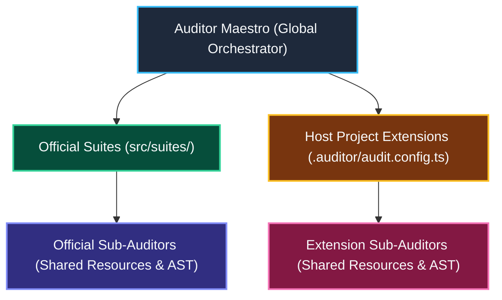

# Auditor: Architecture, Verification & Governance Engine

This skill defines the immutable standard and architectural contract for creating, administering, refactoring, and maintaining all sub-auditors, reporting scripts, and the `@francogp/auditor` engine across the repository.

Every sub-auditor and reporter is part of a unified static analysis and verification system orchestrated by `npm run auditor`.

---

## 🏗️ 3-Tier Hierarchical Architecture & Atomic Console Mandate

The framework enforces a universal, 3-tier hierarchical and symmetric architecture where official suites and host project extensions share identical OOP abstractions:



1. **Global Orchestrator (`npm run auditor`)**: Discovers suites dynamically, manages CPU worker pools, and coordinates atomic console output.
2. **Symmetric OOP Model**: Both official suites and host extensions inherit from `BaseAuditor` or `FileScanAuditor`, implementing identical interfaces, capability declarations, and error handling.
3. **Resource Sharing (`SharedAstContext`)**: Multi-rule sub-auditors share cached resources (filesystem reads, preheated ASTs, external tool passes) to maximize performance.
4. **Atomic Console Mandate**: Multi-rule suites MUST wait for all sub-checks to finish before rendering step reports (`│  🔍 [X/Y] ...`), preventing mixed output across concurrent workers.
5. **Mandatory Construction Contract**: `AuditorOptions` strictly requires: `id`, `name`, `description`, `family`, `packageName`, `icon`, `ruleDescriptions`, `ruleCapabilities`, `configKey`, `defaultConfig`, and `criticalConfig`. Omitting any field throws a loud runtime error.
6. **Compiled Artifact Verification (`npm run auditor:build`)**: Suites declaring `capabilities: { requiresBuild: true }` are excluded from pre-build source audit and execute post-build against `dist/`.

---

## 🏛️ Core Principles & Tooling Mandates

### 1. Absolute Prohibition on Backward-Compatible Code & Loud Failure Mandate

- Writing backward-compatible shims, deprecated aliases, or legacy fallback wrappers is **STRICTLY PROHIBITED**.
- Outdated consumers, obsolete configs, and unmigrated calls MUST fail loudly with immediate, blocking errors (`throw new Error(...)` or exit code 1) forcing canonical upgrades.

### 2. Prohibition on Modifying or Disabling Configurations Without Prior Human Authorization

- **NEVER turn off, relax, revert, or modify auditor configuration** (`.auditor/audit.config.ts`, `eslint.config.js`, `.stylelintrc.json`, `.fallowrc.json`) when encountering errors or warnings.
- Errors are **REAL ARCHITECTURAL DEFECTS** that must be resolved in source code or via `npm run auditor:fix`.
- If an agent believes a configuration genuinely requires adjustment, the agent **MUST HALT IMMEDIATELY AND EXPLICITLY CONSULT THE HUMAN PROGRAMMER** via `ask_question`, presenting the technical explanation, trade-offs, pros, and cons before modifying any configuration.

### 3. Absolute Prohibition on Suppressing Audit Rules & Zero-Tolerance Fake Pass Mandate

- Suppressing, silencing, or bypassing rules (e.g., setting `"rule": null`, `"rule": "off"`, passing arbitrary skip flags) to achieve a fake pass is considered critical architectural sabotage.

### 4. Node.js 26+ Native Engine & Prohibition of NPX / Third-Party Runners

- Executes strictly under Node.js 26+ native engine with native TypeScript (`node --experimental-strip-types`).
- Invoking or recommending npx runners (such as tsx, legacy auditor, or vitest via npx) or third-party runners is **STRICTLY PROHIBITED**. Use native Node.js or canonical npm scripts (`npm run <script>`, `npm test`).

### 5. Strict OOP Inheritance Mandate

- Every sub-auditor MUST extend `BaseAuditor<TRuleId>` or `FileScanAuditor<TRuleId>`.
- Procedural scripts, custom CLI loggers, and ad-hoc result printers are **STRICTLY FORBIDDEN**.

### 6. Dynamic Monospace Box-Drawing Table Mandate (80 Columns, Zero Wrapping)

- All terminal output uses shared Box-Drawing utilities (`renderBanner`, `renderBoxTable`, `formatStatusBadge`, `getVisualWidth`).
- Tables must fit within standard 80 columns (`TERMINAL_WIDTH = 80`) and use `getVisualWidth()` for emoji padding.
- Multi-row summary tables MUST include a `TOTAL CONSOLIDADO` footer row.

### 7. Universal Empirical Individual Timing Mandate

- 100% of declared sub-auditors and rules must record real empirical execution runtime badges (`(X ms)` or `(<0,1 ms)`). Suites taking seconds or hundreds of ms must NEVER show `(0 ms)` on child rules.
- **Prohibition of Synthetic Division**: Multi-rule suites must NEVER synthetically divide suite duration or stamp batch durations identically onto rules.
- **Superclass Wrappers**: Wrap rule checks with `this.runSubAuditorSync(ruleId, () => T)` or `await this.runSubAuditor(ruleId, async () => T)`. These helpers invoke `markRuleEvaluated(ruleId)` internally.
- **Deconstruction of External Tools**: Execute the shared tool pass, then aggregate findings per rule inside dedicated `this.runSubAuditorSync(ruleId, () => { ... })` blocks.
- **Explicit Non-Applicability (`markRuleNotApplicable`)**: When a subsystem or directory does not exist, call `this.runSubAuditorSync(ruleId, () => this.markRuleNotApplicable(ruleId, 'reason'))`.

### 8. Atomic Console Streaming & Completion-Ordered Output (`streamingRunner.ts`)

- Master audit executes suites concurrently across CPU workers (`Math.max(1, Math.floor(availableCpus / 2))`).
- **Completion Order**: Suites appear in console strictly in the order they **FINISH** ($T_{\text{finish}} = T_{\text{start}} + \text{durationMs}$). The printed duration reflects active child runtime (`performance.now() - taskStart`), not global wall-clock time. Short suites queued later display after earlier heavy suites.
- **`printLock` Mutex**: Guarantees each suite's output block renders as an unbroken atomic unit.

### 9. Post-Run Phase Isolation (`capabilities.postRun: true`)

- Suites declaring `capabilities.postRun: true` (`validate_audit_coverage`) are completely excluded from concurrent worker pools.
- They execute sequentially ONLY AFTER 100% of preceding suites finish and flush coverage ledgers to `scratch/audits/coverage/<suiteId>.json`, eliminating false `coverage-missing-ledger` alarms.

### 10. Shared AST Engine & Zero Duplicate Parse Mandate (`SharedAstContext`)

- Suites requiring AST or Vue SFC `<script>` parsing declare `requiresAst: true`.
- NEVER call `ts.createProgram` or `ts.createSourceFile` in file loops. Consume `SharedAstContext` preheated by the orchestrator.

### 11. Centralized Directory Scanning & Prohibition of Custom Walkers

- Sub-auditors MUST NEVER implement custom recursive directory traversals (`fs.readdir` loops, `walkDir`, `getAllFiles`).
- Use `this.context.collectFiles(roots, extensions)` or `collectRepositoryFiles()`.

### 12. Mandatory Modular Identity & Human-Friendly Description Standard

- `packageName`: Mandatory package/technology scope (e.g. `'ESLint'`, `'TypeScript'`, `'Config'`, `'Estilos'`).
- `description`: Suite purpose, max 60 characters (`MAX_AUDITOR_SUITE_DESCRIPTION_LENGTH = 60`).
- `ruleDescriptions`: Pure Spanish explanation for each rule ID. Composed `${packageName}: ${ruleDescription}` MUST be `<= 50` characters (`MAX_AUDITOR_DESCRIPTION_LENGTH = 50`) without newlines.
- Positive health phrasing for active checks (e.g. `'Salud del motor similar-code'`), reserving error phrasing for violation messages.

### 13. Single Source of Truth Directory Ignores (`isPathIgnored`)

- Sub-auditors MUST NEVER declare local ignore arrays. Use `isPathIgnored(relPath)` unifying `CANONICAL_IGNORE_DIRS` + `config.paths.ignoredDirs` + `ignoredPatterns` + `ignoreGlobs`.

### 14. Universal Ephemeral Scratch (`scratch/`) & Build Output (`dist/`) Isolation

- `scratch/`: All temporary files, AI drafts, testing dumps, and raw audit outputs (`scratch/audits/`). Must be in `.gitignore`.
- `dist/`: All compiled outputs and production bundles. Must be in `.gitignore`.

### 15. Dynamic Auto-Discovery & Zero Hardcoded Suite Maps

- Generic suites in `src/suites/<family>/` and host extensions in `.auditor/audit.config.ts` are discovered dynamically. Never hardcode static suite arrays.

### 16. Pure Configuration-Driven Resolution & Zero Bespoke Host Logic

- `@francogp/auditor` MUST remain 100% domain-agnostic. No hardcoded host directories, domain entity IDs, or business rules in the core package. Host-specific rules belong in extension plugins (`scripts/auditors/`).

### 17. Active by Default Subsystem Mandate ("All Defaults ON")

- All subsystems in `@francogp/auditor` are ACTIVATED BY DEFAULT (`enabled: true`). Host configurations declare customizations or explicit deactivations (`enabled: false`, `engine: 'none'`).

### 18. Mandatory GSAP UI Animation Governance & Anti-Destruction of CSS Transitions

- UI animations and delays must use GSAP standard primitives (`gsapSleep`, `delayedCall`, `gsap.to`).
- Deleting or stripping CSS transitions (`transition: ...`) to pass audits is **STRICTLY FORBIDDEN**. Transitions must be cleanly migrated to GSAP tweens.

### 19. Vector Semantic Duplication Architecture (`validate_similar_code`)

- Detects semantic clones via Fallow embeddings (`jina-embeddings-v2-base-code`) on **Candle CPU** (CPU-only, no GPU/CUDA) with `--threads ${os.availableParallelism()}`.
- Caches persist in `%LOCALAPPDATA%\fallow\similar-code` (Windows) or `~/.cache/fallow/similar-code` (Linux).
- Bypassed cleanly in fast presets (`preset=lint`) and production environments (`AUDITOR_ENV=production`). Skipping vector analysis in local development is strictly prohibited.

### 20. Fallow 100% Error Severity & Holistic Refactoring Targets

- All Fallow findings map strictly to `severity: 'error'`. Downgrading to warning is prohibited.
- Governed by holistic Fallow Refactoring Targets (`fallow-refactoring-targets`, `config.fallow.enforceTargets: true`), eliminating artificial function fragmentation.

### 21. Per-Rule Capabilities Contract (`ruleCapabilities`)

- Every sub-auditor declares capabilities on each rule individually via `ruleCapabilities: Record<TRuleId, AuditorRuleCapabilities>`.
- Passing suite-level `capabilities` directly in constructor options is prohibited (`capabilities?: never`).
- Each rule capability explicitly enforces all 9 boolean flags (`fix`, `fixPriority`, `lint`, `md`, `ast`, `changedSince`, `heavy`, `requiresBuild`, `postRun`).
- Canonical templates export `LINT_RULE_CAPABILITIES` and `AST_RULE_CAPABILITIES`, or accept full 9-field literals via `createUniformRuleCapabilities(RULES, { ... })`.

### 21.1 Mandatory Execution Speed Contract (`speed: AuditExecutionSpeed`)

- Every sub-auditor step strictly reports `speed: AuditExecutionSpeed` (`'fast' | 'heavy'`) in `SubAuditorReport`.
- **Absolute Prohibition on `undefined`**: Speed can NEVER be `undefined` or optional.
- **Loud Failure Mandate**: If any sub-auditor, rule capability, or host extension omits its speed contract (missing rule capability or undefined `heavy: boolean`), the engine throws a loud blocking error (`throw new Error(...)`), immediately halting execution.

### 21.2 LPT Task Scheduler & Sub-Line Speed Indicators (`⚡` / `🐢`)

- **Scheduler LPT (Longest Processing Time First)**: In `audit_full`, suites that execute heavy commands or rules are sorted and dispatched FIRST in the worker queue, ensuring multi-core CPU workers absorb heavy suites immediately while fast suites execute concurrently.
- **Sub-Line Console Indicators**: The suite header remains clean. Individual sub-auditor child lines display `⚡` for fast execution and `🐢` for heavy execution alongside execution durations.

### 22. Strict ESLint Flat Config & Domain-Type-First Type Integrity

- Governs `eslint.config.js` enforcing `@typescript-eslint/no-explicit-any: 'error'`, banning `as unknown as` and `Date` constructors without explicit domain wrappers.

### 23. Authentic Documented Commands Governance (`validate_documented_commands`)

- Every documented command in Markdown files and AI skills (`.agents/skills/**`) is validated against executable truth (`package.json.scripts`, `node_modules/.bin`).

### 24. Single Source of Truth Configuration Layout (`.auditor/`)

- All auditor-owned configuration and warning baselines live in `.auditor/` (`audit.config.ts`, `audit-baseline.json`). Root-level `audit.config.ts` fails loudly.

### 25. Warning Ratchet & Baseline Governance (`ratchet`)

- Full audit (`npm run auditor`) enforces **0 errors AND 0 new warnings** comparing fingerprints against `.auditor/audit-baseline.json`. Resolving existing warnings monotonically shrinks the baseline.

### 26. Canonical DOX Hierarchy Governance (`validate_dox_integrity`)

- Every `AGENTS.md` MUST contain all 6 mandatory sections in order: `# Purpose` ➔ `## Ownership` ➔ `## Local Contracts` ➔ `## Work Guidance` ➔ `## Verification` ➔ `## Child DOX Index`.
- Source code files in governed directories MUST be indexed under `## Key Files`.

### 27. Test Execution Code Coverage Ratcheting (`validate_test_coverage`)

- Istanbul/C8 coverage (`coverage/coverage-final.json`) evaluated against `config.testCoverage.thresholds` (default 80%). Untested files detected as shadow code.

### 28. Universal Dynamic Language Governance

- `config.documentation.language`: Governs repository documentation, Markdown files, DOX (`AGENTS.md`), code comments, commit messages, and release notes (default: `'en'`).
- `config.documentation.chatLanguage`: Governs conversational chat communication and `ask_question` dialogs with the human programmer (default: `'es'`). Never conflate the two.

### 29. Sub-Auditor & Extension Hygiene Governance (`validate_auditor_hygiene`)

- Enforces 11 strict hygiene rules eradicating homebrew utilities:
  1. `auditor-manual-package-json` (`getPackageJson()`)
  2. `auditor-manual-vue-sfc-regex` (`parseVueSfc()`)
  3. `auditor-isolated-ts-ast` (`SharedAstContext`)
  4. `auditor-manual-path-normalization` (`normalizePosixPath` / `toPosixRelative`)
  5. `auditor-direct-console-call` (`BaseAuditor` / `UnifiedTheme`)
  6. `auditor-manual-comment-stripping` (`stripComments` / `stripCommentsAndStrings`)
  7. `auditor-manual-brace-counting` (`scanBalancedDelimiter`)
  8. `auditor-manual-cwe22-path-check` (`isPathInside` / `isInsideRoot`)
  9. `auditor-manual-dir-walk` (`collectFiles` / `collectRepositoryFiles`)
  10. `auditor-manual-path-predicate` (`isTestPath` / `isTestFileForCodeAudit`)
  11. `auditor-manual-timing` (`runSubAuditorSync` / `runSubAuditor`)

### 30. Grounded Fixability Contract (`fixable: boolean`)

- A finding reports `fixable: true` ONLY when a programmatic automated fixer exists for that exact violation.
- Aggregated via `BaseAuditor.countFixableFindings()` and `BaseAuditor.computeFixableViolations()`.

### 31. Mandatory Safe-Commit Pipeline Protocol

- Manual `git commit`, `git tag`, or `git push` without running `/safe-commit` is strictly forbidden.

> [!NOTE]
> 📘 **Deep Technical Subsystem Specifications**: For detailed rules on Dart Sass collision casing, mixin block ordering, sentinels, by-file grouping, monospace emoji variation selectors, idempotent AGENTS.md auto-repairs, script extensions migration, and Mermaid syntax, see [subsystem-rules-reference.md](./references/subsystem-rules-reference.md).

---

## 📂 Canonical Architecture: Built-in Suites & Host Extensions

### 1. Generic Built-In Suites (`src/suites/`)

Discovered automatically across 6 architectural families:

- **`architecture/`**: AST rules, Fallow intelligence, component styles, HTML-Validate, Stylelint, ESLint config, Git config, Auditor hygiene, Knip package hygiene, Publint distribution, Type coverage, WCAG accessibility, vector similar-code, test coverage, AGENTS integrity, Vue SFC hygiene, code simplification, SCSS architecture.
- **`domain_data/`**: O(1) data structures, canonical domain catalogs, Domain-Type-First validation.
- **`performance/`**: Web performance optimization, Database query performance.
- **`security/`**: Static security hardening, secret leaks, dependency CVE vulnerabilities.
- **`persistence/`**: Client Web Storage, SQL anti-patterns, Valibot schema and serializer bidirectional parity.
- **`documentation/`**: Documented commands, Markdown links, DOX hierarchy (AGENTS.md), documentation language, markdown lint, Mermaid syntax.

### 2. Host Project Extensions (`scripts/auditors/`) & Configuration

Domain-specific rules unique to host applications reside in `scripts/auditors/` extending `BaseAuditor`.

> [!TIP]
> 📘 **Complete Configuration Reference**: For the complete catalog of all subsystem options and validated example blueprints for Enterprise and Gaming applications, see [blueprints.md](./references/blueprints.md), [audit.config.enterprise.example.ts](./references/audit.config.enterprise.example.ts), and [audit.config.gaming.example.ts](./references/audit.config.gaming.example.ts).

---

## 🛠️ Scaffolding & Code Templates (`assets/templates/`)

Pre-formatted, production-ready templates conforming to all project standards:

- **Line-by-Line Scanner (`FileScanAuditor`)**: [`assets/templates/file_scan_auditor_template.ts`](./assets/templates/file_scan_auditor_template.ts)
- **Composite / Database / Asset Auditor (`BaseAuditor`)**: [`assets/templates/base_auditor_template.ts`](./assets/templates/base_auditor_template.ts)
- **AST-Driven Sub-Auditor (`requiresAst: true` & `SharedAstContext`)**: [`assets/templates/ast_auditor_template.ts`](./assets/templates/ast_auditor_template.ts)
- **Dedicated Vitest Unit Test**: [`assets/templates/auditor_unit_test_template.test.ts`](./assets/templates/auditor_unit_test_template.test.ts)

📘 **Step-by-Step Authoring Walkthrough**: See [sub-auditor-authoring-guide.md](./references/sub-auditor-authoring-guide.md) and [extension-helpers-guide.md](./references/extension-helpers-guide.md).

---

## 🚀 Host Installation, Updates & Governance

`@francogp/auditor` is consumed across host projects as a native GitHub npm package (`github:francogp/auditor`).

- **Updates (`auditor-update` / `npm run auditor:update`)**: Pull latest upstream changes strictly via the official native CLI binary `auditor-update` (or `npm run auditor:update`) and verify with `auditor-version -v`. Ad-hoc `node -e` scripts or cloning into `/tmp` are strictly forbidden.
- **Production Builds (`AUDITOR_ENV=production`)**: In production deployments, Docker containers, or CI pipelines, run `npm run build:prod` (`auditor-build-prod`) under `AUDITOR_ENV=production` to cleanly skip Candle CPU vector duplication and test coverage checks without failing builds on uncommitted coverage files.

📘 **Detailed Governance Guide**: See [host-package-governance.md](./references/host-package-governance.md).

---

## 🎯 Remote Project Execution & Cross-Repository Testing (`--project` / `-p`)

Test new suites, fixes, and analyzers against local host applications without intermediate commits:

```bash
npm run auditor -- project="../PokeBorrador"
npm run auditor:lint -- project="../PokeBorrador"
npm run auditor:fix -- project="../PokeBorrador"
npm run auditor:findings -- project="../PokeBorrador"
```

📘 **Detailed Architecture & CLI Guide**: See [cross-repo-testing-guide.md](./references/cross-repo-testing-guide.md).

---

## 🛡️ Testing & Conformance Verification

Every sub-auditor and host extension MUST adhere to the **5-Point Conformance Contract**:

1. Instantiation & Metadata verification (`validateAuditorConstruction(auditor)`).
2. Clean Workspace / Negative Verification (`errors === 0`, `status === 'passed'`).
3. Violation Detection (`errors > 0`, `status === 'failed'`).
4. Warning Verification (where warnings are declared).
5. 100% of declared rule IDs tested.

Hermetic test isolation requires using `testScanFile` + `finishAudit()` for snippets, or passing a temporary sandbox directory via `projectRoot`. Live repository scanning in unit tests is strictly prohibited.

📘 **Comprehensive Testing Guide**: See [auditor-testing-guide.md](./references/auditor-testing-guide.md).

---

## 🔍 Interactive Findings Reporter (`report_findings.ts`) & CLI Tools

- `npm run auditor:findings` / `npm run auditor:errors` / `npm run auditor:warnings` / `npm run auditor:summary`
- `npm run auditor:by-file`: Hierarchical Box-Drawing tree inspection of findings grouped by file and line.
- `npm run auditor:test-coverage`: Test execution code coverage analysis, directory aggregates, and uncovered line ranges.
- `npm run auditor:complexity`: Code complexity hotspots and Fallow refactoring targets.
- `npm run auditor:similar`: Semantic and structural clone detection using Fallow ML vector embeddings.
- `npm run auditor:review`: Graph-grounded architectural review brief for changed code.

📘 **Full CLI Diagnostics Reference**: See [cli-reporters-guide.md](./references/cli-reporters-guide.md) and [test-coverage-guide.md](./references/test-coverage-guide.md).

---

## 🛠️ Master Environment Setup & Update Scripts Governance

Root environment lifecycle scripts belong canonically to `@francogp/auditor`:

- `setup-linux.sh` & `setup-windows.ps1`: Core setup engine locking declared versions (`.nvmrc` / `package.json`).
- `update-linux.sh` & `update-windows.ps1`: Parameterless wrappers delegating with `--update-version` / `-UpdateVersion`.
- Local patches in host projects are strictly prohibited; fixes must be synchronized upstream via `syncEnvScripts`.

📘 **Setup Extension & Plugin Architecture**: See [setup-extension-guide.md](./references/setup-extension-guide.md).

---

## 📚 References & Host Integration Blueprints Index

| Reference Guide | Description |
|---|---|
| [`references/sub-auditor-authoring-guide.md`](./references/sub-auditor-authoring-guide.md) | Complete sub-auditor authoring guide with boilerplate implementations. |
| [`references/extension-helpers-guide.md`](./references/extension-helpers-guide.md) | Standard framework helpers, base methods, and migration guide for host extensions. |
| [`references/subsystem-rules-reference.md`](./references/subsystem-rules-reference.md) | Detailed technical specifications for Dart Sass casing, sentinels, by-file grouping, and more. |
| [`references/blueprints.md`](./references/blueprints.md) | Configuration blueprints overview and active subsystem settings. |
| [`references/cross-repo-testing-guide.md`](./references/cross-repo-testing-guide.md) | Cross-repository testing guide for `--project` / `-p` CLI execution. |
| [`references/auditor-testing-guide.md`](./references/auditor-testing-guide.md) | 5-point conformance testing contract and hermetic unit testing patterns. |
| [`references/host-package-governance.md`](./references/host-package-governance.md) | Host installation, GitHub npm updates, CI reproducibility, and binary inheritance. |
| [`references/cli-reporters-guide.md`](./references/cli-reporters-guide.md) | Reference manual for interactive findings reporting and CLI diagnostic options. |
| [`references/test-coverage-guide.md`](./references/test-coverage-guide.md) | Test execution code coverage analysis, Istanbul/V8 JSON parsing, and CI gating. |
| [`references/setup-extension-guide.md`](./references/setup-extension-guide.md) | Environment setup script architecture and extension plugins for Linux and Windows. |
| [`references/audit.config.enterprise.example.ts`](./references/audit.config.enterprise.example.ts) | Reference configuration for Enterprise applications (Supabase backend, strict types). |
| [`references/audit.config.gaming.example.ts`](./references/audit.config.gaming.example.ts) | Reference configuration for Gaming applications (hybrid persistence, Web Workers). |
| [`references/extensions/`](./references/extensions/) | Reference blueprints for host extension plugins. |
| [`references/plugins/`](./references/plugins/) | Sample setup plugins for Docker database containers and local SSL certificates. |
