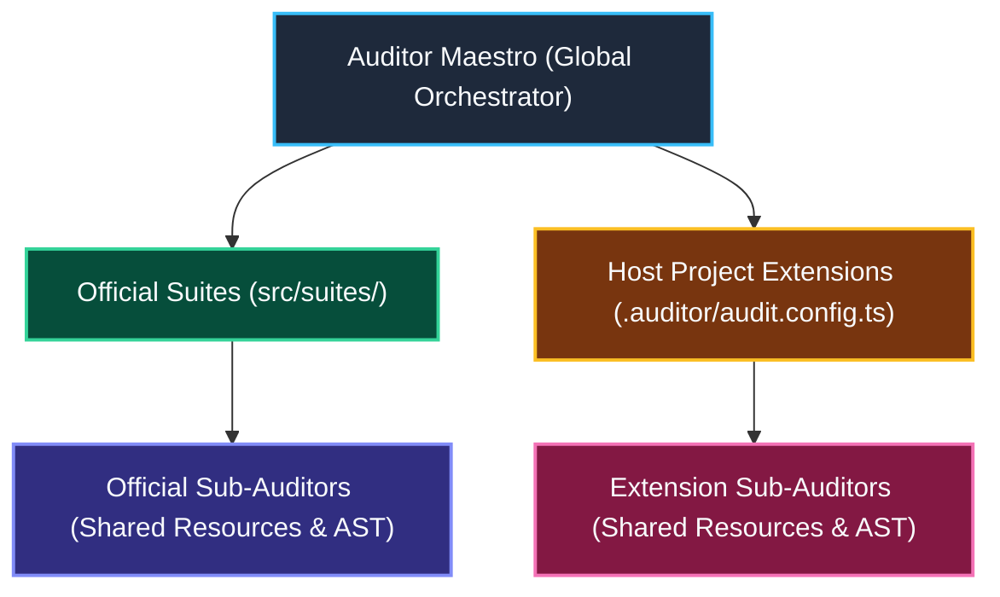

# Auditor: Architecture, Verification & Governance Engine

This skill defines the immutable standard and architectural contract for creating, administering, refactoring, and maintaining all sub-auditors, reporting scripts, and the `@francogp/auditor` engine across the repository.

Every sub-auditor and reporter is part of a unified static analysis and verification system orchestrated by `npm run auditor`.

---

## 🏗️ 3-Tier Hierarchical Architecture & Atomic Console Mandate

The framework enforces a universal, 3-tier hierarchical and symmetric architecture where official suites and host project extensions share identical OOP abstractions:



1. **Global Orchestrator (`npm run auditor`)**: Discovers suites dynamically, manages CPU worker pools, and coordinates atomic console output.
2. **Symmetric OOP Model**: Both official suites and host extensions inherit from `BaseAuditor` or `FileScanAuditor`, implementing identical interfaces, capability declarations, and error handling.
3. **Resource Sharing (`SharedAstContext`)**: Multi-rule sub-auditors share cached resources (filesystem reads, preheated ASTs, external tool passes) to maximize performance.
4. **Atomic Console Mandate**: Multi-rule suites MUST wait for all sub-checks to finish before rendering step reports (`│  🔍 [X/Y] ...`), preventing mixed output across concurrent workers.
5. **Mandatory Construction Contract (`ruleRemediations`, `ruleRemediationPhases`, `requiredPermissions`)**: `AuditorOptions` strictly requires: `id`, `name`, `description`, `family`, `packageName`, `icon`, `ruleDescriptions`, `ruleRemediations`, `ruleRemediationPhases`, `requiredPermissions`, `ruleCapabilities`, `configKey`, `defaultConfig`, and `criticalConfig`. Omitting any field, lacking a remediation guide, omitting `ruleRemediationPhases`, or omitting `requiredPermissions` throws an immediate loud runtime error.
6. **Strategic Remediation Order (7 Canonical Phases) & Sequential Focus (`npm run auditor:next`)**: Findings are deterministically mapped to 7 canonical phases (`setup` -> `prune` -> `dedup` -> `contracts` -> `behavior` -> `hygiene` -> `polish`). Developers and AI agents MUST execute `npm run auditor:next` to focus strictly on the earliest phase containing unresolved errors, postponing downstream findings to eradicate wasted effort. Host extension failures fall under `phase: 'setup'` (`audit-config-invalid-extension`), activating Imperative Setup Blocking and suppressing application findings until infrastructure is healthy. See [remediation-order-guide.md](./references/remediation-order-guide.md).
7. **On-Demand Diagnostic Guides (`auditor guide`)**: Any diagnostic and remediation manual can be rendered on-demand in the terminal via `npm run auditor guide <ruleId>`, `auditor guide suite=<suiteId>`, or `auditor guide family=<family>` with zero truncation and Box-Drawing formatting.
8. **Compiled Artifact Verification (`npm run auditor:post-build`)**: Rules declaring `phase: 'post-build'` (`capabilities.phase === 'post-build'`) are excluded from pre-build source audit and execute post-build against `dist/` via `npm run auditor:post-build` (`auditor phase=post-build`).

---

## 🏛️ Core Principles & Tooling Mandates

### 1. Absolute Prohibition on Backward-Compatible Code & Loud Failure Mandate

- Writing backward-compatible shims, deprecated aliases, or legacy fallback wrappers is **STRICTLY PROHIBITED**.
- Outdated consumers, obsolete configs, and unmigrated calls MUST fail loudly with immediate, blocking errors (`throw new Error(...)` or exit code 1) forcing canonical upgrades.

### 2. Prohibition on Modifying or Disabling Configurations Without Prior Human Authorization

- **NEVER turn off, relax, revert, or modify auditor configuration** (`.auditor/audit.config.ts`, `vite.config.ts`, `.stylelintrc.json`, `.fallowrc.json`) when encountering errors or warnings.
- Errors are **REAL ARCHITECTURAL DEFECTS** that must be resolved in source code or via `npm run auditor:fix`.
- **Auto-Fix First Mandate (`auditor fix` Prior to Manual Edits)**: Whenever an audit reports auto-fixable findings (`(N auto-fixable)`) or suggests `npm run auditor:fix`, AI agents and developers are **STRICTLY PROHIBITED from manually editing files** to resolve those mechanical issues. They MUST invoke `npm run auditor:fix` (or `auditor fix`) FIRST before touching any code. Manual intervention bypasses deterministic AST/linter fixers, risks syntax deviations, and constitutes an operational violation.
- If an agent believes a configuration genuinely requires adjustment, the agent **MUST HALT IMMEDIATELY AND EXPLICITLY CONSULT THE HUMAN PROGRAMMER** via `ask_question`, presenting the technical explanation, trade-offs, pros, and cons before modifying any configuration.

### 3. Absolute Prohibition on Suppressing Audit Rules & Zero-Tolerance Fake Pass Mandate

- Suppressing, silencing, or bypassing rules (e.g., setting `"rule": null`, `"rule": "off"`, passing arbitrary skip flags) to achieve a fake pass is considered critical architectural sabotage.
- **Dependency Immutability (`node_modules/`) & Upstream Bug Reporting**: Modifying, editing, patching, or writing files inside `node_modules/` under ANY circumstances is **STRICTLY AND CATEGORICALLY PROHIBITED**. Reading and inspecting dependency source code or type definitions (`.d.ts`) is completely permitted, but installed dependencies are immutable runtime artifacts. If an agent suspects a bug or false positive in `@francogp/auditor` or any installed dependency, it **MUST HALT AND REPORT IT TO THE HUMAN PROGRAMMER** so it is legitimately resolved in the upstream source repository—never hot-patch or mutate `node_modules/`.

### 4. Node.js 26+ Native Engine & Prohibition of NPX / Third-Party Runners

- Executes strictly under Node.js 26+ native engine with native TypeScript (`node --experimental-strip-types`).
- Compiles with baseline `compilerOptions.target: 'ES2025'` (or `'ESNext'`), enforced strictly by `validate_tsconfig` and auto-repaired via `auditor fix`. Outdated targets (`ES2022` or lower) fail loudly.
- Invoking or recommending npx runners (such as tsx, legacy auditor, or vitest via npx) or third-party runners is **STRICTLY PROHIBITED**. Use native Node.js or canonical npm scripts (`npm run <script>`, `npm test`).

### 5. Strict OOP Inheritance Mandate

- Every sub-auditor MUST extend `BaseAuditor<TRuleId>` or `FileScanAuditor<TRuleId>`.
- Procedural scripts, custom CLI loggers, and ad-hoc result printers are **STRICTLY FORBIDDEN**.

### 6. AI-Friendly Compact Output by Default & Box-Drawing Human Mode

- By default, all executions operate in AI-friendly compact mode (concise 3-line status in English: status, counts, latest_audit.json path).
- Interactive human inspections and full Box-Drawing progress tables (80-col limit, zero wrapping) are rendered on demand via `human`, `--human`, or dedicated package scripts (`npm run auditor:human`, `npm run auditor:lint:human`, `npm run auditor:full:human`). Multi-row summary tables include `TOTAL CONSOLIDADO`.
- Node.js intrinsic `--permission` warnings (`PERM0002`) are cleanly suppressed via `--disable-warning=PERM0002` while preserving 100% of actionable warnings.

### 7. Universal Empirical Individual Timing Mandate

- 100% of declared sub-auditors and rules must record real empirical execution runtime badges (`(X ms)` or `(<0,1 ms)`). Suites taking seconds or hundreds of ms must NEVER show `(0 ms)` on child rules.
- **Prohibition of Synthetic Division**: Multi-rule suites must NEVER synthetically divide suite duration or stamp batch durations identically onto rules.
- **Superclass Wrappers**: Wrap rule checks with `this.runSubAuditorSync(ruleId, () => T)` or `await this.runSubAuditor(ruleId, async () => T)`. These helpers invoke `markRuleEvaluated(ruleId)` internally.
- **Deconstruction of External Tools**: Execute the shared tool pass, then aggregate findings per rule inside dedicated `this.runSubAuditorSync(ruleId, () => { ... })` blocks.
- **Explicit Non-Applicability (`markRuleNotApplicable`)**: When a subsystem or directory does not exist, call `this.runSubAuditorSync(ruleId, () => this.markRuleNotApplicable(ruleId, 'reason'))`.

### 8. Atomic Console Streaming & Completion-Ordered Output (`streamingRunner.ts`)

- Master audit executes suites concurrently across CPU workers (`Math.max(1, Math.floor(availableCpus / 2))`).
- **Completion Order**: Suites appear in console strictly in the order they **FINISH** ($T_{\text{finish}} = T_{\text{start}} + \text{durationMs}$). The printed duration reflects active child runtime (`performance.now() - taskStart`), not global wall-clock time. Short suites queued later display after earlier heavy suites.
- **`printLock` Mutex**: Guarantees each suite's output block renders as an unbroken atomic unit.

### 9. Execution Lifecycle Phases (`phase: 'setup' | 'normal' | 'post-run' | 'post-build'`)

- **`phase: 'setup'` (ABSOLUTE PRIORITY & IMPERATIVE BLOCKING)**: Project infrastructure, configuration, runtime environment, dependency, and package script suites (`validate_audit_config`, `validate_tsconfig`, `validate_vite_plus_config`, `validate_stylelint_config`, etc.). When errors exist in setup suites, the auditor activates **Imperative Setup Blocking**: downstream application and stylesheet findings are postponed in console to eradicate induced false positives, mandating setup remediation first (e.g. `npm run auditor:fix`). In auto-fix mode (`auditor fix`), setup suites execute strictly before any code mutations or third-party linters (`resolveFixOrderWeight < 200`). Developers and AI agents are PROHIBITED from refactoring application code or styling while setup errors remain.
- **`phase: 'normal'`**: Standard source code and architecture suites dispatched across concurrent worker pools once setup is clean.
- **`phase: 'post-run'` (`validate_audit_coverage`)**: Completely excluded from concurrent worker pools; executes sequentially ONLY AFTER 100% of preceding suites finish and flush coverage ledgers to `scratch/audits/coverage/<suiteId>.json`, eliminating false `coverage-missing-ledger` alarms.
- **`phase: 'post-build'` (`npm run auditor:post-build` / `auditor phase=post-build`)**: Verifies compiled distribution artifacts in `dist/` after compilation completes.

### 10. Shared AST Engine & Zero Duplicate Parse Mandate (`SharedAstContext`)

- Suites requiring AST or Vue SFC `<script>` parsing declare `requiresAst: true` (and `ast: true` in `ruleCapabilities`).
- NEVER call `ts.createProgram` or `ts.createSourceFile` in file loops. Consume `SharedAstContext` preheated by the orchestrator.

### 11. Centralized Directory Scanning & In-RAM File Cache (`WorkspaceFileCache`, `scanFilesSinglePass`)

- Sub-auditors MUST NEVER implement custom recursive directory traversals (`fs.readdir` loops, `walkDir`, `getAllFiles`). Use `this.context.collectFiles(roots, extensions)` or `collectRepositoryFiles()`.
- Multi-rule suites scanning the same file set MUST use `await this.scanFilesSinglePass(files, handlers)` backed by the in-RAM `WorkspaceFileCache`, reading each file once and prohibiting nested rule-over-files disk loops (`auditor-inefficient-file-scan`).

### 12. Mandatory Modular Identity & Human-Friendly Description Standard

- `packageName`: Mandatory package/technology scope (e.g. `'Oxlint'`, `'TypeScript'`, `'Config'`, `'Styles'`).
- `description`: Suite purpose in English, max 60 characters (`MAX_AUDITOR_SUITE_DESCRIPTION_LENGTH = 60`).
- `ruleDescriptions`: Concise English explanation for each rule ID. Composed `${packageName}: ${ruleDescription}` MUST be `<= 50` characters (`MAX_AUDITOR_DESCRIPTION_LENGTH = 50`) without newlines.
- Positive health phrasing for active checks (e.g. `'Similar-code engine health'`), reserving error phrasing for violation messages.

### 13. Single Source of Truth Directory Ignores & Dynamic Path Exemptions (`isPathIgnored`, `isPathExempt`)

- Sub-auditors MUST NEVER declare local ignore arrays or hardcoded candidate paths. Use `isPathIgnored(relPath)` unifying `CANONICAL_IGNORE_DIRS` + `config.paths.ignoredDirs` + `ignoredPatterns` + `ignoreGlobs`.
- `FileScanAuditor` natively accepts `exemptPaths` in constructor options and evaluates `isPathExempt(relPath, this.exemptPaths)`, cleanly ignoring configured files or patterns.

### 14. Universal Ephemeral Scratch (`scratch/`) & Build Output (`dist/`) Isolation

- `scratch/`: All temporary files, AI drafts, testing dumps, and raw audit outputs (`scratch/audits/`). Must be in `.gitignore`.
- `dist/`: All compiled outputs and production bundles. Must be in `.gitignore`.

### 15. Dynamic Auto-Discovery & Zero Hardcoded Suite Maps

- Generic suites in `src/suites/<family>/` and host extensions in `.auditor/audit.config.ts` are discovered dynamically. Never hardcode static suite arrays.

### 16. Pure Configuration-Driven Resolution & Anti-Hardcoding Mandate (`auditor-hardcoded-config`)

- `@francogp/auditor` MUST remain 100% domain-agnostic. No hardcoded host directories, domain entity IDs, fallback filenames (e.g. `['visuals.ts', 'constants.ts']`), or business rules in core suites or host extensions.
- All candidate paths, target directories, and exemption patterns MUST resolve dynamically from `.auditor/audit.config.ts`.
- Enforced at build and audit time by `validate_auditor_hygiene` (`auditor-hardcoded-config`), which flags hardcoded candidate arrays and fallback path lists with `severity: 'error'`.

### 17. Active by Default Subsystem Mandate ("All Defaults ON")

- All subsystems in `@francogp/auditor` are ACTIVATED BY DEFAULT (`enabled: true`). Host configurations declare customizations or explicit deactivations (`enabled: false`, `engine: 'none'`).

### 18. Mandatory GSAP UI Animation Governance & Anti-Destruction of CSS Transitions

- UI animations and delays must use GSAP standard primitives (`gsapSleep`, `delayedCall`, `gsap.to`).
- Deleting or stripping CSS transitions (`transition: ...`) to pass audits is **STRICTLY FORBIDDEN**. Transitions must be cleanly migrated to GSAP tweens.

### 19. Vector Semantic Duplication Architecture (`validate_similar_code`)

- Detects semantic clones via Fallow embeddings (`jina-embeddings-v2-base-code`) on **Candle CPU** (CPU-only, no GPU/CUDA) with `--threads ${os.availableParallelism()}`.
- Caches persist in `%LOCALAPPDATA%\fallow\similar-code` (Windows) or `~/.cache/fallow/similar-code` (Linux).
- Bypassed cleanly in `speed=light` (`npm run auditor:lint`) and production deployment builds (`AUDITOR_ENV=production` via `npm run build:deploy`). Skipping vector analysis in local development is strictly prohibited.

### 20. Fallow 100% Error Severity & Holistic Refactoring Targets

- All Fallow findings map strictly to `severity: 'error'`. Downgrading to warning is prohibited.
- Governed by holistic Fallow Refactoring Targets (`fallow-refactoring-targets`, `config.fallow.enforceTargets: true`), eliminating artificial function fragmentation.

### 21. Orthogonal 7-Field Rule Capabilities Contract (`AuditorRuleCapabilities`)

- Every sub-auditor declares capabilities on each rule individually via `ruleCapabilities: Record<TRuleId, AuditorRuleCapabilities>`.
- Passing suite-level `capabilities` directly in constructor options is prohibited (`capabilities?: never`).
- Each rule capability explicitly initializes all 7 orthogonal fields (the legacy contract field `changedSince` is completely eradicated in favor of `changedOnly: boolean`):
  - `speed`: `'light' | 'heavy' | 'full' | readonly AuditExecutionSpeed[]` (`🐇` `'light'`, `🐢` `'heavy'`, `🐘` `'full'`, or array `['light', 'full']` for multi-tier CLI tools).
  - `phase`: `'normal' | 'post-run' | 'post-build'`.
  - `fix`: `'none' | 'normal' | 'priority'` (`'priority'` executes first during `auditor fix` to bootstrap config/environment).
  - `md`: `boolean` (included in `auditor preset=md` / `npm run auditor:md`).
  - `ast`: `boolean` (preheats `SharedAstContext`).
  - `changedOnly`: `boolean` (supports differential scoping via `--changed-since`).
  - `critical`: `boolean` (indispensable for code correctness, typing, and syntax; bypasses speed ceiling in `auditor:lint` and `auditor:critical`).
- Canonical templates export `LINT_RULE_CAPABILITIES` and `AST_RULE_CAPABILITIES`, or accept explicit 7-field literals via `createUniformRuleCapabilities(RULES, { ... })` / `createRuleCapabilities(RULES, baseCapabilities, fixableRuleIds)`.

### 21.1 Speed Engine: Ceiling vs. Exact Modes, Visual Icons (`🐇` / `🐢` / `🐘`) & Multi-Tier Mandates

- **3 Canonical Speed Tiers (`AuditExecutionSpeed`)**:
  - `'light'` (`🐇`): Fast static lint and AST rules (`npm run auditor:lint` / `auditor speed=light`).
  - `'heavy'` (`🐢`): Default workspace audit ceiling (`npm run auditor` / `auditor` / `auditor speed=heavy`), running `'light'` + `'heavy'` suites.
  - `'full'` (`🐘`): Exhaustive pre-build/release ceiling (`npm run auditor:full` / `auditor speed=full`), running `'light'` + `'heavy'` + `'full'` (including `fallow dead-code --type-aware`).
- **Ceiling Mode (`speed=light|heavy|full`)**: Cumulative up to the requested ceiling (`speed=heavy` runs `light` + `heavy`; `speed=full` runs `light` + `heavy` + `full`).
- **Exact Isolation Mode (`only-speed=light|heavy|full`)**: Executes ONLY rules matching that exact tier.
- **Mandatory Speed Selection in Multi-Speed Critical Suites**: If a suite or rule declares `critical: true` and `speed` has 2 or more speeds declared (e.g. `speed: ['light', 'full']`), it **MUST ALWAYS choose the fastest (`light`) when no speed is specified in the invocation** (`auditor`, direct node execution, or `npm run <validate-script>`), guaranteeing that direct local executions run instantaneously with incremental/cache enabled.
- **Mandatory Authentic Tiers & Prohibition of Duplicated Tiers**: Inventing or duplicating speed tiers that repeat identical CLI arguments or behaviors as another tier (such as inventing a `heavy` tier identical to `light`) is STRICTLY PROHIBITED. Each declared tier (`light`, `heavy`, `full`) MUST execute genuinely different commands or CLI flags of the underlying tool. If a tool only supports 2 distinct operational modes (e.g. `tsc` with `--incremental` in `light` vs without `--incremental` in `full`), ONLY those 2 basic tiers are declared (`['light', 'full']`). Only tools with 3 completely decoupled subcommands (such as `validate_fallow`: `dead-code --no-type-aware`, `dupes`, `type-aware`) declare all 3 tiers.
- **Permanent Cache Mandate (Cache is NEVER Turned Off in Full)**: In the Full (`🐘`) tier, the entire project is audited without incremental/delta scoping (evaluating all files), BUT THE CACHE IS NEVER TURNED OFF. Tools with caching support (`oxlint --cache`, `stylelint cache: true`, `type-coverage --cache`, Fallow graph cache) MUST maintain their cache permanently enabled across all tiers to avoid re-processing identical files on disk.
- **Clean Composition in `TieredCommandProfile`**: Repeating identical literal arrays in `profiles` is strictly prohibited. Profiles must be cleanly composed using shared constants (e.g. `standardArgs`, `incrementalArgs`).
- **LPT Task Scheduler (Longest Processing Time First)**: In `audit_full`, suites with higher speed tiers (`🐘` `'full'`, `🐢` `'heavy'`) are sorted and dispatched FIRST in the worker queue so multi-core CPU workers absorb heavy tasks immediately.

### 21.2 Mnemonic Command Naming & Master Build Chaining

- `npm run auditor:lint` (`auditor speed=light`): Fast `🐇` lint pass.
- `npm run auditor` (`auditor`): Default `🐢` heavy audit pass.
- `npm run auditor:full` (`auditor speed=full`): Exhaustive `🐘` pre-compilation/release audit pass.
- `npm run auditor:post-build` (`auditor phase=post-build`, binary `auditor-post-build`): Post-compilation artifact verification against `dist/`.
- `npm run build`: Chains `"npm run auditor:full && <compile> && npm run auditor:post-build"`.
- `npm run build:deploy` (`auditor-build-deploy`): Runs `npm run build` under `AUDITOR_ENV=production` for Docker/CI/deploy environments.
- **Zero Redundant Execution Mandate**: `auditor:lint` is a strict subset of `auditor`. Executing `npm run auditor:lint` AFTER running `npm run auditor`, `npm run auditor:full`, or `npm run build` is strictly redundant and prohibited.

### 22. Strict Vite+ (`vp`) Unified Configuration & Code Hygiene Governance (`validate_vite_plus_config`, `validate_oxlint`, `validate_oxfmt`)

- Eradicates standalone `eslint.config.*`, `vitest.config.*`, `tsdown.config.*`, `tsconfig.build.json`, and `.nvmrc` across all projects in favor of unified **Vite+ (`vite-plus` / CLI `vp`)**.
- Governs `vite.config.ts` (`defineConfig` from `'vite-plus'`) enforcing:
  1. `lint`: Oxlint + type-aware rules (`options: { typeAware: true, typeCheck: true }`), JS plugin `@francogp/auditor/domain-type-plugin` enforcing the `/domain-type-first` rules, `@typescript-eslint/no-explicit-any: 'error'`, `@typescript-eslint/ban-ts-comment: 'error'`, `@typescript-eslint/consistent-type-assertions: ['error', { assertionStyle: 'as', objectLiteralTypeAssertions: 'never' }]`, and banning double casting `as unknown as T` or uncoordinated `Date` constructors without explicit domain wrappers.
  2. `test`: Vitest runner importing from `'vite-plus/test'`, supporting multi-project configurations and V8 coverage.
  3. `fmt`: Oxfmt formatting (`singleQuote: true`, `semi: true`, `trailingComma: 'none'`, `printWidth: 100`), audited and validated by `validate_oxfmt`.
  4. `staged`: Native git hooks (`{ '*': 'vp check --fix' }`).
  5. `pack`: Tsdown library packaging when `packageDistribution.enabled: true`.
  6. `dynamic exclusion sync`: `syncViteConfigWithAuditConfig` dynamically projects `config.paths.ignoreGlobs` into `lint.ignorePatterns` and `fmt.ignorePatterns`.
- **Mandatory Injected Rule & Configuration Canary Verification**:
  Every rule injected or mandated by Vite+ (Oxlint, Oxfmt, domain-types) must have active automated canary tests asserting positive failure detection, clean compliance, and auto-fix behavior. Furthermore, all auditor configuration options must have canaries verifying both active state and disabled state (`enabled: false`).
- **Non-Destructive Auto-Fix Migration Workflow (`auditor fix`)**:
  When migrating a legacy project, `auditor fix` executes the strict 5-stage non-destructive protocol:
  1. **Preserve & Merge Configs**: Reads existing `vitest.config.*` (extracting `test: { ... }` blocks, projects, and custom pools) and merges them into `vite.config.ts`, preserving 100% of existing application plugins, aliases, and server configs.
  2. **Rewrite Imports**: Rewrites test imports from `'vitest'` to `'vite-plus/test'`.
  3. **Migrate Node Runtime**: Migrates `.nvmrc` to `.node-version` (canonical for `vp env`).
  4. **Synchronize `package.json`**: Adds `"vite-plus": "^1.2.0"` to `devDependencies`, strips obsolete `eslint*` packages, and modernizes scripts to `vp check`.
  5. **Clean Legacy Artifacts**: Purges obsolete config files (`vitest.config.*`, `eslint.config.*`, `.nvmrc`) ONLY AFTER all preceding migration steps have succeeded.

### 23. Authentic Documented Commands Governance (`validate_documented_commands`)

- Every documented command in Markdown files and AI skills (`.agents/skills/**`) is validated against executable truth (`package.json.scripts`, `node_modules/.bin`).

### 24. Executable Script & Pipeline Commands Governance (`validate_script_commands`)

- Audits all executable scripts (`.sh`, `.bash`, `.zsh`, `.ps1`, `.bat`, `.cmd`), Dockerfiles, GitHub Actions workflows (`.github/workflows/*.yml`), and maintenance scripts (`scripts/**/*.{ts,js,mjs}`).
- Uses AST parsers (`unbash` for Shell, `yaml` for CI workflows, TypeScript Compiler AST for maintenance scripts) rather than fragile regex line scanners.
- Inspects both process runner calls (`execSync`, `spawn`, `execa`) and CLI diagnostic help guidance (`console.log`, `throw new Error(...)`), verifying scripts exist in `package.json.scripts` while ignoring generic syntax placeholders (`<comando>`, `[...]`, `$...`).
- All rules enforce `severity: 'error'` and `fix: 'none'` with zero backwards-compatibility shims.

### 25. Single Source of Truth Configuration Layout (`.auditor/`)

- All auditor-owned configuration and warning baselines live in `.auditor/` (`audit.config.ts`, `audit-baseline.json`). Root-level `audit.config.ts` fails loudly.

### 26. Warning Ratchet & Baseline Governance (`ratchet`)

- Full audit (`npm run auditor` / `npm run auditor:full`) enforces **0 errors AND 0 new warnings** comparing fingerprints against `.auditor/audit-baseline.json`. Resolving existing warnings monotonically shrinks the baseline.

### 27. Canonical DOX Hierarchy Governance (`validate_dox_integrity`)

- Every `AGENTS.md` MUST contain all 6 mandatory sections in order: `# Purpose` ➔ `## Ownership` ➔ `## Local Contracts` ➔ `## Work Guidance` ➔ `## Verification` ➔ `## Child DOX Index`.
- Source code files in governed directories MUST be indexed under `## Key Files`.

### 28. Test Execution Code Coverage Ratcheting (`validate_test_coverage`)

- Istanbul/C8 coverage (`coverage/coverage-final.json`) evaluated against `config.testCoverage.thresholds` (default 80%). Untested files detected as shadow code.

### 29. Universal Dynamic Language Governance

- `config.documentation.language`: Governs repository documentation, Markdown files, DOX (`AGENTS.md`), code comments, commit messages, and release notes (default: `'en'`).
- `config.documentation.chatLanguage`: Governs conversational chat communication and `ask_question` dialogs with the human programmer (default: `'es'`). Never conflate the two.

### 30. Sub-Auditor & Extension Hygiene Governance (`validate_auditor_hygiene`)

- Enforces 17 strict hygiene rules eradicating homebrew utilities, hardcoded configurations, and inefficient I/O:
  1. `auditor-manual-package-json` (`getPackageJson()`)
  2. `auditor-manual-vue-sfc-regex` (`parseVueSfc()`)
  3. `auditor-isolated-ts-ast` (`SharedAstContext`)
  4. `auditor-manual-path-normalization` (`normalizePosixPath` / `toPosixRelative`)
  5. `auditor-direct-console-call` (`BaseAuditor` / `UnifiedTheme`)
  6. `auditor-manual-comment-stripping` (`stripComments` / `stripCommentsAndStrings`)
  7. `auditor-manual-brace-counting` (`scanBalancedDelimiter`)
  8. `auditor-manual-cwe22-path-check` (`isPathInside` / `isInsideRoot`)
  9. `auditor-manual-dir-walk` (`collectFiles` / `collectRepositoryFiles`)
  10. `auditor-manual-path-predicate` (`isTestPath` / `isTestFileForCodeAudit`)
  11. `auditor-manual-timing` (`runSubAuditorSync` / `runSubAuditor`)
  12. `auditor-hardcoded-config` (`hardcodedConfigDetector.ts` - prohibits hardcoded candidate paths, fallback filenames, or local ignore arrays)
  13. `auditor-manual-step-logging` (prohibits `this.context.logStep(...)`)
  14. `auditor-unmeasured-rule` (prohibits `addViolation` outside timing wrappers)
  15. `auditor-redundant-rule-evaluated` (prohibits manual `markRuleEvaluated` before timing wrappers)
  16. `auditor-third-party-tool-contract` (enforces `usesThirdPartyTool` and `thirdPartyToolPolicy`)
  17. `auditor-inefficient-file-scan` (prohibits nested rule-over-files loops and blind wildcards; requires `scanFilesSinglePass` and `WorkspaceFileCache`)

### 31. Grounded Fixability Contract (`fixable: boolean`)

- A finding reports `fixable: true` ONLY when a programmatic automated fixer exists for that exact violation.
- Aggregated via `BaseAuditor.countFixableFindings()` and `BaseAuditor.computeFixableViolations()`.

### 32. Mandatory Safe-Commit Pipeline Protocol

- Manual `git commit`, `git tag`, or `git push` without running `/safe-commit` is strictly forbidden.

> [!NOTE]
> 📘 **Deep Technical Subsystem Specifications**: For detailed rules on Dart Sass collision casing, mixin block ordering, sentinels, by-file grouping, monospace emoji variation selectors, idempotent AGENTS.md auto-repairs, script extensions migration, and Mermaid syntax, see [subsystem-rules-reference.md](./references/subsystem-rules-reference.md).

---

## 📂 Canonical Architecture: Built-in Suites & Host Extensions

### 1. Generic Built-In Suites (`src/suites/`)

Discovered automatically across 6 architectural families:

- **`architecture/`**: AST rules, Fallow intelligence, CLI contracts (`validate_cli_contracts` / `citty`), component styles, HTML-Validate, Stylelint, Vite+ config, Git config, Auditor hygiene, Knip package hygiene, Publint distribution, Type coverage, WCAG accessibility, vector similar-code, test coverage, AGENTS integrity, Vue SFC hygiene, code simplification, SCSS architecture.
- **`domain_data/`**: O(1) data structures, canonical domain catalogs, Domain-Type-First validation.
- **`performance/`**: Web performance optimization, Database query performance.
- **`security/`**: Static security hardening, secret leaks, dependency CVE vulnerabilities.
- **`persistence/`**: Client Web Storage, SQL anti-patterns, Valibot schema and serializer bidirectional parity.
- **`documentation/`**: Documented commands, Markdown links, DOX hierarchy (AGENTS.md), documentation language, markdown lint, Mermaid syntax.

### 2. Host Project Extensions (`scripts/auditors/`) & Configuration

Domain-specific rules unique to host applications reside in `scripts/auditors/` extending `BaseAuditor`.

> [!TIP]
> 📘 **Complete Configuration Reference**: For the complete catalog of all subsystem options and validated example blueprints for Enterprise and Gaming applications, see [blueprints.md](./references/blueprints.md), [audit.config.enterprise.example.ts](./references/audit.config.enterprise.example.ts), and [audit.config.gaming.example.ts](./references/audit.config.gaming.example.ts).

---

## 🛠️ Scaffolding & Code Templates (`assets/templates/`)

Pre-formatted, production-ready templates conforming to all project standards:

- **Line-by-Line Scanner (`FileScanAuditor`)**: [`assets/templates/file_scan_auditor_template.ts`](./assets/templates/file_scan_auditor_template.ts)
- **Composite / Database / Asset Auditor (`BaseAuditor`)**: [`assets/templates/base_auditor_template.ts`](./assets/templates/base_auditor_template.ts)
- **AST-Driven Sub-Auditor (`requiresAst: true` & `SharedAstContext`)**: [`assets/templates/ast_auditor_template.ts`](./assets/templates/ast_auditor_template.ts)
- **Dedicated Vitest Unit Test**: [`assets/templates/auditor_unit_test_template.test.ts`](./assets/templates/auditor_unit_test_template.test.ts)
- **Unified Vite+ Configuration (`vite.config.ts`)**: [`assets/templates/vite_plus_config_template.ts`](./assets/templates/vite_plus_config_template.ts)
- **Vite+ Test Coverage Blueprint**: [`assets/templates/vite_coverage_config_template.ts`](./assets/templates/vite_coverage_config_template.ts)

📘 **Step-by-Step Authoring Walkthrough**: See [sub-auditor-authoring-guide.md](./references/sub-auditor-authoring-guide.md) and [extension-helpers-guide.md](./references/extension-helpers-guide.md).

---

## 🚀 Host Installation, Updates & Governance

`@francogp/auditor` is consumed across host projects as a pinned GitHub npm package with an exact release tag (`github:francogp/auditor#vX.Y.Z`). Floating ranges (`#semver:*`) and branches (`#main`) are strictly prohibited because SemVer prerelease suffixes (`-build.TIMESTAMP`) cause `npm ci` to fail with `EUSAGE` in clean clones and CI/CD deployments.

- **Installation (`npm install -D github:francogp/auditor#vX.Y.Z --allow-git=all`)**: Direct npm dependency declaration referencing GitHub repository with an exact release tag. The `--allow-git=all` flag is required only for the very first install on npm 12+ (default `allow-git=none` raises `EALLOWGIT`); afterwards the pre-flight bootstrap persists `allow-git=all` in `.npmrc`.
- **Zero-Setup Pre-Flight Auto-Bootstrap (`ensureProjectBootstrapped`)**: Runs transparently on `auditor` or `npm run auditor`. Scaffolds `.auditor/audit.config.ts` on virgin projects, automatically injects missing sub-auditor configuration sections on legacy/updated projects via AST, registers Antigravity skills in `.agents/`, and synchronizes `.gitignore` without relying on npm install scripts. It also persists `allow-git=all` in the host `.npmrc` (`ensureNpmrcAllowGit`).
- **Conditional Minimum Library Versions (`auditor-dependencies` / `validate_dependency_minimums`, `validate_cli_contracts`)**: The auditor exposes a non-negotiable version floor for shared libraries (`citty`, `typescript`, `vite-plus`, `vue`, `vue-router`, `pinia`, `gsap`, `valibot`, `sass`, `html-validate`, `markdownlint-cli`, `fallow`, `@playwright/test`) as optional `peerDependencies` of its own `package.json` (SSoT, read by `getAuditorMinimumVersions()`; zero hardcoded versions). Furthermore, `validate_cli_contracts` mandates `"citty": "^0.2.2"` in `devDependencies` across all host projects executing CLI commands.
  - **Inspection & Diagnosis Tool**: Always inspect via `auditor-dependencies` (or `npm run auditor:dependencies` / `auditor dependencies`). Use `auditor-dependencies --commands` to output ready-to-run grouped `npm install` and `npm install -D` commands.
  - **Conditional Scope**: Only libraries the host already declares are checked (declared range floor + `package-lock.json` version, `severity: 'error'`, lint-only); absent libraries are ignored.
  - **Prohibition on Ad-Hoc Discovery**: Writing ad-hoc `node -e` scripts or running manual `npm view` queries on arbitrary host dependencies is STRICTLY PROHIBITED; always use `auditor-dependencies`. To raise a floor upstream, edit the auditor `peerDependencies` and release a new `vX.Y.Z` tag.
- **Updates (`auditor-update` / `npm run auditor:update [-- targetVersion]`)**: Pull upstream changes strictly via the official native CLI binary `auditor-update` (or `npm run auditor:update`). By default it resolves the latest tag upstream (including major version jumps like `v9.0.0`), or accepts an explicit version parameter (`npm run auditor:update -- v9.0.0`). It installs the pinned tag in `package.json`, updates `package-lock.json`, synchronizes `.agents/skills/`, updates setup scripts (`setup-windows.ps1`, `setup-linux.sh`), and runs `auditor fix`.
- **Migration-First, Delete-Last Gate**: When migrating host configurations to unified Vite+ (`vite.config.ts`), `cleanLegacyConfigFiles` will NEVER delete legacy configuration files (`vitest.config.ts`, `eslint.config.js`, `tsdown.config.ts`) unless `vite.config.ts` actively contains verified `test:`, `lint:` and `pack:` blocks.
- **Deployment Builds (`AUDITOR_ENV=production`)**: In production deployments, Docker containers, or CI pipelines, run `npm run build:deploy` (`auditor-build-deploy`) under `AUDITOR_ENV=production` to cleanly skip Candle CPU vector duplication and test coverage checks without failing builds on uncommitted coverage files.

📘 **Detailed Governance Guide**: See [host-package-governance.md](./references/host-package-governance.md).

---

## 🎯 Remote Project Execution & Cross-Repository Testing (`--project` / `-p`)

Test new suites, fixes, and analyzers against local host applications without intermediate commits:

```bash
npm run auditor -- project="../PokeBorrador"
npm run auditor:lint -- project="../PokeBorrador"
npm run auditor:fix -- project="../PokeBorrador"
npm run auditor:findings -- project="../PokeBorrador"
```

📘 **Detailed Architecture & CLI Guide**: See [cross-repo-testing-guide.md](./references/cross-repo-testing-guide.md).

---

## 🛡️ Testing & Conformance Verification

Every sub-auditor and host extension MUST adhere to the **5-Point Conformance Contract**:

1. Instantiation & Metadata verification (`validateAuditorConstruction(auditor)`).
2. Clean Workspace / Negative Verification (`errors === 0`, `status === 'passed'`).
3. Violation Detection (`errors > 0`, `status === 'failed'`).
4. Warning Verification (where warnings are declared).
5. 100% of declared rule IDs tested.

Hermetic test isolation requires using `testScanFile` + `finishAudit()` for snippets, or passing a temporary sandbox directory via `projectRoot`. Live repository scanning in unit tests is strictly prohibited.

📘 **Comprehensive Testing Guide**: See [auditor-testing-guide.md](./references/auditor-testing-guide.md).

---

## 🔍 Interactive Findings Reporter (`report_findings.ts`) & CLI Tools

- `npm run auditor:next`: Focus immediately on the most critical unresolved remediation phase (`setup` -> `prune` -> `dedup` -> `contracts` -> `behavior` -> `hygiene` -> `polish`), hiding and postponing findings from downstream phases.
- `npm run auditor:help`: Interactive catalog of commands, general options, and specialized tools.
- `npm run auditor:guide -- <ruleId>`: Direct inspection of step-by-step diagnostic and remediation manuals.
- `npm run auditor:findings`: Multi-dimensional findings reporter (`rule=<id>`, `file=<a,b>`, `flat`, `search=...`, `phase=next`).
- `npm run auditor:rules` / `npm run auditor:by-rule`: Consolidated Box-Drawing breakdown of violations sorted by `ruleId` with `TOTAL CONSOLIDADO`.
- `npm run auditor:errors` / `npm run auditor:warnings` / `npm run auditor:summary`: Severity presets.
- `npm run auditor:by-file`: Hierarchical Box-Drawing tree inspection of findings grouped by file and line.
- `npm run auditor:test-coverage`: Test execution code coverage analysis, directory aggregates, and uncovered line ranges.
- `npm run auditor:complexity`: Code complexity hotspots and Fallow refactoring targets.
- `npm run auditor:similar`: Semantic and structural clone detection using Fallow ML vector embeddings.
- `npm run auditor:review`: Graph-grounded architectural review brief for changed code.
- **Mandatory `latest_audit.json` Analysis via Official Auditor Tools**: Whenever analyzing, querying, or inspecting `scratch/audits/latest_audit.json` or `latest_audit.json`, AI agents and developers MUST activate `/auditor` and MUST use the canonical inspection suite designed to consume `latest_audit.json` (`npm run auditor:next`, `npm run auditor:findings` with `rule=<id>`, `file=<path>`, `flat`, `search=<term>`, `npm run auditor:rules` / `npm run auditor:by-rule`, `npm run auditor:by-file`, `npm run auditor:errors`, `npm run auditor:warnings`, `npm run auditor:summary`, `npm run auditor:guide -- <ruleId>`). Reading raw JSON directly, running manual shell greps, or creating ad-hoc parsing scripts (`scratch/analyze_*.ts`, `node -e`) to inspect `latest_audit.json` is STRICTLY PROHIBITED.
- **Mandatory Official Tools Priority & Zero Premature Scratch Scripts**: Developers and AI agents MUST ALWAYS prioritize and use the official CLI tools provided by the framework (`npm run auditor:next`, `npm run auditor:findings`, `npm run auditor:rules`, `npm run auditor:by-rule`, `npm run auditor:by-file`, `npm run auditor:dupes`, `npm run auditor:magic`, `npm run auditor:motion`, `npm run auditor:o1`, `npm run auditor:types`, `npm run auditor:domain`, `npm run auditor:dependencies`, `npm run auditor:version`, `auditor guide <ruleId>`, `vp check`) before attempting manual inspection or writing code. Creating ad-hoc scripts in `scratch/` or running `node -e` one-liners for tasks already covered by official tools is **STRICTLY PROHIBITED**. Temporary scratch scripts are permitted ONLY as an exceptional last resort when no official tool exists for the specific diagnostic or verification task.
- **Dependency Immutability & Zero Reverse Engineering Mandate**: AI agents and developers are STRICTLY AND CATEGORICALLY PROHIBITED from modifying, editing, patching, or creating files inside `node_modules/` under ANY circumstances, and from using search tools (`Select-String`, `grep`, `Get-ChildItem`) or reading internal source files in `node_modules/@francogp/auditor/` to figure out rules, configs, or commands. All commands and rules are 100% documented and queryable via `npm run auditor:help`, `npm run auditor:guide -- <regla>`, `npm run auditor -- info <suiteId>`, and `npm run auditor:<tool> help`. Reverse-engineering dependency internals is a critical anti-pattern. If a tool exhibits a bug, report it upstream or update via `npm run auditor:update`, NEVER tamper with or disassemble `node_modules/`.
- **Npm Arguments Passing Rule & Prohibition of NPX**: To consult help on any refactor tool, ALWAYS use the `help` subcommand: `npm run auditor:types help`, `npm run auditor:motion help`, `npm run auditor:domain help`. DO NOT use `--help` with npm because npm's argument parser traps `--help` even after `--` and renders npm's own manual instead of the tool. For other options with dashes, pass them with `--` (e.g. `npm run auditor:guide -- <regla>`, `npm run auditor:types -- --project <ruta>`) or invoke the binary directly (`auditor-motion help`). Jumping to `npx` is **STRICTLY AND CATEGORICALLY FORBIDDEN**.
- **BaseRefactorEngine Canonical Inheritance & Configuration Parity**: All refactor CLI tools inherit from `BaseRefactorEngine`, enforcing 1:1 parity with audit configurations via `getScannableFiles()`, respecting `codeRoots`, `dataRoots`, `includeTestsInCodeAudit`, global ignore patterns, and tool-specific exclusions.
- **Non-blocking Partial Inspection**: Inspecting partial audit runs (`latest_audit.json` from a single suite) renders immediately without requiring full audit reruns.

📘 **Full CLI Diagnostics Reference**: See [cli-reporters-guide.md](./references/cli-reporters-guide.md) and [test-coverage-guide.md](./references/test-coverage-guide.md).

---

## 🛠️ Master Environment Setup & Update Scripts Governance

Root environment lifecycle scripts belong canonically to `@francogp/auditor`:

- `setup-linux.sh` & `setup-windows.ps1`: Core setup engine locking declared versions (`.node-version` / `package.json`).
- `update-linux.sh` & `update-windows.ps1`: Parameterless wrappers delegating with `--update-version` / `-UpdateVersion`.
- Local patches in host projects are strictly prohibited; fixes must be synchronized upstream via `syncEnvScripts`.

📘 **Setup Extension & Plugin Architecture**: See [setup-extension-guide.md](./references/setup-extension-guide.md).

---

## 🧬 Automated Duplicate & Triplicate Refactoring (Phase 3: Dedup)

Refactoring syntactic and semantic clones (`fallow-duplicate-code`, `fallow-triplicate-code`, `validate_similar_code`) follows a deterministic 3-step workflow:

1. **Dead-Code Triage**: Before refactoring, verify if clones reside in dead code. ~25% of clone groups vanish by running `fallow fix --yes` (or deleting orphaned files).
2. **Dirac Micro-Context Inspection**: Never load entire files into LLM context. Run `npm run auditor:dupes inspect <fingerprint>` (or `auditor-dupes inspect <fingerprint>`) to extract only clone lines with 3–5 lines of local context, achieving a 98.7% token reduction.
3. **Hermetic Worktree Refactor**: Formulate a `refactor_plan.json` conforming to `refactor_plan_blueprint.json` and apply it safely via:

   ```bash
   npm run auditor:dupes apply refactor_plan.json --worktree
   ```

   The Hybrid Harness applies specialized transforms (`ts-morph` for TypeScript imports, `magic-string` for Vue SFCs, `@ast-grep/napi` for polyglot matching) inside an isolated Git worktree, validating with `vp check` and `vp test` before committing changes to the working tree.

📘 **Detailed Refactoring Guide**: See [duplicate-refactoring-guide.md](./references/duplicate-refactoring-guide.md).

---

## 🔢 Automated Magic Numbers & Design Tokens (Phase 6: Hygiene)

Remediating naked magic numbers and design literals (`validate_magic_numbers`, `validate_constant_hygiene`, `validate_scss_architecture`, `validate_z_index`) follows a 3-tier deterministic pipeline:

1. **Zero-Token Semantic Inference**: Deduces candidate names automatically from AST syntax (timers, object properties, comparisons) or maps to existing tokens (`Z_LAYERS`, `--color-*`) with 0 LLM tokens.
2. **Super-Dirac Value Clustering**: Encodes ambiguous domain equations into a compact 1-line-per-cluster table, cutting LLM context by 83% to 95%.
3. **Pre-Flight Hygiene Gate & Worktree**: Validates names against `constant-no-literal-suffix` and generic word bans, applying bottom-up replacements via:

   ```bash
   npm run auditor:magic discover
   npm run auditor:magic inspect <file>
   npm run auditor:magic apply magic_plan.json --worktree
   ```

📘 **Detailed Magic Numbers Guide**: See [magic-numbers-refactoring-guide.md](./references/magic-numbers-refactoring-guide.md).

---

## 🏷️ Automated Type & Domain Refactoring (Phase 4: Contracts)

Remediating loose type assertions, double casts, naked strings, and unbranded entity IDs follows a 0-token Dirac inspection workflow:

1. **Type Hygiene (`auditor-types`)**: Discovers `as any`, `as unknown as T`, and functions lacking explicit return types, replacing them with `as unknown` or strict return annotations (`npm run auditor:types discover`, `npm run auditor:types inspect <file>`).
2. **Domain Hygiene (`auditor-domain`)**: Discovers mutable catalogs lacking `as const`, naked string parameters (`heroId: string`), and unbranded ID aliases, replacing them with literal tuples and nominal `Brand<string, 'T'>` (`npm run auditor:domain discover`, `npm run auditor:domain inspect <file>`).

📘 **Detailed Guides**: See [types-refactoring-guide.md](./references/types-refactoring-guide.md) and [domain-refactoring-guide.md](./references/domain-refactoring-guide.md).

---

## 📚 References & Host Integration Blueprints Index

| Reference Guide | Description |
|---|---|
| [`references/types-refactoring-guide.md`](./references/types-refactoring-guide.md) | Guide for automated type assertion, double cast, and return type refactoring. |
| [`references/domain-refactoring-guide.md`](./references/domain-refactoring-guide.md) | Guide for automated domain catalogs, naked strings, and branded ID refactoring. |
| [`references/magic-numbers-refactoring-guide.md`](./references/magic-numbers-refactoring-guide.md) | Guide for magic numbers, Super-Dirac clustering, and token governance. |
| [`references/duplicate-refactoring-guide.md`](./references/duplicate-refactoring-guide.md) | Guide for automated clone refactoring, Dirac micro-context, and safe worktrees. |
| [`references/motion-refactoring-guide.md`](./references/motion-refactoring-guide.md) | Guide for automated UI animation refactoring, GPU transforms, and timer migration. |
| [`references/o1-data-structures-guide.md`](./references/o1-data-structures-guide.md) | Guide for algorithmic O(1) refactoring, Set hoists, and structuredClone modernization. |
| [`references/error-triage-guide.md`](./references/error-triage-guide.md) | Catálogo maestro de triaje y remediación de errores, causas raíz y uso de `auditor guide`. |
| [`references/sub-auditor-authoring-guide.md`](./references/sub-auditor-authoring-guide.md) | Complete sub-auditor authoring guide with boilerplate implementations. |
| [`references/extension-helpers-guide.md`](./references/extension-helpers-guide.md) | Standard framework helpers, base methods, and migration guide for host extensions. |
| [`references/subsystem-rules-reference.md`](./references/subsystem-rules-reference.md) | Detailed technical specifications for Dart Sass casing, sentinels, by-file grouping, and more. |
| [`references/blueprints.md`](./references/blueprints.md) | Configuration blueprints overview and active subsystem settings. |
| [`references/cross-repo-testing-guide.md`](./references/cross-repo-testing-guide.md) | Cross-repository testing guide for `--project` / `-p` CLI execution. |
| [`references/auditor-testing-guide.md`](./references/auditor-testing-guide.md) | 5-point conformance testing contract and hermetic unit testing patterns. |
| [`references/host-package-governance.md`](./references/host-package-governance.md) | Host installation, GitHub npm updates, CI reproducibility, and binary inheritance. |
| [`references/cli-reporters-guide.md`](./references/cli-reporters-guide.md) | Reference manual for interactive findings reporting and CLI diagnostic options. |
| [`references/test-coverage-guide.md`](./references/test-coverage-guide.md) | Test execution code coverage analysis, Istanbul/V8 JSON parsing, and CI gating. |
| [`references/setup-extension-guide.md`](./references/setup-extension-guide.md) | Environment setup script architecture and extension plugins for Linux and Windows. |
| [`references/audit.config.enterprise.example.ts`](./references/audit.config.enterprise.example.ts) | Reference configuration for Enterprise applications (Supabase backend, strict types). |
| [`references/audit.config.gaming.example.ts`](./references/audit.config.gaming.example.ts) | Reference configuration for Gaming applications (hybrid persistence, Web Workers). |
| [`references/v8-migration-guide.md`](./references/v8-migration-guide.md) | Guía de modernización de aplicaciones anfitrionas a la versión 8 de `@francogp/auditor`. |
| [`references/vite-plus-guide.md`](./references/vite-plus-guide.md) | Guía canónica de referencia de Vite+ (`vp`), comandos CLI, tutorial oficial y arquitectura de migración. |
| [`references/extensions/`](./references/extensions/) | Reference blueprints for host extension plugins. |
| [`references/plugins/`](./references/plugins/) | Sample setup plugins for Docker database containers and local SSL certificates. |
