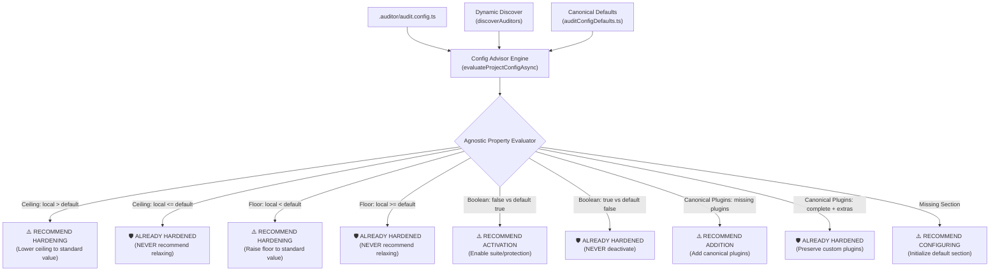

# Configuration Hardening Advisor (`auditor:config`) & Unidirectional Config Ratchet Guide

This reference provides the comprehensive architectural guide, CLI operational manual, and AI agent interaction protocol for `@francogp/auditor`'s Configuration Advisor tool (`auditor:config` / `auditor-config`).

---

## 1. Architectural Purpose & The Unidirectional Config Ratchet

Unlike blocking CI Quality Gates (`npm run auditor`), `auditor:config` belongs to the category of **Interactive Advisory Tools** (alongside `auditor:dependencies`, `auditor:magic`, `auditor:dupes`, `auditor:o1`, `auditor:types`, `auditor:domain`, and `auditor:motion`).

Its core mission is to evaluate `.auditor/audit.config.ts` dynamically against canonical framework defaults (`DEFAULT_AUDIT_CONFIG`, `DEFAULT_VITE_PLUS_AUDIT_CONFIG`) and the sovereign `defaultConfig` contracts exposed by each sub-auditor, enforcing the **Unbreakable Principle of Unidirectional Hardening (Config Ratchet)**.



---

## 2. Invariant Rules for AI Agents

1. **Absolute Prohibition on Recommending Rule Relaxations**:
   If a host project defines stricter thresholds (e.g. `fallow.health.maxCognitive: 12` where default is 20, or `testCoverage.threshold: 95` where default is 80), the agent **MUST NEVER propose raising the ceiling or lowering the floor**. Such settings must be celebrated and categorized as `🛡️ PREEXISTING STRICT RULES`.
2. **Prior Consultation Before Mutating Configuration**:
   The agent must **NEVER** run `npm run auditor:config -- apply` without showing the proposed changes first (`npm run auditor:config -- diff`) and obtaining explicit confirmation from the human developer.
3. **100% Dynamic Introspection**:
   The advisor inspects suites via runtime auto-discovery (`discoverAuditors()`). It contains zero hardcoded subsystem lists. When new subauditors are added to the framework, the advisor automatically incorporates their `defaultConfig`.
4. **Non-Destructive AST Application**:
   When `--apply` is authorized, changes are injected additively via TypeScript AST (`appendMissingSectionsToConfigFile`), preserving comments, formatting, and preexisting customizations.

---

## 3. CLI Command Options & Parameters

| Flag / Parameter                          | Description                                                                                                                          | Example Usage                                         |
| :---------------------------------------- | :----------------------------------------------------------------------------------------------------------------------------------- | :---------------------------------------------------- |
| `npm run auditor:config`                  | Runs evaluation and prints a compact diagnostic summary with counts and bulleted recommendations.                                    | `npm run auditor:config`                              |
| `--human` / `human`                       | Renders rich Box-Drawing tables (`SUBSYSTEM`, `SETTING`, `CURRENT`, `RECOMMENDED`, `RATIONALE`) and preserved strict settings table. | `npm run auditor:config -- human`                     |
| `--diff` / `diff`                         | Emits a non-destructive JSON/TypeScript patch tree representing proposed additions.                                                  | `npm run auditor:config -- diff`                      |
| `--apply` / `apply`                       | Additively writes missing sections and recommended settings to `.auditor/audit.config.ts`.                                           | `npm run auditor:config -- apply`                     |
| `--subsystem=<name>` / `subsystem=<name>` | Restricts evaluation to a single configuration section (e.g. `fallow`, `vitePlusConfig`, `styles`).                                  | `npm run auditor:config -- subsystem=fallow`          |
| `--json` / `json`                         | Emits raw structured `ConfigAdvisorReport` for CI scripting or automated verification.                                               | `npm run auditor:config -- json`                      |
| `--help` / `help`                         | Displays command options and usage manual.                                                                                           | `npm run auditor:config -- help`                      |
| `--project=<dir>` / `-p <dir>`            | Runs the advisor against an external project directory.                                                                              | `npm run auditor:config -- --project=../PokeBorrador` |

---

## 4. Agent Operational Workflow (Pair-Programming Protocol)

When a developer asks to review, audit, improve, or update auditor configurations:

### Step 1: Diagnostic Assessment

Run the configuration advisor in read-only diff mode:

```bash
npm run auditor:config -- diff
```

If evaluating a specific area (e.g., linter plugins or complexity thresholds), filter by subsystem:

```bash
npm run auditor:config -- subsystem=vitePlusConfig --diff
```

### Step 2: Present Findings in Spanish (`'es'`)

Communicate the diagnosis to the user clearly:

- Total properties evaluated vs. optimal vs. recommendations.
- List of preexisting strict rules that are intentionally **preserved** without relaxation.
- Exact proposed hardening items and the rationale behind each.

### Step 3: Human Authorization Gate

Ask the human developer for explicit confirmation before altering configuration files:

> _"Identified N architectural hardening opportunities. Would you like me to additively apply these settings to '.auditor/audit.config.ts'?"_

### Step 4: Additive Application & Verification

Once authorized:

```bash
npm run auditor:config -- apply
```

Then synchronize satellite configurations and verify workspace health:

```bash
npm run auditor:fix
npm run auditor:lint
```

---

## 5. Output Preview Reference

### Human Mode (`--human`)

```text
╔══════════════════════════════════════════════════════════╗
║ AUDITOR CONFIG ADVISOR: ARCHITECTURAL HARDENING          ║
║ Project: my-project | Checked: 46 | Optimal: 40 | Hardened: 4 ║
╚══════════════════════════════════════════════════════════╝

📋 RECOMMENDED HARDENING OPPORTUNITIES:
┌────────────────┬──────────────────────────┬──────────────┬────────────────┬──────────────────────────────────────────────┐
│ SUBSYSTEM      │ SETTING                  │   CURRENT    │  RECOMMENDED   │ RATIONALE                                    │
├────────────────┼──────────────────────────┼──────────────┼────────────────┼──────────────────────────────────────────────┤
│ fallow         │ fallow.health.maxCognitive │      35      │       20       │ Maximum ceiling is more permissive than      │
│                │                          │              │                │ canonical default (20). Lowering increases   │
│                │                          │              │                │ maintainability rigor.                       │
└────────────────┴──────────────────────────┴──────────────┴────────────────┴──────────────────────────────────────────────┘

🛡️ PREEXISTING STRICT RULES (PRESERVED - NEVER RELAXED):
┌────────────────┬──────────────────────────┬──────────────┬────────────────┬──────────────────────────────────────────────┐
│ SUBSYSTEM      │ HARDENED SETTING         │ PROJECT VAL  │    DEFAULT     │ STATUS                                       │
├────────────────┼──────────────────────────┼──────────────┼────────────────┼──────────────────────────────────────────────┤
│ testCoverage   │ testCoverage.threshold   │      95      │       80       │ Minimum floor (95) is stricter than          │
│                │                          │              │                │ canonical standard (80). NEVER relax.        │
└────────────────┴──────────────────────────┴──────────────┴────────────────┴──────────────────────────────────────────────┘
```
