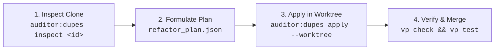

# Duplicate & Triplicate Code Refactoring Guide

> [!IMPORTANT]
> **Distinction Between CI Quality Gate & Interactive Refactor Tool**:
>
> - **`validate_similar_code` & Fallow Dupes (`npm run auditor`)**: CI static verification suite. Audits semantic vector duplication and whole-function duplicates exceeding the duplication threshold in Phase 3 (`dedup`). If CI passes with 0 errors, there are no blocking clone violations.
> - **`auditor-dupes` (`npm run auditor:dupes`)**: Interactive clone refactoring engine (`BaseRefactorEngine`). Discovers opportunities to deduplicate smaller functions, Vue SFC scripts, and SCSS mixins. Provides Dirac micro-context and applies multi-file refactoring plans inside an isolated worktree.
> - `npm run auditor` **NEVER** runs `auditor:dupes`. Discovering candidates in `npm run auditor:dupes discover` does not mean CI is broken. See [quality-gates-vs-refactor-engines.md](./quality-gates-vs-refactor-engines.md).

## 1. Architectural Overview & Dedup Phase

In the canonical 7-Phase Strategic Remediation Order (`RemediationPhaseId`), clone deduplication belongs to **Phase 3 (`dedup`)**:

1. `setup` $\rightarrow$ 2. `prune` $\rightarrow$ **3. `dedup`** $\rightarrow$ 4. `contracts` $\rightarrow$ 5. `behavior` $\rightarrow$ 6. `hygiene` $\rightarrow$ 7. `polish`

### The Dead-Code Triage Rule (Prune before Dedup)

Before executing any refactoring, **always triage for dead code**:
Empirical analysis demonstrates that **~25% of clone groups reside in unreferenced files or unused exports**. Attempting to extract shared functions from dead files wastes engineering tokens and induces phantom dependencies.

- **Rule:** If a clone instance is flagged by `fallow-unused-files` or `fallow-unused-exports`, run `fallow fix --yes` (or delete the file) before refactoring the remaining active instances.

---

## 2. The Dirac Micro-Context Pattern

Reading entire source files into an LLM context window to refactor a 10-line clone is inefficient and error-prone (inducing hallucinated changes in unrelated lines).

The **Dirac Micro-Context Pattern** isolates only:

1. The exact clone lines with $N$ lines of surrounding context ($N \in [3, 5]$).
2. Existing local import declarations to detect specifier availability.
3. Symbol signature (parameters, return type, enclosing function name).

### Empirical Token Benchmark (Measured on real projects)

| Benchmark Case | Full Files Baseline | Dirac Micro-Context | Token Savings |
|---|---|---|---|
| **Case A** (Triplicate TS Utility) | 16,941 tokens | 506 tokens | **97.0%** |
| **Case B** (Quintuple Mixed TS + Vue) | 17,320 tokens | 151 tokens | **99.1%** |
| **Case C** (Intra-File Store Methods) | 33,838 tokens | 147 tokens | **99.5%** |
| **Case D** (Intra-Vue SFC Animation) | 7,548 tokens | 133 tokens | **98.2%** |
| **Total** | **75,647 tokens** | **937 tokens** | **98.7% Reduction** |

To extract micro-context for any clone group:

```bash
npm run auditor:dupes inspect <fingerprint>
# Or via CLI binary
auditor-dupes inspect <fingerprint>
```

---

## 3. The 3-Step Remediation Workflow



### Step 1: Inspect Clone Group

Run `auditor:dupes inspect <fingerprint>` to obtain the structured JSON report containing:

- All file paths and exact line ranges.
- Surrounding code snippets with line numbers.
- File extensions (`.ts`, `.vue`, `.scss`).
- Suggested extraction target type (`pure-function`, `composable`, `scss-mixin`).

### Step 2: Formulate Refactor Plan

Create a `refactor_plan.json` conforming to `refactor_plan_blueprint.json`:

```json
{
  "$schema": "http://json-schema.org/draft-07/schema#",
  "version": 1,
  "planId": "refactor-format-date",
  "fingerprint": "group-042",
  "action": "extract-shared-function",
  "sharedModulePath": "src/utils/dateFormatter.ts",
  "functionName": "formatIsoDate",
  "parameters": [
    { "name": "date", "type": "Date" }
  ],
  "returnType": "string",
  "sharedFunctionCode": "function formatIsoDate(date: Date): string {\n  return date.toISOString().split('T')[0];\n}",
  "targetFiles": [
    "src/components/UserProfile.vue",
    "src/services/billingService.ts"
  ],
  "astPattern": "$DATE.toISOString().split('T')[0]",
  "astRewrite": "formatIsoDate($DATE)"
}
```

### Step 3: Apply Transformation with Safe Worktree Isolation

Apply the plan using the hybrid transformation harness:

```bash
npm run auditor:dupes apply refactor_plan.json --worktree
```

The `--worktree` flag automatically:

1. Spawns an isolated git worktree in `.git-worktrees/refactor-sandbox`.
2. Creates an ephemeral junction to the root `node_modules` (0 disk cost).
3. Applies canonical extraction and surgical AST replacements across TS and Vue files.
4. Executes validation checks (`vp check` / `npm test`).
5. Upon 100% success, cleanly ports changes back to the working tree.
6. Automatically cleans up the worktree on failure, leaving the working tree untouched.

---

## 4. Hybrid Engine Architecture

Different source file extensions require specialized parsing engines:

| Engine | Target Extensions | Primary Responsibility | Performance |
|---|---|---|---|
| **`ts-morph`** | `.ts`, `.tsx` | TypeScript AST, automatic relative import resolution, symbol extraction | High semantic accuracy |
| **`magic-string` + `@vue/compiler-sfc`** | `.vue` | Surgical SFC `<script>` updates preserving `<template>` and `<style>` blocks intact | Zero layout thrashing, 16 ms |
| **`@ast-grep/napi`** | `.ts`, `.js`, `.scss` | High-speed structural pattern matching and replacement | Ultra-fast (21 ms) |
| **`HybridHarness`** | Unified Coordinator | Dispatches each occurrence to the optimal engine based on file extension | Deterministic execution |

---

## 5. Architectural Best Practices by Target Type

### A. Pure TypeScript Functions (`pure-function`)

- Extract into `src/utils/<domain>Utils.ts`.
- Ensure zero framework dependencies (`Vue`, `Pinia`, `React`).
- Must be stateless and deterministic.

### B. Vue Composables (`composable`)

- Extract into `src/composables/use<DomainFeature>.ts`.
- Accept maybe-reactive inputs (`MaybeRefOrGetter<T>`).
- Normalize reactively via `toValue()` inside effects (`watch` / `watchEffect`).

### C. SCSS Mixins / Variables (`scss-mixin`)

- Extract into shared styling tokens `src/styles/_mixins.scss`.
- Avoid hardcoded color or dimension duplicates; bind to design system CSS custom properties.

---

## 6. Advanced Refactoring Capabilities

### A. Parameter Permutation Mapping (`ParamPermutationMapper`)

Real-world semantic clones often exhibit identical logic with transposed or reordered parameters across files (e.g. `calculateStab(move, attacker)` vs `calculateStab(attacker, move)`).
The `ParamPermutationMapper` automatically maps each clone instance's parameter positions to the canonical extracted signature, generating per-callsite argument rewrites:

```ts
// Canonical extracted signature:
export function computeStabMultiplier(moveType: string, attacker: Attacker): number;

// Instance A rewrite (direct):
computeStabMultiplier(moveType, attacker)

// Instance B rewrite (permuted):
computeStabMultiplier(attackerMove, currentPokemon)
```

### B. The 100-Token Dirac Threshold (`MIN_DIRAC_TOKEN_THRESHOLD = 100`)

Empirical benchmarking across repositories revealed a critical threshold effect:

- Snippets **< 100 tokens**: The metadata envelope of Dirac micro-context (signatures, types, file paths, hashes) can exceed the token length of the snippet itself, resulting in **negative token savings** (e.g., a 76-token clone resulted in 118 tokens, or -55% savings).
- Snippets **$\ge$ 100 tokens**: Dirac micro-context yields positive token reductions from **80% to 99%**.
The engine strictly enforces `MIN_DIRAC_TOKEN_THRESHOLD = 100` (`isDiracCandidate`), ensuring micro-context extraction is exclusively applied where positive compression is guaranteed.

### C. Class Hierarchy Hoisting (`ClassHierarchyHoister`)

When duplicate methods exist across multiple sibling classes sharing a common base class, extracting a standalone external function breaks OOP encapsulation.
The `ClassHierarchyHoister` (`action: 'hoist-to-base-class'`):

1. Detects common inheritance ancestors (`class Fighter extends BaseCombatant`, `class Mage extends BaseCombatant`).
2. Hoists the shared method into `BaseCombatant`.
3. Removes redundant overrides in derived classes.

---

## 7. Reaction Protocol: CI Error vs. Elective Deduplication

### Scenario A: CI Quality Gate Error (`validate_similar_code`)

- **Trigger**: `npm run auditor` reports `similar-code-vector-duplicate` or `fallow-duplicate-code`.
- **Strategic Phase**: Phase 3 (`dedup`).
- **Action**: Follow the **Dead-Code Triage Rule** first (`fallow fix --yes`). If the code is alive, formulate a **Correction Plan**. Extract the shared function to a common module in `src/utils/` or `src/shared/`.
- **Verification**: `npm run auditor -- suite=validate_similar_code` -> Green.

### Scenario B: Elective Deduplication (`auditor:dupes`)

- **Trigger**: User requests *"eliminate duplicate code"*, *"deduplicate logic"*, or *"reduce clones"*.
- **Pre-flight Invariant**: Verify `npm run auditor` is 100% green before initiating refactoring.
- **Action**: Formulate an **Improvement Plan**. Run `auditor:dupes discover`, inspect clone candidates with `auditor:dupes inspect <fingerprint>` (Dirac Micro-Context), draft `refactor_plan.json`, and apply with `--worktree`.

---

## 8. Concrete Plan Blueprints

### Correction Plan (CI Error: `similar-code-vector-duplicate`)

````markdown
# Correction Plan: Semantic Clone in orderService.ts and checkoutService.ts

## 1. Diagnosis & Strategic Phase
- **Active Phase (`auditor:next`)**: `dedup` (Phase 3)
- **Suite**: `validate_similar_code`
- **Affected Files**:
  - `src/services/orderService.ts:L45-L68`
  - `src/services/checkoutService.ts:L112-L135`
- **Similarity**: 96.4% (Regional tax calculation with exemptions).

## 2. Canonical Solution
1. Extract pure function `calculateRegionalTax(amount: number, regionCode: RegionCode): number` to `src/utils/taxCalculator.ts`.
2. Replace cloned blocks in both services by importing the newly shared utility.

## 3. Verification

`npm run auditor -- suite=validate_similar_code`
````

### Improvement Plan (Elective: `auditor:dupes`)

````markdown
# Improvement Plan: Date Formatting Deduplication Across Components

## 1. Scope & Motivation
- **Tool**: `auditor-dupes`
- **Fingerprint**: `grp_date_iso_split_402`
- **Dirac Savings**: 98.7% token reduction (from 17,000 to 210 tokens in context).

## 2. Candidate Catalog (Dirac Micro-Context)
| File | Lines | Local Function | Proposed Extraction |
| :--- | :--- | :--- | :--- |
| `src/views/ProfileView.vue` | 42-46 | `formatDate()` | `formatIsoDate(date: Date)` |
| `src/views/InvoiceView.vue` | 78-82 | `formatDate()` | `formatIsoDate(date: Date)` |

## 3. Declarative Plan (`scratch/refactor_plan.json`)

```json
{
  "version": 1,
  "planId": "refactor-date-formatter",
  "fingerprint": "grp_date_iso_split_402",
  "action": "extract-shared-function",
  "sharedModulePath": "src/utils/dateFormatter.ts",
  "functionName": "formatIsoDate",
  "parameters": [{ "name": "date", "type": "Date" }],
  "returnType": "string",
  "sharedFunctionCode": "export function formatIsoDate(date: Date): string {\n  return date.toISOString().split('T')[0];\n}",
  "targetFiles": [
    "src/views/ProfileView.vue",
    "src/views/InvoiceView.vue"
  ],
  "astPattern": "$DATE.toISOString().split('T')[0]",
  "astRewrite": "formatIsoDate($DATE)"
}
```

## 4. Sandbox Execution

`npm run auditor:dupes apply scratch/refactor_plan.json --worktree`
````

---

## 9. Step-by-Step Tutorial & CLI Walkthrough

### Step 1: Discover Clones Across Repository

```bash
npm run auditor:dupes discover
```

Output renders an 80-column Box-Drawing table:

```text
┌──────────────────────────────────────────────────────────────────────────────┐
│                  auditor-dupes: Code Clone Discovery Table                   │
├──────────────────────────┬──────────────┬─────────────┬──────────────────────┤
│ Fingerprint              │ Occurrences  │ Lines Total │ Suggested Type       │
├──────────────────────────┼──────────────┼─────────────┼──────────────────────┤
│ grp_date_iso_split_402   │ 3 files      │ 24 lines    │ pure-function        │
│ grp_card_animation_99    │ 2 files      │ 48 lines    │ composable           │
└──────────────────────────┴──────────────┴─────────────┴──────────────────────┘
```

### Step 2: Inspect Specific Clone via Dirac Micro-Context

```bash
npm run auditor:dupes inspect grp_date_iso_split_402
```

Output emits the ultra-compact JSON packet without flooding the LLM context.

### Step 3: Formulate & Apply Plan with `--worktree`

Save plan to `scratch/refactor_plan.json` and execute:

```bash
npm run auditor:dupes apply scratch/refactor_plan.json --worktree
```

The worktree sandbox builds the project and runs tests. If all pass, changes are safely applied to your working directory.
