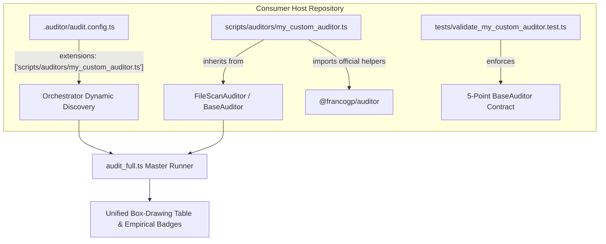

# Host Extension Helpers & Authoring Manual

This manual provides a comprehensive reference, step-by-step tutorial, and complete architectural examples for building custom host sub-auditors and extensions in consumer repositories using the official tooling and helpers provided by `@francogp/auditor`.

---

## 1. Extension Architecture Overview

Host extensions allow individual projects to enforce bespoke architectural invariants, game engine rules, design token constraints, and asset integrity standards without polluting the upstream `@francogp/auditor` framework.



### Core Invariants for Host Extensions

1. **Strict OOP Inheritance**: Every extension MUST inherit from `FileScanAuditor<TRuleId>` (for file-by-file scanning) or `BaseAuditor<TRuleId>` (for multi-file / whole-project coordinators).
2. **5-Point Conformance Contract**: Extensions must provide a corresponding Vitest test verifying:
   - Point 1: Instantiation and metadata validation via `validateAuditorConstruction(auditor)`.
   - Point 2: Clean path testing (`status === 'passed'`, `errors === 0`, `warnings === 0`).
   - Point 3: Violation detection (`status === 'failed'`, `severity === 'error'`).
   - Point 4: Warning path testing where warnings exist (`warnings > 0`, `status === 'passed'` when `errors === 0`).
   - Point 5: 100% of declared rule IDs tested.
3. **Description Length Ceiling**: The composite description (`${packageName}: ${ruleDescription}`) MUST NOT exceed 50 characters (`MAX_AUDITOR_DESCRIPTION_LENGTH = 50`) and contain zero newlines.
4. **Zero Homebrew Helpers & Extension Hygiene (`validate_oxlint`)**: Re-inventing path sanitizers (`.replace(/\\/g, '/')`), handcrafted Vue SFC regexes (`/<template[\s\S]*<\/template>/`), isolated `ts.createSourceFile()` calls, ad-hoc comment strippers, or reading `package.json` with `fs.readFileSync` is strictly forbidden and actively blocked by `validate_oxlint` (`@francogp/domain-type` auditor hygiene rules). Host extensions must import official helpers from `@francogp/auditor`.
5. **Universal Empirical Individual Timing Mandate**: Extensions MUST measure 100% of declared rules individually using `this.runSubAuditorSync(ruleId, () => ...)` or `await this.runSubAuditor(ruleId, async () => ...)`. Duplicate batch duration stamping across rules, synthetic time divisions, and fake `(0 ms)` badges are strictly prohibited. Redundant calls to `this.markRuleEvaluated(ruleId)` are forbidden because `runSubAuditorSync` marks the rule evaluated automatically. Transparent inapplicability (`this.markRuleNotApplicable`) MUST also be wrapped inside `runSubAuditorSync` to record `<0,1 ms` badges.
6. **Zero Hardcoded Candidate Paths & Dynamic Exemption (`auditor-hardcoded-config`)**: Host extensions must never hardcode candidate arrays (e.g. `['visuals.ts', 'constants.ts']`), ignore directories, or fallback path lists. Dynamic paths and file exemptions must be resolved via `.auditor/audit.config.ts`, `getAuditConfig()`, and `options.exemptPaths` / `isPathExempt(relPath, exemptPaths)`.

---

## 2. Official Framework Helpers Reference

### 2.1 Base Classes & Execution Primitives (`@francogp/auditor`)

#### `this.runSubAuditorSync(ruleId, fn)`, `this.runSubAuditor(ruleId, asyncFn)` & `this.scanFilesSinglePass(files, handlers)`

Mandatory execution wrappers provided by `BaseAuditor`. Measures the exact microsecond runtime of `fn` using `performance.now()`, records the empirical duration in the superclass ledger (`durationsByRule`), and automatically marks `ruleId` as evaluated. For multi-rule suites scanning the same file list, `await this.scanFilesSinglePass(files, handlers)` reads each file once from the in-RAM `WorkspaceFileCache` and runs all rule handlers in a single pass (preventing `auditor-inefficient-file-scan`):

```typescript
// Synchronous evaluation inside scanFile or runAudit:
this.runSubAuditorSync('my-rule-id', () => {
  // Logic evaluating my-rule-id exclusively
});

// Asynchronous evaluation:
await this.runSubAuditor('my-async-rule', async () => {
  // Async logic evaluating my-async-rule exclusively
});

// Single-pass multi-rule file scan backed by WorkspaceFileCache in RAM:
await this.scanFilesSinglePass(files, [
  {
    ruleId: 'my-rule-id',
    scan: (file, content, lines) => {
      /* ... */
    }
  }
]);
```

#### `FileScanAuditor<TRuleId extends string>`

Specialized base class for scanning individual files. Handles automatic directory collection, gitignore filtering, test file exemptions, AST context resolution, and coverage ledger tracking.

```typescript
import {
  FileScanAuditor,
  createUniformRuleCapabilities,
  resolveFileScanRoots,
  type FileScanRootsOptions
} from '@francogp/auditor';

export const MY_RULES = ['my-rule-id'] as const;
export type MyRuleId = (typeof MY_RULES)[number];

export interface MyAuditorOptions extends FileScanRootsOptions {
  readonly exemptPaths?: readonly string[];
}

export class MyAuditor extends FileScanAuditor<MyRuleId> {
  constructor(options: MyAuditorOptions = {}) {
    const { effectiveRoot, targetRoots } = resolveFileScanRoots(
      options,
      (config) => config.paths?.srcRoots
    );

    super({
      id: 'validate_my_rules',
      name: 'My Custom Invariants',
      description: 'Enforces project-specific constraints',
      family: 'architecture',
      packageName: 'Custom',
      icon: '🛡️',
      configKey: 'paths',
      defaultConfig: {},
      criticalConfig: {},
      usesThirdPartyTool: false,
      requiredPermissions: [],
      ruleFixers: {},
      projectRoot: effectiveRoot,
      roots: targetRoots,
      allowedExtensions: new Set(['.ts', '.vue']),
      // Dynamic Exemption: automatically bypasses configured files or patterns
      exemptPaths: options.exemptPaths,
      ruleIds: MY_RULES,
      ruleCapabilities: createUniformRuleCapabilities(MY_RULES, {
        speed: 'light',
        phase: 'normal',
        md: false,
        ast: false,
        changedOnly: false,
        critical: false
      }),
      remediationPhase: 'contracts',
      ruleDescriptions: {
        'my-rule-id': 'Custom project invariant rule'
      },
      ruleRemediations: {
        'my-rule-id':
          '1. Root Cause: The custom project invariant was violated.\n' +
          '2. Diagnosis: Open the reported file and line.\n' +
          '3. Canonical Solution: Update the code to satisfy the documented invariant.\n' +
          '4. Example / Command: npm run auditor'
      }
    });
  }

  protected override scanFile(relPath: string, content: string, sourceFile?: ts.SourceFile): void {
    // Inspection logic executed per discovered file
  }
}
```

#### `this.addViolationAtMatch(params)`

Method on `FileScanAuditor` that automatically calculates 1-indexed line and column numbers from a match character index:

```typescript
this.addViolationAtMatch({
  ruleId: 'my-rule-id',
  file: relPath,
  content,
  matchIndex: match.index,
  message: 'Descriptive error message in English',
  severity: 'error' // or 'warning'
});
```

---

### 2.2 Path & Predicate Helpers (`@francogp/auditor`)

```typescript
import {
  normalizePosixPath,
  toPosixRelative,
  isInsideRoot,
  isPathInside,
  matchesAnyRoot,
  isTestPath,
  isTestFileForCodeAudit,
  isExemptFile
} from '@francogp/auditor';
```

| Helper                          | Signature                                             | Description                                                                                               |
| :------------------------------ | :---------------------------------------------------- | :-------------------------------------------------------------------------------------------------------- |
| `normalizePosixPath`            | `(filePath: string) => string`                        | Normalizes backslashes to forward slashes and resolves relative segments deterministically (Node.js 26+). |
| `toPosixRelative`               | `(target: string, from?: string) => string`           | Produces relative paths with forward slashes without leading `./`.                                        |
| `isInsideRoot` / `isPathInside` | `(target: string, root: string) => boolean`           | Hardened CWE-22 path containment check preventing path traversal.                                         |
| `matchesAnyRoot`                | `(path: string, roots: readonly string[]) => boolean` | Checks if a path starts with or is contained inside any declared root directory.                          |
| `isTestPath`                    | `(filePath: string) => boolean`                       | Detects whether a path belongs to test, spec, mock, or integration folders.                               |
| `isTestFileForCodeAudit`        | `(filePath: string, projectRoot?: string) => boolean` | Centralized test file checker respecting both filename conventions and configured test roots.             |
| `isExemptFile`                  | `(relPath: string, projectRoot?: string) => boolean`  | Verifies whether a file is exempted globally via `audit.config.ts`.                                       |

---

### 2.3 Vue SFC Parsing & Scanner Utilities (`@francogp/auditor`)

```typescript
import {
  parseVueSfc,
  hasPrecedingComment,
  stripComments,
  stripCommentsAndStrings,
  scanBalancedDelimiter,
  isPositionInsideFunctionParams,
  getPackageJson
} from '@francogp/auditor';
```

| Helper                           | Signature                                                                                                             | Description                                                                                                                                |
| :------------------------------- | :-------------------------------------------------------------------------------------------------------------------- | :----------------------------------------------------------------------------------------------------------------------------------------- |
| `parseVueSfc`                    | `(content: string) => VueSfcBlocks`                                                                                   | Deterministically parses Vue SFC into structured `<template>`, `<script>`, and `<style>` blocks with precise line and index coordinates.   |
| `hasPrecedingComment`            | `(lines: readonly string[], lineIndex: number, directiveRegex: RegExp, options?: PrecedingCommentOptions) => boolean` | Robustly detects preceding single-line or multi-line comment annotations across Vue SFC templates, scripts, and stylesheets with lookback. |
| `stripComments`                  | `(code: string) => string`                                                                                            | Safely removes line (`//`) and block (`/* ... */`) comments while preserving string literals and line count.                               |
| `stripCommentsAndStrings`        | `(code: string) => string`                                                                                            | Strips comments and string literals, replacing non-whitespace with spaces to preserve line and character offsets.                          |
| `scanBalancedDelimiter`          | `(text: string, open: string, close: string, startIndex: number) => number`                                           | Scans forward from an opening delimiter to locate its matching closing delimiter, handling nested pairs and string escapes.                |
| `isPositionInsideFunctionParams` | `(sourceText: string, targetPos: number) => boolean`                                                                  | Determines if a source position lies inside function parameters vs the function body.                                                      |
| `getPackageJson`                 | `(projectRoot?: string) => Record<string, any>`                                                                       | Safely reads and caches the project's root `package.json` without manual `fs.readFileSync` or `JSON.parse`.                                |

---

### 2.4 AST Context Helpers (`@francogp/auditor`)

#### `SharedAstContext`

High-performance cached TypeScript compiler host (`ts.SourceFile` cache):

```typescript
import { SharedAstContext } from '@francogp/auditor';

const astContext = new SharedAstContext(projectRoot);
const sourceFile = astContext.getSourceFile(absolutePath, content);
```

When authoring a `FileScanAuditor`, set `requiresAst: true` in options: the framework will automatically parse and supply `sourceFile` to `scanFile(relPath, content, sourceFile)`!

---

### 2.5 Extension Metadata Wrapper (`@francogp/auditor/plugin`)

#### `defineAuditorExtension(definition)`

Typed extension metadata wrapper exported by `@francogp/auditor/plugin` (while `.auditor/audit.config.ts` registers extension file or directory paths in `extensions: readonly string[]`):

```typescript
import { defineAuditorExtension } from '@francogp/auditor/plugin';

export const customExtension = defineAuditorExtension({
  id: 'validate_custom_rules',
  name: 'Custom Domain Rules',
  family: 'architecture',
  auditorClass: ValidateCustomRulesAuditor,
  scripts: [
    {
      name: 'auditor:custom-rules',
      command: 'auditor task=validate_custom_rules',
      description: 'Run project-specific custom rule audit'
    }
  ]
});
```

---

### 2.6 Declarative CLI Harness & Refactor CLI Helpers (`citty@^0.2.2`)

All sub-auditors, host extensions, and CLI tools are governed by `validate_cli_contracts` (`phase: 'setup'`). Direct `process.argv` access, `node:util.parseArgs`, third-party CLI parsers (`commander`, `yargs`, `minimist`, `cac`), and manual flag checks (`.startsWith('--')`, `args[0]`) are strictly prohibited.

| Helper                                             | Module                                    | Purpose                                                                                                                             |
| :------------------------------------------------- | :---------------------------------------- | :---------------------------------------------------------------------------------------------------------------------------------- |
| `BaseAuditor.runCliIfMain(importMetaUrl, auditor)` | `@francogp/auditor`                       | Canonical CLI entrypoint for sub-auditors and host extensions; parses `human`, `--fix`, `--json`, and `--help` via Citty.           |
| `isMainModule(importMetaUrl)`                      | `@francogp/auditor`                       | Canonical entrypoint predicate; prevents `runMain(command)` from executing during module imports.                                   |
| `createAuditorCli(options)`                        | `src/core/cli/cittyHarness.ts`            | Builds a declarative Citty `CommandDef` merging `COMMON_CLI_ARGS` (`human`, `pretty`, `json`, `project`, `fix`, `help`, `version`). |
| `parseCittyArgs(argsDef, rawArgs)`                 | `src/core/cli/cittyHarness.ts`            | Synchronously normalizes bare `key=value` and positional `human`/`help` tokens and parses them through Citty's parser.              |
| `createRefactorCli(spec)`                          | `src/core/refactor/refactorCliHarness.ts` | Declarative Citty CLI harness for `BaseRefactorEngine` tools (`discover`, `inspect`, `apply`, `human`, `help`).                     |

> [!TIP]
> 📘 **CLI Script Authoring & Citty Best Practices**: For complete guidelines on writing host maintenance and testing scripts with `defineCommand`, subcommands, typed args, and avoiding background execution storms, see [citty-cli-governance-guide.md](./citty-cli-governance-guide.md).

---

## 3. Step-by-Step Tutorial: Creating a Host Extension

### Step 1: Create the Sub-Auditor Class

Create `scripts/auditors/validate_game_design.ts`:

```typescript
import {
  FileScanAuditor,
  BaseAuditor,
  createUniformRuleCapabilities,
  isExemptFile,
  resolveFileScanRoots,
  type FileScanRootsOptions
} from '@francogp/auditor';
import ts from 'typescript';

export type GameDesignRuleId = 'game-banned-magic-speed' | 'game-missing-layer-tag';

export const GAME_DESIGN_RULES: readonly GameDesignRuleId[] = [
  'game-banned-magic-speed',
  'game-missing-layer-tag'
] as const;

export class ValidateGameDesignAuditor extends FileScanAuditor<GameDesignRuleId> {
  constructor(options: FileScanRootsOptions = {}) {
    const { effectiveRoot, targetRoots } = resolveFileScanRoots(
      options,
      (config) => config.paths.srcRoots
    );
    super({
      id: 'validate_game_design',
      name: 'Game Design Constraints',
      description: 'Validates physics speed constants and entity layer tags',
      family: 'architecture',
      packageName: 'Game',
      icon: '🎮',
      configKey: 'paths',
      defaultConfig: {},
      criticalConfig: {},
      usesThirdPartyTool: false,
      requiredPermissions: [],
      ruleFixers: {},
      remediationPhase: 'contracts',
      projectRoot: effectiveRoot,
      roots: targetRoots,
      allowedExtensions: new Set(['.ts']),
      requiresAst: true,
      scripts: [
        {
          name: 'auditor:game-design',
          command: 'auditor task=validate_game_design',
          description: 'Audits game speed constants and entity layer tags'
        }
      ],
      ruleIds: GAME_DESIGN_RULES,
      ruleCapabilities: createUniformRuleCapabilities(GAME_DESIGN_RULES, {
        speed: 'light',
        phase: 'normal',
        md: false,
        ast: true,
        changedOnly: false,
        critical: false
      }),
      ruleDescriptions: {
        'game-banned-magic-speed': 'Magic speed literal without constant',
        'game-missing-layer-tag': 'Missing @LayerTag on entity class'
      },
      ruleRemediations: {
        'game-banned-magic-speed':
          '1. Root Cause: A raw numeric literal (>= 100) was assigned to a speed property.\n' +
          '2. Diagnosis: Inspect the AST property assignment reported at the file and line.\n' +
          '3. Canonical Solution: Hoist the speed value into a named constant in the physics balance module.\n' +
          '4. Example / Command: npm run auditor suite=validate_game_design',
        'game-missing-layer-tag':
          '1. Root Cause: An Entity class declaration does not specify its render layer decorator.\n' +
          '2. Diagnosis: Inspect the reported class declaration.\n' +
          '3. Canonical Solution: Decorate the class with @LayerTag(...) using a canonical layer token.\n' +
          '4. Example / Command: npm run auditor suite=validate_game_design'
      }
    });
  }

  protected override scanFile(relPath: string, content: string, sourceFile?: ts.SourceFile): void {
    if (!sourceFile || isExemptFile(relPath, this.projectRoot)) return;

    // Rule 1: game-banned-magic-speed (AST visitor, individually measured)
    this.runSubAuditorSync('game-banned-magic-speed', () => {
      const visit = (node: ts.Node): void => {
        if (
          ts.isPropertyAssignment(node) &&
          ts.isIdentifier(node.name) &&
          node.name.text === 'speed' &&
          ts.isNumericLiteral(node.initializer) &&
          Number(node.initializer.text) >= 100
        ) {
          this.addViolationAtMatch({
            ruleId: 'game-banned-magic-speed',
            file: relPath,
            content,
            matchIndex: node.getStart(sourceFile),
            message: `Magic physics speed literal (${node.initializer.text}). Extract a named constant in 'src/constants/physics.ts'.`,
            severity: 'error'
          });
        }
        ts.forEachChild(node, visit);
      };
      visit(sourceFile);
    });

    // Rule 2: game-missing-layer-tag (AST visitor, individually measured)
    this.runSubAuditorSync('game-missing-layer-tag', () => {
      const visit = (node: ts.Node): void => {
        if (ts.isClassDeclaration(node) && node.name?.text.endsWith('Entity')) {
          const decorators = ts.canHaveDecorators(node) ? ts.getDecorators(node) : undefined;
          const hasLayerTag = decorators?.some((d) =>
            d.getText(sourceFile).startsWith('@LayerTag')
          );
          if (!hasLayerTag) {
            this.addViolationAtMatch({
              ruleId: 'game-missing-layer-tag',
              file: relPath,
              content,
              matchIndex: node.name.getStart(sourceFile),
              message: `Entity class '${node.name.text}' is missing mandatory @LayerTag decorator.`,
              severity: 'error'
            });
          }
        }
        ts.forEachChild(node, visit);
      };
      visit(sourceFile);
    });
  }
}

await BaseAuditor.runCliIfMain(import.meta.url, new ValidateGameDesignAuditor());
```

---

### Step 2: Register in `.auditor/audit.config.ts`

```typescript
import { defineAuditConfig } from '@francogp/auditor';

export default defineAuditConfig({
  // ... other SSoT sections
  extensions: ['scripts/auditors/validate_game_design.ts']
});
```

---

### Step 3: Synchronize Package Scripts

Run the canonical fixer to automatically inject declared `scripts` into `package.json`:

```bash
npm run auditor:fix
```

---

## 4. Practical Real-World Examples

### Example 1: Non-Code Stylesheet / Template Pattern Scanner (`FileScanAuditor`)

Enforces color palette governance and prohibits raw hex colors in `.scss` stylesheets:

```typescript
import {
  FileScanAuditor,
  createUniformRuleCapabilities,
  isExemptFile,
  resolveFileScanRoots,
  DEFAULT_AUDIT_CONFIG,
  type FileScanRootsOptions
} from '@francogp/auditor';

export const UI_COLOR_RULES = ['ui-banned-raw-hex-color'] as const;
export type UiColorRuleId = (typeof UI_COLOR_RULES)[number];

export class ValidateUiColorPaletteAuditor extends FileScanAuditor<UiColorRuleId> {
  constructor(options: FileScanRootsOptions = {}) {
    const { effectiveRoot, targetRoots } = resolveFileScanRoots(
      options,
      (config) => config.paths?.stylesRoots ?? DEFAULT_AUDIT_CONFIG.paths.stylesRoots
    );

    super({
      id: 'validate_ui_color_palette',
      name: 'UI Color Palette Hygiene',
      description: 'Bans raw hex colors outside design tokens',
      family: 'architecture',
      packageName: 'Palette',
      icon: '🎨',
      configKey: 'paths',
      defaultConfig: {},
      criticalConfig: {},
      usesThirdPartyTool: false,
      requiredPermissions: [],
      ruleFixers: {},
      remediationPhase: 'hygiene',
      projectRoot: effectiveRoot,
      roots: targetRoots,
      allowedExtensions: new Set(['.scss']),
      ruleIds: UI_COLOR_RULES,
      ruleCapabilities: createUniformRuleCapabilities(UI_COLOR_RULES, {
        speed: 'light',
        phase: 'normal',
        md: false,
        ast: false,
        changedOnly: false,
        critical: false
      }),
      ruleDescriptions: {
        'ui-banned-raw-hex-color': 'Raw hex color literal outside theme tokens'
      },
      ruleRemediations: {
        'ui-banned-raw-hex-color':
          '1. Root Cause: A raw hexadecimal color (#fff, #1a1a1a) was used directly instead of semantic design tokens.\n' +
          '2. Diagnosis: Inspect the reported stylesheet line to identify the unregulated hex value.\n' +
          '3. Canonical Solution: Replace the literal with the corresponding CSS custom property or SCSS token (e.g. var(--color-background-primary)).\n' +
          '4. Example / Command:\n' +
          '   // Before:\n' +
          '   color: #3b82f6;\n' +
          '   // After:\n' +
          '   color: var(--color-primary-500);'
      }
    });
  }

  protected override scanFile(relPath: string, content: string): void {
    if (isExemptFile(relPath, this.projectRoot)) return;

    this.runSubAuditorSync('ui-banned-raw-hex-color', () => {
      const hexRegex = /#(?:[0-9a-fA-F]{3}){1,2}\b/g;
      let match: RegExpExecArray | null;
      while ((match = hexRegex.exec(content)) !== null) {
        this.addViolationAtMatch({
          ruleId: 'ui-banned-raw-hex-color',
          file: relPath,
          content,
          matchIndex: match.index,
          message: `Raw hex color detected: '${match[0]}'. Use theme CSS variables (var(--color-*)).`,
          severity: 'error'
        });
      }
    });
  }
}
```

---

### Example 2: TypeScript AST Analysis (`SharedAstContext`)

Verifies that all exported functions in domain services have explicit return type annotations using TypeScript compiler AST:

```typescript
import {
  FileScanAuditor,
  createUniformRuleCapabilities,
  isExemptFile,
  resolveFileScanRoots,
  DEFAULT_AUDIT_CONFIG,
  type FileScanRootsOptions
} from '@francogp/auditor';
import ts from 'typescript';

export const SERVICE_RETURN_RULES = ['service-missing-explicit-return-type'] as const;
export type ServiceReturnRuleId = (typeof SERVICE_RETURN_RULES)[number];

export class ValidateServiceTypesAuditor extends FileScanAuditor<ServiceReturnRuleId> {
  constructor(options: FileScanRootsOptions = {}) {
    const { effectiveRoot, targetRoots } = resolveFileScanRoots(
      options,
      (config) =>
        config.paths?.logicRoots ?? config.paths?.srcRoots ?? DEFAULT_AUDIT_CONFIG.paths.srcRoots
    );

    super({
      id: 'validate_service_types',
      name: 'Service Explicit Return Types',
      description: 'Requires explicit return types on service exports',
      family: 'architecture',
      packageName: 'Services',
      icon: '📐',
      configKey: 'paths',
      defaultConfig: {},
      criticalConfig: {},
      usesThirdPartyTool: false,
      requiredPermissions: [],
      ruleFixers: {},
      remediationPhase: 'contracts',
      projectRoot: effectiveRoot,
      roots: targetRoots,
      allowedExtensions: new Set(['.ts']),
      requiresAst: true, // Enables automatic TypeScript AST provision
      ruleIds: SERVICE_RETURN_RULES,
      ruleCapabilities: createUniformRuleCapabilities(SERVICE_RETURN_RULES, {
        speed: 'light',
        phase: 'normal',
        md: false,
        ast: true,
        changedOnly: false,
        critical: false
      }),
      ruleDescriptions: {
        'service-missing-explicit-return-type': 'Missing explicit service return type'
      },
      ruleRemediations: {
        'service-missing-explicit-return-type':
          '1. Root Cause: An exported service function omits its explicit return type annotation.\n' +
          '2. Diagnosis: Inspect the exported function signature reported at the file and line.\n' +
          '3. Canonical Solution: Add an explicit canonical domain return type to the function declaration.\n' +
          '4. Example / Command:\n' +
          '   // Before:\n' +
          '   export function calculateBalance(account: Account) { return account.total; }\n' +
          '   // After:\n' +
          '   export function calculateBalance(account: Account): Money { return account.total; }'
      }
    });
  }

  protected override scanFile(relPath: string, content: string, sourceFile?: ts.SourceFile): void {
    if (!sourceFile || isExemptFile(relPath, this.projectRoot)) return;

    this.runSubAuditorSync('service-missing-explicit-return-type', () => {
      const visit = (node: ts.Node): void => {
        if (ts.isFunctionDeclaration(node) && node.name) {
          const isExported = node.modifiers?.some((m) => m.kind === ts.SyntaxKind.ExportKeyword);
          if (isExported && !node.type) {
            this.addViolationAtMatch({
              ruleId: 'service-missing-explicit-return-type',
              file: relPath,
              content,
              matchIndex: node.name.getStart(sourceFile),
              message: `Exported function '${node.name.text}' is missing an explicit return type.`,
              severity: 'error'
            });
          }
        }
        ts.forEachChild(node, visit);
      };

      visit(sourceFile);
    });
  }
}
```

---

### Example 3: Standalone Multi-File Auditor (`BaseAuditor`)

Validates game assets on disk (PNG, WebP, audio) ensuring sprite atlases have corresponding manifest files:

```typescript
import nodeFs from 'node:fs';
import path from 'node:path';

import { BaseAuditor, createRuleCapabilities } from '@francogp/auditor';

export const ASSET_INTEGRITY_RULES = ['asset-missing-atlas-manifest'] as const;
export type AssetIntegrityRuleId = (typeof ASSET_INTEGRITY_RULES)[number];

export class ValidateAssetIntegrityAuditor extends BaseAuditor<AssetIntegrityRuleId> {
  constructor(projectRoot?: string) {
    super({
      id: 'validate_asset_integrity',
      name: 'Game Asset Integrity',
      description: 'Verifies sprite atlases have JSON manifests',
      family: 'architecture',
      packageName: 'Assets',
      icon: '📦',
      configKey: 'paths',
      defaultConfig: {},
      criticalConfig: {},
      usesThirdPartyTool: false,
      requiredPermissions: [],
      ruleFixers: {},
      remediationPhase: 'hygiene',
      coverage: { globs: ['public/assets/sprites/**'] },
      ruleCapabilities: createRuleCapabilities(ASSET_INTEGRITY_RULES, {
        speed: 'light',
        phase: 'normal',
        md: false,
        ast: false,
        changedOnly: false,
        critical: false
      }),
      ruleIds: ASSET_INTEGRITY_RULES,
      ruleDescriptions: {
        'asset-missing-atlas-manifest': 'Missing JSON manifest for sprite atlas'
      },
      ruleRemediations: {
        'asset-missing-atlas-manifest':
          '1. Root Cause: A sprite atlas PNG is missing its sibling JSON frame manifest.\n' +
          '2. Diagnosis: Check public/assets/sprites for atlas_*.png files lacking a matching .json file.\n' +
          '3. Canonical Solution: Re-export the sprite atlas bundle so both .png and .json artifacts are committed.\n' +
          '4. Example / Command: npm run auditor suite=validate_asset_integrity'
      },
      projectRoot
    });
  }

  public override async runAudit(): Promise<void> {
    const assetsDir = path.resolve(this.projectRoot, 'public/assets/sprites');
    if (!nodeFs.existsSync(assetsDir)) {
      this.runSubAuditorSync('asset-missing-atlas-manifest', () => {
        this.markRuleNotApplicable(
          'asset-missing-atlas-manifest',
          'Directory public/assets/sprites does not exist'
        );
      });
      return;
    }

    this.runSubAuditorSync('asset-missing-atlas-manifest', () => {
      const files = nodeFs.readdirSync(assetsDir);
      for (const file of files) {
        if (file.endsWith('.png') && file.startsWith('atlas_')) {
          const relAsset = `public/assets/sprites/${file}`;
          this.recordScanned(relAsset);
          const manifest = file.replace(/\.png$/, '.json');
          const manifestPath = path.resolve(assetsDir, manifest);
          if (!nodeFs.existsSync(manifestPath)) {
            this.addViolation({
              ruleId: 'asset-missing-atlas-manifest',
              file: relAsset,
              line: 1,
              col: 1,
              message: `Sprite atlas '${file}' is missing its sibling manifest '${manifest}'.`,
              severity: 'error'
            });
          }
        }
      }
    });
  }
}
```

---

## 5. Hermetic 5-Point Unit Test Contract

Every host extension must be tested with Vite+ / Vitest according to the 5-point contract:

```typescript
import ts from 'typescript';
import type { ViolationInput } from '@francogp/auditor';
import { validateAuditorConstruction } from '@francogp/auditor/contract';
import { describe, it, expect, beforeEach, afterEach } from 'vite-plus/test';

import {
  ValidateGameDesignAuditor,
  GAME_DESIGN_RULES,
  type GameDesignRuleId
} from '../scripts/auditors/validate_game_design.ts';

class TestableGameDesignAuditor extends ValidateGameDesignAuditor {
  public readonly recordedViolations: ViolationInput<GameDesignRuleId>[] = [];

  public override addViolation(v: ViolationInput<GameDesignRuleId>): void {
    this.recordedViolations.push(v);
    super.addViolation(v);
  }

  public testScanFile(relPath: string, content: string): void {
    const sf = ts.createSourceFile(relPath, content, ts.ScriptTarget.Latest, true);
    this.scanFile(relPath, content, sf);
  }
}

describe('ValidateGameDesignAuditor (5-Point Contract)', () => {
  beforeEach(() => {
    process.env.AUDIT_SUBPROCESS = 'true';
  });

  afterEach(() => {
    delete process.env.AUDIT_SUBPROCESS;
  });

  // Point 1: Construction & Metadata
  it('fulfills Point 1: metadata and construction contract', () => {
    const auditor = new ValidateGameDesignAuditor();
    validateAuditorConstruction(auditor);
    expect(auditor.id).toBe('validate_game_design');
    expect(auditor.ruleIds).toEqual(GAME_DESIGN_RULES);
  });

  // Point 2: Clean Path
  it('fulfills Point 2: passes cleanly on canonical code', async () => {
    const auditor = new TestableGameDesignAuditor();
    auditor.testScanFile(
      'src/entities/Player.ts',
      '@LayerTag("actors")\nexport class PlayerEntity { speed = PHYSICS_PLAYER_SPEED; }'
    );
    const result = await auditor.finishAudit();
    expect(result.status).toBe('passed');
    expect(result.summary.errors).toBe(0);
    expect(auditor.recordedViolations).toHaveLength(0);
  });

  // Point 3 & 5: Violation Detection & 100% Rule ID Testing
  it('fulfills Point 3 & 5: detects game-banned-magic-speed and game-missing-layer-tag', () => {
    const auditor = new TestableGameDesignAuditor();
    auditor.testScanFile('src/entities/Enemy.ts', 'export class EnemyEntity { speed = { speed: 500 }; }');
    expect(auditor.recordedViolations.map((v) => v.ruleId)).toEqual(
      expect.arrayContaining(['game-banned-magic-speed', 'game-missing-layer-tag'])
    );
  });

  // Empirical Timing Verification
  it('guarantees 100% of declared rules record individual empirical durations', async () => {
    const auditor = new TestableGameDesignAuditor();
    auditor.testScanFile('src/entities/Player.ts', 'const speed = PHYSICS_PLAYER_SPEED;');
    await auditor.finishAudit();
    for (const ruleId of GAME_DESIGN_RULES) {
      expect(auditor.isRuleEvaluated(ruleId)).toBe(true);
      expect(auditor.getRuleDuration(ruleId)).toBeGreaterThanOrEqual(0);
    }
  });
});
```

---

## 6. Remote Testing & Debugging Host Extensions

When developing or upgrading `@francogp/auditor` features, you can verify host extensions across local repositories without publishing or modifying the host workspace:

```bash
# Discover all host extensions remotely:
npm run auditor list project="../my-game"

# Execute a single host extension remotely:
npm run auditor suite=validate_game_design project="../my-game"

# Run full audit including host extensions:
npm run auditor project="../my-game"
```

The master runner resolves the host's `.auditor/audit.config.ts`, executes extensions in their host workspace context (`process.chdir`), and renders standard Box-Drawing tables.

---

## 7. Migration Guide: Host Extensions to Modern Standards

When upgrading a host repository from legacy `@francogp/auditor` versions, all host extensions in `scripts/auditors/` must conform to the **Orthogonal 6-Field Per-Rule Capabilities Contract (`AuditorRuleCapabilities`)** and the **Zero Manual Fix Booleans Mandate**.

### Breaking Change: Suite-Level `capabilities` & Manual `fix` Flags Removed

In legacy versions, sub-auditors and extensions configured aggregate suite-level capabilities or manual `fix` flags directly:

```typescript
// ❌ Forbidden — Throws [Auditor Contract Violation]:
super({
  id: 'validate_my_extension',
  capabilities: { fix: false, lint: true, ast: true }, // 💥 FORBIDDEN!
  ...
});
```

In modern versions, `AuditorRuleCapabilities` declares strictly **6 orthogonal fields** (`speed`, `phase`, `md`, `ast`, `changedOnly`, `critical`), where `phase` is `'setup' | 'normal' | 'post-run' | 'post-build'`. Passing `fix` inside `ruleCapabilities` or `createRuleCapabilities` throws an immediate `[Auditor Contract Violation]` because `BaseAuditor` derives suite-level `capabilities.fix` (`'none' | 'normal' | 'priority'`) dynamically from registered `ruleFixers`, `fixableRuleIds`, `configFiles`, or declarative sub-auditor fix handlers.

### Canonical Modern Pattern: 6-Field `ruleCapabilities` + Contract-Driven Fixers

#### If all rules share identical capabilities

Use `createUniformRuleCapabilities(RULES, capabilities)` with `ruleFixers: {}` when lint-only:

```typescript
import { FileScanAuditor, createUniformRuleCapabilities } from '@francogp/auditor';

export const MY_RULES = ['my-rule-one', 'my-rule-two'] as const;
export type MyRuleId = (typeof MY_RULES)[number];

export class MyAuditor extends FileScanAuditor<MyRuleId> {
  constructor() {
    super({
      id: 'validate_my_rules',
      ruleIds: MY_RULES,
      ruleFixers: {},
      ruleCapabilities: createUniformRuleCapabilities(MY_RULES, {
        speed: 'light',
        phase: 'normal',
        md: false,
        ast: false,
        changedOnly: false,
        critical: false
      }),
      ...
    });
  }
}
```

#### If rules support automated repair (`auditor fix`)

Register executable repair functions in `ruleFixers` (or declare `fixableRuleIds` when `runAudit()` repairs in place under `this.isFixActive()`):

```typescript
import { BaseAuditor, createRuleCapabilities } from '@francogp/auditor';

export const MY_RULES = ['my-lint-only', 'my-auto-fixable'] as const;
export type MyRuleId = (typeof MY_RULES)[number];

export class MyAuditor extends BaseAuditor<MyRuleId> {
  constructor() {
    super({
      id: 'validate_my_rules',
      ruleIds: MY_RULES,
      ruleCapabilities: createRuleCapabilities(MY_RULES, {
        speed: 'light',
        phase: 'normal',
        md: false,
        ast: false,
        changedOnly: false,
        critical: false
      }),
      ruleFixers: {
        'my-auto-fixable': async (ctx) => {
          // Apply deterministic repair; BaseAuditor derives fix: 'normal' automatically
          return true;
        }
      },
      ...
    });
  }
}
```

### Post-Migration Verification

Run the non-interactive test runner and targeted suite check to verify:

```bash
# 1. Run extension unit tests once (non-interactive):
vp test run tests/validate_my_rules.test.ts

# 2. Verify coverage ledgers flush cleanly with zero missing ledger warnings:
npm run auditor suite=validate_my_rules
```
