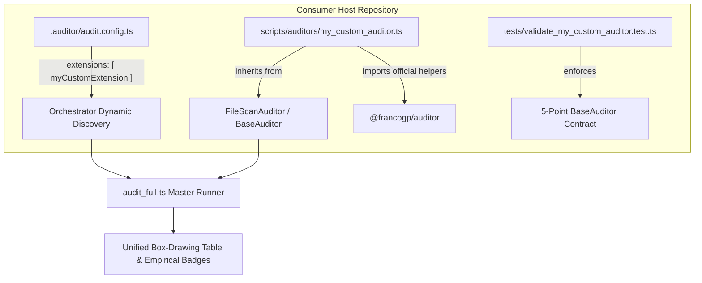

# Host Extension Helpers & Authoring Manual

This manual provides a comprehensive reference, step-by-step tutorial, and complete architectural examples for building custom host sub-auditors and extensions in consumer repositories using the official tooling and helpers provided by `@francogp/auditor`.

---

## 1. Extension Architecture Overview

Host extensions allow individual projects to enforce bespoke architectural invariants, game engine rules, design token constraints, and asset integrity standards without polluting the upstream `@francogp/auditor` framework.



### Core Invariants for Host Extensions

1. **Strict OOP Inheritance**: Every extension MUST inherit from `FileScanAuditor<TRuleId>` (for file-by-file scanning) or `BaseAuditor<TRuleId>` (for multi-file / whole-project coordinators).
2. **5-Point Conformance Contract**: Extensions must provide a corresponding Vitest test verifying:
   - Point 1: Instantiation and metadata validation via `validateAuditorConstruction(auditor)`.
   - Point 2: Clean path testing (`status === 'passed'`, `errors === 0`, `warnings === 0`).
   - Point 3: Violation detection (`status === 'failed'`, `severity === 'error'`).
   - Point 4: Warning path testing where warnings exist (`warnings > 0`).
   - Point 5: 100% of declared rule IDs tested.
3. **Description Length Ceiling**: The composite description (`${packageName}: ${ruleDescription}`) MUST NOT exceed 50 characters (`MAX_AUDITOR_DESCRIPTION_LENGTH = 50`) and contain zero newlines.
4. **Zero Homebrew Helpers & Extension Hygiene (`validate_auditor_hygiene`)**: Re-inventing path sanitizers (`.replace(/\\/g, '/')`), handcrafted Vue SFC regexes (`/<template[\s\S]*<\/template>/`), isolated `ts.createSourceFile()` calls, ad-hoc comment strippers, or reading `package.json` with `fs.readFileSync` is strictly forbidden and actively blocked by `validate_auditor_hygiene`. Host extensions must import official helpers from `@francogp/auditor`.
5. **Universal Empirical Individual Timing Mandate**: Extensions MUST measure 100% of declared rules individually using `this.runSubAuditorSync(ruleId, () => ...)` or `await this.runSubAuditor(ruleId, async () => ...)`. Duplicate batch duration stamping across rules, synthetic time divisions, and fake `(0 ms)` badges are strictly prohibited. Redundant calls to `this.markRuleEvaluated(ruleId)` are forbidden because `runSubAuditorSync` marks the rule evaluated automatically. Transparent inapplicability (`this.markRuleNotApplicable`) MUST also be wrapped inside `runSubAuditorSync` to record `<0,1 ms` badges.

---

## 2. Official Framework Helpers Reference

### 2.1 Base Classes & Execution Primitives (`@francogp/auditor`)

#### `this.runSubAuditorSync(ruleId, fn)` & `this.runSubAuditor(ruleId, asyncFn)`

Mandatory execution wrappers provided by `BaseAuditor`. Measures the exact microsecond runtime of `fn` using `performance.now()`, records the empirical duration in the superclass ledger (`durationsByRule`), and automatically marks `ruleId` as evaluated:

```typescript
// Synchronous evaluation inside scanFile or runAudit:
this.runSubAuditorSync('my-rule-id', () => {
  // Logic evaluating my-rule-id exclusively
});

// Asynchronous evaluation:
await this.runSubAuditor('my-async-rule', async () => {
  // Async logic evaluating my-async-rule exclusively
});
```

#### `FileScanAuditor<TRuleId extends string>`

Specialized base class for scanning individual files. Handles automatic directory collection, gitignore filtering, test file exemptions, AST context resolution, and coverage ledger tracking.

```typescript
import { FileScanAuditor, createUniformRuleCapabilities } from '@francogp/auditor';

export const MY_RULES = ['my-rule-id'] as const;
export type MyRuleId = (typeof MY_RULES)[number];

export class MyAuditor extends FileScanAuditor<MyRuleId> {
  constructor(roots?: readonly string[], projectRoot?: string) {
    super({
      id: 'validate_my_rules',
      name: 'My Custom Invariants',
      description: 'Enforces project-specific constraints',
      family: 'architecture',
      packageName: 'Custom',
      icon: '🛡️',
      configKey: 'paths',
      roots: roots ?? ['src'],
      allowedExtensions: new Set(['.ts', '.vue']),
      ruleIds: MY_RULES,
      ruleCapabilities: createUniformRuleCapabilities(MY_RULES, {
        fix: false,
        fixPriority: false,
        lint: true,
        md: false,
        ast: false,
        changedSince: false,
        heavy: false,
        requiresBuild: false,
        postRun: false
      }),
      ruleDescriptions: {
        'my-rule-id': 'Regla de invariant personalizado'
      }
    });
  }

  protected override scanFile(relPath: string, content: string, sourceFile?: ts.SourceFile): void {
    // Inspection logic executed per discovered file
  }
}
```

#### `this.addViolationAtMatch(params)`

Method on `FileScanAuditor` that automatically calculates line and column numbers from a match character index:

```typescript
this.addViolationAtMatch({
  ruleId: 'my-rule-id',
  filePath: relPath,
  content,
  matchIndex: match.index,
  message: 'Descriptive error message in Spanish',
  severity: 'error' // or 'warning'
});
```

---

### 2.2 Path & Predicate Helpers (`@francogp/auditor`)

```typescript
import {
  normalizePosixPath,
  toPosixRelative,
  isInsideRoot,
  isPathInside,
  matchesAnyRoot,
  isTestPath,
  isTestFileForCodeAudit,
  isExemptFile
} from '@francogp/auditor';
```

| Helper | Signature | Description |
|:---|:---|:---|
| `normalizePosixPath` | `(filePath: string) => string` | Normalizes backslashes to forward slashes and resolves relative segments deterministically (Node.js 26+). |
| `toPosixRelative` | `(target: string, from?: string) => string` | Produces relative paths with forward slashes without leading `./`. |
| `isInsideRoot` / `isPathInside` | `(target: string, root: string) => boolean` | Hardened CWE-22 path containment check preventing path traversal. |
| `matchesAnyRoot` | `(path: string, roots: readonly string[]) => boolean` | Checks if a path starts with or is contained inside any declared root directory. |
| `isTestPath` | `(filePath: string) => boolean` | Detects whether a path belongs to test, spec, mock, or integration folders. |
| `isTestFileForCodeAudit` | `(filePath: string, projectRoot?: string) => boolean` | Centralized test file checker respecting both filename conventions and configured test roots. |
| `isExemptFile` | `(relPath: string, projectRoot?: string) => boolean` | Verifies whether a file is exempted globally via `audit.config.ts`. |

---

### 2.3 Vue SFC Parsing & Scanner Utilities (`@francogp/auditor`)

```typescript
import {
  parseVueSfc,
  stripComments,
  stripCommentsAndStrings,
  scanBalancedDelimiter,
  isPositionInsideFunctionParams,
  getPackageJson
} from '@francogp/auditor';
```

| Helper | Signature | Description |
|:---|:---|:---|
| `parseVueSfc` | `(content: string) => VueSfcBlocks` | Deterministically parses Vue SFC into structured `<template>`, `<script>`, and `<style>` blocks with precise line and index coordinates. |
| `hasLineSuppression` | `(line: string, ruleId: string, lines?: readonly string[], lineIndex?: number) => boolean` | Robustly detects single-line (`// <ruleId>`) and multiline comments (`/* <ruleId> */`, `<!-- <ruleId> -->`) across Vue SFC templates, scripts, and stylesheets. |
| `stripComments` | `(code: string) => string` | Safely removes line (`//`) and block (`/* ... */`) comments while preserving string literals and line count. |
| `stripCommentsAndStrings` | `(code: string) => string` | Strips comments and string literals, replacing non-whitespace with spaces to preserve line and character offsets. |
| `scanBalancedDelimiter` | `(text: string, open: string, close: string, startIndex: number) => number` | Scans forward from an opening delimiter to locate its matching closing delimiter, handling nested pairs and string escapes. |
| `isPositionInsideFunctionParams` | `(sourceText: string, targetPos: number) => boolean` | Determines if a source position lies inside function parameters vs the function body. |
| `getPackageJson` | `(projectRoot?: string) => Record<string, any>` | Safely reads and caches the project's root `package.json` without manual `fs.readFileSync` or `JSON.parse`. |

---

### 2.4 AST Context Helpers (`@francogp/auditor`)

#### `SharedAstContext`

High-performance cached TypeScript compiler host (`ts.SourceFile` cache):

```typescript
import { SharedAstContext } from '@francogp/auditor';

const astContext = new SharedAstContext(projectRoot);
const sourceFile = astContext.getSourceFile(absolutePath, content);
```

When authoring a `FileScanAuditor`, set `requiresAst: true` in options: the framework will automatically parse and supply `sourceFile` to `scanFile(relPath, content, sourceFile)`!

---

### 2.5 Extension Registration Helper (`@francogp/auditor/plugin`)

#### `defineAuditorExtension(definition)`

Fluent registration wrapper used in `.auditor/audit.config.ts`:

```typescript
import { defineAuditorExtension } from '@francogp/auditor/plugin';

export const customExtension = defineAuditorExtension({
  id: 'validate_custom_rules',
  name: 'Custom Domain Rules',
  family: 'architecture',
  auditorClass: ValidateCustomRulesAuditor,
  scripts: [
    {
      name: 'auditor:custom-rules',
      command: 'auditor task=validate_custom_rules',
      description: 'Run project-specific custom rule audit'
    }
  ]
});
```

---

## 3. Step-by-Step Tutorial: Creating a Host Extension

### Step 1: Create the Sub-Auditor Class

Create `scripts/auditors/validate_game_design.ts`:

```typescript
import { FileScanAuditor, BaseAuditor, createUniformRuleCapabilities } from '@francogp/auditor';
import { getAuditConfig, isExemptFile } from '@francogp/auditor';

export type GameDesignRuleId = 'game-banned-magic-speed' | 'game-missing-layer-tag';

export const GAME_DESIGN_RULES: readonly GameDesignRuleId[] = [
  'game-banned-magic-speed',
  'game-missing-layer-tag'
] as const;

export class ValidateGameDesignAuditor extends FileScanAuditor<GameDesignRuleId> {
  constructor(roots?: readonly string[], projectRoot?: string) {
    const config = getAuditConfig(projectRoot);
    super({
      id: 'validate_game_design',
      name: 'Game Design Constraints',
      description: 'Verifica constantes de físicas y tags en entidades',
      family: 'architecture',
      packageName: 'Game',
      icon: '🎮',
      configKey: 'paths',
      roots: roots ?? config.paths.srcRoots,
      allowedExtensions: new Set(['.ts', '.vue']),
      ruleIds: GAME_DESIGN_RULES,
      ruleCapabilities: createUniformRuleCapabilities(GAME_DESIGN_RULES, {
        fix: false,
        fixPriority: false,
        lint: true,
        md: false,
        ast: false,
        changedSince: false,
        heavy: false,
        requiresBuild: false,
        postRun: false
      }),
      ruleDescriptions: {
        'game-banned-magic-speed': 'Velocidad mágica sin constante',
        'game-missing-layer-tag': 'Falta tag de capa en entidad'
      }
    });
  }

  protected override scanFile(relPath: string, content: string): void {
    if (isExemptFile(relPath, this.projectRoot)) return;

    // Rule 1: game-banned-magic-speed (individually measured & marked evaluated)
    this.runSubAuditorSync('game-banned-magic-speed', () => {
      const speedRegex = /\bspeed\s*:\s*([0-9]{3,})\b/g;
      let match: RegExpExecArray | null;
      while ((match = speedRegex.exec(content)) !== null) {
        this.addViolationAtMatch({
          ruleId: 'game-banned-magic-speed',
          filePath: relPath,
          content,
          matchIndex: match.index,
          message: `Velocidad física mágica detectada (${match[1]}). Declara una constante en 'src/constants/physics.ts'.`,
          severity: 'error'
        });
      }
    });

    // Rule 2: game-missing-layer-tag (individually measured & marked evaluated)
    this.runSubAuditorSync('game-missing-layer-tag', () => {
      if (content.includes('class Entity') && !content.includes('@LayerTag')) {
        this.addViolation({
          ruleId: 'game-missing-layer-tag',
          severity: 'error',
          file: relPath,
          line: 1,
          message: 'Entidad carece de decorador @LayerTag mandatorio.'
        });
      }
    });
  }
}

await BaseAuditor.runCliIfMain(import.meta.url, new ValidateGameDesignAuditor());
```

---

### Step 2: Register in `.auditor/audit.config.ts`

```typescript
import { defineConfig } from '@francogp/auditor';
import { defineAuditorExtension } from '@francogp/auditor/plugin';
import { ValidateGameDesignAuditor } from '../scripts/auditors/validate_game_design.ts';

const gameDesignExtension = defineAuditorExtension({
  id: 'validate_game_design',
  name: 'Game Design Constraints',
  family: 'architecture',
  auditorClass: ValidateGameDesignAuditor,
  scripts: [
    {
      name: 'auditor:game-design',
      command: 'auditor task=validate_game_design',
      description: 'Audits game speed and layer constants'
    }
  ]
});

export default defineConfig({
  // ... other configs
  extensions: [gameDesignExtension]
});
```

---

### Step 3: Synchronize Package Scripts

Run the canonical fixer to automatically inject the script into `package.json`:

```bash
npm run auditor:fix
```

---

## 4. Practical Real-World Examples

### Example 1: Regex & Line Matcher (`FileScanAuditor`)

Enforces color palette governance and prohibits raw hex colors in UI component templates:

```typescript
import { FileScanAuditor, BaseAuditor, createUniformRuleCapabilities, isExemptFile } from '@francogp/auditor';

export const UI_COLOR_RULES = ['ui-banned-raw-hex-color'] as const;
export type UiColorRuleId = (typeof UI_COLOR_RULES)[number];

export class ValidateUiColorPaletteAuditor extends FileScanAuditor<UiColorRuleId> {
  constructor(roots?: readonly string[], projectRoot?: string) {
    super({
      id: 'validate_ui_color_palette',
      name: 'UI Color Palette Hygiene',
      description: 'Prohíbe colores hex directos fuera del tema',
      family: 'architecture',
      packageName: 'Palette',
      icon: '🎨',
      configKey: 'paths',
      roots: roots ?? ['src/components'],
      allowedExtensions: new Set(['.vue', '.scss']),
      ruleIds: UI_COLOR_RULES,
      ruleCapabilities: createUniformRuleCapabilities(UI_COLOR_RULES, {
        fix: false,
        fixPriority: false,
        lint: true,
        md: false,
        ast: false,
        changedSince: false,
        heavy: false,
        requiresBuild: false,
        postRun: false
      }),
      ruleDescriptions: {
        'ui-banned-raw-hex-color': 'Color hexadecimal directo prohibido'
      }
    });
  }

  protected override scanFile(relPath: string, content: string): void {
    if (isExemptFile(relPath, this.projectRoot)) return;

    this.runSubAuditorSync('ui-banned-raw-hex-color', () => {
      const hexRegex = /#(?:[0-9a-fA-F]{3}){1,2}\b/g;
      let match: RegExpExecArray | null;
      while ((match = hexRegex.exec(content)) !== null) {
        this.addViolationAtMatch({
          ruleId: 'ui-banned-raw-hex-color',
          filePath: relPath,
          content,
          matchIndex: match.index,
          message: `Color hexadecimal directo detectado: '${match[0]}'. Usa variables CSS del tema (var(--color-*)).`,
          severity: 'error'
        });
      }
    });
  }
}
```

---

### Example 2: TypeScript AST Analysis (`SharedAstContext`)

Verifies that all exported functions in domain services have explicit return type annotations using TypeScript compiler AST:

```typescript
import ts from 'typescript';
import { FileScanAuditor, BaseAuditor, createUniformRuleCapabilities, isExemptFile } from '@francogp/auditor';

export const SERVICE_RETURN_RULES = ['service-missing-explicit-return-type'] as const;
export type ServiceReturnRuleId = (typeof SERVICE_RETURN_RULES)[number];

export class ValidateServiceTypesAuditor extends FileScanAuditor<ServiceReturnRuleId> {
  constructor(roots?: readonly string[], projectRoot?: string) {
    super({
      id: 'validate_service_types',
      name: 'Service Explicit Return Types',
      description: 'Exige tipos de retorno explícitos en servicios',
      family: 'architecture',
      packageName: 'Services',
      icon: '📐',
      configKey: 'paths',
      roots: roots ?? ['src/services'],
      allowedExtensions: new Set(['.ts']),
      requiresAst: true, // Enables automatic TypeScript AST provision
      ruleIds: SERVICE_RETURN_RULES,
      ruleCapabilities: createUniformRuleCapabilities(SERVICE_RETURN_RULES, {
        fix: false,
        fixPriority: false,
        lint: true,
        md: false,
        ast: true,
        changedSince: false,
        heavy: false,
        requiresBuild: false,
        postRun: false
      }),
      ruleDescriptions: {
        'service-missing-explicit-return-type': 'Falta tipo de retorno explícito'
      }
    });
  }

  protected override scanFile(relPath: string, content: string, sourceFile?: ts.SourceFile): void {
    if (!sourceFile || isExemptFile(relPath, this.projectRoot)) return;

    this.runSubAuditorSync('service-missing-explicit-return-type', () => {
      const visit = (node: ts.Node): void => {
        if (ts.isFunctionDeclaration(node) && node.name) {
          const isExported = node.modifiers?.some(m => m.kind === ts.SyntaxKind.ExportKeyword);
          if (isExported && !node.type) {
            this.addViolationAtMatch({
              ruleId: 'service-missing-explicit-return-type',
              filePath: relPath,
              content,
              matchIndex: node.name.getStart(sourceFile),
              message: `Función exportada '${node.name.text}' carece de tipo de retorno explícito.`,
              severity: 'error'
            });
          }
        }
        ts.forEachChild(node, visit);
      };

      visit(sourceFile);
    });
  }
}
```

---

### Example 3: Standalone Multi-File Auditor (`BaseAuditor`)

Validates game assets on disk (PNG, WebP, audio) ensuring sprite atlases have corresponding manifest files:

```typescript
import nodeFs from 'node:fs';
import path from 'node:path';
import { BaseAuditor, createRuleCapabilities } from '@francogp/auditor';

export const ASSET_INTEGRITY_RULES = ['asset-missing-atlas-manifest'] as const;
export type AssetIntegrityRuleId = (typeof ASSET_INTEGRITY_RULES)[number];

export class ValidateAssetIntegrityAuditor extends BaseAuditor<AssetIntegrityRuleId> {
  constructor(projectRoot?: string) {
    super({
      id: 'validate_asset_integrity',
      name: 'Game Asset Integrity',
      description: 'Verifica presencia de manifiestos de sprites',
      family: 'architecture',
      packageName: 'Assets',
      icon: '📦',
      configKey: 'paths',
      defaultConfig: {},
      ruleCapabilities: createRuleCapabilities(ASSET_INTEGRITY_RULES, {
        fix: false,
        fixPriority: false,
        lint: true,
        md: false,
        ast: false,
        changedSince: false,
        heavy: false,
        requiresBuild: false,
        postRun: false
      }),
      ruleIds: ASSET_INTEGRITY_RULES,
      ruleDescriptions: {
        'asset-missing-atlas-manifest': 'Falta manifiesto JSON de atlas'
      },
      projectRoot
    });
  }

  public override async runAudit(): Promise<void> {
    const assetsDir = path.resolve(this.projectRoot, 'public/assets/sprites');
    if (!nodeFs.existsSync(assetsDir)) {
      this.runSubAuditorSync('asset-missing-atlas-manifest', () => {
        this.markRuleNotApplicable('asset-missing-atlas-manifest', 'Directorio public/assets/sprites no existe');
      });
      return;
    }

    this.runSubAuditorSync('asset-missing-atlas-manifest', () => {
      const files = nodeFs.readdirSync(assetsDir);
      for (const file of files) {
        if (file.endsWith('.png') && file.startsWith('atlas_')) {
          const manifest = file.replace(/\.png$/, '.json');
          const manifestPath = path.resolve(assetsDir, manifest);
          if (!nodeFs.existsSync(manifestPath)) {
            this.addViolation({
              ruleId: 'asset-missing-atlas-manifest',
              filePath: `public/assets/sprites/${file}`,
              line: 1,
              column: 1,
              message: `Atlas de sprites '${file}' no tiene manifiesto correspondiente '${manifest}'.`,
              severity: 'error'
            });
          }
        }
      }
    });
  }
}
```

---

## 5. Hermetic 5-Point Unit Test Contract

Every host extension must be tested with Vitest according to the 5-point contract:

```typescript
import { describe, it, expect, beforeEach, afterEach } from 'vitest';
import { validateAuditorConstruction } from '@francogp/auditor/contract';
import {
  ValidateGameDesignAuditor,
  GAME_DESIGN_RULES,
  type GameDesignRuleId
} from '../scripts/auditors/validate_game_design.ts';
import type { ViolationInput } from '@francogp/auditor';

class TestableGameDesignAuditor extends ValidateGameDesignAuditor {
  public readonly recordedViolations: ViolationInput<GameDesignRuleId>[] = [];

  public override addViolation(v: ViolationInput<GameDesignRuleId>): void {
    this.recordedViolations.push(v);
    super.addViolation(v);
  }

  public testScanFile(relPath: string, content: string): void {
    this.scanFile(relPath, content);
  }
}

describe('ValidateGameDesignAuditor (5-Point Contract)', () => {
  beforeEach(() => {
    process.env.AUDIT_SUBPROCESS = 'true';
  });

  afterEach(() => {
    delete process.env.AUDIT_SUBPROCESS;
  });

  // Point 1: Construction & Metadata
  it('fulfills Point 1: metadata and construction contract', () => {
    const auditor = new ValidateGameDesignAuditor();
    validateAuditorConstruction(auditor);
    expect(auditor.id).toBe('validate_game_design');
    expect(auditor.ruleIds).toEqual(GAME_DESIGN_RULES);
  });

  // Point 2: Clean Path
  it('fulfills Point 2: passes cleanly on canonical code', async () => {
    const auditor = new TestableGameDesignAuditor();
    auditor.testScanFile('src/entities/Player.ts', 'const speed = PHYSICS_PLAYER_SPEED;');
    const result = await auditor.finishAudit();
    expect(result.status).toBe('passed');
    expect(result.summary.errors).toBe(0);
    expect(auditor.recordedViolations).toHaveLength(0);
  });

  // Point 3 & 5: Violation Detection & 100% Rule ID Testing
  it('fulfills Point 3 & 5: detects game-banned-magic-speed', () => {
    const auditor = new TestableGameDesignAuditor();
    auditor.testScanFile('src/entities/Enemy.ts', 'const player = { speed: 500 };');
    const violations = auditor.recordedViolations.filter(v => v.ruleId === 'game-banned-magic-speed');
    expect(violations[0]?.severity).toBe('error');
  });

  // Empirical Timing Verification
  it('guarantees 100% of declared rules record individual empirical durations', async () => {
    const auditor = new ValidateGameDesignAuditor();
    auditor.testScanFile('src/entities/Player.ts', 'const speed = PHYSICS_PLAYER_SPEED;');
    await auditor.finishAudit();
    for (const ruleId of GAME_DESIGN_RULES) {
      expect(auditor.isRuleEvaluated(ruleId)).toBe(true);
      expect(auditor.getRuleDuration(ruleId)).toBeGreaterThanOrEqual(0);
    }
  });
});
```

---

## 6. Remote Testing & Debugging Host Extensions

When developing or upgrading `@francogp/auditor` features, you can verify host extensions across local repositories without publishing or modifying the host workspace:

```bash
# Discover all host extensions remotely:
node --experimental-strip-types src/cli/audit_full.ts --list project="../mi-juego"

# Execute a single host extension remotely:
node --experimental-strip-types src/cli/audit_full.ts --suite=validate_game_design project="../mi-juego"

# Run full audit including host extensions:
npm run auditor -- project="../mi-juego"
```

The master runner resolves the host's `.auditor/audit.config.ts`, executes extensions in their host workspace context (`process.chdir`), and renders standard Box-Drawing tables.

---

## 7. Migration Guide: Host Extensions from v6 to v7

When upgrading a host repository from `@francogp/auditor` v6.x to v7.0.0+, all host extensions in `scripts/auditors/` must be migrated to the modern **Per-Rule Capabilities Contract**.

### Breaking Change: Suite-Level `capabilities` Removed

In v6.x, sub-auditors and extensions configured aggregate suite-level capabilities directly:

```typescript
// ❌ Deprecated in v6.x — Throws [Auditor Contract Violation] in v7.0.0+:
super({
  id: 'validate_my_extension',
  capabilities: { fix: false, lint: true, ast: true }, // 💥 FORBIDDEN!
  ...
});
```

In v7.0.0+, `capabilities?: never` is enforced at the TypeScript type level and at runtime:

```text
[Auditor Contract Violation] Suite 'validate_my_extension' passed deprecated suite-level 'capabilities' to constructor options. In v7+, capabilities are derived automatically from individual ruleCapabilities.
```

### Canonical v7 Pattern: `ruleCapabilities`

In v7.0.0+, capabilities are declared on each rule individually, and the `BaseAuditor` superclass aggregates them automatically for the suite.

#### If all rules share identical capabilities

Use `createUniformRuleCapabilities(RULES, capabilities)`:

```typescript
import { FileScanAuditor, createUniformRuleCapabilities } from '@francogp/auditor';

export const MY_RULES = ['my-rule-one', 'my-rule-two'] as const;
export type MyRuleId = (typeof MY_RULES)[number];

export class MyAuditor extends FileScanAuditor<MyRuleId> {
  constructor() {
    super({
      id: 'validate_my_rules',
      ruleIds: MY_RULES,
      ruleCapabilities: createUniformRuleCapabilities(MY_RULES, {
        fix: false,
        fixPriority: false,
        lint: true,
        md: false,
        ast: false,
        changedSince: false,
        heavy: false,
        requiresBuild: false,
        postRun: false
      }),
      ...
    });
  }
}
```

#### If rules have differing capabilities (e.g., some have auto-fix)

Use `createRuleCapabilities(RULES, baseCapabilities, fixableRuleIds)`:

```typescript
import { BaseAuditor, createRuleCapabilities } from '@francogp/auditor';

export const MY_RULES = ['my-lint-only', 'my-auto-fixable'] as const;
export type MyRuleId = (typeof MY_RULES)[number];

export class MyAuditor extends BaseAuditor<MyRuleId> {
  constructor() {
    super({
      id: 'validate_my_rules',
      ruleIds: MY_RULES,
      ruleCapabilities: createRuleCapabilities(
        MY_RULES,
        {
          fix: false,
          fixPriority: false,
          lint: true,
          md: false,
          ast: false,
          changedSince: false,
          heavy: false,
          requiresBuild: false,
          postRun: false
        },
        ['my-auto-fixable'] // List of rule IDs that support --fix
      ),
      ...
    });
  }
}
```

### Post-Migration Verification

Run the test suite or execute the remote runner to verify:

```bash
# 1. Run extension unit tests:
npm test tests/validate_my_rules.test.ts

# 2. Verify coverage ledgers flush cleanly with zero missing ledger warnings:
npm run auditor -- --suite=validate_my_rules
```
