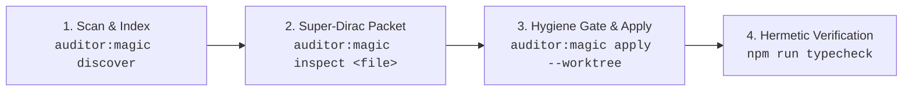

# Magic Numbers & Design Tokens Refactoring Guide

## 1. Architectural Overview & Problem Statement

Naked magic numbers and hardcoded design literals appear across 3 architectural layers:

1. **TypeScript & Vue `<script setup>` (`validate_magic_numbers`)**: Naked numbers in timers, multipliers, thresholds, coordinates (`magic-number-naked`).
2. **Constant Hygiene & Naming (`validate_constant_hygiene`)**: Uncontrolled extraction creates new regressions:
   - Suffix with numeric value (`TIMEOUT_5000` $\rightarrow$ `constant-no-literal-suffix`, `constant-bad-names`).
   - Duplicate constants across files (`duplicate-constant-identical`).
   - Banned generic names (`VALUE`, `MAX`, `DEFAULT`, `COUNT`).
3. **SCSS Stylesheets & Vue `<style lang="scss">` (`validate_scss_architecture`, `validate_z_index`)**:
   - `z-index-hardcoded-literal`: Naked numbers instead of `var(--z-modal)` bound to `Z_LAYERS`.
   - `missing-theme-token-usage`: Raw hex/rgb colors instead of design tokens (`var(--color-*)`).
   - `non-standard-spacing-unit`: Odd spacing pixels (`13px`, `17px`, `23px`).

---

## 2. The 3-Tier Zero-Token & Super-Dirac Architecture



### Tier 1: Zero-Token Deterministic Inference (~65% of cases)

The AST scanner automatically deduces the canonical semantic name from parent syntax without LLM assistance:

- **Timer Delays**: `setTimeout(fn, 1500)` in `handleAttack()` $\rightarrow$ `HANDLE_ATTACK_DELAY_MS = 1500`.
- **Object Properties**: `{ timeout: 5000 }` $\rightarrow$ `DEFAULT_TIMEOUT_MS = 5000`.
- **Binary Comparisons**: `if (stamina < 15)` $\rightarrow$ `MIN_STAMINA_THRESHOLD = 15`.
- **SSoT Token Parity**: If `z-index: 11000` exists in `Z_LAYERS` or `_base.scss` as `--z-modal`, it is mapped automatically in 0 tokens.

### Tier 2: Super-Dirac Batch Cluster Table (~35% ambiguous cases)

For ambiguous domain equations (e.g. `damage = base * 1.35 + 12`), occurrences are clustered by value and parent scope into an ultra-compact 1-line-per-cluster JSON table (~18 tokens/cluster).

- **Result**: Reduces LLM context from >16,000 tokens (reading full files) to **~800 tokens** (**83% to 95% token savings**).

### Tier 3: Pre-Flight Constant Hygiene Gate (`ConstantHygieneGate`)

Before applying any change to disk, every candidate name is sanitized:

- Automatically strips trailing numeric literals (e.g. `RETRY_DELAY_1000` $\rightarrow$ `RETRY_DELAY_MS`).
- Rejects banned generic words (`VALUE`, `NUMBER`, `COUNT`, `MAX`).
- Prevents cross-module duplication by promoting multi-file constants to a shared module.

---

## 3. The 3-Step Remediation Workflow

### Step 1: Discover Magic Literals

```bash
npm run auditor:magic discover
# Or via CLI binary
auditor-magic discover
```

Renders an 80-column Box-Drawing table breaking down occurrences per file with 0-Token vs. pending counts.

### Step 2: Inspect Super-Dirac Packet

```bash
npm run auditor:magic inspect src/features/combat/combatEngine.ts
```

Emits the compact cluster packet with line references, line snippets, and inferred candidate names.

### Step 3: Apply Refactor Plan with Worktree Sandbox

Formulate a `magic_plan.json` conforming to `magic_plan_blueprint.json` and execute:

```bash
npm run auditor:magic apply magic_plan.json --worktree
```

The `--worktree` flag automatically:

1. Spawns an isolated Git worktree in `scratch/refactor-sandbox/`.
2. Applies bottom-up surgical span replacements (`MagicString`) and hoists constants into local file headers or Vue `<script setup>`.
3. Validates the build with `npm run typecheck`.
4. Merges changes into the working tree on success, or executes an instant rollback on error.
