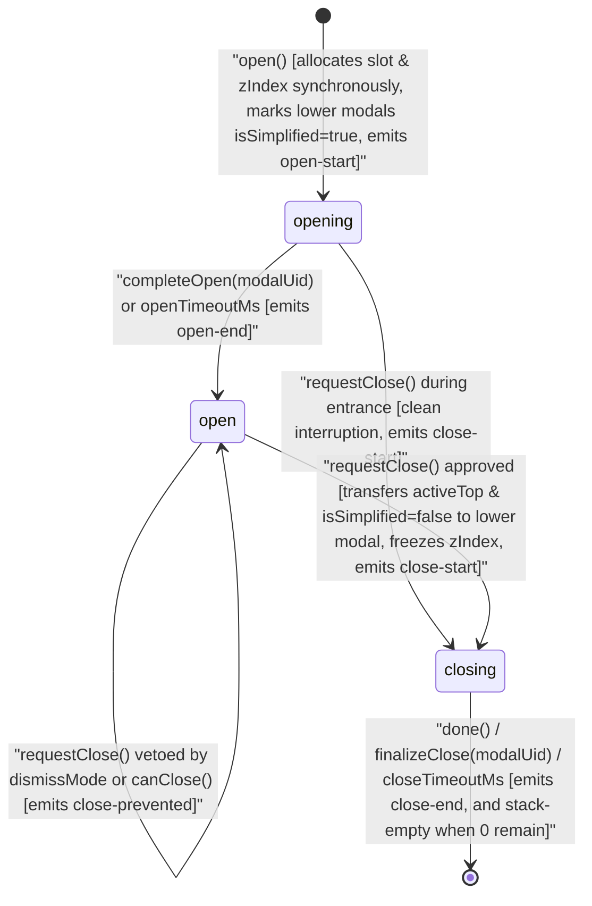
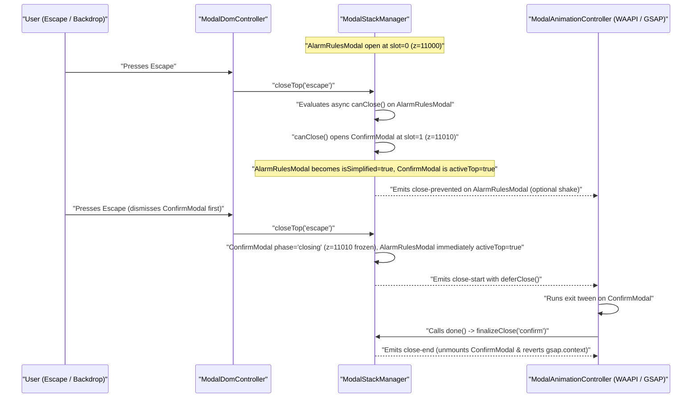
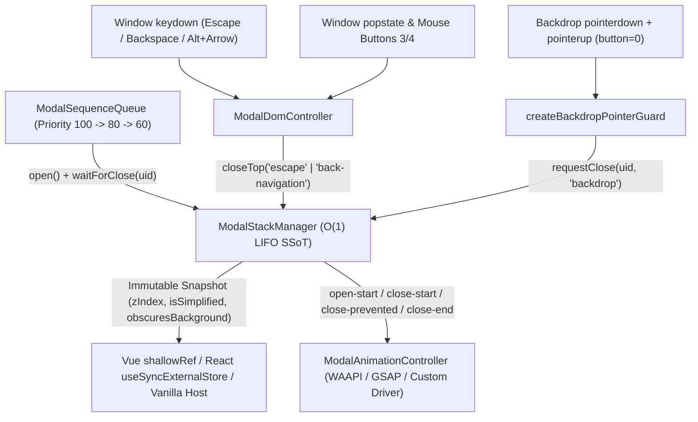

# Modal Stack, Z-Index & Animation Governance Guide (`@francogp/auditor/modals`)

## 1. Architectural Purpose & Design Principles

`@francogp/auditor/modals` is a **100% browser-safe, isomorphic, zero-dependency** runtime library exported from `@francogp/auditor`. It solves fragmented modal state, hardcoded `z-index` collisions, premature DOM unmounting during exit animations, accidental drag-release backdrop dismissals, and timer-polled modal queues across frontend applications (Vue 3 + Pinia, React, Svelte, or Vanilla TypeScript).

### Core Guarantees

1. **Zero Hardcoding of Z-Index, Styles, or Motion**:
   - `CANONICAL_Z_LAYERS` acts strictly as the **default** fallback scale (`MODAL: 11000`, `MODAL_STEP: 10`, `TOOLTIP: 15000`). Consumers can pass their own `zLayers` scale (`{ MODAL: 3000, MODAL_STEP: 20, TOOLTIP: 5000 }`), explicit `baseZIndex` / `stepZIndex` / `ceilingZIndex`, or per-modal `customZIndex` / `zIndexOffset` overrides.
   - `DEFAULT_MODAL_MOTION_PRESETS` (`'scale-fade'`, `'fade'`, `'slide-up'`, `'slide-down'`, `'slide-left'`, `'slide-right'`, `'none'`) and `resolveModalStructuralStyles` provide **overridable defaults** with zero hardcoded colors, borders, or themes.
   - Pluggable `ModalAnimationDriver` supports browser-native Web Animations API (`createWaapiModalDriver`), dependency-injected GSAP (`createGsapModalDriver`), or custom engines.
2. **Deterministic $O(1)$ LIFO Stack & Monotonic Z-Index Freeze**:
   - Unifies declarative (`<BaseModal>`) and imperative (`Confirm`, `Prompt`) dialogs in a single LIFO stack with reference-stable immutable snapshots (`getSnapshot()`).
   - Transfers `activeTop` and `isSimplified` **instantaneously** at `open-start` and `close-start`, while freezing the exiting modal's `zIndex` until `finalizeClose` (`close-end`) and resetting `nextSlot = 0` exclusively on `stack-empty`.
3. **W3C & Modern Web Light-Dismiss Safety**:
   - Single global `Escape` router (`ModalDomController`) respecting `event.defaultPrevented` and IME `event.isComposing`.
   - Two-phase backdrop pointer guard (`createBackdropPointerGuard`) requiring both `pointerdown` and `pointerup` with `button === 0` on `activeTop`'s backdrop so text-selection drags never dismiss dialogs.
   - Optional browser history / mouse side-button / non-editable `Backspace` back-navigation trap (`ModalBackNavigationConfig`).
4. **Zero-Polling Priority Sequence Queue (`ModalSequenceQueue`)**:
   - Replaces `setInterval` / `sleep(50)` loops with event-driven `stack.waitForClose(modalUid)` and `queue.waitUntilIdle()`.

---

## 2. Lifecycle State Machine & Two-Phase Animation Handshake



### Nested Dirty-Form Confirmation & Animated Exit Sequence



### DOM Event & Sequence Coordination Architecture



---

## 3. Customizing Z-Index Scales & Per-Modal Elevation

Nothing in `@francogp/auditor/modals` hardcodes `11000` if your application uses its own design-token scale.

```typescript
import {
  createModalStack,
  resolveModalZLayers,
  resolveModalCssVars
} from '@francogp/auditor/modals';

// 1. Supply your project's custom Z-Layer dictionary (merges onto CANONICAL_Z_LAYERS)
const APP_Z_LAYERS = resolveModalZLayers({
  OVERLAY: 2500,
  MODAL: 3000,
  MODAL_STEP: 20,
  TOOLTIP: 4500,
  TOAST: 5000
});

// 2. Pass zLayers (or explicit baseZIndex / stepZIndex / ceilingZIndex) to createModalStack
const modalStack = createModalStack<'Settings' | 'Confirm' | 'EmergencyAlert'>({
  zLayers: APP_Z_LAYERS,
  backdropOffset: 0,
  contentOffset: 1,
  onCeilingExceeded(diag) {
    // Diagnostic hook if deep modal nesting ever reaches TOOLTIP (4500)
    console.warn(`Modal ${diag.kind} (${diag.zIndex}) reached ceiling ${diag.ceilingZIndex}`);
  }
});

// 3. Standard monotonic allocation: z=3000, backdrop=3000, content=3001
const settings = modalStack.open({ kind: 'Settings' });
const cssVars = resolveModalCssVars(settings);
// -> { '--modal-z': '3000', '--modal-backdrop-z': '3000', '--modal-content-z': '3001' }

// 4. Optional per-modal custom elevation or relative offset when needed
modalStack.open({
  kind: 'EmergencyAlert',
  customZIndex: 4200,
  zIndexOffset: 5
});
```

---

## 4. Customizing Animations, Structural Styles & Drivers

`@francogp/auditor/modals` provides default motion presets (`'scale-fade'`, `'fade'`, `'slide-up'`, `'slide-down'`, `'slide-left'`, `'slide-right'`, `'none'`), directional placement mapping (`resolveModalPlacementMotionPreset`), and structural layout helpers (`resolveModalStructuralStyles`), all 100% overridable globally or per modal:

```typescript
import gsap from 'gsap';
import {
  ModalAnimationController,
  createGsapModalDriver,
  createModalStack,
  resolveModalPlacementMotionPreset,
  resolveModalStructuralStyles
} from '@francogp/auditor/modals';

// Global custom default motion on the stack
const stack = createModalStack<'Dialog' | 'SideDrawer'>({
  defaultMotion: {
    basePreset: 'scale-fade',
    enter: { durationSec: 0.28, ease: 'expo.out' },
    exit: { durationSec: 0.2, ease: 'power2.in' },
    prevented: { enabled: true, offsetPx: 8, durationSec: 0.25, cycles: 2 }
  }
});

// Plug in GSAP (or omit driver to use the zero-dependency browser WAAPI driver)
const animations = new ModalAnimationController({
  stack,
  driver: createGsapModalDriver(gsap)
});

// Per-modal motion override (preset name, placement helper, or custom keyframes)
const drawerEntry = stack.open({
  kind: 'SideDrawer',
  motion: {
    basePreset: resolveModalPlacementMotionPreset('side-right'),
    panelFrom: { opacity: 0, x: '100%' },
    enter: { durationSec: 0.32, ease: 'power3.out' }
  }
});

// Theme-agnostic structural layout styles with customizable CSS fallback token
const surfaceStyles = resolveModalStructuralStyles(drawerEntry, {
  justifyContent: 'flex-end',
  fallbackZIndexVar: 'var(--app-z-modal)'
});
```

---

## 5. Vue 3 + Pinia + SCSS Integration Blueprint

### Reactive Store Bridge (`shallowRef` + `ModalDomController`)

```typescript
import { computed, shallowRef } from 'vue';
import { defineStore } from 'pinia';
import {
  ModalDomController,
  createModalStack,
  type ModalOpenOptions,
  type ModalStackSnapshot
} from '@francogp/auditor/modals';

export type AppModalKind = 'Inventory' | 'Shop' | 'Profile' | 'Settings' | 'Confirm';

export interface AppModalMeta {
  readonly title?: string;
  readonly message?: string;
}

export const useModalStackStore = defineStore('modalStack', () => {
  const manager = createModalStack<AppModalKind, AppModalMeta>();
  const snapshot = shallowRef<ModalStackSnapshot<AppModalKind, AppModalMeta>>(
    manager.getSnapshot()
  );

  manager.subscribe((nextSnapshot) => {
    snapshot.value = nextSnapshot;
  });

  const domController = new ModalDomController({
    stack: manager,
    backNavigation: {
      enabled: true,
      blockMouseSideButtons: true,
      blockBrowserShortcuts: true,
      blockBackspaceOutsideInputs: true
    }
  });

  const isFastMode = computed((): boolean => snapshot.value.obscuresBackground);

  function openModal(options: ModalOpenOptions<AppModalKind, AppModalMeta>): string {
    return manager.open(options).modalUid;
  }

  async function confirmAction(title: string, message: string): Promise<boolean> {
    const entry = manager.open({
      kind: 'Confirm',
      dismissMode: 'closerequest',
      meta: { title, message }
    });
    const result = await manager.waitForClose(entry.modalUid);
    return result.reason === 'programmatic';
  }

  function disposeModalSystem(): void {
    domController.dispose();
    manager.dispose();
  }

  return {
    manager,
    snapshot,
    isFastMode,
    openModal,
    confirmAction,
    disposeModalSystem
  };
});
```

### Declarative `<BaseModal.vue>` SFC Recipe (`<script setup lang="ts">`)

```vue
<script setup lang="ts">
import { computed, onBeforeUnmount, onMounted, useTemplateRef } from 'vue';
import gsap from 'gsap';
import {
  ModalAnimationController,
  createBackdropPointerGuard,
  createGsapModalDriver,
  resolveModalCssVars,
  resolveModalDomIds,
  type ModalStackEntry
} from '@francogp/auditor/modals';
import { useModalStackStore, type AppModalKind, type AppModalMeta } from './modalStackStore';

const props = defineProps<{
  readonly entry: ModalStackEntry<AppModalKind, AppModalMeta>;
}>();

const store = useModalStackStore();
const backdropRef = useTemplateRef<HTMLElement>('backdropEl');
const panelRef = useTemplateRef<HTMLElement>('panelEl');

const domIds = computed(() => resolveModalDomIds(props.entry.modalUid));
const cssVars = computed(() => resolveModalCssVars(props.entry));

const backdropGuard = createBackdropPointerGuard({
  stack: store.manager,
  getModalUid: () => props.entry.modalUid
});

const animController = new ModalAnimationController({
  stack: store.manager,
  driver: createGsapModalDriver(gsap)
});

let unbindSurface: (() => void) | null = null;

onMounted(() => {
  unbindSurface = animController.bindSurface(props.entry.modalUid, {
    container: backdropRef.value,
    backdrop: backdropRef.value,
    panel: panelRef.value
  });
});

onBeforeUnmount(() => {
  unbindSurface?.();
  animController.dispose();
});
</script>

<template>
  <div
    :id="domIds.modalId"
    ref="backdropEl"
    class="app-modal-backdrop"
    :class="{
      'is-closing': entry.phase === 'closing',
      'is-simplified': entry.isSimplified
    }"
    :style="cssVars"
    role="dialog"
    aria-modal="true"
    :aria-labelledby="domIds.titleId"
    :aria-describedby="domIds.bodyId"
    @pointerdown="backdropGuard.onPointerDown"
    @pointerup="backdropGuard.onPointerUp"
    @pointercancel="backdropGuard.onPointerCancel"
  >
    <div ref="panelEl" class="app-modal-panel">
      <header class="app-modal-header">
        <h2 :id="domIds.titleId">{{ entry.meta?.title ?? entry.kind }}</h2>
        <button
          :id="domIds.closeButtonId"
          type="button"
          aria-label="Close modal"
          @click="store.manager.requestClose(entry.modalUid, 'close-button')"
        >
          ×
        </button>
      </header>
      <div :id="domIds.bodyId" class="app-modal-body">
        <slot :is-simplified="entry.isSimplified" />
      </div>
    </div>
  </div>
</template>
```

### Canonical SCSS Consumption (100% Compliant with `validate_z_index` & Stylelint)

Bind `resolveModalCssVars(entry)` to the modal root element and reference CSS custom properties in SCSS with zero numeric literals:

```scss
.app-modal-backdrop {
  position: fixed;
  inset: 0;
  display: flex;
  align-items: center;
  justify-content: center;
  overscroll-behavior: contain;
  z-index: var(--modal-backdrop-z, var(--z-modal));

  &.is-closing {
    pointer-events: none;
  }

  &.is-simplified {
    backdrop-filter: none;
  }
}

.app-modal-panel {
  position: relative;
  z-index: var(--modal-content-z, var(--z-modal));
  max-block-size: 90dvh;
  overflow-y: auto;
  overscroll-behavior: contain;
}
```

---

## 6. Priority-Ordered Modal Sequences (`ModalSequenceQueue`)

When domain workflows (such as post-battle rewards, onboarding steps, or multi-stage wizards) must display several modals strictly one after another ordered by priority without `setInterval` polling:

```typescript
import { createModalSequenceQueue, createModalStack } from '@francogp/auditor/modals';

type RewardStepKind = 'move_learning' | 'evolution' | 'event_auto_enroll';

const stack = createModalStack<RewardStepKind>({ animatedClose: false });
const rewardQueue = createModalSequenceQueue<RewardStepKind, { readonly stack: typeof stack }>();

rewardQueue.enqueue({
  taskUid: 'enroll-1',
  kind: 'event_auto_enroll',
  priority: 60,
  async execute(ctx): Promise<void> {
    const entry = ctx.stack.open({ kind: 'event_auto_enroll' });
    await ctx.stack.waitForClose(entry.modalUid);
  }
});

rewardQueue.enqueue({
  taskUid: 'learn-1',
  kind: 'move_learning',
  priority: 100,
  async execute(ctx): Promise<void> {
    const entry = ctx.stack.open({ kind: 'move_learning' });
    await ctx.stack.waitForClose(entry.modalUid);
  }
});

// Executes move_learning (100) -> waits for user close -> executes event_auto_enroll (60)
await rewardQueue.runSequence({ stack });

// Secondary flows can await completion with zero polling before opening their own UI
await rewardQueue.waitUntilIdle();
```
