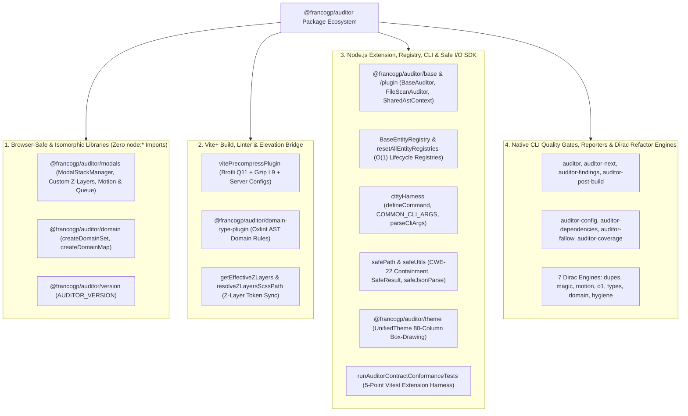
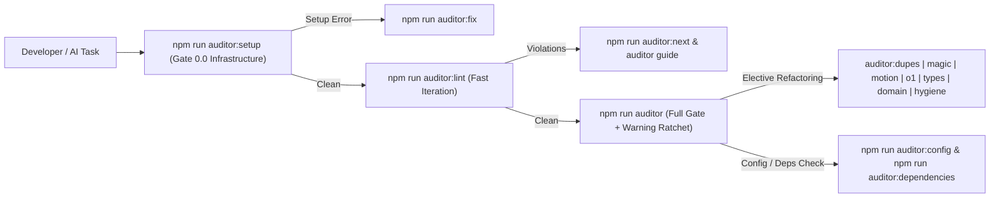

# Provided Libraries, Subpath SDKs & Consumer Tooling Catalog

`@francogp/auditor` is not merely a static linter—it is a comprehensive architectural platform that provides **reusable runtime libraries, Vite+/Oxlint build plugins, typed registries, Citty CLI harnesses, safe filesystem/path primitives, conformance test runners, and 35 native CLI tools** to every consumer project.

> [!IMPORTANT]
> **AI Agent Reuse Mandate**: Before implementing custom modal stacks, manual `z-index` counters, untyped `Set<string>` casts, custom Brotli/Gzip build scripts, `process.argv` parsers, CWE-22 path checks, or custom refactoring scripts, AI agents and developers **MUST** import the canonical primitives exported by `@francogp/auditor`.

---

## 1. Ecosystem Architecture Overview



---

## 2. Subpath Exports Compatibility Matrix (`package.json#exports`)

| Import Path | Runtime Environment | Primary Exports | Typical Consumer Usage |
| :--- | :--- | :--- | :--- |
| `@francogp/auditor/modals` | Browser, SSR, Web Worker, Node | `createModalStack`, `ModalStackManager`, `ModalDomController`, `createBackdropPointerGuard`, `ModalSequenceQueue`, `ModalAnimationController`, `createWaapiModalDriver`, `createGsapModalDriver`, `resolveModalZLayers`, `resolveModalCssVars`, `resolveModalDomIds`, `resolveModalMotionPreset`, `resolveModalStructuralStyles` | Frontend LIFO modal stack, customizable `z-index` governance, customizable motion presets, safe light-dismiss, and priority modal sequences. |
| `@francogp/auditor/domain` | Browser, SSR, Web Worker, Node | `createDomainSet`, `createDomainMap`, `DomainSet` | Compile-time narrowed `ReadonlySet` / `ReadonlyMap` with `has(x: unknown): x is T` type guard and zero `as string` casts. |
| `@francogp/auditor/version` | Browser, SSR, Node | `AUDITOR_VERSION`, `AUDITOR_SEMVER` | Runtime telemetry and package stamp verification. |
| `@francogp/auditor/domain-type-plugin` | Vite+ / Oxlint | Default Oxlint JS plugin | Enforces `/domain-type-first`, security, and query rules inside `vite.config.ts`. |
| `@francogp/auditor/config` | Node (`.auditor/audit.config.ts`) | `defineAuditConfig`, `AuditEngineConfig` | Strongly typed Single Source of Truth configuration authoring. |
| `@francogp/auditor/base` | Node (Custom Sub-Auditors) | `BaseAuditor`, `FileScanAuditor`, `createRuleCapabilities`, `resolveFileScanRoots` | Authoring domain-specific static analysis suites in host projects. |
| `@francogp/auditor/plugin` | Node (Custom Extensions) | `defineAuditorExtension` | Registering custom host sub-auditors cleanly with `.auditor/audit.config.ts`. |
| `@francogp/auditor/contract` | Node / Tooling | `AuditViolation`, `AuditSuiteResult`, `AuditRunMetadata`, `AuditorManifest` | Consuming structured audit reports and rule metadata. |
| `@francogp/auditor/theme` | Node CLI | `UnifiedTheme`, `renderBoxTable`, `stringWidth`, `padVisual` | 80-column Unicode-aligned Box-Drawing terminal tables and banners. |
| `@francogp/auditor` | Node (Full SDK Barrel) | All of the above + `vitePrecompressPlugin`, `BaseEntityRegistry`, `COMMON_CLI_ARGS`, `safeResolve`, `tryCatchSync`, `parseVueSfc`, `runAuditorContractConformanceTests` | Build plugins (`vite.plugins.ts`), Node backend/CLI scripts, and Vitest suites. |

---

## 3. Detailed Guide & Examples for Provided Libraries

### 3.1 Stackable Modals, Customizable Z-Index & Animation Coordinator (`@francogp/auditor/modals`)

Provides deterministic LIFO modal stacking, customizable Z-layer scales with extra domain keys (`resolveModalZLayers`), singleton discrimination (`tryOpen`), reactive in-place entry updates (`updateEntry`, `bindSurface(..., { motion, patch })`), LIFO kind closing (`closeLatestByKind`, `getLatestByKind`), injectable timer drivers (`timerDriver`), instant `activeTop` / `isSimplified` transitions, fast-mode `obscuresBackground` tracking, customizable motion presets (`DEFAULT_MODAL_MOTION_PRESETS`, `ModalAnimationController`), two-step backdrop pointer guards, non-destructive Vue Router-safe history back-navigation traps (`onUnhandledPopState`), and zero-polling `ModalSequenceQueue`.

```typescript
import {
  ModalAnimationController,
  ModalDomController,
  createBackdropPointerGuard,
  createModalStack,
  resolveModalStructuralStyles
} from '@francogp/auditor/modals';

const stack = createModalStack<'AlarmRules' | 'Confirm'>({
  zLayers: { MODAL: 11000, MODAL_STEP: 10, TOOLTIP: 15000 },
  defaultMotion: 'scale-fade'
});

const dom = new ModalDomController({ stack });
const anim = new ModalAnimationController({ stack });

const entry = stack.open({
  kind: 'AlarmRules',
  dismissMode: 'closerequest'
});

const styles = resolveModalStructuralStyles(entry);
const backdropGuard = createBackdropPointerGuard({
  stack,
  getModalUid: () => entry.modalUid
});
```

See the dedicated specification: [modal-stack-governance-guide.md](./modal-stack-governance-guide.md).

---

### 3.2 Domain-Type-First Collections (`@francogp/auditor/domain`)

Eliminates `new Set<string>([...])` and manual `as MyUnion` type assertions in both browser frontend code and Node.js backend code:

```typescript
import { createDomainMap, createDomainSet } from '@francogp/auditor/domain';

export const ORDER_STATUSES = ['draft', 'paid', 'shipped', 'cancelled'] as const;
export type OrderStatus = (typeof ORDER_STATUSES)[number];

export const TERMINAL_ORDER_STATUSES = createDomainSet(['shipped', 'cancelled'] as const);

export const ORDER_STATUS_LABELS = createDomainMap([
  ['draft', 'Draft Order'],
  ['paid', 'Payment Confirmed'],
  ['shipped', 'In Transit'],
  ['cancelled', 'Cancelled']
] as const);

export function canCancelOrder(rawStatus: string): boolean {
  // TERMINAL_ORDER_STATUSES.has() narrows `rawStatus` to `'shipped' | 'cancelled'`!
  if (TERMINAL_ORDER_STATUSES.has(rawStatus)) {
    return false;
  }
  return rawStatus === 'draft' || rawStatus === 'paid';
}
```

---

### 3.3 Strongly Typed $O(1)$ In-Memory Registries (`BaseEntityRegistry`)

Standardizes keyed in-memory catalogs with hermetic test reset (`resetAllEntityRegistries()`):

```typescript
import { BaseEntityRegistry, resetAllEntityRegistries } from '@francogp/auditor';

interface WebhookHandler {
  readonly eventId: string;
  handle(payload: string): Promise<void>;
}

export const WebhookRegistry = new BaseEntityRegistry<WebhookHandler>(
  (item) => item.eventId
);

// In Vitest afterEach():
resetAllEntityRegistries();
```

---

### 3.4 Vite+ Static Asset Precompression (`vitePrecompressPlugin` in `vite.plugins.ts`)

Generates companion `.br` (Brotli Quality 11) and `.gz` (Gzip Level 9) production bundles using native `node:zlib` and optionally scaffolds static-serving snippets for Nginx, Apache, or Caddy:

```typescript
// vite.plugins.ts (100% developer/AI-owned module)
import vue from '@vitejs/plugin-vue';
import { vitePrecompressPlugin } from '@francogp/auditor';
import type { PluginOption } from 'vite-plus';

export const plugins: PluginOption[] = [
  vue(),
  vitePrecompressPlugin({
    enabled: true,
    brotli: true,
    gzip: true,
    thresholdBytes: 512,
    serverConfigs: ['nginx', 'caddy'],
    report: 'summary'
  })
];
```

---

### 3.5 Declarative Citty CLI Harness (`cittyHarness`)

All maintenance and operational scripts in consumer projects (configured via `paths.cliRoots`) must use the Citty harness rather than reading `process.argv` directly:

```typescript
import {
  COMMON_CLI_ARGS,
  defineCommand,
  isMainModule,
  runNormalizedMain
} from '@francogp/auditor';

export const syncCatalogCommand = defineCommand({
  meta: {
    name: 'sync-catalog',
    description: 'Synchronizes static domain catalogs deterministically'
  },
  args: {
    ...COMMON_CLI_ARGS,
    dryRun: {
      type: 'boolean',
      description: 'Preview mutations without writing files',
      default: false
    }
  },
  run({ args }): void {
    if (args.dryRun) {
      process.stdout.write(`Dry-run catalog sync on ${args.project}\n`);
    }
  }
});

if (isMainModule(import.meta.url)) {
  await runNormalizedMain(syncCatalogCommand);
}
```

---

### 3.6 Security-Hardened Path & Safe Execution Utilities (`safePath` & `safeUtils`)

Prevents CWE-22 path traversal vulnerabilities, cross-OS slash drift, and silent `try { ... } catch {}` blocks:

```typescript
import {
  isPathContained,
  normalizePosixPath,
  safeJsonParse,
  safeReadFileSync,
  safeResolve,
  toPosixRelative,
  tryCatchSync
} from '@francogp/auditor';

const configPath = safeResolve('config', 'settings.json');
const rawContent = safeReadFileSync(configPath);

if (rawContent !== null) {
  const parsed = safeJsonParse<{ readonly retries: number }>(rawContent);
  if (parsed.ok) {
    const rel = toPosixRelative(process.cwd(), configPath);
    const insideConfig = isPathContained(normalizePosixPath(rel), 'config');
    if (insideConfig) {
      tryCatchSync(() => parsed.value.retries);
    }
  }
}
```

---

### 3.7 Custom Host Sub-Auditors, AST Caching & 5-Point Conformance Testing

Host projects can author custom domain rules using `FileScanAuditor` / `BaseAuditor`, `SharedAstContext`, `WorkspaceFileCache`, and `parseVueSfc`, then verify 100% contract compliance in Vitest with `runAuditorContractConformanceTests`:

```typescript
// Host extension conformance suite (e.g. all_auditors_contract_conformance.test.ts)
import { describe, it, expect, beforeAll, afterAll } from 'vite-plus/test';
import { runAuditorContractConformanceTests } from '@francogp/auditor';

runAuditorContractConformanceTests({
  vitest: { describe, it, expect, beforeAll, afterAll }
});
```

---

### 3.8 Z-Layers Token Bridge (`getEffectiveZLayers` & `resolveZLayersScssPath`) & Terminal Box-Drawing (`@francogp/auditor/theme`)

Host build scripts and custom sub-auditors can resolve project-specific Z-layer scales and render 80-column Box-Drawing tables:

```typescript
import { getEffectiveZLayers, resolveZLayersScssPath } from '@francogp/auditor';
import { renderBoxTable, stringWidth } from '@francogp/auditor/theme';

const projectLayers = getEffectiveZLayers(process.cwd());
const scssPath = resolveZLayersScssPath(process.cwd());

const tableOutput = renderBoxTable(
  [
    { header: 'LAYER TOKEN', width: 24, key: 'token' },
    { header: 'Z-INDEX', width: 14, align: 'right', key: 'value' }
  ],
  Object.entries(projectLayers).map(([token, value]) => ({
    token,
    value: String(value)
  }))
);

if (scssPath !== undefined && stringWidth(scssPath) > 0) {
  process.stdout.write(`${tableOutput}\n`);
}
```

---

## 4. Complete 35-Binary Native CLI Ecosystem (`package.json#bin`)

| Binary Command | Category | Purpose |
| :--- | :--- | :--- |
| `auditor` | Core CI Gate | Master multi-worker audit runner (`speed=light\|heavy\|full`, `fix`, `guide <id>`, `info`, `list`). |
| `auditor-post-build` | Core CI Gate | Post-build verification against compiled `dist/` artifacts (`phase=post-build`). |
| `auditor-build-deploy` | Deployment | Production deployment build runner (`AUDITOR_ENV=production`). |
| `auditor-next` | Diagnostics | Isolates findings in the earliest active strategic phase (`setup` -> `polish`). |
| `auditor-findings` | Diagnostics | Interactive multi-dimensional query engine over `scratch/audits/latest_audit.json`. |
| `auditor-errors` | Diagnostics | Filters active findings strictly to blocking `severity=error` items. |
| `auditor-warnings` | Diagnostics | Filters active findings strictly to `severity=warning` items. |
| `auditor-summary` | Diagnostics | Compact executive breakdown of audit results and suite status. |
| `auditor-rules` | Diagnostics | Consolidated Box-Drawing breakdown grouped by `ruleId`. |
| `auditor-by-rule` | Diagnostics | Alias for `auditor-rules`. |
| `auditor-by-file` | Diagnostics | Hierarchical file-tree report ordered by line number ascending. |
| `auditor-guide` | Diagnostics | Renders canonical remediation manuals (`auditor guide <ruleId\|suiteId>`). |
| `auditor-guard` | Pre-Flight | Inspects architectural boundaries and active policies for target files. |
| `auditor-config` | Advisor | Unidirectional Config Ratchet hardening advisor (`diff`, `apply`, `human`). |
| `auditor-dependencies` | Advisor | Audits shared package version floors and outputs grouped `npm install` upgrade commands. |
| `auditor-fallow` | Intelligence | Fallow codebase intelligence reporter (`dupes`, `architecture`, `shared-state`, `mutation`, `doctor`). |
| `auditor-complexity` | Intelligence | Code complexity hotspots and Fallow refactoring target rankings. |
| `auditor-similar` | Intelligence | Semantic function clone detection powered by vector embeddings. |
| `auditor-review` | Intelligence | Graph-grounded architectural review brief for changed code. |
| `auditor-css` | Intelligence | Stylelint and SCSS hygiene diagnostic reporter. |
| `auditor-flags` | Intelligence | Feature flag discovery and retirement candidate report. |
| `auditor-test-coverage` | Coverage | Istanbul/V8 test coverage analyzer and hotspot correlator. |
| `auditor-coverage` | Coverage | Alias for `auditor-test-coverage`. |
| `auditor-coverage-map` | Coverage | Static audit suite file-coverage mapper across workspace directories. |
| `auditor-dupes` | Dirac Refactor | Clone discovery, Dirac micro-context extraction, and `--worktree` refactoring engine. |
| `auditor-magic` | Dirac Refactor | Magic numbers Super-Dirac clustering and design-token extraction engine. |
| `auditor-motion` | Dirac Refactor | UI animation, timer, and GPU transform refactoring engine. |
| `auditor-o1` | Dirac Refactor | Linear-to-$O(1)$ `Set`/`Map` and `structuredClone` refactoring engine. |
| `auditor-types` | Dirac Refactor | Type assertion, double-cast, and explicit return-contract refactoring engine. |
| `auditor-domain` | Dirac Refactor | Frozen catalog, union derivation, and nominal branded ID refactoring engine. |
| `auditor-hygiene` | Dirac Refactor | Member accessibility, `globalThis`, and `void` expression refactoring engine. |
| `auditor-version` | Lifecycle | SemVer diff analyzer (`analyze`), deterministic version bumper (`bump`), and stamp verifier. |
| `auditor-update` | Lifecycle | Pulls upstream `@francogp/auditor` tags, syncs skills/scripts, and runs `auditor fix`. |
| `auditor-init` | Bootstrap | Initializes a zero-defect Vite+ repository with `.auditor/audit.config.ts` and `AGENTS.md`. |
| `auditor-init-agent` | Bootstrap | Registers `@francogp/auditor` in `.agents/plugins.json` (+ `auditor-sync-env`, `auditor-check-env`, `auditor-setup-env`). |

---

## 5. Operational CLI Workflow Decision Graph


