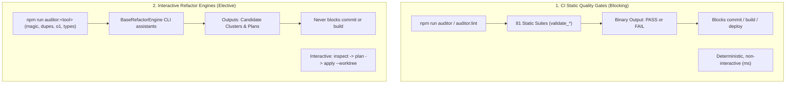
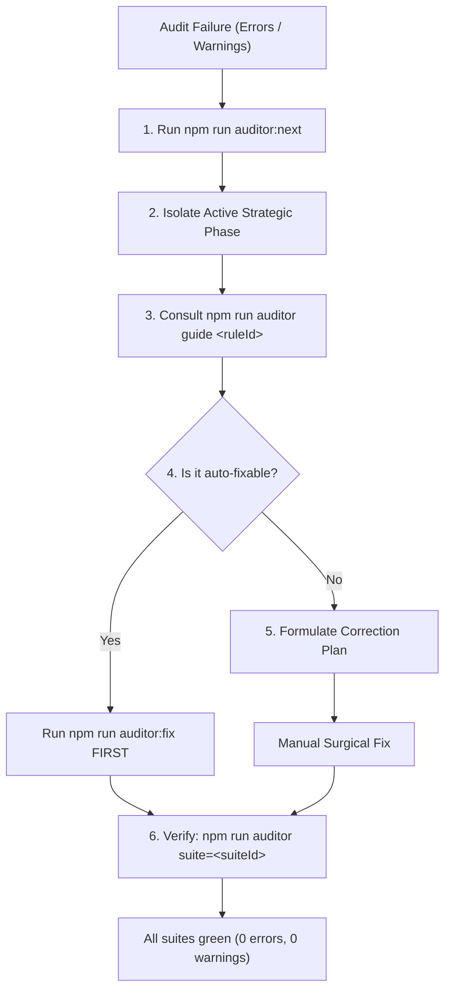
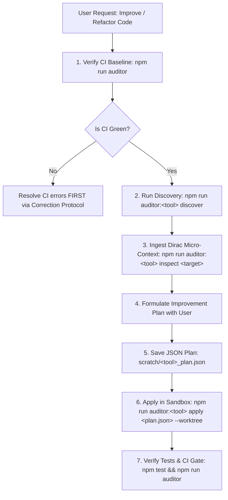

# CI Quality Gates vs. Interactive Refactor Engines

This guide defines the architectural dichotomy between **CI Static Verification Quality Gates** (`npm run auditor`) and **Interactive Code Refactoring Engines** (`auditor-magic`, `auditor-dupes`, `auditor-o1`, `auditor-types`, `auditor-motion`, `auditor-domain`, `auditor-hygiene`), providing agent reaction protocols, decision trees, plan templates, and tutorials.

---

## 1. The Core Architectural Dichotomy

The `@francogp/auditor` ecosystem is strictly partitioned into two separate tool tiers with fundamentally different purposes:



### Direct Comparison Matrix

| Property | CI Static Quality Gates (`auditor`) | Interactive Refactor Engines (`auditor:<tool>`) |
| :--- | :--- | :--- |
| **Primary Binaries** | `auditor`, `auditor-findings`, `auditor-fallow` | `auditor-magic`, `auditor-dupes`, `auditor-o1`, `auditor-types`, `auditor-motion`, `auditor-domain`, `auditor-hygiene` |
| **Package Scripts** | `npm run auditor`, `auditor:lint`, `auditor:full`, `auditor:next` | `npm run auditor:magic`, `auditor:dupes`, `auditor:o1`, `auditor:motion`, `auditor:types`, `auditor:domain`, `auditor:hygiene` |
| **Base Abstraction** | `BaseAuditor`, `FileScanAuditor` | `BaseRefactorEngine<TFinding, TPlan>` |
| **Purpose** | Enforces mandatory repository laws and invariants | Assists developers in elective code surgery and modernization |
| **Execution Trigger** | Automatic in CI/CD, pre-commit, and safe-commit gates | On-demand explicit invocation by developer or AI agent |
| **Run in `npm run auditor`?** | **YES** (runs 100% of applicable suites) | **NEVER** (strictly separate standalone CLI tools) |
| **Commit Blocking?** | **YES**: Errors block build, safe-commit, and deploy | **NO**: Opportunities and proposals never block CI |
| **Resolution Mode** | `npm run auditor:fix` (auto) or surgical manual fix | Declarative JSON plans applied via `--worktree` |

> [!IMPORTANT]
> **The Golden Rule for AI Agents**:
> Running `npm run auditor` (or `auditor:lint`, `auditor:full`) **NEVER** runs interactive refactoring tools like `auditor:magic`, `auditor:dupes`, `auditor:o1`, `auditor:types`, `auditor:motion`, `auditor:domain`, or `auditor:hygiene`.
> If `npm run auditor` passes with **0 errors and 0 warnings**, the codebase is 100% clean and healthy for commit. Discovering candidates in `auditor:magic` does NOT mean the project is broken or has hidden debt.

---

## 2. The "100% Green CI vs. Candidates Discovered" Paradox

### Why does `validate_magic_numbers` pass while `auditor:magic` finds candidates?

A frequent source of agent confusion is running `npm run auditor` (0 errors) and subsequently running `npm run auditor:magic` and seeing 50+ candidates. This is intentional:

1. **`validate_magic_numbers` (CI Suite)**:
   - Scans **TypeScript business logic** (`src/engine/`, `src/logic/`, `src/server/`).
   - Flags naked numeric literals in domain formulas, multipliers, or timers (e.g. `const dmg = base * 1.5432;`).
   - Standard numbers (`0`, `1`, `-1`, `100`, sentinel constants) and UI styling pixels are exempt.
   - When all business formulas use constants, it reports **0 errors (GREEN)**.

2. **`auditor:magic` (Interactive Refactor Engine)**:
   - Scans **CSS/SCSS stylesheets and Vue SFC `<style>` blocks** for visual literals.
   - Detects hex colors (`#d4a34b`, `#252e40`) and custom dimensions (`border: 1.5px solid`).
   - These are **100% valid and working CSS**; they are NOT bugs.
   - The tool lists them as candidates so the designer or developer can optionally extract them into global SCSS design tokens (e.g. `$color-gold: #d4a34b`).

If `npm run auditor` failed because of every hex color in a component stylesheet, **no developer could ever commit code** without extracting every single pixel and color into a global design token.

---

## 3. Reaction Protocol: When Errors Occur (CI Quality Gates)

When `npm run auditor` or `npm run auditor:findings` reports violations, agents MUST follow the **Correction Protocol**:



### Step-by-Step Triage

1. **Isolate Strategic Phase**: Run `npm run auditor:next` (or `npm run auditor:findings -- phase=next`). Always remediate the earliest active phase (`setup` -> `prune` -> `dedup` -> `contracts` -> `behavior` -> `hygiene` -> `polish`).
2. **Consult Canonical Guide**: Run `npm run auditor guide <ruleId>` to read the Root Cause, Diagnosis, and Canonical Solution.
3. **Auto-Fix First Mandate**: If findings are marked `(N auto-fixable)`, execute `npm run auditor:fix` BEFORE touching any file manually.
4. **Formulate a Correction Plan**: If manual code edits are required, create a structured **Correction Plan** (see template below).
5. **Hermetic Verification**: Verify the fixed suite in isolation (`npm run auditor -- suite=<suiteId>`), then verify the full gate (`npm run auditor`).

---

## 4. Reaction Protocol: When Improvements are Requested (Refactor Engines)

When the user asks to optimize, deduplicate, modernize, or clean up code (*"revisa si hay mejoras"*, *"limpiar números mágicos"*, *"deduplicar código"*), agents MUST follow the **Enhancement Protocol**:



### Step-by-Step Refactoring

1. **Baseline Invariant**: Never start an elective refactor on a red CI baseline. Always confirm `npm run auditor` passes first.
2. **Discovery & Dirac Inspection**: Run `npm run auditor:<tool> discover` to identify candidate files. Run `inspect <file>` to obtain the Dirac Micro-Context. **NEVER load full source files into context**; use the compact Dirac packet.
3. **Collaborative Naming**: Present candidate tokens/constants to the user with clear semantic proposals.
4. **Formulate an Improvement Plan**: Create a structured **Improvement Plan** (see template below).
5. **Worktree Sandbox Execution**: Apply the generated declarative JSON plan using `--worktree`. The refactor engine applies changes in an isolated Git worktree, runs `vp check` / `vp test`, and merges only upon 100% verification.

---

## 5. Correction Plan vs. Improvement Plan Templates

### Template A: Correction / Remediation Plan (CI Errors)

Use this format when formulating a plan to resolve CI audit failures:

```markdown
# Correction Plan: [Suite Name / Rule Id]

## 1. Diagnosis & Strategic Phase
- **Active Phase (`auditor:next`)**: [setup | prune | dedup | contracts | behavior | hygiene | polish]
- **Affected Suite**: `[suite_id]`
- **Failing Rules**: `[rule-id-1]`, `[rule-id-2]`
- **Root Cause**: [Concise explanation extracted from `auditor guide <ruleId>`]

## 2. Affected Files & Planned Modifications
| File | Rule | Diagnosis | Canonical Solution |
| :--- | :--- | :--- | :--- |
| `src/.../file.ts:L45` | `rule-id` | [Exact violation message] | [Specific patch] |

## 3. Remediation Strategy
1. **Pre-flight Auto-Fix**: Run `npm run auditor:fix` (if auto-fixable rules exist).
2. **Surgical Manual Edits**:
   - Modify `src/.../file.ts` to [exact replacement].
3. **Contract Preservation**: Zero use of `// *-ok:` escape hatches and zero configuration relaxation.

## 4. Verification Plan
1. Isolated suite verification: `npm run auditor -- suite=[suite_id]`
2. Full quality gate: `npm run auditor`
3. Regression tests: `npm test`
```

---

### Template B: Improvement / Refactoring Plan (Elective Enhancements)

Use this format when formulating an elective modernization, token extraction, or clone removal plan:

````markdown
# Improvement Plan: [Design Tokens / Deduplication / O(1) Optimization]

## 1. Scope & Motivation
- **Tool**: `[auditor-magic | auditor-dupes | auditor-o1 | auditor-types | auditor-motion]`
- **Objective**: [Extract color tokens to SCSS variables / Eliminate semantic clones / Migrate Map to O(1)]
- **Pre-flight CI Baseline**: 100% Green (0 errors, 0 warnings).

## 2. Candidate Catalog (Dirac Micro-Context)
| Cluster ID | Location | Current Value | Role / Type | Proposed Semantic Name |
| :--- | :--- | :--- | :--- | :--- |
| `G1` | `src/.../Component.vue:L297` | `#d4a34b` | `color-token` | `$color-gold-border` |
| `G2` | `src/.../Component.vue:L306` | `#485460` | `color-token` | `$color-slate-muted` |

## 3. Estimated Architectural Gain
- **LLM tokens saved**: [85%+]
- **Duplication eliminated / Unified tokens**: [N tokens]
- **Runtime impact**: 0 regressions (verified via AST).

## 4. Declarative Plan Structure (`scratch/[tool]_plan.json`)

```json
{
  "version": 1,
  "planId": "magic-plan-[timestamp]",
  "targetFiles": ["src/.../Component.vue"],
  "declarations": [
    {
      "name": "$color-gold-border",
      "value": "#d4a34b",
      "targetLocation": "src/styles/_tokens.scss",
      "isExported": true
    }
  ],
  "fileReplacements": {
    "src/.../Component.vue": [
      {
        "startOffset": 21405,
        "endOffset": 21412,
        "replacement": "$color-gold-border",
        "originalSnippet": "#d4a34b"
      }
    ]
  }
}
```

## 5. Execution & Verification in Sandbox

1. Save the plan to `scratch/[tool]_plan.json`.
2. Apply inside isolated worktree:
   `npm run auditor:[tool] apply scratch/[tool]_plan.json --worktree`
3. Verify test suite passes: `npm test`.
4. Verify auditor remains 100% green: `npm run auditor`.
````

---

## 6. Tutorials & Realistic Scenarios

### Tutorial 1: Agent Encounters a CI Error (`domain-naked-string-primitive`)

**User Prompt**: *"Run the auditor and repair any reported issues."*

1. **Agent Action (Inspection)**:

   ```bash
   npm run auditor:next
   ```

   *Terminal Output*:

   ```text
   [FAIL] AUDIT FAILED [1 suite failed]
     Phase: contracts (1 error)
     [validate_domain_types] src/models/user.ts:12: Domain parameter 'userId: string' is a bare string primitive.
   ```

2. **Agent Thought**:
   *"This is a CI error in Phase 4 (contracts). It blocks safe-commit. I will run `auditor guide domain-naked-string-primitive` to get the canonical solution."*

3. **Agent Action (Guide)**:

   ```bash
   npm run auditor guide domain-naked-string-primitive
   ```

   *Guide indicates*: Use `Brand<string, 'UserId'>` from `@francogp/auditor`.

4. **Agent Action (Fix & Verify)**:
   The agent edits `src/models/user.ts` to export `type UserId = Brand<string, 'UserId'>;` and updates the function signature.

   ```bash
   npm run auditor -- suite=validate_domain_types
   npm run auditor
   ```

   *Output*: `[OK] AUDIT PASSED [81 suites]`.

5. **Agent Reply to User (in Spanish)**: Clear, concise confirmation in Spanish that the contract error was repaired and verified clean.

---

### Tutorial 2: User Requests Elective Design Token Refactoring

**User Prompt**: *"Can we improve and unify the visual styles of the navigation sidebar?"*

1. **Agent Action (Baseline Check)**:

   ```bash
   npm run auditor
   ```

   *Result*: `[OK] AUDIT PASSED` (baseline is clean).
2. **Agent Action (Dirac Inspection)**:

   ```bash
   npm run auditor:magic inspect src/ui/components/hud/WodSidebarNav.vue
   ```

   *Terminal Output*:

   ```json
   {
     "file": "src/ui/components/hud/WodSidebarNav.vue",
     "totalItems": 3,
     "items": [
       { "id": "G1", "loc": "WodSidebarNav.vue:L297", "val": "#d4a34b", "role": "color-token" },
       { "id": "G2", "loc": "WodSidebarNav.vue:L306", "val": "#485460", "role": "color-token" }
     ]
   }
   ```

3. **Agent Thought**:
   *"This is an elective enhancement. The project is already 100% green. I will formulate an Improvement Plan with semantic SCSS token names ($wod-gold, $wod-border-slate) and request the user's feedback before applying."*
4. **Agent Action (Plan Presentation)**:
   Presents the Improvement Plan to the user detailing the proposed tokens.
5. **Agent Action (Worktree Apply)**:
   Once approved:

   ```bash
   npm run auditor:magic apply scratch/magic_plan.json --worktree
   npm test
   npm run auditor
   ```

---

### Tutorial 3: User Questions Why `auditor:magic` Shows Candidates if CI is Green

**User Question**: *"I don't understand, the auditor in human mode says 0 errors but npm run auditor:magic finds 63 items. Is the auditor or project broken?"*

**Canonical Agent Response**:
> "Neither is broken; both are functioning exactly as architected:
>
> 1. **`npm run auditor` (Suite `validate_magic_numbers`)**:
>    This is a CI quality gate. It verifies that no undeclared numeric equations exist in **TypeScript business logic** (`src/engine/`). In that suite, your project is **100% green (0 errors)** because your logic satisfies all invariants.
>
> 2. **`npm run auditor:magic` (`auditor-magic`)**:
>    This is not a CI error, but an **interactive design refactoring assistant**. It analyzes visual styles in Vue SFCs (such as `#d4a34b` in CSS borders) which are 100% valid CSS code, but present opportunities to be extracted into global SCSS design tokens for design system polish.
>
> In summary: your project satisfies all mandatory invariants required to commit and deploy; the proposals in `auditor:magic` are elective surgeries you can perform whenever you choose to standardize styling tokens."
