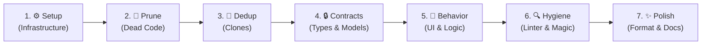
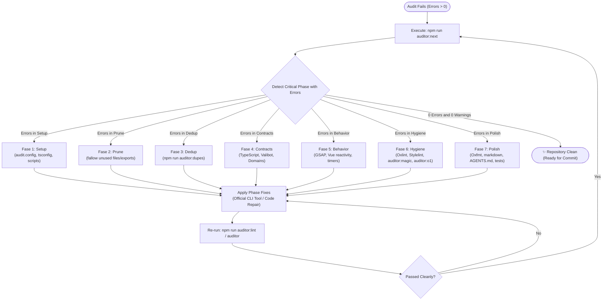

# Canonical Strategic Remediation Order Guide (7 Phases)

## Purpose and Architectural Philosophy

When a repository is analyzed by `@francogp/auditor`, a comprehensive audit may surface dozens or hundreds of findings across diverse suites. Attempting to repair these findings in an arbitrary order, or fixing cosmetic or typing warnings first in code that will later be pruned or deduplicated, is a major source of **wasted engineering time, rework, and frustration**.

The auditor implements a **Canonical 7-Phase Strategic Remediation Order** (`RemediationPhaseId`), computed deterministically from each sub-auditor's mandatory constructor contract (`ruleRemediationPhases`).

---

## 1. The 7 Canonical Remediation Phases



| Order | Phase ID | Title | Primary Focus | Representative Suites | Strategic Rationale |
|---|---|---|---|---|---|
| **1** | `setup` | **Infrastructure & Setup** | Project integrity, runtime, extensions, dependencies, and package scripts | `validate_audit_config`, `validate_tsconfig`, `validate_dependency_minimums`, `validate_vite_plus_config`, etc. | If configuration or extensions are broken, downstream analysis produces **massive false positives**. This phase triggers *Imperative Setup Blocking*. |
| **2** | `prune` | **Dead Code Pruning** | Unreferenced files, exports, members, and unused types | `validate_fallow` (`fallow-unused-file`, `fallow-unused-export`, `fallow-unused-member`, `fallow-unused-type`), `validate_orphaned_assets` | Pruning dead code **eliminates hundreds of findings** immediately without modifying active application logic. |
| **3** | `dedup` | **Deduplication & Clones** | Syntactic clones, semantic vector duplicates, and triplicates | `validate_similar_code`, `validate_fallow` (`fallow-duplicate-*`, `fallow-triplicate-*`). Remediate via `npm run auditor:dupes` (`inspect` + `apply --worktree`). | Unifying duplicated functions BEFORE refactoring prevents fixing the same bug or applying types multiple times across copies. |
| **4** | `contracts` | **Domain Contracts & Types** | State interfaces, Valibot schemas, canonical domain types, and DTOs | `validate_valibot_parity`, `validate_domain_types`, `validate_domain_type_first` | Unstable domain types or contracts cause downstream UI or business logic refactors to desynchronize. |
| **5** | `behavior` | **Framework, UI & Logic** | GSAP animations, Vue directives, accessibility, and functional business logic | `validate_gsap_animations`, `validate_vue_security`, `validate_game_loop`. Remediate GSAP and UI animations via `npm run auditor:motion` (`discover` + `inspect` + `apply --worktree`). | Once code is deduplicated and strongly typed, component interaction and business logic are safely adjusted. |
| **6** | `hygiene` | **Hygiene, Linter & Complexity** | Oxlint, Stylelint, magic numbers, excessive nesting, and cyclomatic debt | `validate_oxlint`, `validate_stylelint`, `validate_cyclomatic_complexity`, `validate_magic_numbers`, `validate_o1_data_structures`. Remediate magic numbers via `npm run auditor:magic` (`inspect` + `apply`), and O(1) structures via `npm run auditor:o1` (`discover` + `inspect` + `apply --worktree`). | Micro-optimizations, linter rules, and constant extraction belong on consolidated, typed, and functioning code. |
| **7** | `polish` | **Formatting, Docs & Coverage** | OxFmt formatting, documentation integrity, and coverage thresholds | `validate_oxfmt`, `validate_audit_coverage`, `validate_test_coverage`, `validate_documented_commands` | The final pass: mechanically format the clean tree, synchronize documentation, and verify test coverage. |

---

## 2. Mandatory Constructor Contract (`ruleRemediationPhases`)

Every sub-auditor (`BaseAuditor`) and host extension **MUST declare** the `ruleRemediationPhases` dictionary mapping 100% of its declared rules to one of the 7 canonical phases:

```typescript
import {
  BaseAuditor,
  createUniformRemediationPhases,
  type RemediationPhaseId
} from '@francogp/auditor';

export class ValidateMyModuleAuditor extends BaseAuditor<MyRuleId> {
  public constructor(options?: AuditorOptions<MyRuleId>) {
    super({
      ...options,
      id: 'validate_my_module',
      rules: MY_RULES,
      ruleCapabilities: MY_RULE_CAPABILITIES,
      ruleRemediations: MY_RULE_REMEDIATIONS,
      // Mandatory contract: map each rule to its strategic phase
      ruleRemediationPhases: createUniformRemediationPhases(MY_RULES, 'behavior')
    });
  }
}
```

If an auditor declares rules belonging to different phases (such as `validate_fallow`, which contains rules for `prune`, `dedup`, and `hygiene`), it must declare them explicitly:

```typescript
ruleRemediationPhases: {
  'fallow-unused-file': 'prune',
  'fallow-unused-export': 'prune',
  'fallow-duplicate-code': 'dedup',
  'fallow-triplicate-code': 'dedup',
  'fallow-complexity-hotspot': 'hygiene',
  // ... 100% of declared rules covered
}
```

> [!CAUTION]
> **No Fallbacks and Loud Failure Mandate**: If `ruleRemediationPhases` is omitted or any rule is unmapped, `BaseAuditor` fails loudly by throwing an immediate exception (`throw new Error(...)`). Backward-compatible shims are strictly prohibited.

---

## 3. Imperative Setup Blocking on Extension Failures

When a host project includes extensions (`config.extensions` in `.auditor/audit.config.ts`), `validate_audit_config` (belonging to `phase: 'setup'`) dynamically audits each extension file.

If an extension:

1. Fails to compile (syntax or TypeScript/JavaScript error), or
2. Fails at runtime during instantiation (e.g., violating `BaseAuditor` constructor contracts or omitting `ruleRemediationPhases`),

An error is emitted with severity `error` under rule `audit-config-invalid-extension`.
Because `validate_audit_config` belongs to `phase: 'setup'`, this finding **triggers Imperative Setup Blocking**:

- The console displays a prominent red box banner (`renderSetupBlockingBanner`).
- **All downstream application code findings are suppressed** to prevent false positives.
- Modifying application code is strictly prohibited until extensions are repaired and compile cleanly.

---

## 4. Console Visualization & Grouped Sub-Tables

The terminal audit summary (`npm run auditor` or `vp run auditor`) does not render an uncontextualized flat table. Instead, it renders **Box-Drawing sub-tables grouped by recommended resolution order**:

```text
📊 DESGLOSE POR TIPO DE ERROR Y ADVERTENCIA (ORDEN ESTRATÉGICO DE RESOLUCIÓN):

┌──────────────────────────────────────────────────────┬───────────┬───────────┐
│ TIPO DE INCIDENCIA / REGLA                           │   ERRORES │  WARNINGS │
├──────────────────────────────────────────────────────┼───────────┼───────────┤
│ ⚙️ FASE 1 · INFRAESTRUCTURA Y SETUP                    │           │           │
│   audit-config-invalid-extension                     │         1 │         0 │
│   ↳ Subtotal Fase 1                                  │         1 │         0 │
├──────────────────────────────────────────────────────┼───────────┼───────────┤
│ 🧹 FASE 2 · PODA DE CÓDIGO MUERTO                    │           │           │
│   fallow-unused-file                                 │         4 │         0 │
│   fallow-unused-export                               │        12 │         0 │
│   ↳ Subtotal Fase 2                                  │        16 │         0 │
├──────────────────────────────────────────────────────┼───────────┼───────────┤
│ 🧩 FASE 3 · DESDUPLICACIÓN Y CLONES                  │           │           │
│   fallow-duplicate-function                          │         3 │         0 │
│   ↳ Subtotal Fase 3                                  │         3 │         0 │
├──────────────────────────────────────────────────────┼───────────┼───────────┤
│ TOTAL CONSOLIDADO                                    │        20 │         0 │
└──────────────────────────────────────────────────────┴───────────┴───────────┘
```

Each active phase displays:

1. The phase header with icon and compact title.
2. The rules belonging to that phase with their error and warning counts.
3. The phase subtotal (`↳ Subtotal Fase X`).
4. At the end of all phases, a single **`TOTAL CONSOLIDADO`**.

---

## 5. Strategic Focus with `auditor:next` (Automated Active Phase)

To eliminate the risk of developers or AI agents arbitrarily jumping between phases or polishing dead code, the framework provides the canonical focus tool:

```bash
npm run auditor:next
# or in interactive Box-Drawing mode:
npm run auditor:next:human
# or via flag:
npm run auditor:findings next
```

### Deterministic Remediation Workflow



When `auditor:next` runs:

1. It queries `scratch/audits/latest_audit.json`.
2. It evaluates the 7 canonical phases in strict priority order (`setup` $\to$ `prune` $\to$ `dedup` $\to$ `contracts` $\to$ `behavior` $\to$ `hygiene` $\to$ `polish`).
3. It locates the earliest phase with at least 1 unresolved `error` (or `warning` if errors are 0).
4. It emits an active focus banner and displays **strictly the findings of that active phase**, hiding and postponing all downstream findings.

---

## 6. Command-Line Inspection (CLI)

Developers and AI agents can also filter and inspect findings phase-by-phase using `auditor:findings`:

```bash
# Automatically focus the most critical active phase
npm run auditor:next
npm run auditor:findings next

# Inspect only Phase 2 findings (Dead Code Pruning)
npm run auditor:findings phase=prune

# Inspect Phase 3 findings (Deduplication) in flat format
npm run auditor:findings phase=dedup flat

# Inspect Phase 4 findings (Contracts & Types) grouped by file
npm run auditor:findings phase=contracts by-file

# Inspect Phase 1 findings (Setup)
npm run auditor:findings phase=setup
```

Both `phase=<phaseId>` and `fase=<phaseId>` prefixes are supported.

---

## 7. Dual Presentation Standards (`compact` vs. `human`)

To maintain absolute consistency across the toolchain and prevent visual clutter during automated AI analysis, all remediation tools strictly enforce dual presentation modes:

1. **AI-Friendly Compact Mode (Default: `npm run auditor:next`)**:
   - **Zero Decorative Emojis**: Strictly bans loose emojis (`✨`, `🔒`, `🔍`, etc.) in plain text console output.
   - **Canonical ASCII Bracketed Tokens**: Standardizes exclusively on uppercase tokens (`[OK]`, `[FOCUS]`, `[Notice]`, `[FAIL]`, `[Errors]`, `[Warnings]`).
   - Clean, deterministic single-line verdicts for automated token efficiency:

     ```text
     [OK] All 7 remediation phases are clean (0 errors, 0 warnings).
     ```

2. **Interactive Human Mode (`npm run auditor:next:human` or `human` flag)**:
   - **UnifiedTheme Box-Drawing**: Renders full 80-column double-bordered cards via `buildNoticeBox` / `boxen`.
   - **Semantic Colors**: Green for clean phases, yellow for warnings, red for errors.
   - Formatted monospace cards:

     ```text
     ╔═════════════════════════════════════════════════════════════════╗
     ║ STRATEGIC REMEDIATION STATUS: ALL PHASES CLEAN                  ║
     ║ All 7 remediation phases passed cleanly (0 errors, 0 warnings). ║
     ║ The repository is fully verified and ready for commit.          ║
     ╚═════════════════════════════════════════════════════════════════╝
     ```
