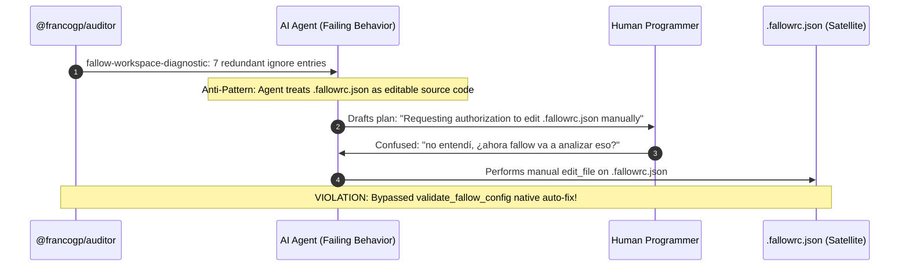
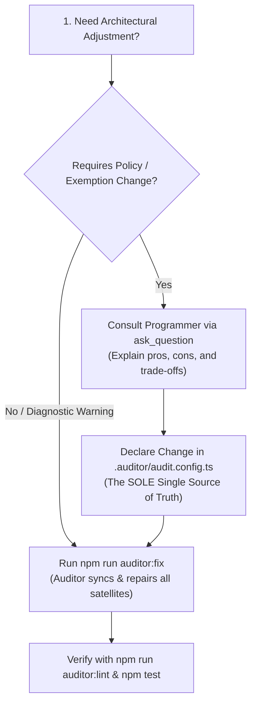

# Satellite Configurations Sovereignty & SSoT Governance Guide

## Purpose & Core Philosophy

In modern software architecture governed by `@francogp/auditor`, multiple underlying tools (Fallow, Vite+, Stylelint, TypeScript, HTML-Validate, Oxlint, etc.) require configuration files in the project root (`.fallowrc.json`, `vite.config.ts`, `.stylelintrc.json`, `tsconfig.json`, `.htmlvalidate.json`).

Allowing developers or AI agents to manually edit these disparate configuration files causes:

1. **Configuration Drift & Desynchronization**: Satellite tools fall out of alignment with project governance.
2. **False Alarms & User Confusion**: Direct edits in satellite files obscure the origin of rules and mislead engineers.
3. **Loss of Determinism**: Changes made outside automated quality gates are volatile and cannot be reproduced in clean CI clones.

To eliminate these hazards, the framework enforces the **Auditor Exclusive SSoT Sovereignty Mandate**:

- **`.auditor/audit.config.ts` is the SOLE Single Source of Truth (SSoT)** for repository architecture, rules, boundaries, and exceptions.
- **Satellite configuration files are derived, projected artifacts** owned exclusively by `@francogp/auditor`.
- **The Auditor is the ONLY entity authorized to generate, mutate, and synchronize satellite configurations** via official setup suites (`phase: 'setup'`) executed during `npm run auditor:fix`.

---

## 1. Governed Satellite Configurations Catalog

The following table documents every satellite configuration file, its governing setup suite, its SSoT section in `.auditor/audit.config.ts`, and its blocking undeclared entries detection rule:

| Satellite Config File | Governing Setup Suite | SSoT Section in `.auditor/audit.config.ts` | Blocking Undeclared Entries Rule | Auto-Fix Command |
|---|---|---|---|---|
| `.fallowrc.json` | `validate_fallow_config` | `config.fallow.ignoreGlobs`, `config.fallow.ignoreDependencies` | `fallow-undeclared-config-entry` | `npm run auditor:fix` |
| `vite.config.ts` | `validate_vite_plus_config` | `config.vitePlusConfig`, `config.paths.ignoreGlobs`, `config.testCoverage` | `vite-plus-undeclared-config-entry` | `npm run auditor:fix` |
| `.stylelintrc.json` | `validate_stylelint_config` | `config.stylelint.strictValues.properties`, `ignoreValues` | `stylelint-undeclared-config-entry` | `npm run auditor:fix` |
| `tsconfig.json` | `validate_tsconfig` | `config.paths.ignoreGlobs`, `config.paths.dataRoots` | `tsconfig-undeclared-config-entry` | `npm run auditor:fix` |
| `.htmlvalidate.json` | `validate_html_validate_config` | `config.htmlValidate.rules`, `disabledRules`, `extraPlugins` | `html-validate-undeclared-config-entry` | `npm run auditor:fix` |
| `.markdownlint.json` | `validate_markdown_lint_config` | `config.documentation.markdownLint.rules`, `disabledRules` | `markdownlint-undeclared-config-entry` | `npm run auditor:fix` |

---

## 2. Forensic Case Study: Anti-Pattern in `poekborrador`

In conversation [`poekborrador`](conversation://5e1a6657-8469-43ea-abd4-fbf454ea2ee6), a failure of agent judgment occurred:



### What Went Wrong

1. **Unnecessary Manual Plan**: The agent drafted a plan proposing manual removal of lines in `.fallowrc.json`, asking the human for permission.
2. **Induced User Confusion**: The human programmer wondered if removing ignore entries meant Fallow would now analyze unneeded files or introduce new errors.
3. **Bypassing the Setup Engine**: The sub-auditor `ValidateFallowConfigAuditor` in `phase: 'setup'` **already had automated repair capabilities** (`fixable: true`). Running `npm run auditor:fix` would have pruned those redundant entries in milliseconds cleanly and idempotently, with zero manual touches and zero cognitive load on the user.

---

## 3. Categorical Prohibition on Manual Satellite Configuration Plans

AI agents, developers, and architectural planning workflows (`/plan`, `/brainstorming`, `/architecture`, `/code-review`) are **STRICTLY AND CATEGORICALLY PROHIBITED** from:

- Creating work plans or task lists that propose manual edits to satellite configurations (`.fallowrc.json`, `vite.config.ts`, `.stylelintrc.json`, etc.).
- Calling `write_file` or `edit_file` on satellite configuration files.
- Asking the user for permission to edit satellite configuration files directly.

### Permitted vs Prohibited Matrix

| Action | Status | Canonical Path |
|---|---|---|
| Manually editing `.fallowrc.json` | ❌ **PROHIBITED** | Run `npm run auditor:fix` |
| Proposing in `/plan` to alter `.fallowrc.json` | ❌ **PROHIBITED** | Plan must instruct running `npm run auditor:fix` |
| Manually modifying `vite.config.ts` blocks | ❌ **PROHIBITED** | Run `npm run auditor:fix` (via `validate_vite_plus_config`) |
| Manually modifying `.stylelintrc.json` | ❌ **PROHIBITED** | Run `npm run auditor:fix` (via `validate_stylelint_config`) |
| Adding an exemption path to `audit.config.ts` | ✅ **PERMITTED** | Edit `.auditor/audit.config.ts` (consult human first if altering boundaries) |
| Running official auto-fixers | ✅ **MANDATORY** | `npm run auditor:fix` |

---

## 4. The 3-Step Canonical Workflow for Configuration Adjustments

Whenever a developer or AI agent encounters a legitimate architectural requirement that affects a satellite tool (for example, configuring an exempt directory, adding a custom domain alias, or tuning nesting depth):



### Step 1: Consult the Human Programmer (if altering governance)

If the change alters architecture boundaries, rules, or exemptions, present a technical justification with pros and cons via `ask_question`.

### Step 2: Edit ONLY `.auditor/audit.config.ts`

Declare the desired change in the appropriate section of `.auditor/audit.config.ts`. Never touch any satellite file.

### Step 3: Run `npm run auditor:fix`

The Auditor's setup suites (`phase: 'setup'`) execute in deterministic order (`resolveFixOrderWeight < 200`), reading `.auditor/audit.config.ts` and synchronizing `.fallowrc.json`, `vite.config.ts`, `.stylelintrc.json`, and `tsconfig.json` automatically.

---

## 5. Upstream Evolution vs Local Patching

If a satellite tool requires a new configuration property or option that `@francogp/auditor` does not currently synchronize:

1. **HALT and DO NOT patch the local satellite file**. Local patches are volatile and will be overwritten or flagged on the next audit run.
2. Report the enhancement to the human programmer to implement the projection in the appropriate setup suite inside `@francogp/auditor` upstream.
3. Once updated upstream, the host project consumes the new feature cleanly via `npm run auditor:update`.

---

## 6. Mandatory Third-Party Satellite Config Explanation Contract

To prevent external tool suites from being integrated without proper configuration governance, every sub-auditor or extension that declares `usesThirdPartyTool: true` is contractually required to declare `explainSatelliteConfig` in its constructor `thirdPartyToolPolicy`:

```ts
thirdPartyToolPolicy: {
  toolName: 'Stylelint',
  fallbackBehavior: 'violation',
  fallbackRuleId: 'stylelint-issue',
  explainSatelliteConfig: () => ({
    configFile: '.stylelintrc.json',
    ssotKey: 'stylelint',
    undeclaredEntryRuleId: 'stylelint-undeclared-config-entry',
    configSuiteId: 'validate_stylelint_config'
  })
}
```

If the third-party tool has no external satellite configuration file (such as `npm audit` in `validate_package_hygiene`), it must declare `explainSatelliteConfig: undefined` explicitly.

Omitting `explainSatelliteConfig` causes `BaseAuditor` and `auditorContractConformance` to fail loudly during instantiation with a blocking runtime error (`throw new Error(...)`).
