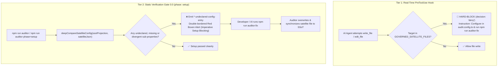

# Satellite Tool Integration Manual & Universal Recursive Parity Mandate

> Path: `.agents/skills/auditor/references/satellite-tool-integration-manual.md`
> Status: CANONICAL ARCHITECTURAL INVARIANT
> Applicable to: All Tools, Sub-Auditors, and Satellite Configurations in `@francogp/auditor`

---

## 🏛️ 1. Purpose & The Universal Recursive Parity Invariant

In repositories governed by `@francogp/auditor`, **`.auditor/audit.config.ts` is the SOLE Single Source of Truth (SSoT)**.
Underlying linters, bundlers, type checkers, and quality engines (Fallow, Stylelint, TypeScript, HTML-Validate, Vite+, Oxlint, Markdownlint, etc.) require satellite configuration files in the project root (`.fallowrc.json`, `.stylelintrc.json`, `tsconfig.json`, `.htmlvalidate.json`, `vite.config.ts`, etc.).

### The Invariant Mandate

> **Universal Recursive Parity Invariant**:
> Every satellite configuration file is a **strictly projected, derived artifact** owned exclusively by `@francogp/auditor`.
> Shallow or partial configuration checks are strictly prohibited. 100% of properties, nested sub-properties, thresholds, rules, and exemptions governed by the framework MUST be verified recursively 1:1 against the SSoT. Any undeclared, missing, or divergent sub-property at ANY nesting depth MUST trigger a blocking error in `phase: 'setup'` (`*-undeclared-config-entry`), and MUST be deterministically synchronized in auto-fix mode (`npm run auditor:fix`).

---

## 🔒 2. The 2-Tier Defense System



---

## 📋 3. Mandatory 5-Step Integration Checklist for New Satellite Tools

Whenever integrating a new external tool or extending an existing one that requires a configuration file:

### Step 1: Register in `GOVERNED_SATELLITE_FILES` and `SATELLITE_CONFIG_EXPLANATIONS`

1. Open `src/core/satelliteConfigParity.ts` and add the tool's configuration file basenames to `GOVERNED_SATELLITE_FILES`:

   ```typescript
   export const GOVERNED_SATELLITE_FILES: readonly string[] = Object.freeze([
     // ...
     '.mytoolrc.json',
     'mytool.config.js',
     'mytool.config.ts'
   ]);
   ```

2. Open `src/core/auditContract.ts` and declare the satellite config explanation in `SATELLITE_CONFIG_EXPLANATIONS`:

   ```typescript
   myTool: {
     configFile: '.mytoolrc.json',
     ssotKey: 'myTool',
     undeclaredEntryRuleId: 'mytool-undeclared-config-entry',
     configSuiteId: 'validate_mytool_config'
   }
   ```

   _Impact_: This automatically activates the Antigravity PreToolUse hook, hard-blocking AI agents from executing `write_file` or `edit_file` on the satellite file directly.

### Step 2: Declare Strongly-Typed SSoT Section in `auditConfigTypes.ts`

Declare the configuration contract under `AuditEngineConfig`:

```typescript
export interface AuditMyToolConfig {
  enabled?: boolean;
  rules?: Record<string, 'error' | 'warn' | 'off'>;
  thresholds?: {
    maxDepth?: number;
    maxComplexity?: number;
  };
  ignoreGlobs?: string[];
}
```

Define canonical defaults in `src/core/auditConfigDefaults.ts` and builders in `src/core/auditConfigBuilders.ts`.

### Step 3: Implement SSoT Projection Function (`projectMyToolConfigFromAuditConfig`)

Inside the suite or a shared sync module, define the deterministic projection function:

```typescript
export function projectMyToolConfigFromAuditConfig(auditConfig: AuditConfig): MyToolConfigSchema {
  return {
    $schema: 'https://mytool.org/schema.json',
    rules: {
      ...CANONICAL_MYTOOL_RULES,
      ...(auditConfig.myTool?.rules ?? {})
    },
    thresholds: {
      maxDepth: auditConfig.myTool?.thresholds?.maxDepth ?? 3,
      maxComplexity: auditConfig.myTool?.thresholds?.maxComplexity ?? 10
    }
  };
}
```

### Step 4: Implement `phase: 'setup'` Suite with `deepCompareSatelliteConfig`

In `src/suites/architecture/validate_mytool_config.ts`:

1. Declare `phase: 'setup'`.
2. In audit mode (`!auditor.isFixActive()`):

   ```typescript
   const diffs = deepCompareSatelliteConfig({
     ssotProjection: projected,
     actualConfig: actual,
     allowedExtraKeys: new Set(['$schema']),
     pathPrefix: ''
   });

   for (const diff of diffs) {
     this.addViolation({
       ruleId: 'mytool-undeclared-config-entry',
       severity: 'error',
       file: '.mytoolrc.json',
       line: 1,
       message: diff.message,
       context: diff.path,
       fixable: true
     });
   }
   ```

3. In fix mode (`auditor.isFixActive()`):

   ```typescript
   const modified = mergeSatelliteConfigProjection(actual, projected);
   if (modified) {
     fs.writeFileSync(configPath, JSON.stringify(actual, null, 2) + '\n', 'utf8');
   }
   ```

### Step 5: Unit Tests of Recursive Parity and Auto-Fix

In `tests/validate_mytool_config.test.ts`, guarantee:

1. **Divergent values test**: Altering a nested property (e.g. `thresholds.maxDepth: 10`) triggers `mytool-undeclared-config-entry`.
2. **Clandestine entries test**: Adding an unapproved nested key (e.g. `thresholds.customBypass: true`) triggers `mytool-undeclared-config-entry`.
3. **Auto-fix test**: Running with `fix: true` rewrites the file to match the SSoT projection with zero leftover violations.

---

## 🛑 4. Rules of Engagement for AI Agents

1. **NEVER call `write_file` or `edit_file` on any file listed in `GOVERNED_SATELLITE_FILES`**:
   The PreToolUse hook will intercept and block the call with `decision: 'deny'`.
2. **NEVER propose manual edits in `/plan` or walkthroughs**:
   Plans that propose editing `.fallowrc.json`, `vite.config.ts`, `.stylelintrc.json`, etc., are invalid.
3. **THE ONLY CANONICAL PATH**:
   1. If a policy or exemption needs updating, consult the human developer.
   2. Edit `.auditor/audit.config.ts`.
   3. Run `npm run auditor:fix`. The auditor will project and synchronize the satellite file automatically.
