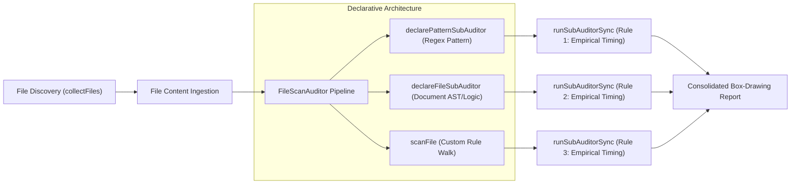
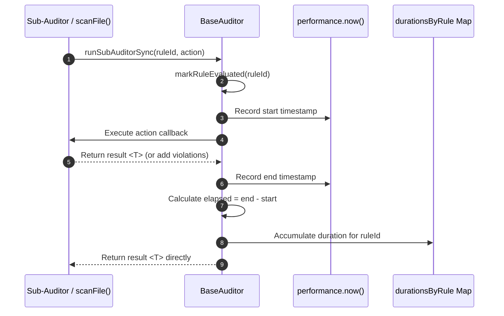
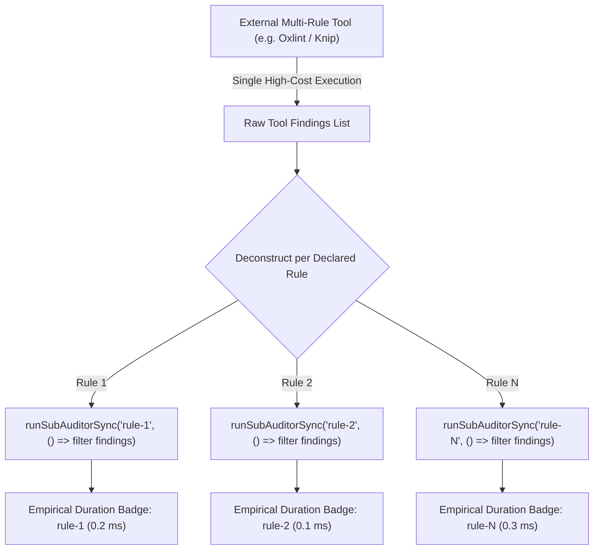
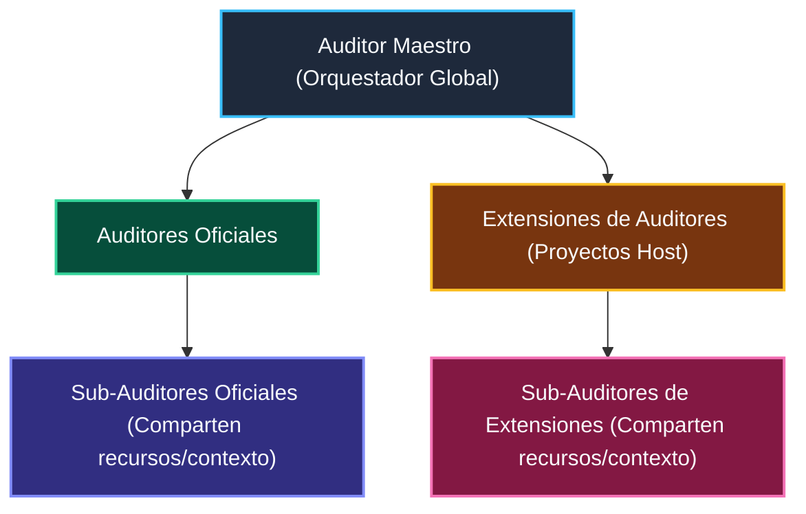
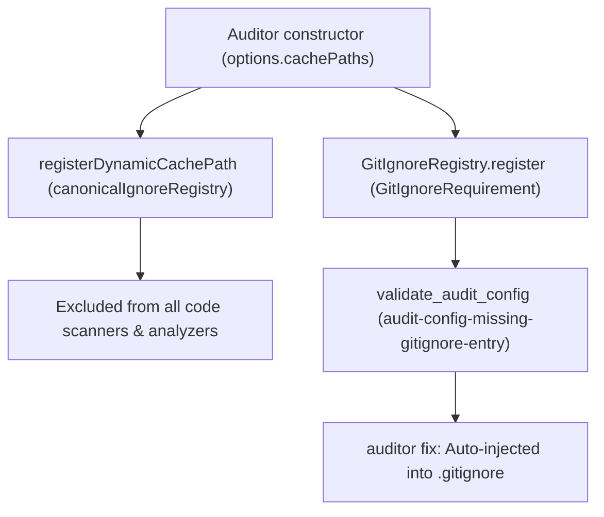

# Step-by-Step Guide: How to Create a New Sub-Auditor

This reference provides exhaustive implementation examples and walkthroughs for authoring new sub-auditors in `@francogp/auditor` or host extensions in `scripts/auditors/`.

---

## 1. Bundled Boilerplate Templates (`assets/templates/`)

Pre-formatted, production-ready templates conforming to all project standards are bundled directly within this skill for instant scaffolding:

- **Line-by-Line Scanner**: [`assets/templates/file_scan_auditor_template.ts`](../assets/templates/file_scan_auditor_template.ts)
- **Composite / Database / Asset Auditor**: [`assets/templates/base_auditor_template.ts`](../assets/templates/base_auditor_template.ts)
- **AST-Driven Auditor**: [`assets/templates/ast_auditor_template.ts`](../assets/templates/ast_auditor_template.ts)
- **Dedicated Vitest Unit Test**: [`assets/templates/auditor_unit_test_template.test.ts`](../assets/templates/auditor_unit_test_template.test.ts)

---

## 2. Option A: File-Scanning Auditor (`FileScanAuditor`)

Use `FileScanAuditor` when the audit inspects files line-by-line across specific directories (e.g. searching for regex patterns, forbidden tokens, or syntax rules).



```typescript
/**
 * scripts/auditors/architecture/validate_my_feature.ts
 *
 * MY FEATURE AUDITOR (Node.js 26+ Native)
 */

import path from 'node:path';
import { enableCompileCache } from 'node:module';
import {
  BaseAuditor,
  FileScanAuditor,
  hasPrecedingComment,
  createUniformRuleCapabilities,
  createUniformRemediationPhases,
  resolveFileScanRoots,
  type FileScanRootsOptions
} from '@francogp/auditor';

enableCompileCache();

export type MyFeatureRuleId =
  | 'my-feature-forbidden-token'
  | 'my-feature-missing-attribute';

export const MY_FEATURE_RULES: readonly MyFeatureRuleId[] = [
  'my-feature-forbidden-token',
  'my-feature-missing-attribute'
];

export interface MyFeatureAuditorOptions extends FileScanRootsOptions {
  readonly exemptPaths?: readonly (string | RegExp)[];
}

export class MyFeatureAuditor extends FileScanAuditor<MyFeatureRuleId> {
  constructor(options: MyFeatureAuditorOptions = {}) {
    const { effectiveRoot, targetRoots } = resolveFileScanRoots(
      options,
      (config) => config.paths?.srcRoots
    );

    super({
      id: 'validate_my_feature',
      name: 'My Feature Validator',
      description: 'Validates forbidden tokens and required attributes in src/',
      icon: '🔍', // Mandatory thematic emoji
      family: 'architecture',
      ruleCapabilities: createUniformRuleCapabilities(MY_FEATURE_RULES, {
        speed: 'light',
        phase: 'normal',
        fix: 'none',
        md: false,
        ast: false,
        changedOnly: false,
        critical: false
      }),
      ruleIds: MY_FEATURE_RULES,
      packageName: 'MyModule',
      configKey: 'paths.srcRoots',
      defaultConfig: {
        srcRoots: ['src']
      },
      criticalConfig: {},
      requiredPermissions: [],
      usesThirdPartyTool: false,
      ruleDescriptions: {
        'my-feature-forbidden-token': 'Forbidden token in source file',
        'my-feature-missing-attribute': 'Missing mandatory attribute'
      },
      ruleRemediations: {
        'my-feature-forbidden-token':
          '1. Root Cause: A prohibited token was detected in the source file.\n' +
          '2. Diagnosis: Locate the reported file and line.\n' +
          '3. Canonical Solution: Replace it with the canonical function or constant.\n' +
          '4. Example / Command: npm run auditor',
        'my-feature-missing-attribute':
          '1. Root Cause: A mandatory attribute is missing on the analyzed element.\n' +
          '2. Diagnosis: Inspect the reported template element.\n' +
          '3. Canonical Solution: Add the required attribute according to component documentation.\n' +
          '4. Example / Command: npm run auditor'
      },
      // Strategic Remediation Order: Mandatory mapping of every rule to one of the 7 canonical phases
      ruleRemediationPhases: createUniformRemediationPhases(MY_FEATURE_RULES, 'behavior'),
      roots: targetRoots,
      allowedExtensions: new Set(['.vue', '.ts']),
      // Dynamic Exemption Architecture: automatically skips documents matching strings or RegExps.
      // Prohibits hardcoding ignores or candidate file arrays in code.
      exemptPaths: options.exemptPaths,
      projectRoot: effectiveRoot
    });
  }

  protected override scanFile(relPath: string, content: string): void {
    const lines = content.split(/\r?\n/);

    // Rule 1: Forbidden token check (empirically timed, markRuleEvaluated handled automatically)
    this.runSubAuditorSync('my-feature-forbidden-token', () => {
      for (let i = 0; i < lines.length; i++) {
        const line = lines[i]!;
        const lineNum = i + 1;

        if (line.includes('bannedToken')) {
          this.addViolation({
            ruleId: 'my-feature-forbidden-token',
            severity: 'error',
            file: relPath,
            line: lineNum,
            message: `Forbidden token 'bannedToken' detected. Use canonical helper instead.`,
            context: line.trim()
          });
        }
      }
    });

    // Rule 2: Missing attribute check (empirically timed)
    this.runSubAuditorSync('my-feature-missing-attribute', () => {
      if (relPath.endsWith('.vue') && content.includes('<custom-widget') && !content.includes('aria-label=')) {
        this.addViolation({
          ruleId: 'my-feature-missing-attribute',
          severity: 'error',
          file: relPath,
          line: 1,
          message: `<custom-widget> requires an 'aria-label' attribute.`,
          context: '<custom-widget'
        });
      }
    });
  }
}

// Canonical CLI Entrypoint
await BaseAuditor.runCliIfMain(import.meta.url, new MyFeatureAuditor());
```

---

## 3. Option B: Composite / Data Auditor (`BaseAuditor`)

Use `BaseAuditor` when the audit performs multi-source comparisons, AST graphs, database schema validations, or dataset integrity checks.

```typescript
/**
 * scripts/auditors/domain_data/validate_my_data.ts
 *
 * MY DATA INTEGRITY AUDITOR (Node.js 26+ Native)
 */

import path from 'node:path';
import { enableCompileCache } from 'node:module';
import { BaseAuditor, createUniformRuleCapabilities, createUniformRemediationPhases } from '@francogp/auditor';
import { MY_DATA } from '../../../src/data/myData.ts';

enableCompileCache();

export type MyDataRuleId = 'my-data-key-missing' | 'my-data-value-invalid';

export const MY_DATA_RULES: readonly MyDataRuleId[] = [
  'my-data-key-missing',
  'my-data-value-invalid'
];

export interface MyDataAuditorOptions {
  readonly projectRoot?: string;
}

export class MyDataAuditor extends BaseAuditor<MyDataRuleId> {
  constructor(options: MyDataAuditorOptions = {}) {
    super({
      id: 'validate_my_data',
      name: 'My Data Validator',
      description: 'Validates dataset integrity and required fields',
      icon: '📊', // Mandatory thematic emoji
      family: 'domain_data',
      ruleCapabilities: createUniformRuleCapabilities(MY_DATA_RULES, {
        speed: 'light',
        phase: 'normal',
        fix: 'none',
        md: false,
        ast: false,
        changedOnly: false,
        critical: false
      }),
      ruleIds: MY_DATA_RULES,
      packageName: 'Data',
      configKey: 'paths.dataRoots',
      defaultConfig: {
        dataRoots: ['src/data']
      },
      criticalConfig: {},
      requiredPermissions: [],
      usesThirdPartyTool: false,
      ruleDescriptions: {
        'my-data-key-missing': 'Missing key in data record',
        'my-data-value-invalid': 'Invalid value in required property'
      },
      ruleRemediations: {
        'my-data-key-missing':
          '1. Root Cause: A mandatory key is missing in the data record.\n' +
          '2. Diagnosis: Open src/data/myData.ts and locate the offending object.\n' +
          '3. Canonical Solution: Add the required property with its canonical value.\n' +
          '4. Example / Command: npm run auditor',
        'my-data-value-invalid':
          '1. Root Cause: The value assigned to the data property is invalid or has an incorrect type.\n' +
          '2. Diagnosis: Inspect the corresponding data schema interface.\n' +
          '3. Canonical Solution: Fix the assigned value to satisfy the typed schema.\n' +
          '4. Example / Command: npm run auditor'
      },
      // Strategic Remediation Order: Mandatory mapping of every rule to one of the 7 canonical phases
      ruleRemediationPhases: createUniformRemediationPhases(MY_DATA_RULES, 'contracts'),
      coverage: {
        include: ['src/data/myData.ts'],
        source: 'runtime'
      },
      projectRoot: options.projectRoot
    });
  }

  public override async runAudit(): Promise<void> {
    const dataFilePath = path.resolve(this.projectRoot, 'src/data/myData.ts');
    this.recordScanned(dataFilePath);

    // Rule 1: Missing key check (timed empirically)
    this.runSubAuditorSync('my-data-key-missing', () => {
      for (const [key, value] of Object.entries(MY_DATA)) {
        if (!value.requiredField) {
          this.addViolation({
            ruleId: 'my-data-key-missing',
            severity: 'error',
            file: 'src/data/myData.ts',
            line: 1,
            message: `Entry '${key}' is missing 'requiredField'.`,
            context: key
          });
        }
      }
    });

    // Rule 2: Value check (timed empirically)
    this.runSubAuditorSync('my-data-value-invalid', () => {
      for (const [key, value] of Object.entries(MY_DATA)) {
        if (typeof value.requiredField !== 'string') {
          this.addViolation({
            ruleId: 'my-data-value-invalid',
            severity: 'error',
            file: 'src/data/myData.ts',
            line: 1,
            message: `Entry '${key}' has invalid value.`,
            context: key
          });
        }
      }
    });

    this.context.setMetric('Total Entries Checked', Object.keys(MY_DATA).length);
  }
}

// Canonical CLI Entrypoint
await BaseAuditor.runCliIfMain(import.meta.url, new MyDataAuditor());
```

---

## 4. Option C: AST-Driven Sub-Auditor (`requiresAst: true` & `SharedAstContext`)

Use `BaseAuditor` with `requiresAst: true` (or `FileScanAuditor` with `sourceFile`) when the audit inspects TypeScript syntax trees, imports, exports, decorators, types, or Vue SFC script blocks across codebase files.

```typescript
/**
 * scripts/auditors/architecture/validate_my_ast_rule.ts
 *
 * AST-DRIVEN AUDITOR (Node.js 26+ Native)
 */

import path from 'node:path';
import ts from 'typescript';
import { enableCompileCache } from 'node:module';
import {
  BaseAuditor,
  SharedAstContext,
  createUniformRuleCapabilities,
  createUniformRemediationPhases,
  resolveFileScanRoots,
  type FileScanRootsOptions
} from '@francogp/auditor';

enableCompileCache();

export const MY_AST_RULES = [
  'my-ast-forbidden-call'
] as const;
export type MyAstRuleId = (typeof MY_AST_RULES)[number];

export class MyAstAuditor extends BaseAuditor<MyAstRuleId> {
  constructor(options: FileScanRootsOptions = {}) {
    const { effectiveRoot, targetRoots } = resolveFileScanRoots(
      options,
      (config) => config.paths?.srcRoots
    );

    super({
      id: 'validate_my_ast_rule',
      name: 'My AST Rule Validator',
      description: 'Valida llamadas prohibidas en el AST de TypeScript',
      icon: '🌳', // Mandatory thematic emoji
      family: 'architecture',
      ruleIds: MY_AST_RULES,
      packageName: 'AST',
      configKey: 'paths.srcRoots',
      defaultConfig: {
        srcRoots: ['src']
      },
      criticalConfig: {},
      requiredPermissions: [],
      usesThirdPartyTool: false,
      ruleDescriptions: {
        'my-ast-forbidden-call': 'Llamada prohibida detectada en AST'
      },
      ruleRemediations: {
        'my-ast-forbidden-call':
          '1. Root Cause: Se detectó una llamada prohibida por la arquitectura en el código TypeScript.\n' +
          '2. Diagnosis: Inspecciona el archivo y la invocación señalada en el informe de auditoría.\n' +
          '3. Canonical Solution: Reemplázala por la alternativa canónica recomendada.\n' +
          '4. Example / Command: npm run auditor'
      },
      ruleRemediationPhases: createUniformRemediationPhases(MY_AST_RULES, 'contracts'),
      ruleCapabilities: createUniformRuleCapabilities(MY_AST_RULES, {
        speed: 'light',
        phase: 'normal',
        fix: 'none',
        md: false,
        ast: true,
        changedOnly: false,
        critical: false
      }),
      requiresAst: true,
      projectRoot: effectiveRoot,
      roots: targetRoots,
      allowedExtensions: new Set(['.ts', '.vue'])
    });
  }

  public override async runAudit(astContext?: SharedAstContext): Promise<void> {
    const astEngine = astContext ?? new SharedAstContext();
    const relFiles = await this.context.collectFiles(this.roots, new Set(['.ts', '.vue']));

    this.runSubAuditorSync('my-ast-forbidden-call', () => {
      for (const relFile of relFiles) {
        this.recordScanned(relFile);
        const absPath = path.resolve(this.projectRoot, relFile);
        const sourceFile = astEngine.getSourceFile(absPath);

        ts.forEachChild(sourceFile, (node) => {
          if (ts.isCallExpression(node)) {
            // Inspect AST node properties...
          }
        });
      }
    });

    this.context.setMetric('Files Scanned with AST', relFiles.length);
  }
}

// Canonical CLI Entrypoint
await BaseAuditor.runCliIfMain(import.meta.url, new MyAstAuditor());
```

---

## 5. Universal Sub-Auditor Progress Contract (`ICompositeAuditor`)

All sub-auditors in `@francogp/auditor` adhere to the **Universal Sub-Auditor Progress Contract**, ensuring that every sub-rule, internal verification step, and returning result is disclosed live in the console of the main auditor (`audit_full.ts`) and recorded in `StandardAuditResult.subAuditors`.

### The Contract Types (`auditContract.ts`)

```typescript
export interface SubAuditorStep {
  readonly id: string;
  readonly name: string;
  readonly description: string;
}

export interface SubAuditorReport {
  readonly id: string;
  readonly name: string;
  readonly status: 'passed' | 'failed';
  readonly count: number;
  readonly speed: AuditExecutionSpeed;
  readonly detail?: string;
}

export interface ICompositeAuditor {
  getSubAuditors(): readonly SubAuditorStep[];
}
```

### In FileScanAuditor (Automatic Ingestion)

When you inherit from `FileScanAuditor`, every rule declared in `this.ruleIds` is automatically mapped into `getSubAuditors()` using `this.formatRuleDescription(ruleId)`.
Upon completing the file scan, `ensureSubAuditorsLogged()` automatically logs each sub-auditor step:

```text
🔍 [1/2] MiModulo: Token prohibido en archivo fuente 🐇 (12,4 ms)
🔍 [2/2] MiModulo: Atributo obligatorio faltante [🐛 2] 🐇 (5,1 ms)
```

- **Zero Findings**: Silent and clean, with no badges or verbose text like `(0 encontradas)`.
- **With Findings**: Displays `[🐛 <count>]` prominently in square brackets, with execution duration strictly enclosed in parentheses `(X ms)`.
- **Description Length Cap**: The composed string `${packageName}: ${ruleDescription}` MUST remain `<= 50` characters (`MAX_AUDITOR_DESCRIPTION_LENGTH = 50`) and contain zero newlines. If a rule description exceeds 50 characters, `BaseAuditor` throws an explicit runtime `Error` during instantiation.
Zero manual logging code is required.

### In Composite / Multi-Phase BaseAuditor (Explicit Progress)

If your auditor performs multiple distinct phases (such as database indexing followed by parity checks, or running multiple AST sub-analyzers):

1. Override `getSubAuditors()`:

   ```typescript
   public override getSubAuditors(): readonly SubAuditorStep[] {
     return [
       { id: 'step-1-index', name: 'Indexación de datos', description: 'Indexa registros' },
       { id: 'step-2-parity', name: 'Paridad cruzada', description: 'Verifica paridad' }
     ];
   }
   ```

2. Call `this.logSubAudit(...)` as each sub-phase completes:

   ```typescript
   this.logSubAudit(1, 2, 'Indexación de datos', indexViolationsCount);
   // ... run phase 2 ...
   this.logSubAudit(2, 2, 'Paridad cruzada', parityViolationsCount);
   ```

Any unlogged steps will be backfilled automatically by `ensureSubAuditorsLogged()` when `finishAudit()` runs.

---

## 6. Universal Empirical Individual Timing Contract & Sub-Auditor Execution Mechanics

To eliminate false passes, unmeasured rules, synthetic time divisions, and duplicate batch timestamps in the terminal Box-Drawing summary table, all sub-auditors and host extensions MUST adhere strictly to the **Universal Empirical Individual Timing Contract**.

### 6.1. 100% Empirical Individual Measurement (Zero Synthetic Division & Zero Batch Duplication)

- **Mandatory Empirical Stamping**: 100% of declared rules in `ruleIds` MUST record and display an empirical execution duration badge (`(X ms)` or `(<0,1 ms)`).
- **Prohibition of Synthetic Division**: Dividing total audit duration by the number of rules ($T / N$) is **STRICTLY PROHIBITED**. Synthetic divisions produce fake numbers that mask actual slow checks.
- **Prohibition of Batch Stamping Duplication**: Running a batch action and stamping the entire elapsed time identically onto every rule (e.g. duplicating `(449,5 ms)` across multiple rules) is **STRICTLY PROHIBITED**. Each rule check must measure its own distinct execution slice.

### 6.2. Superclass Measurement Wrappers (`runSubAuditorSync` & `runSubAuditor`)

`BaseAuditor` and `FileScanAuditor` provide built-in execution wrappers that measure execution time via high-resolution timers (`performance.now()`), accumulate durations across multiple files, and automatically mark rules as evaluated:

1. **Synchronous Checks (`this.runSubAuditorSync`)**:

   ```typescript
   this.runSubAuditorSync('my-rule-id', () => {
     // Perform analysis for this rule...
     if (hasViolation) {
       this.addViolation({ ruleId: 'my-rule-id', ... });
     }
   });
   ```

2. **Asynchronous Checks (`await this.runSubAuditor`)**:

   ```typescript
   await this.runSubAuditor('my-async-rule-id', async () => {
     const data = await fetchOrReadData();
     // Perform async analysis...
   });
   ```

3. **In `FileScanAuditor.scanFile` Loops (Non-Code Textual Formats Only)**:
   > [!IMPORTANT]
   > Per the **AST Traversing Mandate & Zero Regex Code Inspection Mandate**, line splitting (`content.split(/\r?\n/)`) and regex inspection are **strictly prohibited** for source code files (`.ts`, `.tsx`, `.js`, `.vue`). For all code files, you must use AST inspection (`SharedAstContext`, `ts.forEachChild`, or [`ast_auditor_template.ts`](../assets/templates/ast_auditor_template.ts)).
   > Line iteration inside `scanFile` is permitted strictly for non-code textual formats (such as Markdown `.md`, YAML, or configuration files):

   ```typescript
   protected override scanFile(relPath: string, content: string): void {
     const lines = content.split(/\r?\n/);

     this.runSubAuditorSync('doc-rule-one', () => {
       // Evaluate non-code textual rule one across lines...
     });

     this.runSubAuditorSync('doc-rule-two', () => {
       // Evaluate non-code textual rule two across lines...
     });
   }
   ```

   `FileScanAuditor` automatically sums the execution time across all scanned files for each rule ID.

### 6.2.1 Generic Action Return Values (`runSubAuditorSync<T>` & `runSubAuditor<T>`)

Both `this.runSubAuditorSync<T>` and `await this.runSubAuditor<T>` return the evaluated result of their action callback directly:

```typescript
// Synchronous check returning data directly:
const parsedConfig = this.runSubAuditorSync('config-syntax', () => {
  return JSON.parse(rawContent) as MyConfig;
});

// Asynchronous check returning data directly:
const verifiedFiles = await this.runSubAuditor('config-missing', async () => {
  return await this.ensureConfigFile(requirement);
});
```

This pattern eliminates the need for outer mutable `let` variables across closures, preventing TypeScript Control Flow Analysis (CFA) narrowing issues (such as variables being inferred as `null` or `never` following an `await` closure).



### 6.2.2. AST Traversal vs. AddViolation Wrapping Contract (Elimination of Dormant Rules)

In AST-based sub-auditors (`BaseAuditor` with `requiresAst: true` or `FileScanAuditor`), a common pitfall is wrapping only the `this.addViolation` call inside `runSubAuditorSync`:

```typescript
// ❌ WRONG PATTERN: Wrapping only addViolation inside runSubAuditorSync
const visit = (node: ts.Node) => {
  if (isViolation(node)) {
    this.runSubAuditorSync('my-rule', () => {
      this.addViolation({ ruleId: 'my-rule', ... });
    });
  }
  ts.forEachChild(node, visit);
};
visit(sourceFile);
```

**Why this fails**:
If the scanned repository is 100% compliant and contains no violations, `isViolation(node)` never evaluates to `true`. Consequently, `runSubAuditorSync('my-rule', ...)` is **never invoked**, leaving the rule with `0 evaluations` in the coverage ledger. When `validate_audit_coverage` runs, it marks the rule as a "dormant rule" (`Regla dormida: 0 evaluaciones`), causing audit suites to fail.

**Canonical Solution**:
Wrap the visitor traversal itself for that rule inside `runSubAuditorSync`:

```typescript
// ✅ CANONICAL PATTERN: Wrapping the AST traversal inside runSubAuditorSync
this.runSubAuditorSync('my-rule', () => {
  const visit = (node: ts.Node): void => {
    if (isViolation(node)) {
      this.addViolation({ ruleId: 'my-rule', ... });
    }
    ts.forEachChild(node, visit);
  };
  visit(sourceFile);
});
```

Wrapping the visitor traversal guarantees that `markRuleEvaluated` is invoked and the execution time of scanning that file is accurately registered in the ledger, even when no violations exist.

### 6.3. Deconstruction Pattern for External Multi-Rule Tools (Oxlint, Stylelint, Knip, TypeCoverage)

When an auditor wraps a heavy external tool or linter that produces a composite report for multiple rules in a single pass:

1. **Execute Shared Tool Once**: Run the external CLI, parser, or library once up-front to collect the raw findings list.
2. **Deconstruct Rule Evaluation**: Iterate over each declared rule, wrapping the filtering and registration of its specific findings inside `this.runSubAuditorSync(ruleId, () => { ... })`:



```typescript
// Step 1: Run the shared analysis once up-front
const findings = await runExternalTool(this.projectRoot);

// Step 2: Evaluate and measure each declared rule individually
for (const ruleId of MY_DECLARED_RULES) {
  this.runSubAuditorSync(ruleId, () => {
    const matchingFindings = findings.filter(f => f.ruleId === ruleId);
    for (const finding of matchingFindings) {
      this.addViolation({
        ruleId,
        severity: finding.severity,
        file: finding.file,
        line: finding.line,
        message: finding.message
      });
    }
  });
}
```

This pattern guarantees:

- External CLI executes only once (zero performance regression).
- 100% of declared rules receive individual, empirical execution timestamps (`<0,1 ms`, `0,2 ms`, etc.) in the terminal table.
- Zero duplicate batch times (`449,5 ms`) or fake `(0 ms)` badges.

### 6.4. Automatic Rule Evaluation & Prohibition of Redundant `markRuleEvaluated` Boilerplate

`runSubAuditorSync` and `runSubAuditor` internally call `this.markRuleEvaluated(ruleId)`.
Preceding these calls with explicit loops like:

```typescript
// ❌ PROHIBITED: Redundant boilerplate
for (const r of this.ruleIds) {
  this.markRuleEvaluated(r);
}
```

is completely redundant and strictly prohibited. Let the superclass wrappers handle rule evaluation tracking automatically.

### 6.5. Transparent Inapplicability & Empty Targets (`markRuleNotApplicable`)

If a subsystem, configuration, or target folder does not exist on disk (for example, `e2e/` folder does not exist, or `persistence.engine: 'none'`), rules must NEVER be silently skipped without timing, which would leave their duration undefined and cause `(0 ms)` badges.

Always wrap the inapplicability declaration inside `runSubAuditorSync`:

```typescript
if (!fs.existsSync(targetDir)) {
  for (const ruleId of this.ruleIds) {
    this.runSubAuditorSync(ruleId, () => {
      this.markRuleNotApplicable(ruleId, `Directorio objetivo '${targetDir}' no encontrado`);
    });
  }
  return;
}
```

This records a genuine duration badge (`<0,1 ms`), marks the status cleanly as `passed`, and provides transparent audit logging.

### 6.6. Canonical Implementation Blueprints from New Framework Suites

The framework includes 5 modern sub-auditors implementing this contract across architectural, performance, and security domains:

1. **`validate_web_performance`** (`performance` family, 7 rules):
   - Rules: `unoptimized-images`, `font-display-missing`, `inline-svg-bloat`, `css-render-blocking`, `excessive-dom-depth`, `layout-shift-dimensions`, `uncompressed-video`.
   - Pattern: AST and SFC scanner measuring font-display, img dimension attributes, and inline SVG sizes with per-rule `runSubAuditorSync`.

2. **`validate_query_performance`** (`performance` family, 6 rules):
   - Rules: `unindexed-foreign-keys`, `select-star-in-queries`, `unpaginated-queries`, `n-plus-one-patterns`, `heavy-count-queries`, `unindexed-order-by`.
   - Pattern: Static query analyzer inspecting SQL and ORM queries for `SELECT *` anti-patterns, missing `.limit()` calls, and query loops inside array mappings.

3. **`validate_security_hardening`** (`security` family, 8 rules):
   - Rules: `hardcoded-secrets`, `insecure-random`, `vulnerable-regex-redos`, `raw-html-injection`, `missing-csrf-token`, `eval-or-function-constructor`, `permissive-cors`, `unvalidated-redirect`.
   - Pattern: High-speed AST scanner checking `Math.random()`, `eval()`, `new Function()`, `v-html`, and unvalidated redirect targets.

4. **`validate_code_simplification`** (`architecture` family, 6 rules):
   - Rules: `dead-code-accumulation`, `boolean-trap-parameters`, `deep-nesting-control-flow`, `redundant-else-after-return`, `premature-abstraction-wrapper`, `massive-switch-branching`.
   - Pattern: Structural AST analyzer inspecting nested control flow depth, redundant else branches after return/throw, and boolean trap signatures.

5. **`validate_scss_architecture`** (`architecture` family, 5 rules):
   - Rules: `raw-css-in-sfc`, `scss-deep-selector-abuse`, `non-standard-spacing-unit`, `missing-theme-token-usage`, `excessive-scss-nesting`.
   - Pattern: Style preprocessor analyzer enforcing `lang="scss"` on SFC `<style>` blocks, disallowing obsolete spacing units (`pt`, `in`, `cm`), and preventing excessive nesting depth.

---

## 7. Official Stylelint Engine & Pure In-Memory Analysis (Zero External Binaries)

Sub-auditors validating styles, stylesheets (`.css`, `.scss`), or Vue SFC `<style>` blocks **MUST NOT** spawn external native binaries (such as `css-checker-kit`, Go binaries, or unmaintained tools). These binaries cause Smart App Control (SAC) blocks on Windows, fail under `ignore-scripts: true`, and create platform fragility.

Instead, stylesheet and component style hygiene, duplicate class rules, similar selectors, empty blocks, property order, and SCSS syntax are analyzed strictly through the official Stylelint engine with Vue SFC and SCSS support (`stylelint`, `stylelint-scss`, `stylelint-order`) and in-memory PostCSS AST processing:

```typescript
import stylelint from 'stylelint';

export async function lintStyleContent(code: string, codeFilename: string) {
  const result = await stylelint.lint({
    code,
    codeFilename,
    config: {
      extends: ['stylelint-config-standard-scss', 'stylelint-config-recommended-vue/scss']
    }
  });
  return result.results;
}
```

This pattern powers [`src/suites/architecture/validate_stylelint.ts`](../../../../src/suites/architecture/validate_stylelint.ts), evaluating all CSS hygiene, property order, duplicate rules, and SCSS syntax cleanly in milliseconds across all platforms.

### Dart Sass Function Collision Prevention (`sass-traps/collision-casing`)

In SCSS and Vue SFC `<style lang="scss">`, standard CSS functions that share names with Dart Sass built-in functions (`scale`, `scaleX`, `scaleY`, `scaleZ`, `scale3d`, `saturate`, `grayscale`, `invert`, `alpha`, `brightness`, `contrast`, `drop-shadow`, `hue-rotate`, `translateX`, `translateY`, `translateZ`, `translate3d`, `radial-gradient`, `linear-gradient`) must be written with PascalCase/CamelCase initial letters (e.g. `Scale(1.1)`, `Saturate(0.9)`, `Drop-Shadow(...)`, `hue-Rotate(...)`).

Lowercase invocations collide with Dart Sass internal evaluation and cause fatal build crashes:

```text
[sass] $color: 1.1 is not a color.
[sass] Missing argument $amount.
```

The native Stylelint plugin [`src/suites/architecture/stylelintSassTrapsPlugin.ts`](../../../../src/suites/architecture/stylelintSassTrapsPlugin.ts) (`sass-traps/collision-casing`) inspects PostCSS value AST nodes and automatically repairs colliding functions to their canonical capitalized forms when running in `--fix` mode. Standard `.stylelintrc.json` preserves `function-name-case: ['lower', { ignoreFunctions: ['/^[A-Z]/', 'Drop-Shadow', 'Drop-shadow', 'hue-Rotate', 'Hue-Rotate'] }]` and `value-keyword-case: ['lower', { camelCaseSvgKeywords: true, ignoreProperties: ['/--.*/'], ignoreFunctions: ['v-bind'] }]` to ensure zero rule deactivation while preserving unquoted `v-bind(...)` in Vue SFC. Furthermore, `order/order` partitions `@include` mixins by `hasBlock` (`hasBlock: false` before declarations, `hasBlock: true` after declarations) so that media queries properly override declarations down the CSS cascade without being superseded in mobile-first layouts.

---

## 8. Orthogonal 7-Field Rule Capabilities Contract (`AuditorRuleCapabilities`) & Speed Engine

Every sub-auditor declares its execution capabilities per rule via `ruleCapabilities: Record<TRuleId, AuditorRuleCapabilities>`. The orchestrator inspects these capabilities to coordinate specialized execution modes (`auditor fix`, speed ceilings `speed=light|heavy|full`, exact speed isolation `only-speed=light|heavy|full`, lifecycle phases `phase=normal|post-run|post-build`, differential runs, or AST sharing) without maintaining hardcoded suite lists.

### The Standard 7-Field Per-Rule Capabilities (`AuditorRuleCapabilities`)

```typescript
export type AuditExecutionSpeed = 'light' | 'heavy' | 'full';
export type AuditExecutionPhase = 'normal' | 'post-run' | 'post-build';
export type AuditFixCapability = 'none' | 'normal' | 'priority';

export interface AuditorRuleCapabilities {
  /** Execution speed tier ('light' 🐇, 'heavy' 🐢, 'full' 🐘) or array of tiers (e.g. ['light', 'full'] for TieredCommandProfile). */
  readonly speed: AuditExecutionSpeed | readonly AuditExecutionSpeed[];
  /** Execution lifecycle phase ('normal', 'post-run' after coverage ledgers flush, or 'post-build' against dist/). */
  readonly phase: AuditExecutionPhase;
  /** Auto-repair support: 'none', 'normal' (--fix), or 'priority' (executes FIRST in --fix to bootstrap configs/env). */
  readonly fix: AuditFixCapability;
  /** Included in markdown documentation preset (preset=md / npm run auditor:md). */
  readonly md: boolean;
  /** Requires in-memory TypeScript AST parsing engine (SharedAstContext). */
  readonly ast: boolean;
  /** Supports differential file scanning (--changed-since / changed-since=origin/main). Note: legacy changedSince is eradicated. */
  readonly changedOnly: boolean;
  /** Whether the rule is critical for correctness, typing, and syntax (bypasses speed ceiling in auditor:lint and auditor:critical). */
  readonly critical: boolean;
}
```

### Mandatory 7-Field Contract & 100% Complete Initialization

`BaseAuditor` enforces strict, complete initialization with **zero fallbacks**. Sub-auditors and host extensions **MUST declare `ruleCapabilities`** (using `createUniformRuleCapabilities(ruleIds, capabilities)` or `createRuleCapabilities(ruleIds, baseCapabilities, fixableRuleIds)`), explicitly declaring all 7 orthogonal fields (`speed`, `phase`, `fix`, `md`, `ast`, `changedOnly`, `critical`).

> [!CAUTION]
> **V6 → V8 BREAKING CHANGE: PROHIBITION ON PASSING SUITE-LEVEL `capabilities` OR LEGACY 10-BOOLEAN FLAGS**
> Suite-level `capabilities` must **NEVER** be passed directly to constructor options (`capabilities?: never`), and the legacy 10-boolean flags (`lint`, `precommit`, `fixPriority`, `heavy`, `requiresBuild`, `postRun`) are replaced by the 7-field orthogonal contract (`speed`, `phase`, `fix`, `md`, `ast`, `changedOnly`, `critical`). Always use `ruleCapabilities: createRuleCapabilities(...)` or `createUniformRuleCapabilities(...)`. The superclass automatically derives suite-level `AuditorCapabilities` from the registered rules!

```typescript
// Standard sub-auditor: initialize ruleCapabilities using createUniformRuleCapabilities
export class MyValidator extends BaseAuditor<MyRuleId> {
  constructor() {
    super({
      id: 'validate_my_validator',
      ruleCapabilities: createUniformRuleCapabilities(MY_RULES, {
        speed: 'light',
        phase: 'normal',
        fix: 'none',
        md: false,
        ast: false,
        changedOnly: false,
        critical: false
      }),
      ruleIds: MY_RULES,
      ...
    });
  }
}

// Auto-repair capable sub-auditor: declare fixableRuleIds via createRuleCapabilities
export class MyAutoFixValidator extends BaseAuditor<MyRuleId> {
  constructor() {
    super({
      id: 'validate_my_auto_fix',
      ruleCapabilities: createRuleCapabilities(
        MY_RULES,
        {
          speed: 'light',
          phase: 'normal',
          fix: 'none',
          md: false,
          ast: false,
          changedOnly: false,
          critical: false
        },
        ['my-fixable-rule'] // fixableRuleIds automatically upgraded to fix: 'normal'
      ),
      ruleIds: MY_RULES,
      ...
    });
  }
}
```

> [!IMPORTANT]
> **Grounded Fixability Contract for `fixableRuleIds`**:
> A sub-auditor or rule MUST be 100% automatically fixable via mechanical code mutation, or NOT be classified as fixable at all. Rules included in `fixableRuleIds` or emitting `fixable: true` MUST be backed by a verified, mechanical, automated code mutation engine on disk that resolves violations with zero human intervention. Speculative fixability, linters emitting suggestions (`💡`), hints, dangerous fixes (`⚠️`), or rules requiring human architectural decisions MUST NEVER be included in `fixableRuleIds`. Every fix-enabled suite must maintain positive and negative canary tests in `tests/fixable_integrity_canary.test.ts`.

### Dynamic Auto-Coordination in the Runner (Zero Hardcoding)

- **`auditor fix` / `npm run auditor:fix`**: Automatically discovers all suites with rules declaring `fix: 'normal' | 'priority'`. Suites with `fix: 'priority'` (environment, tooling, and configuration generators) execute **FIRST**, ensuring `.auditor/audit.config.ts`, `.gitignore`, `package.json` scripts, and linter configs are established before dependent code/style fixers run.
- **Speed Ceiling Mode (`speed=light|heavy|full`)**:
  - `npm run auditor:lint` (`auditor speed=light`): Executes `'light'` (`🐇`) rules in milliseconds.
  - `npm run auditor` (`auditor` / `auditor speed=heavy`): Default ceiling executing `'light'` (`🐇`) + `'heavy'` (`🐢`) rules.
  - `npm run auditor:full` (`auditor speed=full`): Exhaustive pre-build/release ceiling executing `'light'` (`🐇`) + `'heavy'` (`🐢`) + `'full'` (`🐘`) rules.
- **Exact Speed Isolation (`only-speed=light|heavy|full`)**: Executes ONLY rules matching that exact tier.
- **Post-Build Verification (`npm run auditor:post-build` / `auditor phase=post-build`)**: Automatically runs suites with `phase: 'post-build'` against `dist/` post-compilation, excluding them from source audits.
- **Pre-heat AST**: Automatically initializes `SharedAstContext` before executing any suite with `ast: true`.

### Mandatory Speed Contract (`speed: AuditExecutionSpeed`) & Scheduler LPT

The framework enforces strict governance over execution speed across all suites and host extensions:

1. **Mandatory Speed Property (`SubAuditorReport.speed`)**:
   - Every sub-auditor report step MUST contain `speed: AuditExecutionSpeed` (`'light' | 'heavy' | 'full'`).
   - The speed property is **strictly non-optional**. Setting `speed` to `undefined` or allowing it to remain unassigned is categorically forbidden.
   - If a sub-auditor or rule capability omits `speed` or cannot resolve its execution speed, the orchestrator **FAILS LOUDLY** (`throw new Error(...)`) at runtime, preventing silent contract degradation.

2. **Longest Processing Time First (Scheduler LPT)**:
   - When preparing the execution queue in `audit_full`, tasks are prioritized dynamically: suites that execute `'full'` (`🐘`) or `'heavy'` (`🐢`) commands/rules are placed **FIRST** in the queue.
   - This ensures background worker threads absorb heavy suites (e.g. `validate_type_check`, `validate_oxlint`, `validate_fallow`) immediately from $T_0$, while lighter `'light'` (`🐇`) suites execute concurrently across free threads, eliminating tail-end bottlenecks.

3. **Sub-Line Console Indicators (`🐇` / `🐢` / `🐘`)**:
   - The suite header remains clean and unaltered.
   - Sub-auditor child lines render the execution speed emoji alongside the elapsed duration:
     - `🐇` indicates `'light'` rule execution.
     - `🐢` indicates `'heavy'` rule execution.
     - `🐘` indicates `'full'` exhaustive rule execution.

4. **Logical Classification of Speed Tiers**:
   - **`speed: 'light'` (`🐇`)**: Fast, pure static analysis of application source code (`.ts`, `.vue`, `.scss`, `.html`), Domain-Type-First validation, and O(1) structures.
   - **`speed: 'heavy'` (`🐢`)**: Standard workspace scanning, environment and packaging checks (`validate_environment_engines`, `validate_package_scripts`), test hygiene and fragmentation, secret leak scanning, and database/asset verifications.
   - **`speed: 'full'` (`🐘`) or `speed: ['light', 'full']`**: Exhaustive cross-module symbol graph checks (such as `fallow dead-code --type-aware` via `TieredCommandProfile`) executed during `npm run auditor:full` and `npm run build`.

### Mandatory Speed Selection in Multi-Speed Critical Suites

If a suite or rule declares `critical: true` and `speed` has 2 or more declared speeds (e.g. `speed: ['light', 'full']`), the engine **MUST ALWAYS choose the fastest (`light`) when no speed is specified in the invocation** (`auditor`, direct node execution, or `npm run <validate-script>`):

- **Why**: Essential linters and type checkers (`validate_oxlint`, `validate_type_check`, `validate_stylelint`, `validate_html_validate`, `validate_domain_types`) are indispensable for developer feedback. When invoked directly by a developer, they must run instantaneously using caching/incremental compilation (`--incremental`, `--cache`) rather than triggering an exhaustive full-tree recheck.
- **Implementation in `BaseAuditor`**: `this.resolveRuleEffectiveSpeed(ruleId)` and `this.getExecutionTier()` inspect `caps.critical && !speedOpts.isSpeedSpecified`. When true, they select the minimum rank speed (`'light'`).

### Mandatory Authentic Tiers & Prohibition of Duplicated Tiers

Inventing or duplicating speed tiers that repeat identical CLI arguments or behaviors as another tier (such as inventing a `heavy` tier identical to `light`) is **STRICTLY PROHIBITED**:

- Each declared tier (`light`, `heavy`, `full`) MUST execute genuinely different commands or CLI flags of the underlying tool.
- If a tool only supports 2 distinct operational modes (e.g. `tsc` with `--incremental` in `light` vs without `--incremental` in `full`; `npm ls --depth=0` in `heavy` vs `--all` in `full`), declare **ONLY those 2 basic tiers** (e.g. `speed: ['light', 'full']`). Declaring a cloned 3rd tier is forbidden.
- Only tools with 3 completely decoupled subcommands (such as `validate_fallow`: `dead-code --no-type-aware`, `dupes`, `type-aware`) declare all 3 tiers.

### Permanent Cache Mandate (Cache is NEVER Turned Off in Full)

In the Full (`🐘`) tier, the entire project is audited without incremental/delta scoping (evaluating all files), **BUT THE CACHE IS NEVER TURNED OFF**:

- Tools with caching support (`oxlint --cache`, `stylelint cache: true`, `type-coverage --cache`, Fallow graph cache) MUST maintain their cache permanently enabled across all tiers.
- Running full verification verifies whole-project invariants, but disabling cache causes redundant I/O and CPU waste on unmodified source files.

### Clean Composition in `TieredCommandProfile` Without Code Duplication

Repeating identical literal arrays in `profiles` is strictly prohibited. Profiles must be cleanly composed using shared constants:

```typescript
const { cmd, args: baseArgs } = resolveTypeCheckBinary(this.projectRoot);
const tsBuildInfoPath = path.resolve(this.projectRoot, 'scratch/.tsbuildinfo');

// Composed cleanly via shared constants — zero duplicate array literals:
const standardArgs = [...baseArgs, '--pretty', 'false'];
const incrementalArgs = [...standardArgs, '--incremental', '--tsBuildInfoFile', tsBuildInfoPath];

const resolvedArgs = this.resolveCommandArgs<string[]>({
  command: 'tsc-type-check',
  defaultArgs: standardArgs,
  profiles: {
    light: incrementalArgs,
    full: standardArgs
  }
});
```

---

## 9. Registering Host Extensions in `.auditor/audit.config.ts`

Host applications implementing custom rules in `scripts/auditors/<family>/validate_<name>.ts` register them dynamically in `.auditor/audit.config.ts`:

```typescript
import { defineAuditConfig } from '@francogp/auditor/config';
import { MyCompositeAuditor } from '../scripts/auditors/domain_data/validate_my_composite.ts';

export default defineAuditConfig({
  extensions: [
    {
      auditor: new MyCompositeAuditor(),
      family: 'domain_data',
      name: 'Custom Domain Validator'
    }
  ]
});
```

When `auditor` or `npm run auditor` runs, `auditScanner.ts` automatically discovers registered extensions and executes them seamlessly within the main Box-Drawing summary table.

---

## 10. Dynamic GitIgnore Requirements Contract (`gitIgnoreEntries`)

Sub-auditors and extensions MUST NOT rely on hardcoded tool lists in the general framework. If a sub-auditor, tool, or CLI runner produces intermediate artifacts (e.g. `.mytoolcache`, `dist/`), it must declare its required patterns via `gitIgnoreEntries`:

```typescript
import { BaseAuditor, type GitIgnoreRequirement } from '@francogp/auditor';

export class MyCustomAuditor extends BaseAuditor<MyRuleId> {
  public static readonly gitIgnoreEntries: readonly GitIgnoreRequirement[] = [
    {
      id: 'my-cache',
      pattern: '.my-cache/',
      samplePath: '.my-cache/cache.json',
      reason: 'Caché de herramienta personalizada'
    }
  ];

  constructor() {
    super({
      id: 'validate_my_custom',
      name: 'My Custom Validator',
      description: 'Valida reglas personalizadas',
      family: 'architecture',
      packageName: 'MiModulo',
      gitIgnoreEntries: MyCustomAuditor.gitIgnoreEntries
    });
  }
}
```

The orchestrator and `validate_audit_config` will:

1. Dynamically discover this requirement from your extension or subauditor without hardcoding.
2. Assert that `.gitignore` contains the pattern matching your entry (`severity: 'error'`).
3. Automatically append missing entries to `.gitignore` when running with `--fix` (`npm run auditor:fix` or `auditor fix`).

---

## 11. Forbidden Anti-Patterns & Hygiene Contracts

When authoring sub-auditors or host extensions, `validate_auditor_hygiene` strictly enforces four execution invariants:

1. **NO Manual Step Logging (`auditor-manual-step-logging`)**:
   Never invoke `this.context.logStep(...)`. The framework runner automatically streams rule lines (`🔍 [n/m]`) with real-time empirical durations.

2. **Always Wrap Violations in Measurement Wrappers (`auditor-unmeasured-rule`)**:
   Never invoke `this.addViolation(...)` in top-level code or helper methods without enclosing it in a measurement wrapper:
   - Synchronous rules: `this.runSubAuditorSync('rule-id', () => { ... })`
   - Asynchronous rules: `await this.runSubAuditor('rule-id', async () => { ... })`
   - File scanners: `this.declareFileSubAuditor('rule-id', (doc) => { ... })`
   - Single-pass multi-rule file scan: `await this.scanFilesSinglePass(files, handlers)`
   - External tools: `this.recordRuleDuration('rule-id', elapsedMs)`
   Emitting violations outside wrappers produces fake `(0 ms)` badges and triggers `auditor-unmeasured-rule`. (Single-rule `FileScanAuditor` classes automatically measure `scanFile` per file).

3. **NO Redundant `markRuleEvaluated` (`auditor-redundant-rule-evaluated`)**:
   Do NOT call `this.markRuleEvaluated('rule-id')` right before `this.runSubAuditorSync('rule-id', ...)` or `declareFileSubAuditor`. Measurement wrappers already mark rules evaluated internally.

4. **NO Inefficient Multi-Pass File Scans (`auditor-inefficient-file-scan`)**:
   Never iterate rules in an outer loop that re-reads the same files from disk (`fs.readFileSync`) in an inner loop, and never pass blind wildcards to external tools when an explicit file list is available. Always use `await this.scanFilesSinglePass(files, handlers)` backed by the in-RAM `WorkspaceFileCache`.

---

## 12. Mandatory Hermetic Unit Testing

Every sub-auditor MUST have a companion unit test file in `tests/<suite_name>.test.ts` (or `tests/node/auditors/` for host extensions) adhering to:

1. **Negative Verification**: Asserts that clean code yields `0 errors` and `status: 'passed'`.
2. **RuleId Coverage**: Every declared rule ID has dedicated dirty snippet assertions.
3. **Zero Live Scanning**: Use `auditor.testScanFile(...)` followed by `await auditor.finishAudit()`, or initialize `BaseAuditor({ projectRoot: tempDir })`. Never run `auditor.execute()` on `process.cwd()`.

---

## 12. Mandatory Thematic Emoji Contract (`AuditorOptions.icon`)

Every sub-auditor (built-in framework suites and user host extensions alike) **MUST** declare a non-empty thematic emoji in `AuditorOptions.icon`:

```typescript
super({
  id: 'validate_combat_invariants',
  name: 'Combat Engine & Invariants Auditor',
  description: 'Invariantes de combate y bifurcación p1/p2',
  icon: '🛡️', // MANDATORY: thematic emoji representing the suite
  family: 'fsm',
  ruleIds: COMBAT_INVARIANTS_RULES,
  packageName: 'Combate',
  ruleDescriptions: COMBAT_INVARIANTS_DESCRIPTIONS,
  ruleRemediations: COMBAT_INVARIANTS_REMEDIATIONS // MANDATORY: step-by-step guide per rule
});
```

- **Strict Instantiation Validation**: If `icon` is omitted, `undefined`, or whitespace-only, `validateAuditorOptions` throws an explicit, loud runtime `Error: Auditor [<id>] must define a mandatory thematic icon/emoji`.
- **Zero Fallback Compromise**: Core suites and host extensions are prohibited from relying on generic cogs (`⚙️`) or generic folders (`📁`). Every suite author chooses a meaningful visual symbol matching their domain (e.g. ⚔️, 🛡️, 🎒, 🔴, 🔤, 💾, 📊).
- **Scanner Propagation**: The streaming runner and terminal tables render this icon directly on progress lines and finding breakdowns.

---

## 13. Transparent Skip Reporting Contract (`markSkipped`, `status: 'skipped'`)

When an auditor must be bypassed (e.g. due to environmental guards, configuration flags, or fast presets), it **MUST NOT** pretend to have passed (`status: 'passed'`) with a green checkmark `✅`. Doing so creates cognitive friction and conceals skipped checks.

Instead, sub-auditors call `this.markSkipped(reason)`:

```typescript
if (isSkippedByEnvironment()) {
  this.markSkipped('Omitido por variable de entorno AUDITOR_SKIP_SIMILAR_CODE_VECTOR_ANALYSIS=1');
  return;
}
```

- **Contract Transition**: Sets `result.status = 'skipped'`, updates `result.metrics['Estado'] = 'OMITIDO ⏭️'`, and records the skip justification.
- **Console Stream**: Displays `⏭️  SKIP` in cyan with the suite's thematic icon and skip reason.
- **Summary Accounting**: The Box-Drawing summary table and total footer clearly reflect skipped suites: `(1 Omitida ⏭️)` rather than masking them as passed.

---

## 14. Anti-Abuse Protection for `coverage.exemptGlobs`

When configuring path-based coverage exemptions, host projects configure `coverage.exemptGlobs` with narrow patterns and explicit technical justifications:

```typescript
coverage: {
  exemptGlobs: [
    {
      glob: 'scripts/fixtures/**',
      reason: 'Temporary test fixtures generated during hermetic integration runs'
    }
  ]
}
```

Broad wildcards (`*`, `**`, `src/**`, `scripts/**`) or whole code roots are strictly rejected by the configuration anti-abuse engine.

---

## 15. Introspection & Canonical DTO Contract (`toManifest()`, `AuditorManifestDTO`)

Every sub-auditor and host extension inherits from `BaseAuditor` and provides the typed `toManifest(): AuditorManifestDTO` method:

```typescript
export interface AuditorManifestDTO {
  readonly id: string;
  readonly name: string;
  readonly family: string;
  readonly icon: string;
  readonly description: string; // <= 60 characters
  readonly capabilities: AuditorCapabilities;
  readonly rules: Readonly<Record<string, string>>;
  readonly configKey?: string;
}
```

### Constraints

1. **Concise Descriptions (Zero Text Walls)**: `description` must not exceed 60 characters and must contain zero newlines.
2. **Dynamic Exposure**: The CLI inspects all suites dynamically via `node --experimental-strip-types src/cli/audit_full.ts --list --json` (or `auditor --list --json`) and `--info=<suiteId>` without hardcoding.

- **Strict Specificity Guard**: Broad wildcards matching entire repositories or primary source trees (`**/*`, `*`, `src/**`, `src/*`) are strictly rejected with an explicit validation error, preventing evasion of the Named Constants Mandate.
- **Safe Scope**: Use specific maintenance scripts, seed files, or test generator catalogs where inline numbers are strictly non-semantic tabular data.

---

## 16. Hierarchical Architecture & Sub-Auditor Composition

The auditor framework follows a 3-tier hierarchical structure:



### Key Principles for Authors

1. **Symmetric Class Inheritance**:
   Both official suites in `@francogp/auditor` and host project extensions in `scripts/auditors/` inherit from `BaseAuditor<TRuleId>` (or `FileScanAuditor<TRuleId>`). They share identical options, capabilities, and lifecycle methods without duplicate code.
2. **Sub-Auditors Share Resources**:
   When an auditor contains sub-auditors, it coordinates their execution and provides shared resources (e.g. parsed AST, loaded datasets, or external command results) so each sub-check doesn't repeat heavy filesystem or parsing operations.
3. **Atomic Console Reporting**:
   An auditor with sub-auditors MUST wait for all its sub-auditors to complete execution before emitting its progress step lines (`│  🔍 [X/Y] ...`). This prevents mixed line outputs across concurrent background workers.
4. **Mandatory Construction & Runtime Rule Registration Guard**:
   Every rule ID emitted via `this.addViolation` must be explicitly declared in `ruleDescriptions: Record<TRuleId, string>` passed to `super({...})`. Any violation for an undeclared rule throws a loud runtime error immediately.

---

## 17. Declarative Configuration File Requirements & Auto-Fix Contract

Sub-auditors and extensions that validate or depend on external tool configuration files (such as `vite.config.ts`, `.fallowrc.json`, `.stylelintrc.json`, `.htmlvalidate.json`, `.markdownlint.json`, or custom host configs) MUST NOT implement bespoke file writers or manual boilerplate checking.

Instead, declare configuration requirements declaratively via `AuditorConfigFileRequirement` and `configFiles`:

```typescript
import {
  BaseAuditor,
  type AuditorConfigFileRequirement
} from '@francogp/auditor';

export class MyToolAuditor extends BaseAuditor<MyToolRuleId> {
  public static readonly configFiles: readonly AuditorConfigFileRequirement[] = [
    {
      file: '.mytoolrc.json',
      content: () => JSON.stringify({ version: 1, strict: true }, null, 2) + '\n',
      description: 'Canonical MyTool configuration',
      customMissingMessage: 'Missing .mytoolrc.json configuration file.'
    }
  ];

  constructor() {
    super({
      id: 'validate_my_tool',
      name: 'My Tool Validator',
      description: 'Valida contratos y configuración de MyTool',
      icon: '🔧',
      family: 'architecture',
      packageName: 'MyTool',
      ruleIds: MY_TOOL_RULES,
      configKey: 'tools.myTool',
      defaultConfig: {
        enabled: true
      },
      criticalConfig: {},
      requiredPermissions: [],
      usesThirdPartyTool: false,
      configFiles: MyToolAuditor.configFiles,
      ruleDescriptions: MY_TOOL_DESCRIPTIONS,
      ruleRemediations: MY_TOOL_REMEDIATIONS
    });
  }

  public override async runAudit(): Promise<void> {
    // 1. Automatically verifies config existence and creates default files if in --fix mode:
    const missingConfigs = await this.verifyAndFixConfigFiles();
    for (const missing of missingConfigs) {
      this.addViolation({
        ruleId: 'my-tool-missing-config',
        severity: 'error',
        file: missing.file,
        message: missing.message
      });
    }

    // 2. Or programmatically ensure a specific config file if needed:
    // const result = await this.ensureConfigFile(MyToolAuditor.configFiles[0]);
  }
}
```

### Core Architecture

1. **Dynamic Registration**: `BaseAuditor` registers all declared `configFiles` into `ConfigFileRegistry` automatically during instantiation.
2. **Auto-Repair Protocol (`--fix`)**: When executed with `auditor fix` (`this.isFixActive()`), `verifyAndFixConfigFiles()` writes the canonical default content atomically to disk and avoids logging violations.
3. **Extension Support**: Extensions registered via `defineAuditorExtension({ configFiles: [...] })` also register requirements dynamically without modifying framework internals.

---

## 18. Mandatory Constructor Metadata Contract (Zero Bypass / Zero Optional Defaults)

Under the v5 architecture, it is mathematically impossible to instantiate a sub-auditor or extension without supplying all canonical metadata in the constructor:

| Option | Type | Constraint | Purpose |
| :--- | :--- | :--- | :--- |
| `id` | `string` | Canonical ID | Unique identifier across the orchestrator (`validate_<name>`). |
| `name` | `string` | Non-empty | Formal human-readable name of the suite. |
| `description` | `string` | `<= 60` chars | Concise English explanation of what the suite verifies. |
| `family` | `AuditFamily` | Strict enum | One of `'architecture'`, `'domain_data'`, `'persistence'`, `'performance'`, `'security'`, `'documentation'` (or dynamic host extensions). |
| `packageName` | `string` | Non-empty | Technology scope prefix (`'Oxlint'`, `'TypeScript'`, `'Config'`, `'Styles'`, `'DOX'`). |
| `icon` | `string` | Thematic emoji | Mandatory visual emoji icon (`'🏛️'`, `'🔍'`, `'🎨'`). |
| `ruleIds` | `readonly TRuleId[]` | Exhaustive | Array of declared rule IDs. |
| `ruleCapabilities` | `Record<TRuleId, AuditorRuleCapabilities>` | 100% of rules, 7 fields | Orthogonal 7-field capability declaration per rule (`speed`, `phase`, `fix`, `md`, `ast`, `changedOnly`, `critical`). |
| `ruleDescriptions` | `Record<TRuleId, string>` | 100% of rules | Concise English description (prefixed `${packageName}: ${desc}` must be `<= 50` chars). |
| `ruleRemediations` | `Record<TRuleId, string>` | 100% of rules, non-empty | Mandatory on-demand diagnostic and remediation guide (may be long). Rendered by `auditor guide <ruleId>`; omission throws at construction. |
| `remediationPhase` / `ruleRemediationPhases` | `RemediationPhaseId` \| `Record<TRuleId, RemediationPhaseId>` | 100% of rules | Mandatory strategic phase mapping (`setup`, `prune`, `dedup`, `contracts`, `behavior`, `hygiene`, `polish`). Omission throws at construction. |
| `requiredPermissions` | `readonly NodePermissionFlag[]` | Exhaustive array (or `[]`) | Mandatory Node.js Permission Model flags required by this suite (e.g. `[]` or `['--allow-addons']`). Omission throws at construction. |
| `configKey` | `string` | Dotted path | Mandatory SSoT configuration key inspected by the dynamic gating engine. |
| `defaultConfig` | `Record<string, unknown>` | Valid object | Mandatory default object dynamically collected by `auditor fix` to scaffold `.auditor/audit.config.ts`. For all subsystems, `enabled: boolean` is mandatory. |
| `criticalConfig` | `AuditorCriticalConfig` | Valid object (can be `{}`) | Mandatory critical architectural baseline (`requiredMinimums`, `forbiddenOverrides`, `validate`, `repair`). Strictly additive; projects can add restrictions but cannot remove canonical minimums. |
| `usesThirdPartyTool` | `boolean` | `true` or `false` | Mandatory boolean explicitly declaring whether the suite delegates to external binaries or CLI tools (e.g. Oxlint, Stylelint, HTML-Validate, Fallow, Docker). Omission throws runtime Error. |
| `thirdPartyToolPolicy` | `ThirdPartyToolFailurePolicy` | Mandatory if `usesThirdPartyTool: true` | Policy object defining `{ toolName: string, fallbackBehavior: 'throw' \| 'violation', fallbackRuleId?: TRuleId }`. Prohibited if `usesThirdPartyTool: false`. |

If any of these fields are missing or invalid, `BaseAuditor` throws an immediate runtime `Error` during instantiation.

---

## 19. Dynamic Introspection, Auto-Registration & Dynamic Suite Gating

The master orchestrator does not maintain hardcoded lists of enabled suites. Every auditor dropped into `src/suites/` or declared as a host extension is discovered automatically:

1. **Dynamic Status Resolution**: `evaluateSuiteStatus(suiteId, config, declaredConfigKey)` evaluates the declared `configKey` against `.auditor/audit.config.ts`. If the value resolves to `false` or `'none'`, the suite is cleanly marked `⏭️  SKIP`.
2. **Dynamic Config Scaffolding (`auditor fix`)**: When generating `.auditor/audit.config.ts`, `collectConfigSectionsFromTasks` iterates over all discovered tasks, dynamically assembling their declared `defaultConfig` with zero hardcoding.

---

## 20. Post-Build Compiled Artifact Partitioning (`auditor:post-build` / `phase=post-build`)

Suites that validate compiled distribution artifacts (such as bundle budgets, export maps, or TypeScript `.d.ts` declaration maps) declare `phase: 'post-build'`:

```typescript
ruleCapabilities: createUniformRuleCapabilities(RULES, {
  speed: 'heavy',
  phase: 'post-build',
  fix: 'none',
  md: false,
  ast: false,
  changedOnly: false,
  critical: false
})
```

1. **Pre-Build Exclusion**: `npm run auditor` and `npm run auditor:full` automatically filter out suites with `phase: 'post-build'` (`capabilities.phase === 'post-build'`) so pre-build development checks never fail due to missing `dist/` folders.
2. **Post-Build Chaining**: In `package.json`, the standard build script chains `auditor:full` pre-build and `auditor:post-build` post-compilation:

   ```json
   "build": "npm run auditor:full && tsc -p tsconfig.build.json && npm run auditor:post-build"
   ```

   Executing `npm run auditor:post-build` (`auditor phase=post-build`) isolates and evaluates only compiled artifact suites against the fresh `dist/` output.

---

## 21. Mandatory Dynamic Testing Conformance & 5-Point Unit Test Contract

Every official sub-auditor in `@francogp/auditor` and every extension created in host projects (`scripts/auditors/`) MUST have a dedicated Vitest unit test. The test runner dynamically discovers all declared tasks and verifies conformance via `auditorContractConformance.ts`.

### The 5-Point Testing Contract

1. **Construction & Metadata Integrity**:
   Verify that the sub-auditor instantiates cleanly and satisfies all mandatory metadata requirements:

   ```typescript
   import { validateAuditorConstruction } from '@francogp/auditor';

   it('conforms to construction metadata contract and exposes manifest', () => {
     const auditor = new MyFeatureAuditor({ projectRoot: TEST_DIR });
     validateAuditorConstruction(auditor);
     const manifest = auditor.toManifest();
     expect(manifest.packageName).toBe('MiModulo');
     expect(manifest.configKey).toBe('paths.srcRoots');
   });
   ```

2. **Clean Path Verification**:
   Assert that when code has zero violations, the auditor produces zero errors and passes:

   ```typescript
   expect(result.summary.errors).toBe(0);
   expect(result.summary.warnings).toBe(0);
   expect(result.status).toBe('passed');
   expect(result.findings.length).toBe(0);
   ```

3. **Violation Path Verification**:
   Assert that non-compliant code produces errors, a failed status, and structured error findings:

   ```typescript
   expect(result.summary.errors).toBeGreaterThan(0);
   expect(result.status).toBe('failed');
   expect(result.findings.some(f => f.ruleId === 'my-rule-id' && f.severity === 'error')).toBe(true);
   ```

4. **Warning Path Verification**:
   Assert that advisory issues produce warnings and warned status (`severity === 'warning'`, `status === 'warned'`).
5. **100% of Declared Rule IDs Tested**:
   Every rule ID declared in `ruleIds` must be evaluated and covered in unit tests.

### Whole-Workspace Dynamic Conformance in 2 Lines

Host projects can verify all their custom extension sub-auditors dynamically by creating `tests/node/auditors/conformance.test.ts`:

```typescript
import { describe } from 'vite-plus/test';
import { runAuditorContractConformanceTests } from '@francogp/auditor';

describe('All Auditors Dynamic Conformance', () => {
  runAuditorContractConformanceTests();
});
```

---

## 22. Dynamic Package Script Contract & Collision Prevention (`PackageScriptRegistry`)

Every sub-auditor and host extension has a mandatory execution contract (`scripts`) defining how it is invoked via CLI and package scripts:

### 1. Automatic Derivation by Convention (`BaseAuditor`)

Sub-auditors and extensions extending `BaseAuditor` do not need to write manual script definitions. The base class automatically derives canonical script requirements by convention:

- **Script Name**: `auditor:<short-id>` (e.g. `validate_my_feature` -> `auditor:my-feature`).
- **Command**: `auditor task=<id>` (e.g. `auditor task=validate_my_feature`).
- **Description**: Derived directly from the auditor's `description`.
- **Category**: Derived directly from the auditor's `family`.

### 2. Custom Aliases & Flags (`AuditorOptions.scripts`)

If a sub-auditor or extension requires custom aliases or specialized multi-flag commands, they can be declared explicitly:

```typescript
import { BaseAuditor, type AuditorPackageScriptRequirement } from '@francogp/auditor';

export class MyFeatureAuditor extends BaseAuditor<MyFeatureRuleId> {
  public static readonly scripts: readonly AuditorPackageScriptRequirement[] = [
    {
      name: 'auditor:my-feature:light',
      command: 'auditor task=validate_my_feature speed=light',
      description: 'Fast check for my feature violations',
      category: 'architecture'
    }
  ];

  constructor(options: MyFeatureAuditorOptions = {}) {
    super({
      // ...
      scripts: MyFeatureAuditor.scripts,
      // ...
    });
  }
}
```

### 3. Collision Prevention (`[COLISIÓN DE COMANDOS]`)

All scripts are registered into `PackageScriptRegistry`. If two sub-auditors or extensions declare the same command name with conflicting commands, the registry throws an immediate, loud error:

```text
[COLISIÓN DE COMANDOS] El comando de script 'auditor:my-feature' está duplicado entre 'validate_my_feature' ('auditor task=validate_my_feature') y 'otra_extension' ('auditor task=otra_extension'). Cada sub-auditor y extensión DEBE declarar nombres de comandos únicos en package.json. Cambia el nombre del comando para resolver la colisión.
```

### 4. Automated Non-Destructive Injection (`auditor fix`)

When running `auditor fix` (or `npm run auditor:fix`), `validate_audit_config` dynamically inspects the host's `package.json` against all registered scripts in `PackageScriptRegistry` and appends missing ones without modifying existing custom scripts.

---

## 23. Sub-Auditor & Extension Hygiene Governance (`validate_auditor_hygiene`)

All sub-auditors in `@francogp/auditor` and host project extensions (`scripts/auditors/`) are strictly evaluated by `validate_auditor_hygiene`. To guarantee performance, cross-platform stability, and architectural cleanliness, all sub-auditors and extensions MUST follow these 17 invariants:

1. **Zero Manual `package.json` Reading (`auditor-manual-package-json`)**:
   - ❌ **Prohibited**: `fs.readFileSync(path.join(root, 'package.json'))` + `JSON.parse`.
   - ✅ **Canonical**: `getPackageJson(projectRoot)`.

2. **Zero Handcrafted Vue SFC Block Regexes (`auditor-manual-vue-sfc-regex`)**:
   - ❌ **Prohibited**: `/<template[\s\S]*<\/template>/` or manual tag slicing.
   - ✅ **Canonical**: `parseVueSfc(content)` from `@francogp/auditor`.

3. **Zero Isolated AST Creation (`auditor-manual-ts-ast`)**:
   - ❌ **Prohibited**: Direct calls to `ts.createSourceFile()` in scan loops.
   - ✅ **Canonical**: `this.context.getAst()`, `SharedAstContext`, or `AuditedDocument`.

4. **Zero Manual Path Normalization (`auditor-manual-path-normalize`)**:
   - ❌ **Prohibited**: `path.split('\\').join('/')` or `.replace(/\\/g, '/')`.
   - ✅ **Canonical**: `normalizePosixPath(filePath)` or `toPosixRelative(filePath, root)` from `@francogp/auditor`.

5. **Zero Direct Console Logging (`auditor-raw-console`)**:
   - ❌ **Prohibited**: `console.log()` or `console.warn()` inside sub-auditors.
   - ✅ **Canonical**: `this.addViolation()`, `this.context.setMetric()`, or `UnifiedTheme`.

6. **Zero Handcrafted Comment Stripping (`auditor-manual-comment-stripping`)**:
   - ❌ **Prohibited**: Fragile regexes like `code.replace(/\/\*[\s\S]*?\*\/|\/\/.*/g, '')`.
   - ✅ **Canonical**: `stripComments()` and `stripCommentsAndStrings()` from `@francogp/auditor`.

7. **Zero Manual Delimiter/Brace Counting (`auditor-manual-brace-counting`)**:
   - ❌ **Prohibited**: Handcrafted loops counting `braceDepth` or `parenDepth`.
   - ✅ **Canonical**: `scanBalancedDelimiter()` or `isPositionInsideFunctionParams()` from `@francogp/auditor`.

8. **Zero Manual CWE-22 Path Containment (`auditor-manual-path-containment`)**:
   - ❌ **Prohibited**: Ad-hoc checks using `.startsWith('..')`.
   - ✅ **Canonical**: `isPathInside(candidatePath, parentPath)` or `isInsideRoot()`.

9. **Zero Handcrafted Recursive File Walkers (`auditor-manual-file-walker`)**:
   - ❌ **Prohibited**: Manual recursive `readdirSync` or custom traversing helpers.
   - ✅ **Canonical**: `this.context.collectFiles()` or `FileScanAuditor` automated file discovery.

10. **Zero Ad-Hoc Test File Predicates (`auditor-homebrew-predicates`)**:
    - ❌ **Prohibited**: Ad-hoc regexes like `/\.(test|spec)\.ts$/`.
    - ✅ **Canonical**: `isTestPath(filePath)` or `isTestFileForCodeAudit(filePath)`.

11. **Zero Manual Execution Timing (`auditor-manual-timing`)**:
    - ❌ **Prohibited**: Handcrafted `const start = performance.now()` with manual delta calculation.
    - ✅ **Canonical**: `this.runSubAuditorSync(ruleId, () => ...)` or `await this.runSubAuditor(ruleId, async () => ...)`.

12. **Zero Hardcoded Paths or Configuration Candidates (`auditor-hardcoded-config`)**:
    - ❌ **Prohibited**: Hardcoded arrays of candidate files (e.g. `['visuals.ts', 'constants.ts']`), local directory ignores, or fallback path lists in sub-auditors or extensions.
    - ✅ **Canonical**: Dynamic resolution from `config.<section>`, `getAuditConfig()`, and `options.exemptPaths` / `isPathExempt`.

13. **Zero Manual Step Logging (`auditor-manual-step-logging`)**:
    - ❌ **Prohibited**: Calling `this.context.logStep(...)` inside sub-auditors or scan loops.
    - ✅ **Canonical**: Let the streaming runner and `BaseAuditor` report per-rule streaming lines (`🔍 [n/m]`) automatically.

14. **Zero Unmeasured Rules (`auditor-unmeasured-rule`)**:
    - ❌ **Prohibited**: Calling `this.addViolation(...)` outside a timing wrapper or relying on bare `markRuleEvaluated` without measurement.
    - ✅ **Canonical**: Wrap evaluation in `this.runSubAuditorSync(ruleId, ...)`, `await this.runSubAuditor(ruleId, ...)`, `this.declareFileSubAuditor(ruleId, ...)`, or `await this.scanFilesSinglePass(files, handlers)`.

15. **Zero Redundant Rule Marking (`auditor-redundant-rule-evaluated`)**:
    - ❌ **Prohibited**: Calling `this.markRuleEvaluated(ruleId)` immediately before a measuring wrapper for the same rule.
    - ✅ **Canonical**: Omit the manual mark; all timing wrappers mark rules evaluated internally.

16. **Mandatory Third-Party Tool Policy Contract (`auditor-third-party-tool-contract`)**:
    - ❌ **Prohibited**: Spawning external tools without declaring `usesThirdPartyTool: true` and `thirdPartyToolPolicy`, or declaring `thirdPartyToolPolicy` when `usesThirdPartyTool: false`.
    - ✅ **Canonical**: Explicitly align `usesThirdPartyTool` and `thirdPartyToolPolicy` in `super({ ... })`.

17. **Zero Inefficient Multi-Pass File Scans (`auditor-inefficient-file-scan`)**:
    - ❌ **Prohibited**: Nested rule-over-files loops re-reading files from disk (`fs.readFileSync`) per rule, or blind wildcard arguments in external CLI calls.
    - ✅ **Canonical**: Use `await this.scanFilesSinglePass(files, handlers)` backed by the in-RAM `WorkspaceFileCache`.

---

## 16. Host Extension Migration Quick Guide (v7+ Modernization)

When upgrading `@francogp/auditor` in a host project with local extensions in `scripts/auditors/`, adapt legacy constructors to v7+ standards:

### 1. Error: `passed redundant 'capabilities' to constructor options` or missing 7-field `ruleCapabilities`

- ❌ **Legacy Pattern**: Passing `capabilities: { ... }` directly to `super({ ... })` or using the old 10-boolean object.
- ✅ **Canonical Pattern**: Pass the 7-field orthogonal `ruleCapabilities: createUniformRuleCapabilities(RULES, { speed: 'light', phase: 'normal', fix: 'none', md: false, ast: false, changedOnly: false, critical: false })` (or `LINT_RULE_CAPABILITIES` / `AST_RULE_CAPABILITIES`). `BaseAuditor` derives suite-level capabilities automatically.

```typescript
// Legacy:
super({
  id: 'my_extension',
  capabilities: { lint: true, fix: false, ... },
  ...
});

// Modern v8+:
import { createUniformRuleCapabilities } from '@francogp/auditor';

super({
  id: 'my_extension',
  ruleCapabilities: createUniformRuleCapabilities(MY_RULES, {
    speed: 'light',
    phase: 'normal',
    fix: 'none',
    md: false,
    ast: false,
    changedOnly: false,
    critical: false
  }),
  coverage: { include: ['src/**'] },
  ...
});
```

### 2. Error: `auditor-manual-step-logging`

- ❌ **Legacy Pattern**: Calling `this.context.logStep('Scanned...')` inside `runAudit` or scanner loops.
- ✅ **Canonical Pattern**: Remove all `logStep` calls. Per-rule progress (`🔍 [n/m]`) is measured and emitted automatically by `runSubAuditorSync` / `declareFileSubAuditor`.

### 3. Error: `[Auditor Contract Violation] Auditor [...] must define mandatory 'ruleRemediations'`

- ❌ **Legacy Pattern**: Omitting `ruleRemediations` in the extension constructor.
- ✅ **Canonical Pattern**: Mandatorily declare `ruleRemediations: Record<TRuleId, string>` covering 100% of declared rules in `ruleIds`. Omitting `ruleRemediations` or leaving any rule without a guide causes `BaseAuditor` and `validate_auditor_tests` to fail loudly (`throw new Error(...)`).

```typescript
super({
  id: 'my_extension',
  ruleIds: MY_RULES,
  ruleDescriptions: {
    'my-rule-id': 'Concise rule description'
  },
  // MANDATORY: Step-by-step remediation guide required by contract for every declared rule:
  ruleRemediations: {
    'my-rule-id':
      '📖 REMEDIATION GUIDE: my-rule-id\n' +
      '1. Root Cause: Explanation of architectural deviation.\n' +
      '2. Diagnosis: Inspect the reported file and line number.\n' +
      '3. Canonical Solution: Apply canonical documented pattern.\n' +
      '4. Example / Auto-fix command: npm run auditor:fix'
  },
  // ...
});
```

### 4. Error: `[Auditor Contract Violation] Auditor [...] must define mandatory 'remediationPhase' or 'ruleRemediationPhases'`

- ❌ **Legacy Pattern**: Omitting `remediationPhase` in the constructor.
- ✅ **Canonical Pattern**: Declare `remediationPhase: 'contracts'` (or another canonical phase: `setup`, `prune`, `dedup`, `contracts`, `behavior`, `hygiene`, `polish`), or declare rule-specific phases via `ruleRemediationPhases: Record<TRuleId, RemediationPhaseId>`.

### 5. Error: `[Auditor Contract Violation] Auditor [...] must define mandatory 'requiredPermissions'`

- ❌ **Legacy Pattern**: Omitting `requiredPermissions` in the constructor options.
- ✅ **Canonical Pattern**: Declare `requiredPermissions: []` (or specific flags such as `['--allow-addons']` if the suite loads native Node addons). Leaving it undefined triggers an immediate contract violation during instantiation.

---

## 24. Declarative CLI Contracts & Citty Governance Mandate (`validate_cli_contracts`, `citty@^0.2.2`)

Every sub-auditor, host extension, refactoring engine, and CLI reporter across `@francogp/auditor` and consumer host repositories is strictly governed by **`validate_cli_contracts`** (`phase: 'setup'`, `critical: true`). Reinventing the wheel with homebrew CLI argument parsing is **STRICTLY PROHIBITED**.

### 1. The 7 Rules Enforced by `validate_cli_contracts`

1. **`cli-contracts-direct-argv-access`**: Prohibits direct, bracketed, destructured, or aliased access to `process.argv`, `Deno.args`, or `Bun.argv` outside the canonical Citty harness (`src/core/cli/cittyHarness.ts`).
2. **`cli-contracts-banned-parser-library`**: Prohibits importing or requiring unauthorized CLI parsers (`minimist`, `yargs`, `commander`, `cac`, `arg`, `mri`, `sade`, `meow`, `clipanion`, `oclif`, or `node:util.parseArgs`). All CLIs standardize exclusively on **`citty`** (`citty@^0.2.2`).
3. **`cli-contracts-homebrew-flag-parsing`**: Prohibits manual flag heuristics on CLI arguments (`arg.startsWith('--')`, `args.includes('--fix')`, `arg.split('=')`, `BOOLEAN_FLAGS.has(arg)`, `args[0]`, or `switch (cmd)`).
4. **`cli-contracts-dynamic-eval-bypass`**: Prohibits dynamic evaluation or synchronous stdin descriptor bypasses (`eval()`, `new Function()`, `fs.readFileSync(0)`).
5. **`cli-contracts-missing-citty-contract`**: Every CLI entrypoint under `src/cli/` MUST declare its command contract using `defineCommand`, `createAuditorCli`, `parseCittyArgs`, or `createRefactorCli`.
6. **`cli-contracts-missing-citty-dependency`**: Enforces that `"citty": "^0.2.2"` is declared in `peerDependencies` of `@francogp/auditor` and `devDependencies` of all host projects consuming it. Automatically fixable with `auditor fix`.
7. **`cli-contracts-unregistered-script`**: Enforces that `CORE_PACKAGE_SCRIPT_REQUIREMENTS` in `src/core/packageScriptRegistry.ts` registers all 5 mandatory `:human` package scripts (`auditor:human`, `auditor:lint:human`, `auditor:full:human`, `auditor:fix:human`, `auditor:findings:human`).

### 2. Canonical CLI Entrypoints by Component Type

- **Sub-Auditors & Host Extensions (`BaseAuditor` / `FileScanAuditor`)**:
  Always end your sub-auditor file with:

  ```typescript
  await BaseAuditor.runCliIfMain(import.meta.url, new MyFeatureAuditor());
  ```

  `BaseAuditor.runCliIfMain` uses `isMainModule(import.meta.url)` and parses CLI options (`--fix`, `human`, `--human`, `--json`, `--help`) via `parseCittyArgs(COMMON_CLI_ARGS, getProcessCliArgs())`. Never write manual `if (process.argv[1]?.endsWith(...))` checks.

- **Interactive Refactoring Engines (`BaseRefactorEngine`)**:
  Always dispatch your refactoring engine via `createRefactorCli` from `src/core/refactor/refactorCliHarness.ts`:

  ```typescript
  await createRefactorCli({
    toolName: 'auditor-motion',
    bannerTitle: 'UI MOTION & GSAP REFACTOR ENGINE',
    helpText: HELP_TEXT,
    createEngine: (projectRoot) => new MotionRefactorEngine({ projectRoot }),
    renderDiscoverHuman,
    renderInspectHuman
  });
  ```

  `createRefactorCli` registers declarative `citty` subcommands (`discover`, `inspect`, `apply`, `human`, `help`) so passing `human` or `--human` in any position renders the aesthetic Box-Drawing interface without throwing `Unknown command: human`.

- **Standalone CLI Reporters (`src/cli/report_*.ts`)**:
  Consume `parseCittyArgs`, `COMMON_CLI_ARGS`, `getProcessCliArgs`, and `resolveHumanModeFromArgs` from `src/core/cli/cittyHarness.ts`.

- **General CLI Scripts & Maintenance Tools (`scripts/**/*.ts`)**:
  Always define the command declaratively with `defineCommand` and guard execution strictly with `isMainModule(import.meta.url)`:

  ```typescript
  import { isMainModule } from '@francogp/auditor';
  import { defineCommand, runMain } from 'citty';

  export const command = defineCommand({
    meta: {
      name: 'maintenance-task',
      description: 'Performs scheduled database or environment maintenance'
    },
    args: {
      dryRun: { type: 'boolean', alias: 'd', default: false },
      user: { type: 'string', alias: 'u', description: 'Target user ID' }
    },
    async run({ args }) {
      await executeMaintenance(args);
    }
  });

  // Mandatory Guard: Prevents immediate execution when imported by tests or other tools
  if (isMainModule(import.meta.url)) {
    runMain(command);
  }
  ```

> [!IMPORTANT]
> 📘 **Full Citty & CLI Contracts Guide**: For exhaustive examples, subcommand routing, typed arguments catalog, and anti-patterns (such as unconditional `runMain` causing process storms and memory crashes), see [citty-cli-governance-guide.md](./citty-cli-governance-guide.md).

---

## 25. Sub-Auditor Cache & Temporary Paths Contract (`cachePaths`)

Every sub-auditor or host extension that executes an underlying tool or generates transient cache files outside the canonical `scratch/` directory MUST declare those paths in its constructor options using `cachePaths: readonly string[]`.

### 1. The `cachePaths` Lifecycle & Mechanics



1. **Automatic `.gitignore` Governance**:
   When declared, `BaseAuditor` and `auditorMetadata` automatically register each cache entry into `GitIgnoreRegistry`.
   `validate_audit_config` checks `.gitignore` against these requirements. In `--fix` mode (`npm run auditor:fix` / `auditor fix`), missing entries are automatically appended to `.gitignore`.
2. **Universal Code Scan Exclusion**:
   Declared paths are registered into `canonicalIgnoreRegistry`. Functions like `getEffectiveIgnoreDirs()` and `getEffectiveIgnoreGlobs()` automatically incorporate them, preventing all downstream linters, AST inspectors, and DOX analyzers from falsely scanning or indexing tool cache artifacts.

### 2. Implementation Example

```typescript
export class ValidateFallowConfigAuditor extends BaseAuditor<FallowConfigRuleId> {
  // Static declaration for fast discovery during auditScanner inspection
  public static readonly cachePaths = ['.fallow'] as const;

  constructor(options: ValidateFallowConfigOptions = {}) {
    super({
      id: 'validate_fallow_config',
      name: 'Fallow Configuration Validator',
      // ...
      cachePaths: ValidateFallowConfigAuditor.cachePaths,
      // ...
    });
  }
}
```

---

## 26. Zero Hardcoded Paths Mandate & Canonical Ignore Integration

Developers and AI agents are **STRICTLY AND CATEGORICALLY PROHIBITED** from hardcoding directory names (e.g. `'docs'`, `'skills'`, `'.agents/skills'`, `'.auditor'`, `'scripts'`), file names, or manual exclusion arrays (`['coverage/**', 'dist/**', 'scratch/**', '.agents/**']`) inside sub-auditors and extensions.

### 1. Permitted Exceptions Baseline

The ONLY permitted fixed directory exceptions are:

1. `node_modules` (Node.js native runtime package manager directory).
2. `scratch` (ephemeral auditor output and diagnostic workspace).
3. VCS & Cache artifacts (`.git`, `dist`, `.vitest-cache`, `.fallow`, `coverage`, `tmp`).
4. Official agent skills dynamically listed in `skills-lock.json`.

All other paths must be derived dynamically from `audit.config.ts`.

### 2. Canonical Helpers Catalog

| Helper Function | Origin | Purpose |
| :--- | :--- | :--- |
| `getAuditConfig(projectRoot)` | `@francogp/auditor` | Resolves typed SSoT config (`paths.codeRoots`, `paths.srcRoots`, `documentation.skillsRoots`, etc.). |
| `getEffectiveIgnoreGlobs(projectRoot, options)` | `@francogp/auditor` | Returns deduplicated `${dir}/**` glob array of all ignore directories + custom globs + tool caches. |
| `getEffectiveUnignoreDirs(projectRoot)` | `@francogp/auditor` | Dynamically derives unignore directories from `paths.unignoreDirs`, `documentation.unignoreDirs`, or `documentation.skillsRoots`. |
| `getEffectiveIgnoreDirs(projectRoot)` | `@francogp/auditor` | Returns immutable `ReadonlySet<string>` of canonical ignore dirs merged with `paths.ignoredDirs` and dynamic tool caches. |

### 3. Isolated Subsystem Ignore Governance & Universal Ignore Resolution

1. **Binary Rule**: If a directory belongs to a tool or sub-auditor (`.fallow`, `.oxlintcache`, `.stylelintcache`), the sub-auditor MUST declare it via `cachePaths`. If it belongs to no specific sub-auditor (`.git`, `node_modules`, `scratch`, `tmp`, `volumes`, `.vscode`, `.github`, `.gemini`, `dist`, `coverage`), it lives in `ALWAYS_IGNORE_DIRS`.
2. **Section Isolation**: Each sub-auditor isolates its custom ignores in its own section (e.g. `dox: { enabled: true, ignoreGlobs: ['.agents/**'] }`), ensuring that other sub-auditors scan `.agents/**` normally.
3. **Universal Resolution**: `BaseAuditor` resolves ignores through:
   $$\text{UNION}(\text{ALWAYS\_IGNORE\_DIRS}, \text{DynamicCaches}, \text{LockedSkills}, \text{paths.ignoreGlobs}, \text{subsystem.ignoreGlobs})$$
4. **Scaffolding vs. Auto-Fix Invariant**: Suggested defaults in `defaultConfig` are only injected when generating a new configuration file (`createDefaultAuditConfigContent`). In auto-fix (`auditor fix`), the engine NEVER re-injects optional ignores that the user intentionally removed from their configuration.

---

## 27. Complete Canonical Implementation Examples

### 27.1. AST-Driven Sub-Auditor for Source Code (`BaseAuditor` with TypeScript AST)

Use this pattern whenever analyzing `.ts`, `.tsx`, `.js`, or `.vue` files. It strictly adheres to the **AST Traversing Mandate & Zero Regex Code Inspection Mandate**, explicit 7-field rule capabilities, and dynamic ignore resolution:

```typescript
import path from 'node:path';
import ts from 'typescript';
import { enableCompileCache } from 'node:module';
import {
  BaseAuditor,
  SharedAstContext,
  getEffectiveIgnoreGlobs,
  resolveFileScanRoots,
  deriveCoverageFromRoots,
  type AuditorRuleCapabilities,
  type RemediationPhaseId,
  type FileScanRootsOptions
} from '@francogp/auditor';

enableCompileCache();

export type SecurityAstRuleId =
  | 'security-no-eval'
  | 'security-require-exported-guard';

export const SECURITY_AST_RULES: readonly SecurityAstRuleId[] = [
  'security-no-eval',
  'security-require-exported-guard'
] as const;

export class ValidateSecurityAstAuditor extends BaseAuditor<SecurityAstRuleId> {
  // Sub-Auditor Cache & Temporary Paths Contract:
  public static readonly cachePaths = ['.security_ast_cache'] as const;

  private readonly targetRoots: readonly string[];

  constructor(options: FileScanRootsOptions = {}) {
    const { effectiveRoot, targetRoots } = resolveFileScanRoots(
      options,
      (config) => config.paths?.srcRoots
    );
    const allowedExtensions = new Set(['.ts', '.vue']);

    super({
      // Explicit 7-Field Orthogonal Rule Capabilities (Zero Fallbacks Mandate)
      ruleCapabilities: {
        'security-no-eval': {
          speed: 'light',
          phase: 'normal',
          fix: 'none',
          md: false,
          ast: true,
          changedOnly: false,
          critical: true
        },
        'security-require-exported-guard': {
          speed: 'light',
          phase: 'normal',
          fix: 'none',
          md: false,
          ast: true,
          changedOnly: false,
          critical: false
        }
      },
      id: 'validate_security_ast',
      name: 'Security AST Validator',
      description: 'Enforces secure code patterns via AST inspections across TypeScript and Vue SFCs',
      icon: '🛡️',
      family: 'architecture',
      ruleIds: SECURITY_AST_RULES,
      packageName: 'Security',
      configKey: 'paths.srcRoots',
      defaultConfig: {
        srcRoots: ['src']
      },
      criticalConfig: {},
      requiredPermissions: [],
      usesThirdPartyTool: false,
      cachePaths: ValidateSecurityAstAuditor.cachePaths,
      ruleDescriptions: {
        'security-no-eval': 'Prohibits direct usage of eval in TypeScript source code',
        'security-require-exported-guard': 'Requires exported guard functions across authentication modules'
      },
      ruleRemediations: {
        'security-no-eval':
          '1. Root Cause: Usage of eval executes arbitrary strings, introducing severe injection vulnerabilities.\n' +
          '2. Diagnosis: Inspect the reported AST node and identify the eval call.\n' +
          '3. Canonical Solution: Replace dynamic string evaluation with structured data parsing (e.g. JSON.parse or Valibot).\n' +
          '4. Example / Command: npm run auditor',
        'security-require-exported-guard':
          '1. Root Cause: Auth modules must export an explicit guard function contract.\n' +
          '2. Diagnosis: Check module exports for the required guard declaration.\n' +
          '3. Canonical Solution: Export a typed guard function satisfying the security contract.\n' +
          '4. Example / Command: npm run auditor'
      },
      ruleRemediationPhases: {
        'security-no-eval': 'behavior',
        'security-require-exported-guard': 'contracts'
      },
      requiresAst: true,
      roots: targetRoots,
      allowedExtensions,
      // Dynamic SSoT ignore globs derived without hardcoding
      coverage: {
        ...deriveCoverageFromRoots(targetRoots, allowedExtensions, effectiveRoot),
        exclude: getEffectiveIgnoreGlobs(effectiveRoot)
      },
      projectRoot: effectiveRoot
    });

    this.targetRoots = targetRoots;
  }

  public override async runAudit(astContext?: SharedAstContext): Promise<void> {
    const astEngine = astContext ?? new SharedAstContext(this.projectRoot);
    const relFiles = await this.context.collectFiles(this.targetRoots, new Set(['.ts', '.vue']));
    const targetFiles = relFiles.filter(
      (f) => !f.includes('.spec.') && !f.includes('.test.') && !f.includes('.d.ts')
    );

    for (const relFile of targetFiles) {
      const absPath = path.resolve(this.projectRoot, relFile);
      this.recordScanned(relFile);

      // Fast cached O(1) AST with automatic Vue SFC script extraction & line offset adjustment
      const sourceFile = astEngine.getSourceFile(absPath);

      // Rule 1: Security eval detection (timing & coverage wrapped around the traversal)
      this.runSubAuditorSync('security-no-eval', () => {
        const visit = (node: ts.Node): void => {
          if (ts.isIdentifier(node) && node.text === 'eval') {
            const { line, character } = sourceFile.getLineAndCharacterOfPosition(node.getStart());
            this.addFinding({
              ruleId: 'security-no-eval',
              file: relFile,
              line: line + 1,
              column: character + 1,
              message: `Forbidden direct 'eval' invocation detected in AST.`
            });
          }
          ts.forEachChild(node, visit);
        };
        visit(sourceFile);
      });

      // Rule 2: Guard export check
      this.runSubAuditorSync('security-require-exported-guard', () => {
        if (relFile.includes('/auth/')) {
          let hasExportedGuard = false;
          for (const statement of sourceFile.statements) {
            if (
              ts.isFunctionDeclaration(statement) &&
              statement.name?.text.endsWith('Guard') &&
              statement.modifiers?.some((m) => m.kind === ts.SyntaxKind.ExportKeyword)
            ) {
              hasExportedGuard = true;
              break;
            }
          }
          if (!hasExportedGuard) {
            this.addFinding({
              ruleId: 'security-require-exported-guard',
              file: relFile,
              line: 1,
              column: 1,
              message: `Auth file '${relFile}' must export a function ending in 'Guard'.`
            });
          }
        }
      });
    }

    this.context.setMetric('Security AST Files Scanned', targetFiles.length);
  }
}

// Canonical CLI Entrypoint
await BaseAuditor.runCliIfMain(import.meta.url, new ValidateSecurityAstAuditor());
```

---

### 27.2. File-Scan Sub-Auditor for Non-Code Textual Formats (`FileScanAuditor`)

Use this pattern ONLY for non-code text files (`.md`, `.txt`, `.json` non-structural files). Regex and line splitting are strictly forbidden on source code:

```typescript
import { enableCompileCache } from 'node:module';
import {
  FileScanAuditor,
  BaseAuditor,
  getEffectiveIgnoreGlobs,
  getEffectiveUnignoreDirs,
  type FileScanRootsOptions
} from '@francogp/auditor';

enableCompileCache();

export type TextRuleId = 'docs-trailing-whitespace' | 'docs-missing-eof-newline';

export const TEXT_RULES: readonly TextRuleId[] = [
  'docs-trailing-whitespace',
  'docs-missing-eof-newline'
] as const;

export class ValidateDocsTextAuditor extends FileScanAuditor<TextRuleId> {
  public static readonly cachePaths = ['.docs_cache'] as const;

  constructor(options: FileScanRootsOptions = {}) {
    super({
      ruleCapabilities: {
        'docs-trailing-whitespace': {
          speed: 'light',
          phase: 'normal',
          fix: 'direct',
          md: true,
          ast: false,
          changedOnly: true,
          critical: false
        },
        'docs-missing-eof-newline': {
          speed: 'light',
          phase: 'normal',
          fix: 'direct',
          md: true,
          ast: false,
          changedOnly: true,
          critical: false
        }
      },
      id: 'validate_docs_text',
      name: 'Documentation Text Hygiene Validator',
      description: 'Enforces formatting hygiene across Markdown and plaintext documentation',
      icon: '📝',
      family: 'documentation',
      ruleIds: TEXT_RULES,
      packageName: 'Docs',
      configKey: 'documentation.docsRoots',
      defaultConfig: {
        docsRoots: ['docs']
      },
      criticalConfig: {},
      requiredPermissions: [],
      usesThirdPartyTool: false,
      cachePaths: ValidateDocsTextAuditor.cachePaths,
      ruleDescriptions: {
        'docs-trailing-whitespace': 'Trailing whitespace at end of lines in documentation',
        'docs-missing-eof-newline': 'Missing newline at end of file'
      },
      ruleRemediations: {
        'docs-trailing-whitespace':
          '1. Root Cause: Lines have extra trailing spaces.\n' +
          '2. Diagnosis: Inspect the end of reported lines.\n' +
          '3. Canonical Solution: Trim trailing spaces or run auditor fix.\n' +
          '4. Example / Command: npm run auditor:fix',
        'docs-missing-eof-newline':
          '1. Root Cause: File terminates abruptly without a trailing newline.\n' +
          '2. Diagnosis: Check the last byte of the file.\n' +
          '3. Canonical Solution: Add a newline character at EOF.\n' +
          '4. Example / Command: npm run auditor:fix'
      },
      ruleRemediationPhases: {
        'docs-trailing-whitespace': 'hygiene',
        'docs-missing-eof-newline': 'polish'
      },
      allowedExtensions: new Set(['.md', '.txt']),
      resolveConfigRoots: (config) => config.documentation?.docsRoots,
      options
    });
  }

  protected override async scanFile(relPath: string, content: string): Promise<void> {
    // Permitted: Line-splitting on non-code documentation formats (.md, .txt)
    const lines = content.split(/\r?\n/);

    this.runSubAuditorSync('docs-trailing-whitespace', () => {
      lines.forEach((line, index) => {
        if (/\s+$/.test(line)) {
          this.addFinding({
            ruleId: 'docs-trailing-whitespace',
            file: relPath,
            line: index + 1,
            column: line.length,
            message: `Line has trailing whitespace.`
          });
        }
      });
    });

    this.runSubAuditorSync('docs-missing-eof-newline', () => {
      if (!content.endsWith('\n')) {
        this.addFinding({
          ruleId: 'docs-missing-eof-newline',
          file: relPath,
          line: lines.length,
          column: 1,
          message: `File does not end with a newline.`
        });
      }
    });
  }
}

// Canonical CLI Entrypoint
await BaseAuditor.runCliIfMain(import.meta.url, new ValidateDocsTextAuditor());
```
