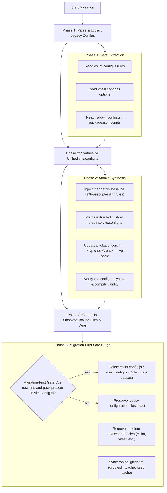

# Vite+ (`vp`) Unified Toolchain & Migration Reference Guide

## 1. Overview & Canonical Purpose

**Vite+** is the unified web toolchain orchestrated behind the `vp` CLI. It integrates and replaces standalone disparate developer utilities into a unified, high-performance runtime and toolset combining:

- **[Vite](https://vite.dev/)**: Next-generation frontend build tool and development server.
- **[Rolldown](https://rolldown.rs/)**: High-performance Rust-based bundler powering next-gen Vite.
- **[Vitest](https://vitest.dev/)**: Blazing-fast unit and integration testing engine.
- **[tsdown](https://tsdown.dev/)**: Zero-config TypeScript library packager powered by Rolldown.
- **[Oxlint](https://oxc.rs/docs/guide/usage/linter.html)** & **[Oxfmt](https://oxc.rs/docs/guide/usage/formatter.html)**: Rust-based JavaScript/TypeScript linter and formatter.
- **[Vite Task](https://github.com/voidzero-dev/vite-task)**: High-speed workspace task runner with intelligent filesystem hashing and caching.
- **Runtime & Package Manager Governance**: Dynamic version coordination for Node.js, npm, pnpm, and yarn.

Within the **`@francogp/auditor`** architecture, Vite+ is the non-negotiable frontend and tooling standard governed by `validate_vite_plus_config`, `validate_oxlint`, and `vitePlusConfigSync.ts`.

---

## 2. Official Tutorial & Prompt Specification

The following prompt represents the authoritative upstream specification for scaffolding, upgrading, and migrating projects to Vite+:

```markdown
I want to use Vite+ in my project. Vite+ is the unified toolchain for the web behind the `vp` CLI — one tool combining Vite, Rolldown, Vitest, tsdown, Oxlint, Oxfmt, and Vite Task, plus runtime and package-manager management.

First, read https://viteplus.dev/llms-full.txt and https://viteplus.dev/guide to learn Vite+'s commands and configuration. Inspect the worktree and preserve unrelated changes. Determine whether I want a new project or want to migrate or upgrade an existing project. Follow only the matching flow below.

For a new project:

Read https://viteplus.dev/guide/create and choose the template, target directory, package manager, and intended Vite+ release or preview for my project. Use the target CLI's `help create` output to select supported options. Scaffold with `vp create`; do not overwrite existing project files.

A global installation is optional. To install the global `vp` CLI when it is not already available:
- macOS / Linux: curl -fsSL https://vite.plus | bash
- Windows (PowerShell): irm https://vite.plus/ps1 | iex

Open a new terminal after installation. Follow https://viteplus.dev/guide/upgrade to select the target release or preview and check `vp toolchain --global` before scaffolding.

Without a global installation, use a supported Node.js runtime from the compatibility guide. For the 1.2.0 release, run `pnpm dlx --package=vite-plus@1.2.0 vp create` or `npm exec --package=vite-plus@1.2.0 -- vp create`. Replace 1.2.0 with the intended release version. For a preview, use the version from its PR and pass `--registry=https://registry-bridge.viteplus.dev` to pnpm or npm before the vp command.

Run `vp install`, `vp check`, and `vp test`, then `vp build` for applications or `vp pack` for libraries. Without a global CLI, install with the project's package manager and run the local CLI through it, such as `pnpm exec vp check` or `npm exec -- vp check`. Explain how to use `vp dev` for the dev server and `vp run <task>` for project scripts or tasks. Report the setup changes, validation results, and any remaining work. Do not commit or push unless I ask.

For an existing project, including one that already uses Vite+, follow these migration or upgrade instructions:

Migrate this project to Vite+ while preserving its application, test, and library build behavior.

Read these guides before making changes:

- https://viteplus.dev/guide/migrate
- https://viteplus.dev/guide/migrate-rules
- https://viteplus.dev/guide/vitest-v5
- https://vitest.dev/guide/migration/
- https://github.com/rolldown/tsdown/releases/tag/v0.23.0

Inspect the worktree and preserve unrelated changes. Identify the workspace root, package manager, scripts, configuration files, and tools in use. If the project already uses Vite+, follow the upgrade flow in the migration guide and keep the existing setup; do not use --full unless I request it.

For a project that does not use Vite+ yet, check the prerequisites for the tools it uses: Vite 7+ and Vitest 4+. Complete any required upstream upgrades and validate them before starting the Vite+ migration. Then keep those manifests, lockfile, and installed packages available so the migrator can identify the original Vitest version. Do not install vite-plus or upgrade Vitest to the target's bundled version before running migration.

Use the CLI from the target Vite+ 1.0 release or its preview build. Use a supported Node.js runtime from the compatibility guide. A global installation is optional:

- With a global vp installation, follow https://viteplus.dev/guide/upgrade to select the target release and check `vp toolchain --global`. Run `vp help` and `vp help migrate`, then `vp migrate --no-interactive` from the workspace root.
- Without a global installation, run the target CLI through the package manager from the workspace root. For the 1.2.0 release, use `pnpm dlx --package=vite-plus@1.2.0 vp migrate --no-interactive` or `npm exec --package=vite-plus@1.2.0 -- vp migrate --no-interactive`. First run the same command with `help migrate` instead of `migrate --no-interactive` to read its help. These commands fetch the target CLI without replacing the old project dependencies first.

Replace 1.2.0 with the intended release version. For a preview, use the version from its PR and pass `--registry=https://registry-bridge.viteplus.dev` to pnpm or npm before the vp command.

Do not run migration with an old project's node_modules/.bin/vp. Migrate monorepos from the workspace root so shared manifests, catalogs, overrides, and lockfiles remain consistent.

Resolve BLOCK findings and rerun migration. Review every REVIEW finding and manual-migration warning using the linked guidance, even if migration exits with success. Keep the generated Vitest v4 and tsdown <0.23 compatibility settings and comments for the first validation run.

Review the resulting changes against the migration rules:

- Confirm Vite and test imports use the supported vite-plus and vite-plus/test* entries. Keep type augmentations on their upstream module identities and the community WebDriverIO provider on @vitest/browser-webdriverio.
- Preserve dependencies, aliases, catalogs, and overrides configured by the migrator. On pnpm, keep the configured vite and vitest entries. Retain upstream packages when the migration rules require them.
- Move remaining tool-specific configuration into the appropriate blocks in vite.config.ts. Review manual follow-up for lint, formatting, packaging, and hooks without discarding project-specific behavior.
- Distinguish built-ins from tasks: `vp dev` and `vp test` run built-in tools; `vp run dev` and `vp run test` run the corresponding project scripts or tasks. The packageManager field selects the package manager used by `vp install`, `vp add`, and `vp remove`.

Run `vp install`, `vp check`, and `vp test`, plus configured browser, coverage, and benchmark suites. Run `vp build` for applications and `vp pack` for libraries, including both where the workspace contains both. Check library consumers against emitted imports and declarations. Without a global CLI, install with the project's package manager and invoke the updated local CLI through it, such as `pnpm exec vp check` or `npm exec -- vp check`. Fix failures without weakening assertions or dropping test coverage.

After establishing a passing baseline, try to remove the generated "Vitest v4 compatibility" settings with no code changes or small, localized fixes:

1. Use the migration diff and generated comments to identify additions in root, workspace, and inline project configs. Read each linked explanation and check the effective setting after removal, including inherited values. Preserve pre-existing user settings and settings whose origin is unclear.
2. Remove one added setting at a time and first run the affected projects and suites without code changes. If needed, make small, localized application, test, or setup fixes that preserve test intent, such as correcting a locator or adjusting mock setup in a few tests. Do not weaken assertions, accept snapshot changes without review, or reduce the test set. For fakeTimers.toNotFake, remove only the added Temporal entry and preserve other exclusions. Do not weaken coverage enforcement: retain glob-threshold perFile: true unless I approve aggregate checking, even if coverage passes.
3. Keep a removal only when the affected tests pass and still execute the same tests without new skips. Remove that setting's generated comment too. If removal requires widespread test edits or shared setup refactoring, keep compatibility for now and report the follow-up work. Restore the setting and its comment if validation still fails, cannot run, or leaves uncertainty about behavior. Undo only cleanup-specific trial edits; preserve completed migration fixes and unrelated work.
4. Run the full validation commands again with the accepted removals together. Report each candidate's config path, removed or retained status, code changes, commands and results, and the reason for retaining it. Distinguish a deferred rewrite from a setting you could not validate.

For projects that use vp pack, also review the generated "tsdown <0.23 compatibility" settings after a passing library build. Use the migration diff and linked comments to distinguish inserted settings from pre-existing user choices. Removing deps.resolveDepSubpath: true preserves external subpath imports as written; check that consumers can still resolve the emitted imports. Removing attw.profile: 'strict' adopts the esm-only profile, which skips node10 and CommonJS resolution checks. Keep strict if those checks are part of the package's intended support. Do not drop intended declaration checks merely to make a build pass. Remove one setting and its generated comment at a time, then run vp pack and the package's consumer checks. Restore the setting and comment if validation fails or the required consumer behavior is unclear. Report which settings remain and why.

Report the migration changes, validation results, retained compatibility settings, and unresolved findings. Do not commit or push unless I ask.
```

---

## 3. Official Documentation Index & Key Links

The authoritative guides provided by Vite+ and VoidZero include:

| Resource | URL | Focus & Scope |
| :--- | :--- | :--- |
| **Complete LLM Knowledge Base** | [https://viteplus.dev/llms-full.txt](https://viteplus.dev/llms-full.txt) | Complete unrolled documentation and API specs for AI agents. |
| **General Guide** | [https://viteplus.dev/guide](https://viteplus.dev/guide) | Architecture, core commands, and toolchain overview. |
| **Project Creation** | [https://viteplus.dev/guide/create](https://viteplus.dev/guide/create) | Scaffolding new applications, libraries, and monorepos. |
| **Migration Guide** | [https://viteplus.dev/guide/migrate](https://viteplus.dev/guide/migrate) | Automated transformation from legacy toolchains to Vite+. |
| **Migration Rules** | [https://viteplus.dev/guide/migrate-rules](https://viteplus.dev/guide/migrate-rules) | Exact transformation invariants for configs, scripts, and imports. |
| **Vitest 5 Upgrade** | [https://viteplus.dev/guide/vitest-v5](https://viteplus.dev/guide/vitest-v5) | Breaking changes, compatibility flags, and cleanup checklist. |
| **Vitest Migration** | [https://vitest.dev/guide/migration/](https://vitest.dev/guide/migration/) | Upstream Vitest breaking change chronicle. |
| **tsdown v0.23 Release** | [https://github.com/rolldown/tsdown/releases/tag/v0.23.0](https://github.com/rolldown/tsdown/releases/tag/v0.23.0) | Library packager configuration updates (`unbundle`, `outExtensions`). |
| **Global Installer (Linux/macOS)** | `curl -fsSL https://vite.plus \| bash` | Global `vp` binary installation script. |
| **Global Installer (Windows)** | `irm https://vite.plus/ps1 \| iex` | PowerShell global installation script. |

---

## 4. CLI Execution Model & Core Commands

Vite+ provides both a **global binary** (`vp`) and a **project-local execution** model:

```bash
# Direct invocation (when global vp is installed)
vp check
vp test
vp pack

# Local-only execution (via package manager)
npm exec -- vp check
pnpm exec vp check
```

### 4.1 Command Taxonomy

```text
┌────────────────────────────────────────────────────────┐
│                   Vite+ CLI Taxonomy                   │
├────────────────────────────┬───────────────────────────┤
│ Built-in Commands          │ Task Runner Commands      │
├────────────────────────────┼───────────────────────────┤
│ `vp dev`   (dev server)    │ `vp run dev`   (script)   │
│ `vp test`  (vitest runner) │ `vp run test`  (script)   │
│ `vp check` (lint+fmt+types)│ `vp run lint`  (script)   │
│ `vp build` (app bundler)   │ `vp run <any-npm-script>` │
│ `vp pack`  (lib packager)  │                           │
└────────────────────────────┴───────────────────────────┘
```

> [!IMPORTANT]
> **Built-ins vs. Tasks**: `vp dev` and `vp test` execute internal Vite+ built-in engines. To execute the corresponding script declared in `package.json.scripts`, you MUST use `vp run <target>` (e.g. `vp run test` or `vp run dev`).

---

## 5. Non-Destructive Migration Protocol (`vitePlusConfigSync.ts`)

In projects governed by `@francogp/auditor`, migration to Vite+ is fully automated via `npm run auditor:fix` (`auditor fix`) through `src/core/vitePlusConfigSync.ts`.

### 5.1 The 3-Phase Safe Migration Sequence



> [!CAUTION]
> **Migration-First, Delete-Last Mandate**: The `cleanLegacyConfigFiles` routine in `vitePlusConfigSync.ts` strictly validates that `vite.config.ts` exists on disk and actively contains all equivalent blocks (`hasTest`, `hasLint`, `hasPack`) before authorizing the deletion of `vitest.config.ts`, `eslint.config.js`, or `tsdown.config.ts`. If any section is missing or the migration process is interrupted, legacy configuration files are preserved intact.

### 5.2 Mandatory Minimum Oxlint Baseline

When synthesizing or validating `vite.config.ts`, `validate_vite_plus_config` enforces an immutable minimum baseline of Oxlint rules:

```ts
import { defineConfig } from 'vite-plus';

export default defineConfig({
  lint: {
    options: {
      typeAware: true,
      typeCheck: true
    },
    rules: {
      '@typescript-eslint/no-explicit-any': 'error',
      '@typescript-eslint/ban-ts-comment': 'error',
      '@typescript-eslint/consistent-type-assertions': [
        'error',
        { assertionStyle: 'as', objectLiteralTypeAssertions: 'never' }
      ]
    },
    ignorePatterns: ['dist/**', 'node_modules/**', 'scratch/**']
  },
  fmt: {
    singleQuote: true,
    semi: true,
    trailingComma: 'none',
    printWidth: 100,
    ignorePatterns: ['dist/**', 'node_modules/**', 'scratch/**']
  }
});
```

Omitting or downgrading any mandatory rule triggers `vite-plus-config-defect` (`severity: 'error'`). In `--fix` mode, the orchestrator automatically injects and repairs these rules and dynamically synchronizes `ignorePatterns` from `audit.config.ts` (`paths.ignoreGlobs`) without losing existing project configuration.

---

## 6. Vitest v5 & tsdown Compatibility Cleanup Strategy

When migrating from legacy projects, `vp migrate` injects temporary compatibility settings:

### 6.1 Vitest v4 Compatibility Settings

1. **Mock Call History**: In Vitest v4, mocks maintained call history across tests in certain configurations. Vitest v5 isolates mocks strictly by default.
2. **`fakeTimers.toNotFake`**: Remove only the added `Temporal` entry; preserve custom timer exclusions.
3. **Coverage Glob Thresholds**: Retain `perFile: true` for strict individual file coverage enforcement.

### 6.2 tsdown <0.23 Compatibility Settings

1. **`bundle: false` $\rightarrow$ `unbundle: true`**: In tsdown 0.23, unbundled file emission is explicitly enabled via `unbundle: true`.
2. **`outExtension` $\rightarrow$ `outExtensions`**: Updated plural property mapping.
3. **`attw.profile`**: Removing `attw.profile: 'strict'` adopts the ESM-only profile. Retain `'strict'` if the package distributes dual CJS/ESM modules.

---

## 7. Verification & Post-Migration Health Checks

Following Vite+ setup or migration, run the full validation suite:

```bash
# 1. Install & resolve dependencies
vp install

# 2. Perform linting, formatting, and type-checks
vp check

# 3. Execute unit and integration tests
vp test

# 4. Compile packages or libraries
vp pack

# 5. Execute full architectural auditor
npm run auditor:full
```

---

## 8. Production Lessons & Edge-Case Architecture Guide (Lessons from Large Codebases)

During large-scale production migrations (such as Poké Vicio with 431 test suites, 7,100+ assertions, Vue 3, Pinia, and GSAP), several edge cases and TypeScript architectural boundaries were discovered and resolved:

### 8.1 TypeScript Plugin Type Recursion ("Excessive stack depth comparing types")

In complex configurations combining multiple third-party Vite plugins (e.g. `vite-plugin-pwa`, `@vitejs/plugin-vue`) alongside inline custom plugins with closures, TypeScript can fail with `Excessive stack depth comparing types 'Plugin<any>' and 'Plugin<any>'` (TS2321 / TS2589) when all plugins are defined inline inside `defineConfig({ plugins: [...] })`.

**Root Cause**: Recursive structural comparison between Vite core types bundled in `vite-plus` and upstream plugin Rollup types.

**Canonical Solution**:

1. **Extract Plugins Array**: Declare the plugins array outside `defineConfig` using the canonical `PluginOption[]` interface:

   ```ts
   import { defineConfig, type PluginOption } from 'vite';
   import vue from '@vitejs/plugin-vue';
   import { VitePWA } from 'vite-plugin-pwa';

   const plugins: PluginOption[] = [
     vue(),
     VitePWA({ ... })
   ];

   export default defineConfig({
     plugins,
     // ... rest of config
   });
   ```

2. **Unify Dependencies via `overrides`**: In `package.json`, align all transitive Vite references to the bundled core using npm's dynamic reference syntax (`"$vite"` and `"$vitest"`):

   ```json
   "overrides": {
     "vite": "$vite",
     "vitest": "$vitest"
   }
   ```

   This binds transitive references directly to whatever version is declared in `devDependencies`, preventing version drift, hardcoded version conflicts, and fatal npm `EOVERRIDE` crashes during upgrades.

### 8.2 Eradication of Obsolete `environmentMatchGlobs`

In Vitest 3+ and Vite+, `environmentMatchGlobs` in project configurations is deprecated and silently ignored or triggers runtime warnings.

**Canonical Solution**:

- Scoped project tests declare their execution environment via the official docblock directive on line 1:

  ```ts
  // @vitest-environment jsdom
  import { describe, it, expect } from 'vite-plus/test';
  ```

- Centralized node projects (`tests/node/`) run under the default `'node'` environment without needing file-level annotations.

### 8.3 ANSI Terminal Escapes in Test Log Assertions

Node.js 26+ native styling (`styleText` from `node:util`) injects ANSI VT sequences (`\u001b[...m`). Tests spying on `console.warn` or `console.error` that perform exact string comparisons will fail due to terminal color codes.

**Canonical Solution**:

- Use regex matching or strip ANSI sequences before assertion:

  ```ts
  expect(warnSpy).toHaveBeenCalledWith(
    expect.stringMatching(/⚠️ \[Warning\] Target message/)
  );
  ```

### 8.4 Clean Test Import Architecture

Never retain dual imports or direct `'vitest'` dependencies. Ensure 100% of test files import primitives from `'vite-plus/test'`:

```ts
import { describe, it, expect, vi, beforeEach, afterEach } from 'vite-plus/test';
```

### 8.5 Third-Party Rollup Plugins Type Compatibility (`as PluginOption`) & Custom Vite Plugins

When declaring plugins in `vite.config.ts`, third-party Rollup plugins often declare slightly incompatible Rollup `Plugin` types with Vite's internal `Plugin` type bundled in `vite` / `vite-plus`. (Note: for bundle size and compression statistics, use native `vp pack` size reports instead of external visualizer plugins).

**Canonical Solution**:

1. Cast third-party Rollup plugins as `as PluginOption` when instantiating them:

   ```ts
   import type { PluginOption } from 'vite';
 
   const plugins: PluginOption[] = [
     vue(),
     ...(customPlugin() as PluginOption)
   ];
   ```

2. Type custom Vite plugins explicitly with the `: Plugin` return type from `'vite'`:

   ```ts
   import type { Plugin } from 'vite';

   function myCustomPlugin(): Plugin {
     return {
       name: 'my-custom-plugin',
       configureServer(server) { ... }
     };
   }
   ```

### 8.6 Oxlint Type-Aware Mode with Vue SFCs (`src/env.d.ts`)

When `typeAware: true` or `typeCheck: true` is configured in `vite.config.ts` for Oxlint (`vp check`), Oxlint's underlying TypeScript type checker requires module resolution for Vue SFC (`.vue`) imports referenced across TypeScript code.

Without an ambient declaration, Oxlint throws module resolution errors (`Cannot find module '@/components/Foo.vue'`).

**Canonical Solution**:

Ensure `src/env.d.ts` (included in `tsconfig.json` `include` list) declares the standard Vue module:

```ts
/// <reference types="vite/client" />

declare module '*.vue' {
  import type { DefineComponent } from 'vue';
  const component: DefineComponent<{}, {}, any>;
  export default component;
}
```

### 8.7 Oxfmt vs. Html-Validate Doctype Harmonization (`doctype-style: lowercase`)

Vite+'s code formatter (`vp fmt` / `oxfmt`) enforces lowercase `<!doctype html>` in `index.html` following modern HTML and Prettier/Biome standards.
However, `html-validate:recommended` (when auditing top-level HTML files via `validate_html_validate`) enforces uppercase `<!DOCTYPE html>` by default under its `doctype-style` rule.

**Canonical Solution**:

Align `.htmlvalidate.json` so both tools agree deterministically without relaxing standards:

```json
{
  "extends": ["html-validate:recommended", "html-validate-vue:recommended"],
  "rules": {
    "doctype-style": ["error", { "style": "lowercase" }]
  }
}
```

This preserves strict doctype validation while allowing `oxfmt` to format the root `index.html` cleanly.

### 8.8 Multi-line SCSS Variables with Oxfmt vs. Stylelint

When `oxfmt` formats long lists or arrays in SCSS (e.g. `$font-mono: '...', '...';`), it may collapse them into single lines or wrap them across colons, potentially triggering Stylelint's `scss/dollar-variable-colon-space-after` or `declaration-colon-space-after`.

**Canonical Solution**:

Structure long variables as an indented multiline list with an inline trailing comment on the first line (e.g., `// Monospace stack`). This instructs `oxfmt` to preserve the multiline structure and satisfies strict Stylelint spacing rules.

---

### 8.9 Vitest Workspace Projects & Runner Isolation Protocol (SSoT Anti-Contamination Mandate)

In complex repositories with multiple test environments (such as frontend JSDOM unit tests, Node.js backend logic tests, and ephemeral database migrations), Vitest supports inline workspace projects:

```ts
// vite.config.ts
export default defineConfig({
  test: {
    projects: [
      {
        test: {
          name: 'unit',
          environment: 'node',
          environmentOptions: { jsdom: { pretendToBeVisual: true } },
          include: ['tests/unit/**/*.{test,spec}.ts', 'src/**/*.{test,spec}.ts'],
          setupFiles: ['./tests/vitest.setup.ts']
        }
      },
      {
        test: {
          name: 'node',
          environment: 'node',
          include: ['tests/node/**/*.test.ts'],
          setupFiles: ['./tests/vitest.node.setup.ts']
        }
      }
    ]
  }
});
```

#### The Runner Cross-Contamination Pitfall

In Vitest, if a root `include: [...]` array exists on `test:` alongside `projects: [...]`, Vitest uses the root include as a global matcher. When running `vitest run --project unit`, Vitest will execute **all** tests matching the root include (including backend Node and database tests) under the `unit` runner with `vitest.setup.ts`, causing false positive failures.

#### SSoT Governance in `.auditor/audit.config.ts`

To ensure 100% deterministic auto-fixing without guessing or manual editing, configure `vitePlusConfig.test.projects` in `.auditor/audit.config.ts`:

```ts
// .auditor/audit.config.ts
export default defineAuditConfig({
  paths: {
    srcRoots: ['src'],
    testRoots: ['tests', 'test_aventura/tests']
  },
  vitePlusConfig: {
    enabled: true,
    test: {
      projects: {
        unit: ['tests/unit', 'tests/integration', 'src'],
        node: ['tests/node', 'test_aventura/tests']
      }
    }
  }
});
```

#### Canonical Auditor Guarantees

1. **Anti-Contamination Enforcement**: `validate_vite_plus_config` (`vite-plus-config-ts`) flags any root `test.include` coexisting with `test.projects` as a blocking error.
2. **Deterministic Auto-Fix (`auditor fix`)**: Purgers the root `test.include` from `vite.config.ts`, maps each declared root to its corresponding project's `include`, and leaves custom project properties (`setupFiles`, `globals`, `environmentOptions`) completely intact.
