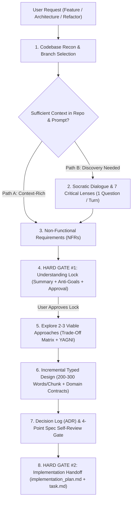

# Brainstorming Ideas Into Validated Designs

## Purpose

Turn raw ideas and partially formed requests into **clear, stress-tested, and strongly-typed architectural designs** through structured codebase reconnaissance and Socratic dialogue **before a single line of implementation code is written**.

Why this skill exists:

- **Eliminate Premature Implementation**: Writing code before locking requirements and invariants wastes 10x more effort when architectural flaws surface mid-build.
- **Defeat Sycophancy & XY Problems**: Passive agreement with a user's first idea often builds an over-engineered solution to the wrong underlying problem.
- **Surface Hidden Assumptions & Anti-Goals**: Making implicit beliefs, non-functional requirements, and unacceptable failure modes explicit upfront prevents fragile systems.
- **Produce Code-Shaped Contracts**: Handing off typed interfaces, state machines, and test seams eliminates ambiguity during execution.

> [!IMPORTANT]
> **Hard Gate on Implementation**: You are strictly prohibited from writing application code, modifying source files, or executing refactoring mutations while this skill is active. Your role is **Senior Design Partner & Architectural Sparring Facilitator**.

---

## Operating Mode & Language Governance

1. **Dynamic Language Separation**: Always consult `.auditor/audit.config.ts` to respect the repository's dual-language contract:
   - Conduct all interactive user dialogue, questions, option matrices, and summaries in `config.documentation.chatLanguage` (e.g., Spanish `'es'`).
   - Write all repository documentation, code contracts, comments, and DOX indices in `config.documentation.language` (e.g., English `'en'`).
2. **Evidence Over Guesswork**: Never ask the user a question that the repository already answers. Inspect relevant files first.
3. **Sparring Partner, Not Passive Scribe**: Challenge fragile assumptions politely, highlight hidden complexity, and always include a radical simplification (*YAGNI / do-least*) option.
4. **No Silent Assumptions**: Every unverified belief about scale, behavior, or environment must be voiced and explicitly confirmed.

---

## Progressive Disclosure Reference Map

To keep this core workflow fast and focused while providing deep engineering rigor, consult these specialized reference manuals inside `./references/` as you progress through the stages:

| Reference Manual | When to Read | What It Contains |
| :--- | :--- | :--- |
| **[`critical-thinking-lenses.md`](./references/critical-thinking-lenses.md)** | **Before Stage 2 & Stage 5** | Full guide to the **7 Critical Thinking Lenses** (First Principles, Contrarian Pre-Mortem, Anti-Goals, Prior Art, Expert Panel, Radical YAGNI, Edge-Case Stress Test) and the **`ask_question` Socratic Playbook**. |
| **[`nfr-and-architecture-seams.md`](./references/nfr-and-architecture-seams.md)** | **Before Stage 3, Stage 5 & Stage 6** | Comprehensive **NFR Taxonomy & Default Baselines**, **7-Dimension Trade-Off Matrix**, **Typed Call-Stack Contracts** ([`/domain-type-first`](../domain-type-first/SKILL.md)), and **Hermetic Test Seam** patterns. |
| **[`design-doc-and-review-checklist.md`](./references/design-doc-and-review-checklist.md)** | **Before Stage 7 & Stage 8** | Running **ADR Decision Log** format, **4-Point Spec Self-Review Gate** (anti-placeholder & ambiguity scan), **Canonical Design Spec Template**, and **Pre-Handoff Governance Checklist**. |

---

## The 8-Stage Brainstorming Workflow

---

### 1️⃣ Stage 1: Codebase Recon & Branch Selection (Mandatory First Step)

Before asking a single question, ground yourself in the current state of the workspace:

- **Inspect Existing Context**:
  - Read relevant source modules, governing `AGENTS.md` files ([`/dox-navigator`](../dox-navigator/SKILL.md)), `.auditor/audit.config.ts`, and recent commits if applicable.
  - Identify **Local Precedent**: How does the codebase currently structure similar modules, domain types, error handling, and tests?
  - Identify **The Delta**: What exists today vs. what must change, and what implicit constraints the current architecture imposes.
- **Select the Execution Branch**:
  - **Path A (Context-Rich / Fast-Track to Lock)**: If the user's prompt combined with existing codebase conventions and documentation already provides clear scope, constraints, and patterns, **do not ask redundant questions**. Synthesize your recon findings, propose sensible NFR defaults (Stage 3), and present the **Understanding Lock (Stage 4)** directly for confirmation.
  - **Path B (Interactive Discovery / Grill First)**: If core intent, domain boundaries, trade-off priorities, or acceptance criteria are ambiguous or underspecified, proceed to **Stage 2**.

> [!TIP]
> **Why**: Asking the user questions they already answered in code or docs wastes their time and erodes trust. Recon turns generic questions into razor-sharp architectural questions.

---

### 2️⃣ Stage 2: Socratic Discovery & The 7 Critical Thinking Lenses

When on **Path B**, guide the user to clarity through disciplined, high-leverage dialogue. Consult **[`critical-thinking-lenses.md`](./references/critical-thinking-lenses.md)** for question banks and deep analytical prompts.

#### The Rules of Dialogue

- **One Question Per Message**: Never ask multiple questions in a single turn. Overloading the user causes decision fatigue and shallow answers.
- **Mandatory `ask_question` Tool for Discrete Choices**: Whenever a question can be framed around 2–5 distinct choices (e.g., architectural direction, failure policy, scope trade-off), you **MUST** invoke the `ask_question` tool rather than writing options in plain text.
  - Place your recommended option first and prefix it with `(Recommended)`.
  - Do not add a manual `"Other"` option (the UI provides a write-in field automatically).
- **Plain Text Only for Unbounded Exploration**: Use a single open-ended plain-text question only when you need the user to describe a real-world workflow or pain point in their own words.
- **Fast-Forward Escape Hatch**: In your very first discovery message, briefly note in one line that if the user prefers to skip the interview and have you propose concrete defaults immediately, they can say so at any time.

#### Apply the 7 Critical Thinking Lenses Internally

Filter the user's request through these seven lenses to uncover blind spots:

1. **First Principles**: What is the irreducible state change or data transformation? Are we solving the root problem or an XY symptom?
2. **Contrarian / Pre-Mortem**: If this fails in six months or becomes a maintenance burden, why did it happen? What if we don't build it?
3. **Anti-Goals**: What outcome would make this a failure *even if all functional requirements pass* (e.g., latency regression, leaky abstraction, noisy warnings)?
4. **Prior Art & Local Precedent**: Which existing module in the repo solves an analogous problem, and should we mirror or evolve its contract?
5. **Expert Panel**: How does this look through the eyes of Security ([`/security-and-hardening`](../security-and-hardening/SKILL.md)), Performance ($O(1)$ data structures), Domain Typing ([`/domain-type-first`](../domain-type-first/SKILL.md)), and Hermetic Testing?
6. **Radical Simplification (YAGNI)**: What is the 20% of effort that delivers 80% of value?
7. **Real-World Edge Cases**: Empty state, $100\times$ scale, malformed input, concurrency, cross-platform paths (Linux vs. Windows), and idempotency.

---

### 3️⃣ Stage 3: Non-Functional Requirements (NFRs) & Sensible Defaults

Explicitly clarify or propose concrete assumptions for the system's operational envelope. Consult **[`nfr-and-architecture-seams.md`](./references/nfr-and-architecture-seams.md)** for the full NFR taxonomy and repository baselines:

- **Performance & Algorithmic Complexity**: Target latency, $O(1)$ vs. $O(n)$ lookups (`Map`/`Set`), single-pass file/AST caching.
- **Scale & Memory Bounds**: Expected dataset/file cardinality and heap limits.
- **Security & Boundary Validation**: Schema parsing at boundaries ([`/valibot`](../valibot/SKILL.md)), path containment (`node:path`), ReDoS/injection prevention.
- **Reliability, Failure Policy & Idempotency**: Fail-loud contracts (`throw new Error(...)`), atomic writes, deterministic re-execution.
- **Cross-Platform & Maintainability**: POSIX/Windows parity, configuration SSoT (`.auditor/audit.config.ts`), and DOX ownership.

If the user has not stated NFR targets, **do not interrogate them on every point**—propose the repository's sensible defaults and list them clearly under **Assumptions** in Stage 4.

---

### 4️⃣ Stage 4: Understanding Lock (Hard Gate #1)

Before proposing **any architectural design**, you MUST pause and present the **Understanding Lock**:

1. **Understanding Summary (5–7 Bullets)**:
   - **Core Objective & Why**: What is being built and the root problem it solves.
   - **Target Consumers / Callers**: Who or what interacts with this capability.
   - **The Codebase Delta**: What changes vs. what stays untouched.
   - **Key Technical Invariants & NFRs**: Complexity, security, and platform constraints.
   - **Explicit Non-Goals (Out of Scope)**: What we are intentionally excluding.
   - **Explicit Anti-Goals (Unacceptable Outcomes)**: What must never be compromised.
2. **Explicit Assumptions**: Every default or unverified belief you are relying on.
3. **Open Questions**: Any remaining unresolved question (should be zero before locking).

- **Mandatory Closing Confirmation** (via `ask_question` or direct prompt):
  *"Does this Understanding Lock accurately capture your intent, constraints, and anti-goals? Please confirm or adjust before we evaluate architectural approaches."*

> [!CAUTION]
> **Hard Stop**: Do NOT proceed to Stage 5 until the user explicitly confirms the Understanding Lock.

---

### 5️⃣ Stage 5: Explore 2–3 Viable Design Approaches

Once the Understanding Lock is confirmed, prevent tunnel vision by comparing **2 to 3 materially different architectural approaches**. Consult **[`nfr-and-architecture-seams.md`](./references/nfr-and-architecture-seams.md)** for the 7-dimension evaluation matrix:

- **Lead with an Opinionated Recommendation**: Clearly mark your recommended approach first and explain *why* it wins given the locked invariants.
- **Include a Minimal / "Do-Least" Baseline**: At least one option must represent the simplest possible change ([`/ponytail`](../ponytail/SKILL.md) / YAGNI) that satisfies the core requirement without new layers.
- **Compare Across Concrete Dimensions**:
  - Module depth (deep interface vs. shallow pass-throughs, per [`/codebase-design`](../codebase-design/SKILL.md)).
  - Locality of invariants & blast radius (how many files change).
  - Caller burden & boundary type safety.
  - Hermetic test seam strategy.
  - Maintenance & complexity cost.

Use `ask_question` to let the user select or customize the preferred architectural approach.

---

### 6️⃣ Stage 6: Present the Design Incrementally (Typed Contracts & Seams)

Once an approach is selected, present the detailed engineering design. Consult **[`nfr-and-architecture-seams.md`](./references/nfr-and-architecture-seams.md)** for typed contract templates:

- **Incremental Pacing**: Break complex designs into digestible sections (**200–350 words per section**) or structured cohesive blocks, validating alignment with the user (*"Does this contract and data flow look right so far?"*) before moving to the next layer.
- **Prefer TypeScript Contracts Over Prose ([`/domain-type-first`](../domain-type-first/SKILL.md))**:
  - Sketch canonical `as const` tuples and derived finite union types.
  - Sketch **Branded Nominal Types** for IDs and validated paths.
  - Sketch **Discriminated Unions** for state machines and execution outcomes (making illegal states unrepresentable).
  - Sketch public class/function signatures and expected error contracts.
- **Cover the 6 Essential Architectural Pillars**:
  1. **Architecture & Module Boundaries**: High-level structure and Mermaid data-flow diagram (always quote Mermaid node labels containing special characters).
  2. **Typed Domain Contracts**: Inputs, outputs, state variants, and SSoT config properties.
  3. **Entrypoint-to-Side-Effect Call Stack**: Step-by-step execution trace.
  4. **Error Handling & Failure Semantics**: How invalid inputs and runtime failures fail loudly.
  5. **Boundary Edge Cases**: How the 7 stress-test conditions from Stage 2 are handled.
  6. **Hermetic Testing Strategy & Seams**: Clean path, violation path, warning/edge path, and idempotency verification without fragile mocks.

---

### 7️⃣ Stage 7: Decision Log & 4-Point Spec Self-Review Gate

Maintain a running **Decision Log (ADR table)** throughout the session and run the **Spec Self-Review Gate** before handoff. Consult **[`design-doc-and-review-checklist.md`](./references/design-doc-and-review-checklist.md)** for the full checklist and templates:

1. **Decision Log Completeness**: Every major architectural choice, rejected alternative, and governing rationale is recorded.
2. **Zero-Placeholder Scan**: Verify zero occurrences of `TODO`, `TBD`, `FIXME`, `???`, or vague hand-waves (*"handle errors appropriately"*).
3. **Internal Consistency Check**: Ensure TypeScript signatures, Mermaid diagrams, and file paths match 100%.
4. **Two-Engineer Ambiguity Test**: Confirm that two engineers reading the spec independently would build compatible contracts and tests.

If the user requested a persistent design document in the repository, write it using the **Canonical Design Specification Template** in [`design-doc-and-review-checklist.md`](./references/design-doc-and-review-checklist.md) and index it via [`/dox-navigator`](../dox-navigator/SKILL.md).

---

### 8️⃣ Stage 8: Implementation Handoff (Hard Gate #2)

This is the final, non-negotiable gate before transitioning from design (*what/why*) to execution (*how*):

1. **Create or Update `implementation_plan.md` Artifact**:
   - Set `RequestFeedback: true` and `UserFacing: true` in `ArtifactMetadata`.
   - Include the validated architecture, exact file modifications (`[NEW]`, `[MODIFY]`, `[DELETE]`), typed contracts, Decision Log summary, and exact verification commands.
   - **Mandatory Pillar Compliance**: Explicitly enforce compliance with [`/architecture`](../architecture/SKILL.md), [`/domain-type-first`](../domain-type-first/SKILL.md), [`/clean-code`](../clean-code/SKILL.md), [`/ponytail`](../ponytail/SKILL.md), [`/dox-navigator`](../dox-navigator/SKILL.md), and [`/auditor`](../auditor/SKILL.md).
2. **Create or Update `task.md` Artifact** (when managing multi-step execution):
   - Break the implementation into granular, ordered, independently verifiable steps.

> [!IMPORTANT]
> **Mandatory Review Before Coding**: Stop calling tools after presenting the implementation plan artifact and wait for the user's explicit approval before writing or modifying any project source code.

---

## Exit Criteria (Hard Stop Conditions)

You may exit brainstorming mode and begin implementation **only when all 6 criteria are satisfied**:

1. **Understanding Lock** was explicitly confirmed by the user.
2. **Anti-Goals and NFR Assumptions** are documented and validated.
3. **At least 2–3 viable approaches** were compared and one was explicitly chosen.
4. **Typed Contracts & Test Seams** are specified without `TODO`/`TBD` placeholders.
5. **Decision Log (ADR)** captures the rationale behind key trade-offs.
6. **Implementation Plan Artifact (`implementation_plan.md`)** has been submitted and explicitly approved by the user.

---

## Related Skills

- [`/architecture`](../architecture/SKILL.md) — Master 5-pillar architectural governance framework.
- [`/domain-type-first`](../domain-type-first/SKILL.md) — Strict compile-time domain unions, branded IDs, and zero loose types.
- [`/codebase-design`](../codebase-design/SKILL.md) — Designing deep modules, clean boundaries, and high-leverage seams.
- [`/dox-navigator`](../dox-navigator/SKILL.md) — Hierarchical `AGENTS.md` indexing and documentation integrity.
- [`/grill-with-docs`](../grill-with-docs/SKILL.md) — Intensive stress-testing interview that records ADRs and glossary terms on the fly.
- [`/to-spec`](../to-spec/SKILL.md) — Synthesizing an existing discussion into a standalone specification issue/document.
