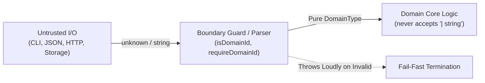

# Anti-Pattern Guide: Diluted String Unions (`DomainType | string`)

## 1. The Subsumption Fallacy

In TypeScript and type theory, when a union combines a specific subtype or branded domain type with its open primitive supertype:

$$\text{DomainType} \subseteq \text{string} \implies \text{DomainType} \cup \text{string} \equiv \text{string}$$

Because every value of `DomainType` is already a `string`, the TypeScript type checker performs **Type Subsumption** and collapses the union to `string`.

### Consequences of Subsumption

- **Zero Static Safety**: TypeScript permits any arbitrary, invalid string (`""`, `"123"`, `"banana"`) without emitting a compilation error.
- **Typographic Illusion**: The parameter or property appears to demand a domain type, but at compile time it accepts any primitive.
- **Boundary Leakage**: Unvalidated external data passes directly into core business logic without explicit boundary guards or parsing.

---

## 2. Core vs Boundary Architecture

The foundational principle of `/domain-type-first` is strict separation of concerns between untrusted boundaries and trusted domain core:



### Rule

- **At the Boundary**: Accept `unknown` or `string`. Use boundary guards (`isDomainId`, `requireDomainId`) or Valibot/Zod schemas to validate.
- **In the Core**: Function and method parameters **MUST ALWAYS** demand pure domain types (`DomainType`). Accepting `DomainType | string` in core functions is strictly prohibited.

---

## 3. Anti-Patterns vs Canonical Solutions

### Case 1: Function Parameter with Domain Code / ID

```typescript
// ❌ ANTI-PATTERN: Open union collapses to 'string', permitting arbitrary strings
export function verifyAuthorization(
  code: RelaxationCode | string,
  options: Options = {}
): Result {
  const clean = code.trim(); // code can be literally anything!
  ...
}

// ✅ CANONICAL SOLUTION (Core Function): Demand pure domain type
export function verifyAuthorization(
  code: RelaxationCode,
  options: Options = {}
): Result {
  ...
}

// ✅ CANONICAL SOLUTION (Boundary Guard for Untrusted Input):
export function isRelaxationCode(raw: string): raw is RelaxationCode {
  return /^RELAX-[0-9a-fA-F]{8}$/.test(raw.trim());
}

export function requireRelaxationCode(raw: string): RelaxationCode {
  if (!isRelaxationCode(raw)) {
    throw new Error(`[Domain] Invalid RelaxationCode: '${raw}'`);
  }
  return raw;
}
```

---

### Case 2: Template Literal Branded Type

Template literal types such as ``type RelaxationCode = `RELAX-${string}` & { readonly __brand?: 'RelaxationCode' }`` already validate the prefix structure at compile time.

```typescript
// ❌ ANTI-PATTERN: Diluting template literal with 'string'
export function processCode(code: `RELAX-${string}` | string) { ... }

// ✅ CANONICAL: Use the pure template literal branded type
export function processCode(code: RelaxationCode) { ... }

// The compiler naturally accepts valid template literals:
processCode('RELAX-abcdef12'); // ✅ Compiles without cast
processCode('invalid-string'); // ❌ TS2345: Argument not assignable to RelaxationCode
```

---

### Case 3: Finite Status or Mode Unions

```typescript
export type ProcessMode = 'fast' | 'safe' | 'full';

// ❌ ANTI-PATTERN: Wildcard union defeating compile-time exhaustiveness
export function runProcess(mode: ProcessMode | string): void {
  switch (mode) {
    case 'fast': return;
    case 'safe': return;
    case 'full': return;
    default:
      // Fallback required because mode can be any string!
  }
}

// ✅ CANONICAL: Strict finite domain union
export function runProcess(mode: ProcessMode): void {
  switch (mode) {
    case 'fast': return;
    case 'safe': return;
    case 'full': return;
    // TypeScript guarantees exhaustiveness at compile time!
  }
}
```

---

## 4. Enforcement & Static Tooling

This mandate is enforced automatically by:

1. **Oxlint Plugin (`@francogp/domain-type/no-naked-string-union`)**:
   Inspects `TSUnionType` AST nodes and reports an immediate error whenever `TSStringKeyword` is mixed with `TSTypeReference`, `TSLiteralType`, or `TSTemplateLiteralType`.
2. **Auditor Suite (`validate_domain_types / domain-naked-string-primitive`)**:
   Audits function parameter signatures across all source roots, blocking `param: DomainType | string` patterns.
