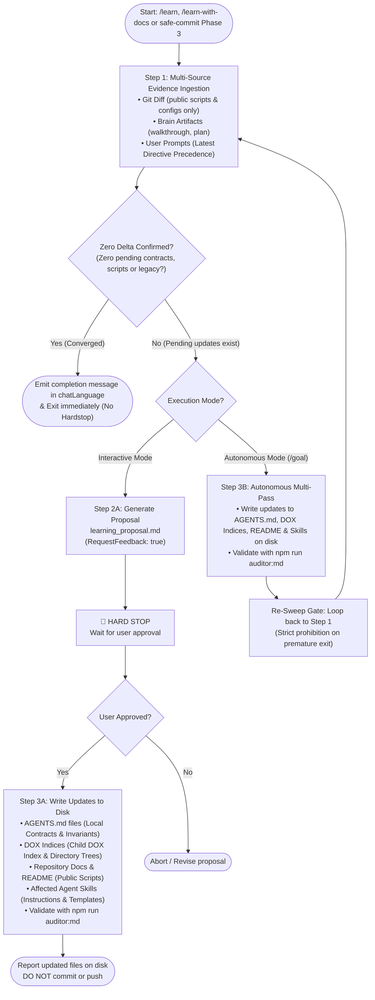

# Learn With Docs

Specialized skill for extracting, synthesizing, and persisting newly acquired knowledge, explicit user corrections, bad-practice warnings, bug resolutions, and architectural decisions into the hierarchical DOX (`AGENTS.md`) tree, host program documentation (`README.md`, `docs/**`), and agent skills (`.agents/skills/**`), while rigorously adapting all documentation surfaces to match working tree reality, eliminating legacy or contradictory content, and cleanly terminating autonomous loops (such as `/goal`) without hanging.

---

## 🎯 Core Principles

1. **Multi-Source Evidence Ingestion (Git Diff, Work Plans & User Prompts)**:
   - A complete learning analysis MUST NEVER rely on isolated memory. It systematically examines three distinct sources of truth:
     1. **Git Changes Since Last Commit**: Inspect `git status -s`, `git diff HEAD`, and staged/unstaged changes across `src/**`, `tests/**`, configs, and scripts to identify structural changes, modified package scripts, new CLI entrypoints, and configuration schema changes. Internal implementation details and private functions are NOT documented for their own sake.
     2. **Conversation Artifacts & Work Plans**: Inspect `<appDataDir>/brain/<conversation-id>/`:
        - `walkthrough.md`: Verification summaries, executed tasks, test results, bug root causes, and architectural rationale.
        - Work Plans (`plan.md`, `/plan` artifacts, task lists, roadmap artifacts): The plan of record, design decisions, and architectural intentions agreed upon in the session.
        - Other brain artifacts generated during the conversation.
     3. **User Prompts & Conversation History**: Scrutinize **every prompt provided by the user** throughout the session. Specifically extract:
        - Explicit user corrections and reprimands (e.g. instructions correcting invalid assumptions or tool misuse).
        - Bad practices or code smells pointed out by the user (e.g. anti-patterns, premature abstractions, improper tool usage).
        - User advice, recommendations, tips, and stylistic/architectural preferences.
        - Directives establishing project invariants or constraints.
        - **Preexisting Working Tree Immutability & Anti-Checkout Mandate**: Modifications present in `git status` prior to the session start belong exclusively to the human developer. The agent must NEVER revert them with `git checkout --`, `git restore`, or assume they are errors to be discarded. When a user says "do not change configurations", it strictly means LEAVE INTACT the configurations in the user's working tree, never revert them.
        - **Deterministic Skills CLI Update Mandate**: Never manually edit or forge hashes in `skills-lock.json`. Updates must be executed via `npm exec --yes -- skills update -p -y`.
        - **Latest Directive Precedence Mandate**: If multiple user prompts across the session contain conflicting guidance or if the user refined an earlier statement, the latest confirmed directive takes absolute precedence. The agent must formulate contracts strictly from the latest stance, discarding superseded instructions.

2. **Comprehensive Documentation, AGENTS.md, DOX & Skill Harmonization**:
   - When new lessons, architectural standards, or working tree changes are identified, the skill inspects and harmonizes across all distinct surfaces:
     1. **`AGENTS.md` Governance Files**: Local contracts (`## Local Contracts`), directory descriptions, module boundaries, and architectural invariants placed at the most specific child boundary.
     2. **Hierarchical DOX Indices**: Navigation tables, tree mappings, and child DOX indices (`## Child DOX Index`) ensuring index integrity and relative path validity.
     3. **Host Program & Repository Documentation**: Root and nested `README.md`, `docs/**`, architecture guides, manuals, and script tables of the program where the auditor is running.
     4. **Agent Skills & Bundled Resources (`.agents/skills/**` or `skills/**`)**: Internal `SKILL.md` instructions, `references/**`, `examples/**`, and `templates/**` / `assets/**`.

3. **Active Eradication of Legacy, Deprecated & Contradictory Content**:
   - Actively identify and purge:
     - **Obsolete / Legacy Documentation**: Instructions, command tables, scripts, prerequisites, or code samples describing obsolete workflows or superseded tools.
     - **Deprecated APIs, Flags & Contracts**: Commands, CLI flags, configuration keys, or methods that have been removed or deprecated in the codebase.
     - **Direct Contradictions**: Any statement, rule, or example prescribing pattern $P$ when the session's implementation or user directive established $\neg P$.
     - **Missing Invariants**: Newly added package scripts, CLI commands, configuration options, or architectural invariants that lack documentation.
   - **STRICTLY PROHIBITED**: Unrelated repository-wide sweeps (fixing random typos or auditing unimpacted modules). The scope is strictly anchored to the changes and lessons of the current session.

4. **Deduplication Check, Zero Redundant Proposals & Loop Convergence**:
   - The proposal artifact (`learning_proposal.md`) MUST ONLY contain actions, contracts, or harmonizations that have **NOT YET BEEN PERFORMED** on disk.
   - If a file, skill, or document was already updated in the working tree, it is already staged or modified on disk and MUST NOT be re-proposed.
   - Convergence is achieved ONLY when a full verification sweep confirms that all lessons, architectural contracts, public script documentation, and contradiction purges are already fully reflected on disk with zero remaining findings. Only then does the agent state clearly in `chatLanguage` that all documentation, DOX indices, and skills are 100% synchronized and no further learning is required, stopping immediately without generating `learning_proposal.md` or triggering a feedback gate.

5. **Precise Hierarchical DOX Placement (Target Boundary)**:
   - Always place the primary rule in the **most specific child `AGENTS.md`** governing that module or domain.
   - **NEVER default to root `AGENTS.md`** unless the learning is truly universal and affects the entire repository.
   - Never pollute host project DOX files with upstream framework (`@francogp/auditor`) internals.

6. **Absolute Prohibition of Git Commit and Push**:
   - `learn-with-docs` is **NOT** a version control or release tool.
   - It is **STRICTLY FORBIDDEN** for this skill to run `git commit`, `git push`, create git tags, or modify `package.json` versions.
   - The skill's scope ends when the approved learning and harmonization diffs are written to disk in the working tree. Versioning, staging, committing, and pushing belong exclusively to `/safe-commit` (Phase 4) or manual user commands.
   - A `learning_proposal.md` MUST NEVER propose or mention `git commit`, `git push`, tags, or release operations.

7. **Dynamic Auditor Configuration Language Governance (Zero Hardcoding)**:
   - The agent MUST dynamically consult `.auditor/audit.config.ts` to determine the configured languages:
     - **Documentation & File Writing Language (`config.documentation.language`)**: Governs repository documentation, markdown files committed to git, DOX indices (`AGENTS.md`), commit messages, git tags, and the code diffs/contracts presented inside `learning_proposal.md`.
     - **AI Chat & Conversational Language (`config.documentation.chatLanguage`)**: Governs all direct interactive chat communication, user interviews, options matrices, `ask_question` dialogs, AND the narrative explanations and section headers in brain artifacts (`learning_proposal.md`, `walkthrough.md`).
   - **Zero Hardcoding**: Skills and agents MUST NEVER hardcode language names or assume fixed languages without consulting `.auditor/audit.config.ts`.
   - **Zero Language Mixing**: Within each section, code block, or file, the chosen language must be strictly maintained without mixed-language paragraphs.

8. **Autonomous Loop Governance & Strict Zero-Delta Convergence (`/goal` Mode)**:
   - When executing inside an autonomous loop (such as `/goal`, unattended multi-turn workflows, or scheduled runs):
     - **Categorical Prohibition on Premature Completion**: The agent MUST NEVER declare that "no further learning is required" simply because it completed the first iteration or just applied a batch of changes. Applying changes in iteration 1 often reveals downstream contradictions, unupdated cross-references, or secondary documentation needs across related files.
     - **Strict Zero-Delta Convergence Mandate**: The terminal statement confirming that no further learning is required can ONLY be emitted when an independent, exhaustive sweep across all 3 pillars confirms that:
       1. **Zero Missing Architectural Contracts**: All new architectural boundaries, invariant rules, and non-obvious bug resolutions from the session are recorded in the governing child `AGENTS.md` under `## Local Contracts`.
       2. **Zero Missing Public Script/CLI Docs**: Any new or modified package script (`package.json`), CLI entrypoint (`src/cli/**`), or configuration key (`.auditor/audit.config.ts`) is documented in `README.md` and host guides. Internal code, helper functions, and private implementations are NEVER documented just for the sake of it.
       3. **Zero Unpersisted User Directives**: Every explicit user correction, bad-practice warning, or advice from the transcript is captured as an enforceable invariant.
       4. **Zero Active Contradictions or Legacy Snippets**: No obsolete commands, deprecated APIs, removed flags, or conflicting instructions remain across any surface.
     - **Autonomous Multi-Pass Execution in Goal Mode**: When running autonomously:
       1. Apply pending updates to the working tree.
       2. Run `npm run auditor:md` to verify Markdown integrity.
       3. Re-execute Step 1 verification sweep. If additional updates or contradictions are found, proceed with another pass.
       4. ONLY when a complete verification pass confirms strictly zero remaining deltas, emit the termination message in `chatLanguage` and conclude the loop.

---

## 📋 The 3-Step Execution Protocol



### Step 1: Multi-Source Evidence Ingestion & Contradiction Sweep

1. **Ingest Working Tree Changes (Last Commit to Now)**:
   - Run `git status -s` and `git diff HEAD` to identify all changed, added, or deleted files.
   - Specifically check for:
     - Modified package scripts (`package.json`) and CLI entrypoints (`src/cli/**`).
     - Configuration schema or options changes (`.auditor/audit.config.ts`, etc.).
     - Architectural boundary shifts or new sub-systems in `src/**`.
     - (Note: Do NOT document internal code, private functions, or trivial bugfixes).
2. **Ingest Conversation Artifacts & Work Plans**:
   - Read `<appDataDir>/brain/<conversation-id>/walkthrough.md` for verification evidence, resolved bugs, and implementation notes.
   - Read `<appDataDir>/brain/<conversation-id>/plan.md` or `task.md` for planned architectural changes, technical decisions, and roadmaps.
   - Check any other brain artifacts created in the conversation directory.
3. **Systematically Mine User Prompts**:
   - Review each user message in the session history chronologically.
   - Apply **Latest Directive Precedence**: When earlier user advice conflicts with a later refinement, the latest directive supersedes earlier positions.
   - What bad practices did the user point out or warn against?
   - What errors or oversights did the user correct?
   - What advice, tips, preferences, or guidelines did the user impart?
   - Formulate concise, actionable invariants/contracts from user guidance.
4. **Locate Target DOX Boundary & Affected Surfaces**:
   - Use `dox-navigator` to identify the most specific child `AGENTS.md` governing the changed code or domain.
5. **Execute Targeted Contradiction & Legacy Sweep across 3 Pillars**:
   - **Host Program Documentation (`README.md`, `docs/**`)**: Identify obsolete commands, removed flags, missing documentation for new scripts/options, or contradictory explanations.
   - **DOX Indices (`AGENTS.md`)**: Identify outdated local contracts or rules conflicting with the new code or user guidance.
   - **Agent Skills (`.agents/skills/**`)**: Check `SKILL.md`, `references/**`, `examples/**`, and `templates/**` for deprecated syntax, outdated advice, or conflicting instructions.
6. **Strict Zero-Delta Convergence Verification & Hard-Stop Bypass Check**:
   - Verify what is already modified on disk.
   - If and ONLY IF an exhaustive verification sweep across all 3 pillars confirms that strictly zero missing architectural contracts, zero missing public script/CLI docs, zero unpersisted user directives, and zero contradictions exist:
     - Output the terminal completion message in `chatLanguage` confirming that all documentation is synchronized and no further learning is required.
     - **Bypass Step 2 completely** (do NOT generate `learning_proposal.md`, do NOT request feedback).
     - Conclude the turn immediately, releasing control to the caller or ending the `/goal` loop.
   - If any unpersisted contracts, missing public script docs, or contradictions are found, proceed to Step 2.

### Step 2: Proposal Artifact (`learning_proposal.md`)

When pending unpersisted learnings exist, proceed based on execution mode:

#### Mode A: Interactive Execution (Standard Session)

Create `<appDataDir>/brain/<conversation-id>/learning_proposal.md` using `write_file` with:

- `ArtifactMetadata`:
  - `UserFacing: true`
  - `RequestFeedback: true`
  - `Summary`: Multi-line summary rendered in `config.documentation.chatLanguage` summarizing extracted lessons, target DOX boundary, and documentation/skill updates.

#### Mode B: Autonomous Loop Execution (`/goal` Mode)

When invoked within an autonomous `/goal` instructing unattended completion:

- Skip interactive `RequestFeedback`.
- Proceed directly to applying changes as described in Step 3.
- After application and verification, loop back to Step 1 to re-verify convergence. Do NOT prematurely emit the loop termination statement.

#### Proposal Canonical Structure

Render section headers and narrative text dynamically in `config.documentation.chatLanguage`, while embedding code diffs and formal contracts in `config.documentation.language`:

````markdown
# Learning Proposal & Documentation Synchronization

## 1. Context & Extracted Lessons

### 1.1 User Guidance & Corrections (Session Prompts)

- **Flagged Bad Practices / Corrected Errors**: <What the user corrected or warned against>
- **Key Advice & Directives**: <Key advice, tips, or guidelines provided by the user>

### 1.2 Implementation Invariants (Git Diff & Work Plans)

- **Key Changes**: <Summary of code changes, new scripts, or resolved root causes>
- **Established Invariant**: <Enforceable rule statement>

## 2. Primary DOX Boundary (Target AGENTS.md)

- `path/to/target/AGENTS.md` (under `## Local Contracts`)

### Proposed Contract (Diff)

```markdown
- **<Contract Name>**: <Enforceable rule text in documentation language>
```

## 3. Host Program & Repository Documentation Modernization (`README.md`, `docs/**`)

<!-- If none pending, write that repository documentation is already synchronized -->

- **Target File**: `README.md`
- **Reason**: <Document new command, remove legacy flag, or update script table>
- **Modernization Diff**:

```markdown
<<<<
<Old or legacy text>
====

<New modernized text>
>>>>
```

## 4. Agent Skills & Bundled Resources Harmonization (`.agents/skills/**`)

<!-- If none pending, write that agent skills are already synchronized -->

- **Affected Skill / Resource**: `.agents/skills/<skill-name>/...`
- **Reason**: <Update instructions, references, examples, or templates to match new reality>
- **Harmonization Diff**:

```markdown
<<<<
<Old instructions or deprecated code>
====

<New instructions or updated examples>
>>>>
```

## 5. Contradiction & Legacy/Deprecated Purge

<!-- If none detected, write that no legacy fragments or contradictions were detected -->

- **Conflicting File**: `path/to/conflicting/file.md`
- **Detected Conflict / Deprecated Pattern**: <Explain why it is legacy, deprecated, or contradictory>
- **Purge / Remediation Diff**:

```markdown
<<<<
<Obsolete or contradictory content>
====

<Clean or harmonized content>
>>>>
```
````

> [!IMPORTANT]
> **🛑 HARD STOP & Final Tool Call Mandate (Interactive Mode Only)**:
>
> 1. In Interactive Mode, `learning_proposal.md` MUST be the **FINAL tool call** executed in the turn so the native interactive feedback card stays active in the UI.
> 2. Present direct clickable Markdown links: `👉 [learning_proposal.md](file://...)` (and `[walkthrough.md](file://...)` if available).
> 3. **STOP EXECUTION IMMEDIATELY** and wait for user confirmation.
> 4. In Autonomous Mode (`/goal`), this hard-stop is bypassed once convergence is verified.

### Step 3: Application to Working Tree

Once approved by the user (Interactive Mode) or executing autonomously (`/goal` Mode):

1. **Apply the Primary Learning**:
   - Insert the proposed rule into the target `AGENTS.md` under `## Local Contracts` using editing tools.
2. **Apply Documentation & README Modernizations**:
   - Update `README.md`, `docs/**`, script tables, and manuals as proposed.
3. **Apply Skill & Bundled Resource Harmonizations**:
   - Update affected `SKILL.md`, references, examples, or templates.
4. **Purge Legacy, Deprecated & Contradictory Snippets**:
   - Apply contradiction removals and replace deprecated code snippets.
5. **Format Sanity Check**:
   - Run `npm run auditor:md` to verify that Markdown syntax, links, and table formatting remain valid.
   - Do NOT run Vitest or code test suites (`npm test`) — this is purely a documentation text update.
6. **Stop & Report**:
   - Report the updated files clearly to the user or orchestrator.
   - **DO NOT declare completion prematurely**: In autonomous loops (`/goal`), applying changes in an iteration does NOT mean learning is complete. The agent must loop back to Step 1 to perform an independent verification sweep. Only when a complete sweep finds strictly zero pending updates, zero unpersisted directives, and zero contradictions across all surfaces may the terminal completion statement be emitted.
   - **DO NOT COMMIT. DO NOT PUSH.** Leave the working tree modified and ready for the user's next action (such as `/safe-commit`).

---

## 📚 Reference Guides

- For detailed extraction patterns, prompt classification heuristics, and legacy detection checklists, see [evidence-mining-guide.md](./references/evidence-mining-guide.md).
