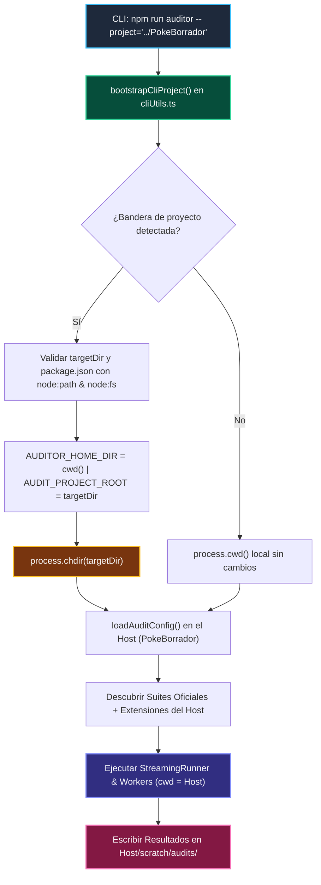

# @francogp/auditor

> **Autonomous static analysis, architectural governance, AI agent skills packaging, and zero-tolerance code quality engine for native Node.js 26+ (`--permission`, `--experimental-strip-types`).**

Provides the `BaseAuditor` and `FileScanAuditor` object-oriented frameworks, streaming concurrent runner, standardized Box-Drawing terminal reporting (80 fixed columns, visual width emoji alignment, and mandatory `TOTAL CONSOLIDADO` footer row), built-in generic suites across all architectural families, **native distribution of Antigravity AI agent skills**, **centralized single source of truth (SSoT) dependencies**, and a **cross-platform environment governance system (Linux/Windows) with zero hardcoded paths**.

---

## 📑 Table of Contents

1. [Key Features & Architectural Architecture](#1-key-features--architectural-architecture)
2. [Quickstart & Local Environment Setup](#2-quickstart--local-environment-setup)
3. [Host Project Installation & Governance](#3-host-project-installation--governance)
4. [Execution Modes & Capability-Driven Presets](#4-execution-modes--capability-driven-presets)
5. [Strict Type Safety & Vite+ (Oxlint) Governance](#5-strict-type-safety--vite-oxlint-governance)
6. [Integrated Quality & Analysis Tools (SSoT)](#6-integrated-quality--analysis-tools-ssot)
7. [Bundle & Performance Packaging with Vite+](#7-bundle--performance-packaging-with-vite)
8. [AI Agent Integration (57 Antigravity Skills)](#8-ai-agent-integration-57-antigravity-skills)
9. [Authoring Custom Sub-Auditors](#9-authoring-custom-sub-auditors)
10. [Centralized Configuration (`audit.config.ts`)](#10-centralized-configuration-auditconfigts)
11. [Hermetic Testing with Vite+ & Vitest](#11-hermetic-testing-with-vite--vitest)
12. [CLI Tools & Reporters Reference](#12-cli-tools--reporters-reference)
13. [License & Third-Party Open Source Attribution](#13-license--third-party-open-source-attribution)

---

## 1. Key Features & Architectural Architecture

- **Built-In Generic Architectural Suites**: Comprehensive static verification across 6 canonical families (`architecture/`, `domain_data/`, `persistence/`, `performance/`, `security/`, `documentation/`).
- **Capability-Driven Auto-Coordination (`AuditorRuleCapabilities`)**: Sub-auditors declare explicit 7-field orthogonal per-rule capabilities (`speed: 'light' | 'heavy' | 'full' | readonly AuditExecutionSpeed[]`, `phase: 'normal' | 'post-run' | 'post-build'`, `fix: 'none' | 'normal' | 'priority'`, `md: boolean`, `ast: boolean`, `changedOnly: boolean`, `critical: boolean`) with 100% mandatory completeness and zero fallbacks. `BaseAuditor` derives suite-level `AuditorCapabilities` automatically from `ruleCapabilities`. No hardcoded suite lists in runners or scanners.
- **3-Tier Speed Engine (`light` `🐇`, `heavy` `🐢`, `full` `🐘`) & `TieredCommandProfile`**: Supports cumulative ceiling mode (`speed=light|heavy|full`, default `speed=heavy`) and exact isolation mode (`only-speed=light|heavy|full`). Multi-profile suites (such as `validate_oxlint`) declare `speed: ['light', 'full']` so fast modes run syntax-only (`🐇` ~2s) while `speed=full` (`🐘`) enables deep type-aware rules.
- **RAM Optimization (`WorkspaceFileCache` & `scanFilesSinglePass`)**: Deduplicates file reads across rules via `WorkspaceFileCache` (`getFileLines()`, `getFileContent()`, `scanFilesSinglePass(files, handlers)`), enforced by `validate_auditor_hygiene` (`auditor-inefficient-file-scan`).
- **Strict Domain-Type-First Governance**: Complete static eradication of arbitrary type bypasses (`: any`, `as any`, `<any>`, and `as unknown as`) and legacy `new Date()` / `Date.now()` constructors in favor of Temporal API.
- **Automated Vite+ Configuration Auditor (`validate_vite_plus_config`)**: Statically analyzes `vite.config.ts` to ensure host projects enforce strict type safety, banning `any`, double casting, and legacy dates, while prohibiting legacy standalone configs.
- **Official Living Specification Engines**: Standards enforcement via official linters (`html-validate`, `stylelint`, `knip`, `publint`, `type-coverage`, `vue-tsc`) rather than handcrafted regex.
- **Fallow Intelligence & Vector Semantic Duplication**: Code complexity, dead code, circular dependencies, CWE security sink auditing (100% error severity mandate), and Candle CPU vector embeddings (`jina-embeddings-v2-base-code`) with OS cache pre-creation.
- **Child Process Stream Isolation (`executeCliAndReadJson`)**: External subprocesses pipe stdout directly to ephemeral file descriptors, preventing output truncation and heap exhaustion.
- **Declarative CLI Contracts & Citty Governance (`validate_cli_contracts`, `citty@^0.2.2`)**: Eliminates homebrew argument parsing and brittle `process.argv` checks across all CLI binaries, tools, and extensions. Standardizes on `citty` with declarative argument typing, automatic non-hyphenated token normalization (`human` -> `--human`, `key=val` -> `--key=val`), and subcommands.
- **UnifiedTheme Box-Drawing Output**: 80-column terminal tables with exact Unicode visual width measurement (`getVisualWidth`), live progress badges, and mandatory `TOTAL CONSOLIDADO` footer row.

---

## 2. Quickstart & Local Environment Setup

When developing directly inside `@francogp/auditor`:

### Initial Setup (Locked to Declared Versions)

Installs dependencies and locks Node.js to the exact version declared in `.node-version` without passing any flags:

```bash
# On Linux / macOS
./setup-linux.sh

# On Windows (PowerShell)
.\setup-windows.ps1
```

### Environment Update (Upgrade to Latest Engine & Dependencies)

Upgrades Node.js, npm, project dependencies, and companion models to the latest versions:

```bash
# On Linux / macOS
./update-linux.sh

# On Windows (PowerShell)
.\update-windows.ps1
```

> [!IMPORTANT]
> **Hermetic Multi-Project Coexistence & Windows Security**:
> Setup scripts preserve all other installed Node.js versions on the host, activate local versions via `.node-version` (with `.nvmrc` fallback) without overriding NVM's `default` alias, scope npm configurations strictly to project `.npmrc` without mutating `~/.npmrc`, and automatically enforce local Git repository settings (`core.filemode false`, `core.autocrlf input`, `core.eol lf`). On Windows, `setup-windows.ps1` configures Windows Defender exclusions and removes Zone.Identifier marks for native Fallow binaries, requesting UAC elevation interactively if executed in a non-elevated terminal for NVM for Windows installation via winget and Defender whitelist configuration.

---

## 3. Host Project Installation & Governance

Install `@francogp/auditor` in any consumer project (Vue/React applications, backend APIs, libraries, or monorepos) as a development dependency directly from GitHub using npm:

### Direct Installation from GitHub via npm

Install `@francogp/auditor` as a development dependency pinned to a release tag (e.g. `#v10.0.0`):

```bash
npm install -D github:francogp/auditor#v10.0.0 --allow-git=all
```

The `--allow-git=all` flag is needed only on the first install (npm 12+ blocks git dependencies by default and fails with `EALLOWGIT`). Afterwards the pre-flight bootstrap writes `allow-git=all` to `.npmrc`, so subsequent installations work without flags.

Or declare it directly in `package.json` using a **pinned release tag** (floating `#semver:*` ranges and branch references are strictly prohibited to ensure deterministic `npm ci` deploys):

```json
{
  "devDependencies": {
    "@francogp/auditor": "github:francogp/auditor#v10.0.0"
  }
}
```

Then install:

```bash
npm install
```

### Zero-Setup Pre-Flight Auto-Bootstrap (npm 12+ Native Architecture)

In **npm 12+**, lifecycle installation scripts (`preinstall`, `postinstall`) are blocked by default for security (`allowScripts: false`). Rather than relying on fragile install hooks, `@francogp/auditor` implements a transparent **Pre-Flight Zero-Setup Auto-Bootstrap engine** (`ensureProjectBootstrapped`) that executes automatically upon the very first run of `auditor` or `npm run auditor`:

1. **Virgin Projects**: Automatically scaffolds `.auditor/audit.config.ts` with 100% of discovered sub-auditors and registered extensions initialized with their canonical default configurations.
2. **Existing / Older Projects**: Detects newly added sub-auditors or missing configuration sections, automatically injecting them via TypeScript Compiler AST (`appendMissingSectionsToConfigFile`) without altering any existing user settings.
3. **Antigravity AI Agent Discovery**: Automatically registers `.agents/plugins.json` and `.agents/skills.json` so Antigravity AI agents instantly discover all 52+ skills without duplicating files.
4. **Git Hygiene**: Automatically synchronizes required `.gitignore` tool cache entries (`scratch/`, etc.).
5. **npm 12+ git dependencies**: Ensures `.npmrc` contains `allow-git=all` (idempotent, preserves other lines) for git dependencies resolution without flags.
6. **CI/CD Safety**: In automated CI environments (`process.env.CI = 'true'`), auto-mutation is cleanly inhibited to ensure deterministic and immutable build gates.

### Updating from GitHub (`auditor-update`)

To update `@francogp/auditor` across your project, use the dedicated native updater. By default, it automatically discovers and installs the latest release tag from GitHub upstream:

```bash
npm run auditor:update
# or directly:
auditor-update
```

You can also target a specific release version (including major version upgrades):

```bash
npm run auditor:update -- v9.0.0
# or directly:
auditor-update v9.0.0
```

`auditor-update` atomically updates `package.json` with the pinned tag, updates `package-lock.json`, synchronizes agent skills in `.agents/skills/`, synchronizes setup scripts (`setup-windows.ps1` and `setup-linux.sh`), and runs `auditor fix`.

> Dependency changes use `npm install` to regenerate `package-lock.json`; commit it together with `package.json`. Setup scripts install with `npm ci` and, if it fails because the lockfile is out of sync, fall back to `npm install` and print a warning that the lockfile was modified.

### Mandatory Minimum Library Versions (`validate_dependency_minimums`)

The auditor exposes a conditional version floor for shared libraries (`typescript`, `vite-plus`, `vue`, `vue-router`, `pinia`, `gsap`, `valibot`, `sass`, `html-validate`, `markdownlint-cli`, `fallow`, `@playwright/test`) through the **optional `peerDependencies`** of `@francogp/auditor/package.json` (single source of truth, no hardcoded versions).

- If your project declares one of these libraries (`dependencies`, `devDependencies`, `optionalDependencies`), both the declared range and the version locked in `package-lock.json` must be at least the auditor floor; otherwise the audit fails with the exact command (e.g. `npm install -D vite-plus@^1.2.0`).
- Libraries you do not use are never required (peers are optional, so npm does not install them).
- To raise a floor for every consumer, edit the auditor `peerDependencies` and release a new tag.

#### Inspecting Minimum Dependencies CLI (`auditor-dependencies`)

To inspect governed dependencies, verify compliance against the current auditor floors, and obtain exact install commands:

```bash
npm run auditor:dependencies
# or directly:
auditor-dependencies
# or via sub-command:
auditor dependencies
```

Supported options:

- `--json`: Emit structured JSON output (`ProjectDependenciesReport`) for scripts and AI agents.
- `--outdated`: Filter table to display only dependencies whose declared range or installed version is below the mandatory floor.
- `--undeclared`: Display only auditor-governed libraries not currently declared in the host project.
- `--strict`: Exit with code 1 if any declared dependency is outdated (ideal for CI pipelines).
- `--project=<path>`: Inspect dependencies of a specific host project directory.

### 3.2. Auditor Configuration Architecture & SSoT (`.auditor/audit.config.ts`)

Every host project is governed by a Single Source of Truth configuration file located strictly at `.auditor/audit.config.ts` (or `.auditor/audit.config.json`):

```typescript
import { defineAuditConfig } from '@francogp/auditor';

export default defineAuditConfig({
  name: 'MiProyecto',
  // Sincronizado automáticamente por el bootstrap del auditor (SemVer + Build ID):
  auditorVersion: '10.0.0-build.20261022-194620',
  paths: {
    srcRoots: ['src'],
    testRoots: ['tests'],
    scriptsRoots: ['scripts']
  },
  documentation: {
    language: 'en', // Idioma del repositorio (código, docs, commits)
    chatLanguage: 'es' // Idioma de interacción y chat del agente de IA
  },
  testCoverage: {
    enabled: true,
    threshold: 82,
    enforceInAudit: true
  },
  fallow: {
    enforceTargets: true,
    maxTargetPriority: 'high'
  }
});
```

#### Core Invariants of the Configuration Engine

- **`auditorVersion` (Full SemVer + Build ID)**: Declares the exact running version and build timestamp. The pre-flight bootstrap engine (`ensureProjectBootstrapped`) dynamically detects missing or diverged versions and build IDs, synchronizing them immediately without manual intervention.
- **Preservation vs. Critical Override Contract**: Existing user configurations (paths, thresholds, custom options) are **100% preserved**. Only properties that explicitly violate mandatory minimums or critical policies defined by sub-auditors (`criticalConfig`) are overridden or repaired.
- **AST In-Place Injection**: When new sub-auditors or host extensions declare configuration sections (`configKey`), the engine injects missing sections via TypeScript Compiler AST using idiomatic formatting: trailing commas attached to closing braces (`},`), zero orphaned commas (`}\n,\n`), and unquoted object keys in `.ts` files.

### Automated Package Scripts Setup (`auditor fix`)

Every sub-auditor and registered host extension automatically derives and exposes its canonical package scripts (`auditor:<short-id>` and CLI utilities) via `PackageScriptRegistry`.

To automatically and non-destructively inject missing auditor scripts into your host `package.json`, simply run:

```bash
auditor fix
# or if running via npm:
npm run auditor:fix
```

The engine will:

1. Inspect all active built-in sub-auditors and registered host extensions.
2. Check for naming collisions across commands (`[COLISIÓN DE COMANDOS]`).
3. Inject any missing scripts into your `package.json` without modifying or duplicating your existing custom scripts or aliases.
4. Automatically chain `npm run auditor:full` and `npm run auditor:post-build` into your `build` script.

### 3.1. AI Agent Installation & Onboarding Protocol (Environment & Config First)

When an AI coding agent (Antigravity, Claude, Cursor, Copilot, etc.) integrates, installs, or updates `@francogp/auditor` in any host repository, it **MUST strictly execute this sequence**:

> [!IMPORTANT]
> **Environment & Auditor Configuration Priority Mandate**:
> When running fixes, the engine and agents **MUST ALWAYS PRIORITIZE ENVIRONMENT AND AUDITOR CONFIGURATION FIRST**. If the environment (`.npmrc`, `setup-windows.ps1`/`setup-linux.sh`), `.auditor/audit.config.ts`, and root linter configurations are not established before running code inspections, downstream fixers will fail or execute against malformed standards.

#### Step 1: Declare the Dependency

Add `@francogp/auditor` to `devDependencies` in `package.json` pinned to an exact release tag (e.g. `"github:francogp/auditor#v10.0.0"`), or install via `npm install -D github:francogp/auditor#v10.0.0 --allow-git=all`.

#### Step 2: Bootstrap the Environment

Run project setup scripts (`./setup-linux.sh` on Linux/macOS, `.\setup-windows.ps1` on Windows) or `npm install`. The canonical setup scripts automatically unlock native Windows binaries (`Unblock-File`), configure Windows Defender exclusions (requesting UAC elevation if required for `fallow-similar-code.exe`), initialize local AI vector embedding models, and execute initial synchronization.

#### Step 3: IMMEDIATELY Run `auditor fix` (`npm run auditor:fix`)

The very first action an AI agent MUST perform after installing or upgrading the package is executing auto-fix:

```bash
npm run auditor:fix
# or directly:
auditor fix
```

In fix mode, `@francogp/auditor` executes **100% serially (`concurrency = 1`)** with `sharedAstContext` disabled across 4 deterministic sequential phases (`FIX_MODE_EXPLICIT_ORDER`) so that zero file write race conditions occur between fixers:

1. **Phase 1 — Configuration & Project Bootstrap (`fix: 'priority'`)**: `validate_audit_config`, `validate_git_config`, `validate_environment_engines`, `validate_dependency_minimums`, `validate_package_hygiene`, `validate_package_scripts`, `validate_tsconfig`, `validate_vite_plus_config` (via TypeScript Compiler AST in `viteConfigAst.ts`), `validate_playwright_config`, `validate_fallow_config`, `validate_stylelint_config`, `validate_html_validate_config`, `validate_markdown_lint_config`, and `validate_agent_plugin`.
2. **Phase 2 — Structural & AST Code Repair (`fix: 'normal'`)**: `audit_project`, `audit_rules`, `validate_script_extensions`, `validate_accessibility`, `validate_component_styles`, `validate_z_index`, `validate_sql_anti_patterns`, `validate_agents_config_mandate`, `validate_markdown_code_references`, `validate_markdown_syntax`, and `validate_mermaid_syntax`.
3. **Phase 3 — Third-Party Linter Repair (`fix: 'normal'`)**: `validate_oxlint`, `validate_stylelint`, `validate_html_validate`, and `validate_markdown_lint`.
4. **Phase 4 — Final Formatting Pass (`fix: 'normal'`)**: `validate_oxfmt` runs as the absolute final step so all repaired files and configurations end in 100% canonical formatting.

#### Step 4: Verify Clean Baseline

Establish the clean baseline by running fast presets:

```bash
npm run auditor:lint
npm run auditor:md
```

#### Step 5: Absolute Prohibition on Silencing Rules

AI agents and developers are strictly forbidden from suppressing, disabling, or bypassing audit rules in panic (`"rule": "off"`, skip flags, etc.). All architectural findings must be legitimately resolved in the source code or repaired via canonical tools.

---

## 4. Execution Modes & Capability-Driven Presets

### 4.1. AI-Friendly Compact Mode (Default) vs. Human Mode (`:human`)

By default, all auditor commands execute in an **AI-friendly compact mode** that outputs a concise, non-polluting 3-line status in English:

```text
✔ AUDIT PASSED [73/80 suites] in 1.42s
  Errors: 0 | Warnings: 0 | Ratchet: OK
  Report: scratch/audits/latest_audit.json
```

For human programmers desiring interactive progress, per-rule telemetry (`🔍 [X/Y]`), and full 80-column Box-Drawing summary tables, pass `human`, `format=human`, or invoke dedicated `:human` package scripts:

```bash
# Interactive human inspect mode with Box-Drawing tables and live telemetry:
npm run auditor:human
npm run auditor:lint:human
npm run auditor:full:human
npm run auditor:fix:human
npm run auditor:findings:human

# Or pass CLI flag directly (using positional 'human' to avoid npm intercepting flags):
npm run auditor human
auditor human
auditor --human
```

Node.js native permission warnings (`PERM0002`) are cleanly silenced using `--disable-warning=PERM0002` while preserving 100% of real actionable warnings.

### 4.2. Default Project Audit (`speed=heavy` `🐢`) & Exhaustive Audit (`auditor:full` / `speed=full` `🐘`)

The 3-tier speed engine classifies rules across `light` (`🐇`), `heavy` (`🐢`), and `full` (`🐘`), supporting both **cumulative ceiling mode** (`speed=<tier>`) and **exact tier isolation** (`only-speed=<tier>`):

```bash
# Default audit (speed=heavy 🐢 — executes light 🐇 + heavy 🐢 suites):
npm run auditor
# or directly with binary in PATH:
auditor

# Exhaustive pre-commit / build gate (speed=full 🐘 — executes light 🐇 + heavy 🐢 + full 🐘):
npm run auditor:full
# or:
auditor speed=full

# Exact tier isolation (e.g., execute ONLY heavy 🐢 or ONLY full 🐘 suites):
auditor only-speed=heavy
auditor only-speed=full
```

- Streams real-time progress in completion order across background workers, displaying each task's speed tier badge (`🐇`, `🐢`, or `🐘`).
- Renders the Box-Drawing consolidated summary table with the `TOTAL CONSOLIDADO` footer row.
- Saves full structured results to `scratch/audits/latest_audit.json`.

### 4.3. Dynamic Discovery & Suite Introspection (`--list`, `--info`)

Discover and inspect suites dynamically without reading source code:

```bash
# Render 80-column Box-Drawing table of all discovered suites and capabilities:
auditor --list

# Emit complete manifest catalog in JSON format (AuditorManifestDTO[]):
auditor --list --json

# Inspect single suite specification, purpose, evaluated rules, and configuration key:
auditor --info=validate_oxlint

# Interactive CLI help manual and specialized refactoring tools catalog:
npm run auditor:help
# or directly:
auditor --help

# Specific rule step-by-step diagnostic & remediation manual:
npm run auditor:guide -- <ruleId>
# or directly:
auditor guide <ruleId>
```

### 4.4. Fast Light Preset (`auditor:lint` / `speed=light` `🐇`)

Dynamically isolates and executes only suites declaring `speed: 'light'` (or multi-profile `speed: ['light', 'full']` in light syntax-only mode) in milliseconds:

```bash
npm run auditor:lint
# or:
auditor speed=light
```

Discovers `light`-tier (`🐇`) suites dynamically (including Oxlint syntax-only mode, Stylelint, HTML-Validate, Markdownlint, A11y, Domain Types, Vue SFC hygiene, and AST checkers).

### 4.5. Documentation Preset (`preset=md`)

Dynamically isolates and executes suites declaring `md: true` in their `ruleCapabilities`:

```bash
npm run auditor:md
# or:
auditor preset=md
```

Discovers documentation suites dynamically (including DOX hierarchy, Markdown syntax, link integrity, Mermaid diagram syntax, code references, and authentic documented commands).

### 4.6. Auto-Fix Mode (`auditor fix`)

Dynamically isolates and runs only suites declaring `fix: 'priority'` or `fix: 'normal'` under the dedicated `[ 🛠️ MODO REPARACIÓN AUTOMÁTICA ]` terminal interface (`fix: 'priority'` suites execute first):

```bash
npm run auditor:fix
# or:
auditor fix
```

Auto-repair suites include: `validate_audit_config`, `validate_git_config`, `validate_vite_plus_config`, `validate_fallow_config`, `validate_agent_plugin`, `validate_oxlint`, `validate_oxfmt`, `validate_stylelint`, `validate_html_validate`, `validate_markdown_lint`, `validate_package_hygiene` (Knip dependency fixes), and `validate_z_index`.

### 4.7. Built-In Warning Ratchet (0 errors, 0 new warnings)

Every full default run (`npm run auditor` / `auditor`) and exhaustive run (`npm run auditor:full`) enforces the warning ratchet. Each warning is fingerprinted by content (suite, rule, file, normalized source line, occurrence index), so moving code does not change it, while new or edited offending lines do. The run fails when any fingerprint is missing from `.auditor/audit-baseline.json` as committed at `ratchet.productionRef` (default `origin/main`), including warnings in files you did not touch.

```bash
git fetch origin
npm run auditor                     # 0 errors + 0 new warnings vs origin/main
npm run auditor -- --init-baseline  # one-time bootstrap when the production ref has no baseline yet
```

- The baseline only shrinks: clean full runs rewrite it when warnings disappear; commit the updated file.
- Local fingerprints absent from the production baseline, a missing local baseline, or an unresolvable ref fail loudly. There is no accept-new escape hatch.
- Partial runs (`speed=light`, `only-speed=...`, `preset=md`, families, tasks, rules, `changed-since`, `fix`, `phase=post-build`) skip the ratchet.
- CI checkouts must expose the production ref (for example `fetch-depth: 0`).
- The former `audit:for-commit` / `auditor-commit` gate is removed; `validate_audit_config` flags leftover scripts (`audit-config-removed-commit-gate`) and `auditor fix` rewrites them.

### 4.8. Post-Build Artifact Phase (`auditor:post-build` / `phase=post-build` / `auditor-post-build`)

Dynamically isolates and executes suites declaring `phase: 'post-build'` against compiled distribution artifacts in `dist/`:

```bash
npm run auditor:post-build
# or:
auditor phase=post-build
# or directly via binary:
auditor-post-build
```

Executes `validate_bundle_budget` post-compilation against `dist/` (ATTW and Publint are executed natively by `vp pack`).

### 4.9. Deployment Build Runner (`build:deploy` / `auditor-build-deploy`)

In headless deployment environments (Docker builds, deployment scripts, CI containers), execute:

```bash
npm run build:deploy
# or directly:
auditor-build-deploy
```

Under `AUDITOR_ENV=production`:

- Automatically skips `validate_similar_code` (Candle CPU vector embeddings).
- Automatically skips `validate_test_coverage` (coverage artifacts are git-ignored and not generated in production).
- Executes all remaining static analysis suites and post-build verification (`auditor:post-build`) at 100% strictness.

### 4.9. Remote Project Execution (`--project`, `-p`)

During framework development or refactoring of `@francogp/auditor`, you can test changes, auto-fixers, and new sub-auditors against any local repository on the same machine **without publishing, linking (`npm link`), or committing to GitHub**:

```bash
# Run full audit against another project on the local disk:
npm run auditor -- project="../PokeBorrador"

# Run quick lint against remote project:
npm run auditor:lint -- project="../PokeBorrador"

# Run auto-fix on remote project:
npm run auditor:fix -- project="../PokeBorrador"

# Inspect findings report from remote project:
npm run auditor:findings -- project="../PokeBorrador"
```

#### Supported Flag Formats

- `--project=<path>` or `--project <path>`
- `project=<path>`
- `-p <path>` or `-p=<path>`

#### Architecture & Subprocess Coordination



- **Early Chdir**: Operates natively in the host's directory, ensuring Oxlint / Vite+, Stylelint, HTML-Validate, Fallow (Candle CPU), and Git inspect local host configs directly.
- **Binary Fallback**: If an external linter binary is not installed in the host's `node_modules/.bin/`, the framework falls back to `AUDITOR_HOME_DIR/node_modules/.bin/`.
- **Zero Host Pollution**: Runs directly from `@francogp/auditor` in memory and writes reports directly into `host/scratch/audits/`.

### 4.10. Findings & Rule Inspection Tools (`auditor:next`, `auditor:findings`, `auditor:rules`, `auditor:by-file`)

Inspect, filter, and drill down into audit findings recorded in `scratch/audits/latest_audit.json` without writing custom inspection scripts:

```bash
# Focus sequentially on the earliest active strategic phase (setup -> prune -> dedup -> contracts -> behavior -> hygiene -> polish):
npm run auditor:next
# or in human-readable boxed format:
npm run auditor:next:human

# View finding counts grouped by rule in an 80-col Box-Drawing table:
npm run auditor:rules
# or:
auditor-findings rules

# Filter findings by a specific rule ID:
npm run auditor:findings -- rule=vue-sfc-lang-ts

# Exhaustive un-truncated output (ideal for AI agents and terminals):
npm run auditor:findings -- flat

# Filter by multiple files or directories:
npm run auditor:findings -- file=src/core/version.ts,src/cli/report_findings.ts

# Hierarchical directory tree view:
npm run auditor:by-file
```

---

## 5. Strict Type Safety & Vite+ (Oxlint) Governance

All repositories governed by `@francogp/auditor` enforce strict `/domain-type-first` principles:

1. **Unified Configuration (`vite.config.ts`)**:
   - `@typescript-eslint/no-explicit-any: 'error'`
   - `@typescript-eslint/ban-ts-comment: 'error'`
   - Double casting restriction (`as unknown as`) and legacy `new Date()` / `Date.now()` ban.
2. **Static AST Rule `forbiddenTypeCasts`**:
   - Evaluated by `audit_project.ts` across all source roots.
   - Detects `: any`, `as any`, `<any>`, and `as unknown as` with zero tolerance.
   - Requires explicit interfaces, branded types, or domain guards.
3. **Vite+ Config Sub-Auditor (`validate_vite_plus_config`)**:
   - Automatically inspects and self-heals `vite.config.ts` to prevent regressions or accidental disabling of type safety rules, while guaranteeing legacy configuration files (`eslint.config.js`, `vitest.config.ts`) remain eradicated.

---

## 6. Integrated Quality & Analysis Tools (SSoT)

`@francogp/auditor` serves as the Single Source of Truth for static analysis dependencies:

| Tool                          | Integrated Suite                                                             | Capability                                                                                                                                                                    |
| :---------------------------- | :--------------------------------------------------------------------------- | :---------------------------------------------------------------------------------------------------------------------------------------------------------------------------- |
| **Vite+ Oxlint**              | `validate_oxlint`                                                            | Ultra-fast syntax and code hygiene verification via Vite+ engine (`vp lint`) with `--fix`.                                                                                    |
| **Vite+ Oxfmt**               | `validate_oxfmt`                                                             | Source code formatting hygiene validation via Vite+ engine (`vp fmt`) with `--fix`.                                                                                           |
| **Vite+ Config**              | `validate_vite_plus_config`                                                  | Strict Vite+ unified configuration validator in `vite.config.ts`, anti-castration enforcement, and dynamic exclude sync.                                                      |
| **`fallow`**                  | `validate_fallow`, `report_fallow`, `validate_similar_code`                  | Refactoring targets, dead code, AST duplicates, Candle CPU vector similarity, CWE security.                                                                                   |
| **Git**                       | `validate_git_config`                                                        | Local repository configuration governance (`core.filemode false`, `core.autocrlf input`, `core.eol lf`) with auto-fix.                                                        |
| **Auditor Hygiene**           | `validate_auditor_hygiene`                                                   | Anti-pattern, single-pass file scanning (`auditor-inefficient-file-scan`), and homebrew helper governance across core sub-auditors and host extensions (`scripts/auditors/`). |
| **`valibot`**                 | `validate_valibot_parity`                                                    | Bidirectional parity between TypeScript interfaces, Valibot schemas, and persistence serializers.                                                                             |
| **Web Storage & Persistence** | `validate_persistence_client`                                                | Client-side `localStorage`/`sessionStorage` governance, bracket notation, untyped keys, and quota error guards.                                                               |
| **Vue 3 SFC & Reactivity**    | `validate_vue_sfc_hygiene`, `validate_vue_reactivity`, `validate_vue_router` | `<script setup lang="ts">` standards, pure computed derivations, getter-wrapped watchers, and SPA routing hygiene.                                                            |
| **Domain Data & O(1)**        | `validate_o1_data_structures`, `validate_canonical_domains`                  | $O(1)$ complexity governance, catalog collision prevention, and domain union deduplication.                                                                                   |
| **Type Assertion Hygiene**    | `validate_type_assertion_hygiene`                                            | Ban on `as any`, double casting (`as unknown as`), boolean literal annotations, and unhandled floating promises.                                                              |
| **`stylelint`**               | `validate_stylelint`                                                         | CSS, SCSS, and Vue SFC style validation, property order, Wallace complexity, `--fix`.                                                                                         |
| **`html-validate`**           | `validate_html_validate`                                                     | Strict W3C/WHATWG Living Standard HTML5 markup and accessibility validation.                                                                                                  |
| **Magic Numbers (AST)**       | `validate_magic_numbers`                                                     | Native TypeScript Compiler AST magic numbers governance with shared context, universal sentinels, and zero directory ignores.                                                 |
| **Stylelint Config**          | `validate_stylelint_config`                                                  | Stylelint configuration integrity, 13 canonical design token properties, configurable `strictValues`, and auto-repair (`--fix`).                                              |
| **`knip`**                    | `validate_package_hygiene`                                                   | Dead dependency, unlisted phantom package, and orphan binary script detection with `--fix`.                                                                                   |
| **Vite+ Pack (`vp pack`)**    | `vp pack` (Rust Native)                                                      | Official ATTW type resolution and Publint export map hygiene verified during build.                                                                                           |
| **`@secretlint/core`**        | `validate_secret_leaks`                                                      | High-entropy secret, API key, and cryptographic token leak detection.                                                                                                         |
| **`npm audit`**               | `validate_dependency_vulnerabilities`                                        | Vulnerability scanning and known CVEs across package dependencies.                                                                                                            |
| **`type-coverage`**           | `validate_type_coverage`                                                     | Quantitative TypeScript coverage percentage (≥95%) and untyped symbol discovery.                                                                                              |
| **WCAG 2.2 Standards**        | `validate_accessibility`                                                     | Static WCAG 2.2 accessibility rules for Vue SFC templates via AST template analysis.                                                                                          |
| **`markdownlint-cli`**        | `validate_markdown_lint`                                                     | Markdown style, table formatting, and document hygiene with `--fix`.                                                                                                          |
| **Mermaid Linter**            | `validate_mermaid_syntax`                                                    | Mermaid diagram syntax and special character quoting validator (`speed=light`, `preset=md`).                                                                                  |
| **`vue-tsc` / `tsc`**         | `validate_type_check`                                                        | Strict compiler type checking without emitting files (`--noEmit`).                                                                                                            |
| **Script Commands (AST)**     | `validate_script_commands`                                                   | AST-aware syntax verification for Shell (`unbash`), GitHub Actions (`yaml`), Dockerfiles, PowerShell, and TypeScript scripts (process runners & CLI help logs).               |
| **Documented Commands**       | `validate_documented_commands`                                               | Verifies that every documented `npm run <cmd>` in Markdown and AI skills exists in `package.json.scripts`.                                                                    |
| **Docker Config**             | `validate_docker_config`                                                     | Container configuration governance (`.dockerignore`, `Dockerfile`) with auto-scaffolding in `--fix`.                                                                          |
| **EditorConfig**              | `validate_editorconfig`                                                      | Cross-editor coding style synchronization (`.editorconfig`) with canonical auto-scaffolding in `--fix`.                                                                       |
| **HTML-Validate Config**      | `validate_html_validate_config`                                              | Strict HTML5 linter configuration (`.htmlvalidate.json`) with standard root rules and auto-scaffolding in `--fix`.                                                            |
| **NPMRC Config**              | `validate_npmrc_config`                                                      | Package manager configuration (`.npmrc`, `allow-git=all`, `engine-strict=true`) with auto-scaffolding in `--fix`.                                                             |
| **Playwright Config**         | `validate_playwright_config`                                                 | End-to-end browser testing configuration (`playwright.config.ts`) with modern headless presets and auto-scaffolding in `--fix`.                                               |
| **TypeScript Config**         | `validate_tsconfig`                                                          | Strict compiler configuration (`tsconfig.json`) with modern type safety baseline and auto-scaffolding in `--fix`.                                                             |
| **MarkdownLint Config**       | `validate_markdown_lint_config`                                              | Markdown linter configuration (`.markdownlint.json`) with strict documentation hygiene and auto-scaffolding in `--fix`.                                                       |

---

## 7. Bundle & Performance Packaging with Vite+

Production bundling, chunk compression, type validation, and export hygiene are powered natively by **Vite+** (`vp pack`):

```bash
vp pack
# or via canonical build pipeline:
npm run build
```

- **Native Rust Compression**: Reports exact bundle sizes, chunk outputs, and real-time Gzip metrics in milliseconds.
- **Official ATTW & Publint Integration**: Built-in verification of dual ESM/CJS type declarations (`attw: { profile: 'esm-only' }`) and package export hygiene (`publint: true`).
- **Main Thread Budget Limits**: Governed via `validate_bundle_budget` ensuring zero heavy driver leaks in UI layers and enforcing chunk size limits against `audit.config.ts`.

### 7.1. Canonical Static Pre-compression Plugin (`vitePrecompressPlugin`)

Centralizes static asset pre-compression across all consumer web applications using Node.js standard library (`node:zlib`) without external dependencies or homebrew scripts:

```typescript
import { vitePrecompressPlugin } from '@francogp/auditor';
// vite.config.ts
import { defineConfig } from 'vite';

export default defineConfig({
  plugins: [
    vitePrecompressPlugin({
      server: 'nginx', // 'nginx' (default) | 'apache' | 'caddy' | 'all'
      spa: true,
      report: 'summary', // 'summary' (default single-line) | 'silent' | 'table'
      threshold: 512
    })
  ]
});
```

- **Maximum Compression Quality**: Generates Brotli Q11 (`.br`) and Gzip Level 9 (`.gz`) for static production assets.
- **Multi-Server Scaffolding**:
  - `server: 'nginx'`: Emits `dist/nginx-precompressed.conf` with `gzip_static on;` and `brotli_static on;`.
  - `server: 'apache'`: Emits `dist/.htaccess` with `mod_rewrite`, `Accept-Encoding` negotiation, MIME types, and SPA fallback.
  - `server: 'caddy'`: Emits `dist/Caddyfile.snippet` with `file_server { precompressed br gzip }`.
- **Zero Homebrew Compression**: `validate_vite_plus_config` automatically detects and migrates legacy/homebrew compression plugins in `auditor fix`.
- **Configurable Subsystem**: Governed dynamically via `vitePlusConfig.precompress` in `.auditor/audit.config.ts`. Non-web packages (libraries/CLIs) explicitly declare `precompress: { enabled: false }`.

---

## 8. AI Agent Integration (57 Antigravity Skills)

`@francogp/auditor` distributes **57 canonical engineering skills** for Google DeepMind Antigravity AI agents.

### 8.1. Initialize Plugin in Host Projects

```bash
auditor-init-agent
```

Automatically runs on `npm install` (via `postinstall`), or directly via the `auditor-init-agent` CLI.
Registers `"node_modules/@francogp/auditor"` in `.agents/plugins.json`. Autonomous agents automatically discover and trigger the bundled skills and `AGENTS.md` guidelines.

### 8.2. Skill Catalog Summary

- **Architecture & Governance**: `auditor`, `architecture`, `clean-code`, `codebase-design`, `domain-modeling`, `domain-type-first`, `improve-codebase-architecture`.
- **Vue 3, SFC, Styles & Reactivity**: `create-adaptable-composable`, `pinia`, `scss-best-practices`, `vite`, `vue-best-practices`, `vue-debug-guides`, `vue-jsx-best-practices`, `vue-options-api-best-practices`, `vue-pinia-best-practices`, `vue-router-best-practices`, `vue-testing-best-practices`, `vueuse-functions`.
- **GSAP UI Animation**: `gsap-core`, `gsap-frameworks`, `gsap-performance`, `gsap-plugins`, `gsap-react`, `gsap-scrolltrigger`, `gsap-timeline`, `gsap-utils`.
- **Codebase Intelligence & Optimization**: `code-simplification`, `fallow`, `fallow-review`, `performance-optimization`, `ponytail`, `ponytail-audit`, `ponytail-debt`, `ponytail-gain`, `ponytail-help`, `ponytail-review`.
- **Security, Pentesting & Hardening**: `security-and-hardening`, `security-review`.
- **Database & Validation**: `database-migrations`, `supabase-postgres-best-practices`, `valibot`.
- **Documentation & DOX Governance**: `dox-navigator`, `grill-with-docs`, `learn-with-docs`, `to-spec`.
- **Testing & QA Automation**: `playwright-cli`, `tdd`, `vitest`.
- **DevOps, Design, Discovery & Meta-Agent Skills**: `ci-cd-and-automation`, `docker-patterns`, `find-skills`, `frontend-design`, `safe-commit`, `skill-creator`, `systematic-debugging`, `web-design-guidelines`.

### 8.3. Dynamic Dual-Language Governance (Zero Hardcoding)

`@francogp/auditor` enforces a strict architectural separation between **chat conversation** and **codebase artifacts**:

- `config.documentation.chatLanguage`: Governs interactive conversational chat, user interviews, options matrices, and completion reports with the human developer (defaults to `'es'`).
- `config.documentation.language`: Governs documentation, code comments, commit messages, and repository artifacts (defaults to `'en'`).

All agent skills dynamically consult `.auditor/audit.config.ts` without hardcoding language strings or assuming fixed locales.

---

## 9. Authoring Custom Sub-Auditors

Host applications can add bespoke domain sub-auditors in `scripts/auditors/<family>/` and register them in `audit.config.ts`. Production-ready blueprints reside in [`.agents/skills/auditor/assets/templates/`](.agents/skills/auditor/assets/templates/):

### Line-by-Line File Scanner (`FileScanAuditor`)

```typescript
// scripts/auditors/architecture/validate_no_inline_sql.ts
import {
  BaseAuditor,
  FileScanAuditor,
  createUniformRuleCapabilities,
  createUniformRemediationPhases,
  resolveFileScanRoots,
  deriveCoverageFromRoots,
  type FileScanRootsOptions
} from '@francogp/auditor';

export const NO_INLINE_SQL_RULES = ['inline-sql-detected'] as const;
export type NoInlineSqlRuleId = (typeof NO_INLINE_SQL_RULES)[number];

export class NoInlineSqlAuditor extends FileScanAuditor<NoInlineSqlRuleId> {
  constructor(options: FileScanRootsOptions = {}) {
    const { effectiveRoot, targetRoots } = resolveFileScanRoots(
      options,
      (config) => config.paths?.srcRoots ?? ['src']
    );
    const allowedExtensions = new Set(['.vue', '.ts']);

    super({
      id: 'validate_no_inline_sql',
      name: 'No Inline SQL Auditor',
      description: 'Prohibits raw SQL queries inside view or component layers',
      icon: '💾', // Mandatory thematic emoji
      family: 'architecture',
      packageName: 'Database',
      configKey: 'paths.srcRoots',
      defaultConfig: {},
      criticalConfig: {},
      requiredPermissions: [],
      remediationPhase: 'contracts',
      usesThirdPartyTool: false,
      ruleIds: NO_INLINE_SQL_RULES,
      ruleDescriptions: {
        'inline-sql-detected': 'Raw SQL query detected in presentation layer'
      },
      ruleRemediations: {
        'inline-sql-detected':
          '1. Root Cause: View components contain direct raw SQL queries, violating architectural decoupling.\n' +
          '2. Diagnosis: Inspect the reported presentation file and locate the inline SQL statement.\n' +
          '3. Canonical Solution: Extract the query into a dedicated repository or persistence service.\n' +
          '4. Example / Auto-fix command:\n' +
          '   Move inline SQL queries to src/database/repositories/.'
      },
      ruleRemediationPhases: createUniformRemediationPhases(NO_INLINE_SQL_RULES, 'contracts'),
      ruleCapabilities: createUniformRuleCapabilities(NO_INLINE_SQL_RULES, {
        speed: 'light',
        phase: 'normal',
        fix: 'none',
        md: false,
        ast: false,
        changedOnly: false,
        critical: false
      }),
      roots: targetRoots,
      allowedExtensions,
      coverage: deriveCoverageFromRoots(targetRoots, allowedExtensions, effectiveRoot),
      projectRoot: effectiveRoot
    });
  }

  protected override scanFile(relPath: string, content: string): void {
    if (relPath.includes('.test.') || relPath.includes('.spec.')) return;

    // Evaluated and timed individually via runSubAuditorSync
    this.runSubAuditorSync('inline-sql-detected', () => {
      const lines = content.split(/\r?\n/);
      for (let i = 0; i < lines.length; i++) {
        if (/SELECT\s+.*\s+FROM\s+/i.test(lines[i]!)) {
          this.addViolation({
            ruleId: 'inline-sql-detected',
            severity: 'error',
            file: relPath,
            line: i + 1,
            message: 'Extract inline SQL queries to a dedicated repository or service layer.',
            context: lines[i]!.trim()
          });
        }
      }
    });
  }
}

// Canonical CLI Entrypoint (delegates argument parsing to Citty via BaseAuditor)
await BaseAuditor.runCliIfMain(import.meta.url, new NoInlineSqlAuditor());
```

---

## 10. Centralized Configuration (`audit.config.ts`)

Every host project declares its configuration via `defineAuditConfig` in `.auditor/audit.config.ts`. The `.auditor/` directory holds every versioned auditor artifact (configuration and `.auditor/audit-baseline.json`), while run results stay in the git-ignored `scratch/audits/`. Tool configs such as `vite.config.ts` or `.stylelintrc.json` remain at the root so editors keep discovering them. A root-level `audit.config.ts` fails loudly; `auditor fix` (or `npm run auditor:fix`) moves it into `.auditor/` and rewrites its relative imports. Paths inside the config stay relative to the project root.

```typescript
// .auditor/audit.config.ts
import { defineAuditConfig } from '@francogp/auditor';

export default defineAuditConfig({
  name: 'My Web Application',
  paths: {
    srcRoots: ['src'],
    testRoots: ['tests'],
    scriptsRoots: ['scripts'],
    codeRoots: ['src', 'scripts'],
    cliRoots: ['scripts/cli'],
    ignoreGlobs: ['node_modules/**', 'dist/**', 'scratch/**'],
    ignoredDirs: ['backup', 'legacy']
  },
  persistence: {
    engine: 'supabase',
    schemaQualified: true,
    authorizedSaveFiles: ['src/logic/storage/saveCoordinator.ts']
  },
  domain: {
    enabled: true,
    finiteDomainTypes: ['UserId', 'StatusId', 'RoleId'],
    infraIdWhitelist: ['saveId', 'sessionId', 'fileId'],
    fallbackIdPatterns: ['userId', 'roleId', 'statusId']
  },
  bundle: {
    enabled: true,
    distDir: 'dist/assets',
    maxClientChunkErrorBytes: 2 * 1024 * 1024,
    maxClientChunkWarnBytes: 1.2 * 1024 * 1024,
    exemptChunkPrefixes: ['worker-vendor-', 'wasm-engine-'],
    allowMissingDist: true
  },
  styles: {
    zLayersEnabled: true,
    baseScssFile: 'src/styles/_base.scss',
    zLayersScssFile: 'src/styles/_base.scss',
    stylelint: {
      enabled: true
    }
  },
  templates: {
    requireInputIds: false,
    safeTemplateFunctions: ['formatMoney', 'translate']
  },
  constants: {
    ignoredNames: ['TAX_DEFAULT_ROUNDING', 'FISCAL_YEAR_BASE']
  },
  documentation: {
    language: 'en', // Primary documentation and file writing language ('en' | 'es', defaults to 'en')
    chatLanguage: 'es', // AI assistant conversational chat language ('en' | 'es', defaults to 'es')
    knownValidAbstractPaths: ['@docs/architecture.md'],
    languageExemptions: []
  },
  coverage: {
    enabled: true,
    exemptGlobs: [
      {
        glob: 'deploy-*.sh',
        reason: 'Host server provisioning and deployment shell scripts'
      }
    ],
    acknowledgedDegradations: [
      {
        policy: 'scripts',
        glob: 'scripts/**',
        reason: 'Maintenance, testing, and deployment scripts'
      },
      {
        policy: 'cli',
        glob: 'scripts/cli/**',
        reason: 'CLI scripts authorized for console operations'
      }
    ]
  },
  packageDistribution: {
    enabled: true
  },
  packageHygiene: {
    enabled: true
  },
  accessibility: {
    enabled: true
  },
  typeCoverage: {
    enabled: true,
    atLeast: 95
  },
  agentPlugin: {
    enabled: true
  },
  fallow: {
    enabled: true,
    security: {
      enabled: true
    },
    enforceTargets: true,
    maxTargetPriority: 'high',
    similarCode: {
      enabled: true,
      threshold: 0.95,
      ignoreSameFile: true
    }
  },
  valibot: {
    enabled: true,
    targets: [
      {
        interfaceName: 'SavePayload',
        schemaFile: 'src/logic/validation/saveSchema.ts',
        schemaName: 'saveSchema',
        typeFile: 'src/types/saveTypes.ts',
        serializerFile: 'src/logic/storage/saveSerializer.ts'
      }
    ]
  },
  webPerformance: {
    enabled: true,
    maxDomDepth: 32,
    maxInlineSvgBytes: 4096,
    maxUncompressedVideoBytes: 10485760
  },
  queryPerformance: {
    enabled: true,
    enforceSelectStar: true,
    enforcePagination: true,
    enforceNPlusOneDetection: true
  },
  securityHardening: {
    enabled: true,
    enforceInsecureRandom: true,
    enforceVulnerableRegex: true,
    enforceEvalDetection: true
  },
  codeSimplification: {
    enabled: true,
    maxNestingDepth: 4,
    maxBooleanParams: 2,
    maxSwitchCases: 10
  },
  scssArchitecture: {
    enabled: true,
    maxNestingDepth: 4,
    enforceThemeTokens: true,
    bannedUnits: ['pt', 'in', 'cm', 'mm', 'pc']
  },
  extensions: ['./scripts/auditors/architecture/validate_no_inline_sql.ts']
});
```

> [!IMPORTANT]
> **Active by Default Subsystem Mandate & Zero Silent Skips**:
> All configurations and subsystems in `@francogp/auditor` are ACTIVATED BY DEFAULT (`enabled: true`, `persistence.engine: 'supabase'`, `zLayersEnabled: true`, `requireInputIds: true`, `similarCode.enabled: true`, `packageScripts.enabled: true`, etc.). If a host project omits any subsystem in `audit.config.ts`, that subsystem automatically defaults to active with complete standard defaults. Non-applicable subsystems must be explicitly deactivated (`enabled: false`, `engine: 'none'`). Sub-auditors never silently bypass checks due to missing files or missing configuration.

---

> [!CAUTION]
> **Primordial Anti-Tampering Mandate & Absolute Ban on Silencing Configs**:
> Developers and AI agents are CATEGORICALLY PROHIBITED from turning off subsystems (`domain.enabled: false`, `bundle.enabled: false`, etc.), lowering thresholds, adding arbitrary whitelists, or tampering with `.auditor/audit.config.ts`, `vite.config.ts`, Stylelint, or Fallow configurations when an audit reports errors or warnings. All findings are real architectural or code defects that must be resolved in source code or through canonical tools (`auditor fix`). Modifying or turning off configurations to achieve a fake clean pass without explicit human programmer consultation is strictly forbidden and considered architectural sabotage.

---

## 11. Hermetic Testing with Vite+ & Vitest

Every sub-auditor must be verified with negative (clean path) and positive (dirty fixture) test cases:

1. **Zero Live Repository Scanning**: Never execute `auditor.execute()` on `process.cwd()` in unit tests. Use isolated synthetic snippets with `testScanFile` or temporary sandboxes via `projectRoot`.
2. **Clean Path Verification Mandate**: Every suite must verify that clean code produces `0` errors and `passed` status (`expect(result.summary.errors).toBe(0)`, `expect(result.status).toBe('passed')`).
3. **Dynamic 5-Point Conformance Testing (`runAuditorContractConformanceTests`)**: Host extensions can verify dynamic conformance across all their custom extension sub-auditors in 2 lines without introducing runtime test dependencies into consumer entrypoints:

```typescript
import { runAuditorContractConformanceTests } from '@francogp/auditor';

// Detects Vitest global hooks automatically when globals: true
runAuditorContractConformanceTests();

// Or pass hooks explicitly when globals: false:
// import { describe, it, expect, beforeAll, afterAll } from 'vite-plus/test';
// runAuditorContractConformanceTests({ vitest: { describe, it, expect, beforeAll, afterAll } });
```

---

## 12. CLI Tools & Reporters Reference

All binaries execute directly or through native `npm run` scripts. Running tools via `npx` is strictly prohibited.

| Binary Command                | Script                            | Description                                                                                                                                                                                                                                               |
| :---------------------------- | :-------------------------------- | :-------------------------------------------------------------------------------------------------------------------------------------------------------------------------------------------------------------------------------------------------------- |
| `auditor`                     | `src/cli/audit_full.ts`           | Runs global project audit plus the warning ratchet. Supports `--list`, `--info`, `guide <ruleId\|suiteId>`, `speed=light\|heavy\|full`, `only-speed=light\|heavy\|full`, `phase=post-build`, `preset=md`, `fix`, `--family`, `--task`, `--init-baseline`. |
| `auditor-post-build`          | `src/cli/audit_post_build.ts`     | Runs post-build compiled artifact audit suites against `dist/` (`phase=post-build`).                                                                                                                                                                      |
| `auditor-build-deploy`        | `src/cli/build_deploy.ts`         | Runs deployment build (`npm run build:deploy`) under `AUDITOR_ENV=production`.                                                                                                                                                                            |
| `auditor-findings`            | `src/cli/report_findings.ts`      | Interactive finding query and filtering tool (`severity=error`, `category=...`, `files`).                                                                                                                                                                 |
| `auditor-next`                | `src/cli/report_findings.ts`      | Focuses findings on the earliest active strategic phase (`setup` -> `prune` -> `dedup` -> `contracts` -> `behavior` -> `hygiene` -> `polish`), postponing downstream errors (`auditor:next`, `auditor:next:human`).                                       |
| `auditor-by-file`             | `src/cli/report_findings.ts`      | Hierarchical tree report of findings grouped strictly by file and ordered by line ascending (`auditor:by-file`).                                                                                                                                          |
| `auditor-fallow`              | `src/cli/report_fallow.ts`        | Fallow intelligence breakdown (`category=dupes`, `category=circular`, `category=security`, `category=suppressions`, `category=flags`, `category=viz`).                                                                                                    |
| `auditor:fallow:suppressions` | `src/cli/report_fallow.ts`        | Displays Box-Drawing table of all `// fallow-ignore` code suppressions, rules, and mandatory justifications.                                                                                                                                              |
| `auditor:fallow:flags`        | `src/cli/report_fallow.ts`        | Discovers and reports active feature flags across the codebase.                                                                                                                                                                                           |
| `auditor:fallow:viz`          | `src/cli/report_fallow.ts`        | Generates interactive architecture and dependency HTML map in `scratch/fallow_map.html`.                                                                                                                                                                  |
| `auditor-complexity`          | `src/cli/report_complexity.ts`    | Fallow refactoring targets and code complexity analysis report.                                                                                                                                                                                           |
| `auditor-dupes`               | `src/cli/refactor_dupes.ts`       | Interactive clone discovery, Dirac micro-context extraction, and safe worktree refactoring CLI (`auditor-dupes`, `npm run auditor:dupes`).                                                                                                                |
| `auditor-magic`               | `src/cli/refactor_magic.ts`       | Interactive magic numbers discovery, Value-Clustering Super-Dirac compression, and AST span refactoring CLI (`auditor-magic`, `npm run auditor:magic`).                                                                                                   |
| `auditor-motion`              | `src/cli/refactor_motion.ts`      | Interactive UI animation and GSAP governance refactoring CLI (`auditor-motion`, `npm run auditor:motion`).                                                                                                                                                |
| `auditor-o1`                  | `src/cli/refactor_o1.ts`          | Interactive O(1) data structures and linear search refactoring CLI (`auditor-o1`, `npm run auditor:o1`).                                                                                                                                                  |
| `auditor-types`               | `src/cli/refactor_types.ts`       | Type assertions (`as any`), double casts, and return contracts zero-token refactoring CLI (`auditor-types`, `npm run auditor:types`).                                                                                                                     |
| `auditor-domain`              | `src/cli/refactor_domain.ts`      | Raw string parameters, mutable catalogs, and unbranded entity IDs refactoring CLI (`auditor-domain`, `npm run auditor:domain`).                                                                                                                           |
| `auditor-similar`             | `src/cli/report_similar_code.ts`  | Semantic clone and function similarity analysis via Fallow vector embeddings.                                                                                                                                                                             |
| `auditor-review`              | `src/cli/report_review.ts`        | Graph-grounded architectural review brief for changed code.                                                                                                                                                                                               |
| `auditor-css`                 | `src/cli/report_css.ts`           | Stylelint and stylesheet hygiene analysis report.                                                                                                                                                                                                         |
| `auditor-update`              | `src/cli/update_package.ts`       | Pulls upstream updates from GitHub, verifies build stamps, and updates skills.                                                                                                                                                                            |
| `auditor-version`             | `src/cli/bump_version.ts`         | Inspects version/build stamps, analyzes diff metrics (`analyze`), and applies SemVer bumps (`bump`).                                                                                                                                                      |
| `auditor-guard`               | `src/cli/report_guard.ts`         | Pre-flight architectural boundary and policy inspector for target files (`auditor:guard <files>`).                                                                                                                                                        |
| `auditor-flags`               | `src/cli/report_flags.ts`         | Feature flag usage and retirement candidates governance tool (`auditor:flags [--retirement]`).                                                                                                                                                            |
| `auditor-test-coverage`       | `src/cli/report_test_coverage.ts` | Canonical test coverage analyzer, metrics calculator, and complexity hotspot correlator (`auditor:test-coverage`).                                                                                                                                        |
| `auditor-coverage`            | `src/cli/report_test_coverage.ts` | Alias for `auditor-test-coverage` (`auditor:coverage`).                                                                                                                                                                                                   |
| `auditor-init-agent`          | `src/cli/init_agent.ts`           | Registers `@francogp/auditor` in `.agents/plugins.json` for AI agent skill discovery.                                                                                                                                                                     |
| `auditor-sync-env`            | `src/cli/sync_env_scripts.ts`     | Synchronizes `setup-linux.sh`, `setup-windows.ps1` and setup plugins into host project.                                                                                                                                                                   |
| `auditor-check-env`           | `src/cli/check_environment.ts`    | Validates Node.js and npm version invariants during host `preinstall`.                                                                                                                                                                                    |
| `auditor-setup-env`           | `src/cli/setup_env.ts`            | Detects host OS and runs appropriate setup script (`setup-linux.sh` / `setup-windows.ps1`).                                                                                                                                                               |

---

## 13. License & Third-Party Open Source Attribution

### Package License

**MIT License** © 2026 Franco Gastón Pellegrini ([`@francogp`](https://github.com/francogp)).  
See [`LICENSE`](LICENSE) for complete details.

### Third-Party Software & Open-Source Licenses

`@francogp/auditor` integrates and coordinates the following open-source libraries and living specification engines. All third-party software remains the intellectual property of its respective authors under its respective open-source licenses:

| Software / Library                     | Repository / Project                                                                                          | License                                                                                            |
| :------------------------------------- | :------------------------------------------------------------------------------------------------------------ | :------------------------------------------------------------------------------------------------- |
| **Vite+**                              | [`voidzero-dev/vite-plus`](https://github.com/voidzero-dev/vite-plus)                                         | [MIT License](https://github.com/voidzero-dev/vite-plus/blob/main/LICENSE)                         |
| **Oxlint (Oxc)**                       | [`oxc-project/oxc`](https://github.com/oxc-project/oxc)                                                       | [MIT License](https://github.com/oxc-project/oxc/blob/main/LICENSE)                                |
| **Stylelint**                          | [`stylelint/stylelint`](https://github.com/stylelint/stylelint)                                               | [MIT License](https://github.com/stylelint/stylelint/blob/main/LICENSE)                            |
| **Stylelint SCSS**                     | [`stylelint-scss/stylelint-scss`](https://github.com/stylelint-scss/stylelint-scss)                           | [MIT License](https://github.com/stylelint-scss/stylelint-scss/blob/master/LICENSE)                |
| **Stylelint Order**                    | [`hudochenkov/stylelint-order`](https://github.com/hudochenkov/stylelint-order)                               | [MIT License](https://github.com/hudochenkov/stylelint-order/blob/master/LICENSE)                  |
| **Stylelint Declaration Strict Value** | [`AndyOGo/stylelint-declaration-strict-value`](https://github.com/AndyOGo/stylelint-declaration-strict-value) | [MIT License](https://github.com/AndyOGo/stylelint-declaration-strict-value/blob/master/LICENSE)   |
| **postcss-html**                       | [`ota-meshi/postcss-html`](https://github.com/ota-meshi/postcss-html)                                         | [MIT License](https://github.com/ota-meshi/postcss-html/blob/master/LICENSE)                       |
| **postcss-scss**                       | [`postcss/postcss-scss`](https://github.com/postcss/postcss-scss)                                             | [MIT License](https://github.com/postcss/postcss-scss/blob/main/LICENSE)                           |
| **postcss-value-parser**               | [`TrySound/postcss-value-parser`](https://github.com/TrySound/postcss-value-parser)                           | [MIT License](https://github.com/TrySound/postcss-value-parser/blob/master/LICENSE)                |
| **HTML-Validate**                      | [`html-validate/html-validate`](https://gitlab.com/html-validate/html-validate)                               | [MIT License](https://gitlab.com/html-validate/html-validate/-/blob/master/LICENSE)                |
| **HTML-Validate Vue**                  | [`html-validate/html-validate-vue`](https://gitlab.com/html-validate/html-validate-vue)                       | [MIT License](https://gitlab.com/html-validate/html-validate-vue/-/blob/master/LICENSE)            |
| **Markdownlint CLI**                   | [`igorshubovych/markdownlint-cli`](https://github.com/igorshubovych/markdownlint-cli)                         | [MIT License](https://github.com/igorshubovych/markdownlint-cli/blob/master/LICENSE)               |
| **Markdownlint**                       | [`DavidAnson/markdownlint`](https://github.com/DavidAnson/markdownlint)                                       | [MIT License](https://github.com/DavidAnson/markdownlint/blob/main/LICENSE.txt)                    |
| **Fallow**                             | [`fallow-rs/fallow`](https://git.mitgai.net/fallow-rs/fallow)                                                 | [Apache-2.0 / MIT Dual License](https://git.mitgai.net/fallow-rs/fallow/blob/main/LICENSE)         |
| **Knip**                               | [`webpro-nl/knip`](https://github.com/webpro-nl/knip)                                                         | [ISC License](https://github.com/webpro-nl/knip/blob/main/LICENSE)                                 |
| **Publint**                            | [`bluwy/publint`](https://github.com/bluwy/publint)                                                           | [MIT License](https://github.com/bluwy/publint/blob/master/LICENSE)                                |
| **@arethetypeswrong/core**             | [`arethetypeswrong/arethetypeswrong`](https://github.com/arethetypeswrong/arethetypeswrong)                   | [MIT License](https://github.com/arethetypeswrong/arethetypeswrong/blob/main/LICENSE)              |
| **@secretlint/core**                   | [`secretlint/secretlint`](https://github.com/secretlint/secretlint)                                           | [MIT License](https://github.com/secretlint/secretlint/blob/master/LICENSE)                        |
| **Type-Coverage**                      | [`plantain-00/type-coverage`](https://github.com/plantain-00/type-coverage)                                   | [MIT License](https://github.com/plantain-00/type-coverage/blob/master/LICENSE)                    |
| **TypeScript**                         | [`microsoft/TypeScript`](https://github.com/microsoft/TypeScript)                                             | [Apache-2.0 License](https://github.com/microsoft/TypeScript/blob/main/LICENSE.txt)                |
| **Vitest**                             | [`vitest-dev/vitest`](https://github.com/vitest-dev/vitest)                                                   | [MIT License](https://github.com/vitest-dev/vitest/blob/main/LICENSE)                              |
| **@ast-grep/napi**                     | [`ast-grep/ast-grep`](https://github.com/ast-grep/ast-grep)                                                   | [MIT License](https://github.com/ast-grep/ast-grep/blob/main/LICENSE)                              |
| **ts-morph**                           | [`dsherret/ts-morph`](https://github.com/dsherret/ts-morph)                                                   | [MIT License](https://github.com/dsherret/ts-morph/blob/latest/LICENSE.txt)                        |
| **Magic-String**                       | [`Rich-Harris/magic-string`](https://github.com/Rich-Harris/magic-string)                                     | [MIT License](https://github.com/Rich-Harris/magic-string/blob/master/LICENSE)                     |
| **Valibot**                            | [`fabian-hiller/valibot`](https://github.com/fabian-hiller/valibot)                                           | [MIT License](https://github.com/fabian-hiller/valibot/blob/main/LICENSE.md)                       |
| **Citty**                              | [`unjs/citty`](https://github.com/unjs/citty)                                                                 | [MIT License](https://github.com/unjs/citty/blob/main/LICENSE)                                     |
| **Boxen**                              | [`sindresorhus/boxen`](https://github.com/sindresorhus/boxen)                                                 | [MIT License](https://github.com/sindresorhus/boxen/blob/main/license)                             |
| **cli-table3**                         | [`cli-table/cli-table3`](https://github.com/cli-table/cli-table3)                                             | [MIT License](https://github.com/cli-table/cli-table3/blob/master/LICENSE)                         |
| **GSAP**                               | [`greensock/GSAP`](https://github.com/greensock/GSAP)                                                         | [Standard GreenSock License](https://gsap.com/licensing/)                                          |
| **Jina Embeddings v2**                 | [`jinaai/jina-embeddings-v2-base-code`](https://huggingface.co/jinaai/jina-embeddings-v2-base-code)           | [Apache-2.0 License](https://huggingface.co/jinaai/jina-embeddings-v2-base-code/blob/main/LICENSE) |
