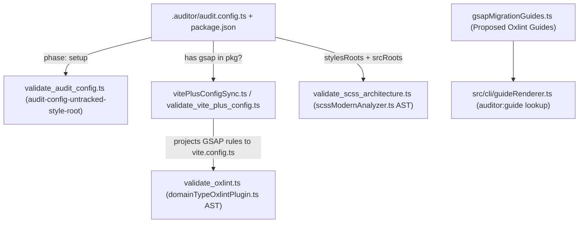

# Deterministic AST Rules for SCSS/DOM to GSAP Migration & Setup Coverage Guard

- **Author:** Franco Gastón Pellegrini
- **Status:** Proposed
- **Date:** 2026-11-25

---

## Overview

This design extends `@francogp/auditor` with 11 AST-only rules covering the statically detectable subset of CSS, SCSS, and imperative DOM animation patterns documented in [gsap-scss-migration-guide.md](../gsap-scss-migration-guide.md), plus 1 setup configuration rule (`audit-config-untracked-style-root`). Stylesheet rules run in the application quality phase (`phase: 'hygiene'`) through the existing `parseScssBlockNodes` and `postcss-value-parser` AST analyzer (`src/analyzers/scssModernAnalyzer.ts` and `src/suites/architecture/validate_scss_architecture.ts`), imperative DOM rules run through the existing Vite+ Oxlint runner (`vp lint` via `src/core/domainTypeOxlintPlugin.ts`), and forgotten stylesheets outside configured style roots are blocked in the pre-flight infrastructure phase (`phase: 'setup'`) inside `src/suites/architecture/validate_audit_config.ts`. All 12 new rules report `severity: 'error'`, and the 11 GSAP/CSS migration rules expose before/after CSS and TypeScript-to-GSAP examples via `npm run auditor:guide <ruleId>`.

## The Problem

When a project uses GSAP, `@francogp/auditor` currently checks only TypeScript GSAP tween calls (`no-gsap-layout-properties`, `gsap-named-timer-constants`, `no-gsap-banned-ui-timers`, `require-gsap-cleanup-on-unmount`) and misses two failure classes:

1. **Stylesheet and DOM animation conflicts**: Rules such as `transition: all`, layout property animations (`top`, `left`, `right`, `bottom`, `width`, `height`, `min-width`, `max-width`, `min-height`, `max-height`, `margin*`, `padding*`, `gap`), `transform: ... !important`, `@for` delay loops, root `scroll-behavior: smooth`, animated `stroke-dashoffset`, `IntersectionObserver` class/style reveals, `scroll`/`mousemove` `.style` mutations, and `scrollIntoView({ behavior: 'smooth' })` trigger layout reflows or fight the GSAP ticker without any auditor error.
2. **Unconfigured stylesheet blind spots**: Stylesheets placed outside `paths.stylesRoots` and `paths.srcRoots` (for example, `public/css/style.scss`) are silently skipped by style and SCSS auditors instead of failing in `phase: 'setup'` when omitted from configuration, `paths.ignoreGlobs`, or `coverage.exemptGlobs` (the `.auditor/audit.config.ts` list of files intentionally excluded from auditor coverage).

## Goals

- Detect the statically detectable subset (11 AST rules) of stylesheet and imperative DOM patterns from [gsap-scss-migration-guide.md](../gsap-scss-migration-guide.md) using deterministic AST visitors only (zero regex-based code scanning).
- Report every violation with `severity: 'error'` and provide actionable before/after CSS and TypeScript-to-GSAP examples in `npm run auditor:guide <ruleId>`.
- Activate GSAP-translation rules only when `gsap` is declared in `package.json` (`dependencies` or `devDependencies`, evaluated once per audit with a `false` fallback when `package.json` is absent), while keeping pure CSS hygiene errors (`transition: all`, layout property animations, `will-change` in `@keyframes`) active across all projects.
- Call `markRuleNotApplicable` explicitly for GSAP-only SCSS rules when `gsap` is absent so `validate_audit_coverage` (which requires every registered rule to evaluate or declare non-applicability) reports zero `coverage-dormant-rule` errors.
- Block in `phase: 'setup'` (`validate_audit_config.ts`) whenever `.scss` or `.css` files exist on disk outside `paths.stylesRoots` and `paths.srcRoots` without an explicit entry in `paths.ignoreGlobs` or `coverage.exemptGlobs`.

## Non-Goals

- Auto-rewriting CSS animations or imperative DOM listeners into GSAP timelines during `npm run auditor:fix` (migrations remain manual, guided by `auditor:guide`).
- Flagging simple non-layout CSS hover transitions (such as `color`, `border-color`, or `background-color`).
- Covering guide rows from `gsap-scss-migration-guide.md` that are ambiguous or already handled elsewhere: raw `transform` string formatting (Case 3), multi-step `@keyframes` sequences (Case 6), grid `:nth-child` formulas (Case 8), manual `pointerdown` drag (Case 15), `SplitText` `` splitting (Case 17), `* { will-change }` (already enforced by `scss-universal-expensive-selectors`, Case 18), duplicated `@media` animations (Case 19), and global class toggles without `gsap.context()` (Case 20).
- Creating a separate standalone TypeScript/DOM auditor suite (existing `domainTypeOxlintPlugin.ts` is reused).
- Using regex matching on raw source text for AST rule detection.

## Open Questions

None — architectural placement, severity, and conditional activation boundaries were resolved during brainstorming.

## Critical User Journeys (CUJs)

### CUJ 1: Developer or AI Agent Runs Auditor in a GSAP Project

- **Given**: A host project declares `gsap` in `package.json` and contains `transition: all`, a `@for` `transition-delay` loop in SCSS, or an `IntersectionObserver` mutating `classList` in TypeScript.
- **When**: The developer or AI agent runs `npm run auditor` (or `npm run auditor:lint`) and then runs `npm run auditor:guide <ruleId>`.
- **Then**: Both SCSS rules (`validate_scss_architecture`) and TS/DOM rules (`validate_oxlint` via `domainTypeOxlintPlugin.ts`) fail with `severity: 'error'`, and `auditor:guide <ruleId>` outputs concrete before/after GSAP migration examples.

### CUJ 2: Project Without GSAP Runs Auditor

- **Given**: A host project has `.scss` files but does not declare `gsap` in `package.json`.
- **When**: The project runs `npm run auditor`.
- **Then**: Universal CSS hygiene errors (`transition: all`, layout properties in `transition`/`@keyframes`, `will-change` in `@keyframes`) still fail with `severity: 'error'`, GSAP-only SCSS rules invoke `markRuleNotApplicable` cleanly with zero `coverage-dormant-rule` errors, and GSAP-only Oxlint rules are not projected into `vite.config.ts`.

### CUJ 3: Forgotten Stylesheet Outside Configured Style Roots

- **Given**: A project adds `public/css/style.scss` without declaring `public/css` in `paths.stylesRoots`, `paths.ignoreGlobs`, or `coverage.exemptGlobs`.
- **When**: The project runs `npm run auditor:setup` or `npm run auditor`.
- **Then**: `validate_audit_config` fails in `phase: 'setup'` with `audit-config-untracked-style-root`, blocking downstream audits until the path is explicitly configured or exempted.

---

## Technical Plan (Architecture)

The implementation reuses the repository's existing AST pipelines and Single Source of Truth (SSoT) projections (`vite.config.ts` satellite synchronization) rather than introducing new parallel runners:

### 1. Shared Remediation Catalog for Oxlint Rules (`gsapMigrationGuides.ts`, new in `src/core/`)

- Keep all 8 new SCSS rule descriptions and remediations inline inside `src/suites/architecture/validate_scss_architecture.ts` alongside the 13 existing SCSS rules (preserving one SSoT for SCSS).
- Store structured 4-part remediation guides (Root Cause, Diagnosis, Canonical Solution, Before/After TypeScript-to-GSAP examples) strictly for `@francogp/domain-type/*` Oxlint rules in `gsapMigrationGuides.ts` (under `src/core/`).
- Update `findRuleGuide` in `src/cli/guideRenderer.ts` so `npm run auditor:guide <ruleId>` resolves `@francogp/domain-type/<name>` (with or without the plugin prefix) from `gsapMigrationGuides.ts` and attaches the `validate_oxlint` `AuditTaskDefinition` from `allTasks` to `GuideQueryMatch.task`.

### 2. SCSS / CSS / Vue `<style>` AST Rules (`src/analyzers/scssModernAnalyzer.ts` & `src/suites/architecture/validate_scss_architecture.ts`)

- Preserve `analyzeModernScss(styleContent: string, lineOffset: number, enableFix: boolean, options?: { readonly hasGsap?: boolean })` (keeping existing positional parameters and adding `options` as an optional 4th parameter) and export the 8 new non-fixable rules in a separate `SCSS_ANIMATION_RULES` constant so `fixableRuleIds` in `ValidateScssArchitectureAuditor` stays restricted to genuinely auto-fixable `MODERN_SCSS_RULES`.
- Use `parseScssBlockNodes` and `postcss-value-parser` (zero regexes over raw source text) to detect:
  - **Universal CSS Hygiene (`severity: 'error'`, always active)**:
    - `scss-transition-all`: `transition: all` or `transition-property: all`.
    - `scss-layout-property-animation`: layout properties (`top`, `left`, `right`, `bottom`, `width`, `height`, `min-width`, `max-width`, `min-height`, `max-height`, `margin*`, `padding*`, `gap`) inside `transition` / `transition-property` values or `@keyframes` blocks.
    - `scss-will-change-in-keyframes`: `will-change` declarations inside `@keyframes`.
  - **GSAP-Conditional CSS (`severity: 'error'`, active only when `gsap` is declared in `package.json` `dependencies` or `devDependencies`; otherwise `markRuleNotApplicable`)**:
    - `scss-gsap-transform-important`: `transform: ... !important` outside `@media (prefers-reduced-motion: reduce)`.
    - `scss-gsap-smooth-scroll`: `scroll-behavior: smooth` on root scroller selectors (`html`, `body`, `:root`) where it conflicts with `ScrollTrigger` / `ScrollSmoother`.
    - `scss-gsap-stagger-for-loop`: `@for` / `@each` blocks emitting `transition-delay` or `animation-delay` (exempting `@media (prefers-reduced-motion: reduce)` and `0s` delay resets).
    - `scss-gsap-auto-alpha-candidate`: `opacity: 0` paired with `visibility: hidden` or `pointer-events: none` in a rule block that also declares `transition` / `transition-property` affecting `opacity` or `visibility` (exempting static initial-hidden states without `transition` and `.sr-only` / `[hidden]` utilities).
    - `scss-gsap-svg-stroke-animation`: animated `stroke-dashoffset` inside `transition` or `@keyframes` (static dashed borders/strokes are ignored; remediation guide notes `DrawSVGPlugin` registration).

### 3. TypeScript / DOM AST Rules (`src/core/domainTypeOxlintPlugin.ts` & `src/core/auditConfigDefaults.ts`)

- Reuse `domainTypeOxlintPlugin.ts` with three pure AST visitors scoped to inline `ArrowFunctionExpression` / `FunctionExpression` callbacks (no filesystem I/O or hardcoded directory paths inside the plugin):
  - `@francogp/domain-type/no-dom-intersection-reveal`: `new IntersectionObserver(...)` whose inline callback mutates `.classList.add/toggle` or `.style.*` (excluding `.dataset.src` / `.dataset.loaded` image lazy-loading and analytics).
  - `@francogp/domain-type/no-scroll-mousemove-style-mutation`: `addEventListener('scroll' | 'mousemove' | 'pointermove', ...)` whose inline callback mutates `.style.*` or `.style.setProperty('--...', ...)` directly (excluding `requestAnimationFrame`-throttled non-animation handlers).
  - `@francogp/domain-type/no-smooth-scroll-into-view`: `.scrollIntoView({ behavior: 'smooth' })`.
- Keep `CANONICAL_GSAP_DOM_RULES` separate from `DEFAULT_CANONICAL_LINT_RULES` (`STRICT_RULE_CHECKS`). Conditionally project and validate these rules in `vite.config.ts` via `buildCanonicalVitePlusAstSource` and `synchronizeViteConfigAst` (`src/core/viteConfigAst.ts`), `vitePlusConfigSync.ts`, and `validate_vite_plus_config.ts` (`phase: 'setup'`) only when `gsap` is declared in `package.json` (`dependencies` / `devDependencies`, defaulting to `false` when `package.json` is absent). Emit `'off'` entries in `DYNAMIC_TEST_OFF_RULES` / `DYNAMIC_DEMO_OFF_RULES` for these 3 rules only when `hasGsap === true`.

### 4. Setup Coverage Guard (`src/suites/architecture/validate_audit_config.ts`)

- Add `audit-config-untracked-style-root` (`phase: 'setup'`, `severity: 'error'`, `AUDIT_CONFIG_RULES`) with `ruleDescriptions` and `ruleRemediations` in `ValidateAuditConfigAuditor`.
- Collect project files via `collectRepositoryFiles()` (`src/core/auditorBase.ts`, complying with `@francogp/domain-type/no-homebrew-file-walker`) while filtering out `CANONICAL_SYSTEM_IGNORE_GLOBS`, `paths.ignoreGlobs`, `coverage.exemptGlobs`, and non-application roots (`paths.testRoots`, `paths.e2eRoots`, `paths.demoRoots`) to preserve `Strict Subsystem Ignore Isolation`. Emit one `severity: 'error'` violation per unique untracked directory root (including when `paths.stylesRoots` is empty or omitted) if `.scss`/`.css` files sit outside `paths.stylesRoots` and `paths.srcRoots`.

---

## Alternatives Considered

### Alternative A: Regex-Based Pattern Scanning in Stylesheets and TypeScript

- **Pros**: Faster initial implementation for simple single-line CSS properties (`transition: all`).
- **Cons**: Produces false positives inside CSS/TS comments, string literals, `@media (prefers-reduced-motion: reduce)` blocks, and unrelated `@for` grid loops.
- **Reason for Rejection**: Rejected by author: regex scanning introduces brittle false positives; AST parsing (`parseScssBlockNodes`, `postcss-value-parser`, and Oxlint AST) is mandatory.

### Alternative B: Standalone `validate_gsap_migration.ts` Suite for TS/DOM Rules

- **Pros**: Native `BaseAuditor` `ruleRemediations`, `runSubAuditorSync`, and `markRuleNotApplicable` without changing `vite.config.ts` satellite projections.
- **Cons**: Duplicates JS/TS AST traversal alongside Oxlint (`vp lint`) instead of reusing the existing `domainTypeOxlintPlugin.ts` infrastructure.
- **Reason for Rejection**: Rejected by author: avoid inventing a separate TS/DOM runner when `domainTypeOxlintPlugin.ts` (Oxlint) already exists and owns TS/DOM AST rules.

### Alternative C: Untracked Stylesheet Check Inside `validate_scss_architecture.ts`

- **Pros**: Keeps all SCSS-related checks inside a single file.
- **Cons**: `validate_scss_architecture.ts` executes in `phase: 'hygiene'` rather than `phase: 'setup'`, inconsistent with `validate_audit_config.ts` which owns path and root validation.
- **Reason for Rejection**: Rejected by author: keep all `phase: 'setup'` path/root validations unified in `validate_audit_config.ts`.

---

## Non-Functional Requirements

- **Performance & Latency**: SCSS AST rules execute within the existing single-pass `analyzeModernScss` traversal; TS/DOM rules execute inside Oxlint's Rust/JS plugin pass without spawning extra child processes. The `validate_audit_config.ts` style-root check reuses `collectRepositoryFiles()` (`src/core/auditorBase.ts`), skipping `CANONICAL_SYSTEM_IGNORE_GLOBS` (`node_modules`, `dist`, `scratch`, `.git`) first.
- **Backward Compatibility & Rollout**: Adding `severity: 'error'` rules will immediately block consumer builds containing unmigrated violations until fixed or explicitly exempted in `.auditor/audit.config.ts`, as intended by the author.

---

## Detailed Implementation

1. **Create Oxlint GSAP remediation catalog**:
   - **[NEW] `gsapMigrationGuides.ts` (under `src/core/`)**: Define `GSAP_MIGRATION_RULE_GUIDES` mapping each `@francogp/domain-type/*` DOM-to-GSAP rule ID to its concise description (`<= 60` chars per `auditor-rule-description-limit`) and 4-part remediation manual (Root Cause, Diagnosis, Canonical Solution, Before/After TypeScript-to-GSAP examples).

2. **Extend CLI guide lookup for Oxlint rules**:
   - **[MODIFY] `src/cli/guideRenderer.ts`**: Update `findRuleGuide` to fall back to `GSAP_MIGRATION_RULE_GUIDES` when `ruleIdOrName` matches a `@francogp/domain-type/*` rule (with or without the `@francogp/domain-type/` prefix), attaching the `validate_oxlint` `AuditTaskDefinition` from `allTasks` to `GuideQueryMatch.task`.

3. **Implement 8 SCSS/CSS AST rules**:
   - **[MODIFY] `src/analyzers/scssModernAnalyzer.ts`**: Export a separate `SCSS_ANIMATION_RULES` constant (keeping `MODERN_SCSS_RULES` strictly for existing auto-fixable rules) and extend `analyzeModernScss(styleContent, lineOffset, enableFix, options?: { readonly hasGsap?: boolean })` using `parseScssBlockNodes` and `postcss-value-parser` (zero regex scanning on raw text) to emit findings for:
     - Universal: `scss-transition-all`, `scss-layout-property-animation` (`top`, `left`, `right`, `bottom`, `width`, `height`, `min-width`, `max-width`, `min-height`, `max-height`, `margin*`, `padding*`, `gap`), `scss-will-change-in-keyframes`.
     - GSAP-conditional (`options?.hasGsap === true`): `scss-gsap-transform-important` (skipping `@media (prefers-reduced-motion: reduce)`), `scss-gsap-smooth-scroll` (root selectors `html`, `body`, `:root`), `scss-gsap-stagger-for-loop` (`@for`/`@each` blocks emitting `transition-delay` or `animation-delay`, skipping `prefers-reduced-motion` and `0s` resets), `scss-gsap-auto-alpha-candidate` (`opacity: 0` + `visibility: hidden`/`pointer-events: none` in a block declaring `transition`/`transition-property` on `opacity`/`visibility`), `scss-gsap-svg-stroke-animation` (animated `stroke-dashoffset` in `transition`/`@keyframes`).
   - **[MODIFY] `src/suites/architecture/validate_scss_architecture.ts`**: Read `package.json` via `getPackageJson(projectRoot)` once per audit to compute `hasGsap` (`dependencies` or `devDependencies`, `false` when missing), pass `{ hasGsap }` as the 4th argument to `analyzeModernScss`, keep `fixableRuleIds: [...MODERN_SCSS_RULES]` (never marking the 8 new `SCSS_ANIMATION_RULES` as fixable), call `this.markRuleNotApplicable(ruleId, 'gsap not declared in package.json')` for the 5 GSAP-only rules when `!hasGsap` (preventing `coverage-dormant-rule`), register inline `ruleDescriptions` (`<= 60` chars) and `ruleRemediations` via `super({ ruleDescriptions, ruleRemediations })` (including `DrawSVGPlugin` registration guidance), and report all violations with `severity: 'error'`.

4. **Implement 3 TypeScript/DOM AST rules in Oxlint + conditional projection**:
   - **[MODIFY] `src/core/domainTypeOxlintPlugin.ts`**: Add three pure AST visitors (`no-dom-intersection-reveal`, `no-scroll-mousemove-style-mutation`, `no-smooth-scroll-into-view`) scoped to inline callbacks, excluding `.dataset.src`/`.dataset.loaded` and `requestAnimationFrame`-throttled non-animation handlers, with zero filesystem I/O or path hardcoding inside `create(context)`. Each `context.report` message includes a concise GSAP replacement hint and references `npm run auditor:guide <ruleId>`.
   - **[MODIFY] `src/core/auditConfigDefaults.ts`**, **`src/core/vitePlusConfigSync.ts`**, **`src/core/viteConfigAst.ts`**, and **`src/suites/architecture/validate_vite_plus_config.ts`**: Group the 3 rules under `CANONICAL_GSAP_DOM_RULES` (explicitly excluded from `DEFAULT_CANONICAL_LINT_RULES` / `STRICT_RULE_CHECKS`), passing `hasGsap` into `buildCanonicalVitePlusAstSource`, `synchronizeViteConfigAst`, `vitePlusConfigSync.ts`, and `validate_vite_plus_config.ts` (`phase: 'setup'`) so these rules and their `DYNAMIC_TEST_OFF_RULES` / `DYNAMIC_DEMO_OFF_RULES` overrides are projected only when `hasGsap === true`.

5. **Add `phase: 'setup'` untracked stylesheet guard**:
   - **[MODIFY] `src/suites/architecture/validate_audit_config.ts`**: Register `audit-config-untracked-style-root` in `AUDIT_CONFIG_RULES` (`phase: 'setup'`, `severity: 'error'`, with `ruleDescriptions` and `ruleRemediations`), collect files via `collectRepositoryFiles()` (`src/core/auditorBase.ts`) while skipping `CANONICAL_SYSTEM_IGNORE_GLOBS`, `paths.ignoreGlobs`, `coverage.exemptGlobs`, `paths.testRoots`, `paths.e2eRoots`, and `paths.demoRoots`, and emit one error per unique untracked directory root whenever `.scss` or `.css` files reside outside `paths.stylesRoots` and `paths.srcRoots`.

6. **Add tests and update DOX (`AGENTS.md`) / skill references**:
   - **[MODIFY] `tests/validate_scss_architecture.test.ts`**, **`tests/domain_type_oxlint_plugin.test.ts`**, **`tests/validate_audit_config.test.ts`**, and **`tests/validate_vite_plus_config.test.ts`**: Add positive, false-positive guard, `markRuleNotApplicable` (preserving `getRuleDuration >= 0`), `auditor:guide`, and `audit-config-untracked-style-root` tests.
   - **[MODIFY] `src/core/AGENTS.md`**, **`src/analyzers/AGENTS.md`**, **`src/suites/architecture/AGENTS.md`**, and **`.agents/skills/auditor/references/subsystem-rules-reference.md`**: Document the new rules, `gsap` conditional activation, and `audit-config-untracked-style-root`.
