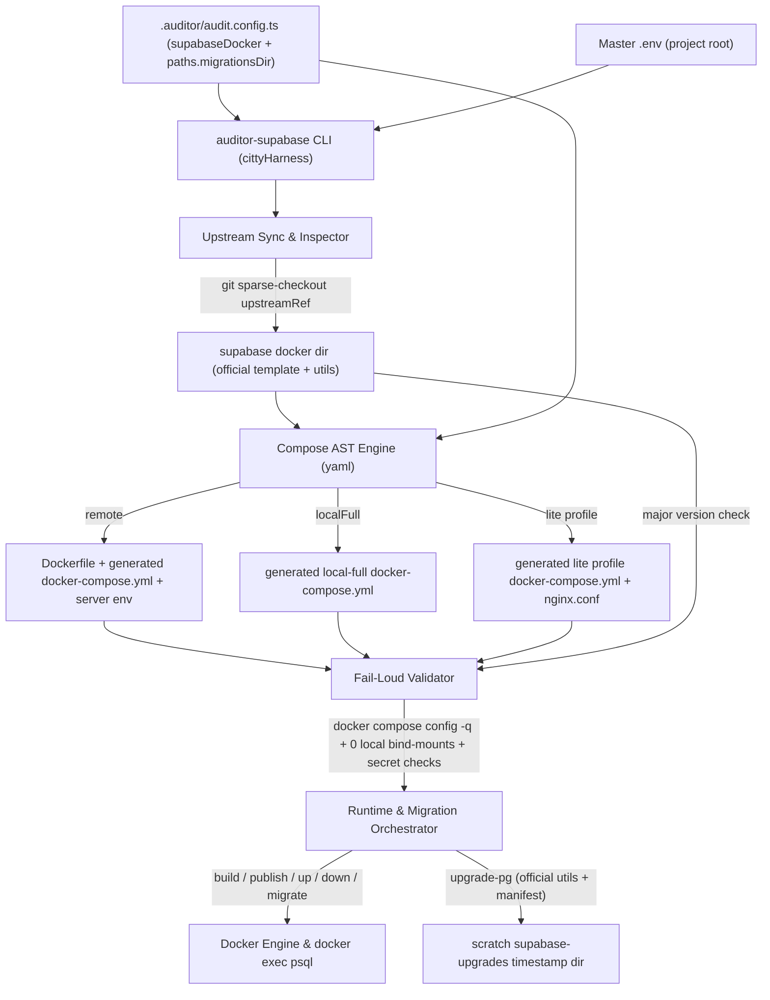

# Unified Supabase Docker System

- **Author:** Franco Gastón Pellegrini
- **Status:** Approved
- **Date:** 2026-11-26

---

## Overview

This design defines a single, parameterizable system to generate, operate, and validate Supabase Docker stacks across all consumer repositories governed by `@francogp/auditor` (`PokeBorrador`, `facturacion2`, `ipdiff3`, and future repositories). One shared engine inside `@francogp/auditor` replaces duplicated per-project scripts and supports, via mandatory declarative configuration in `.auditor/audit.config.ts` (zero hardcoded defaults for project-specific ports, volumes, images, or upstream refs), three profiles: `remote` (bind-mount-free remote deployment), `localFull` (full official Supabase stack locally with isolated container/port prefixes), and `lite` (minimal 3-container stack with persistent volume or in-memory `tmpfs` storage).

For SQL, RLS, schema design, and PostgreSQL optimization, this system explicitly delegates to the official `/supabase` and `/supabase-postgres-best-practices` agent skills rather than duplicating database-governance rules inside `@francogp/auditor`.

---

## The Problem

Each project using Supabase currently maintains its own Docker infrastructure and orchestration scripts, causing four concrete problems:

1. **Duplication and drift between remote deployment scripts**: `PokeBorrador`'s `setup_supabase.ts` (914 lines) and `facturacion2`'s `setup_supabase.ts` (928 lines) are near-identical copies (1,842 lines total) that diverged over time. `facturacion2` remained pinned to a literal Postgres 15 string replacement while adding `127.0.0.1` loopback binding and `local.env`; `PokeBorrador` upgraded to Postgres 17, but did not inherit those security improvements.
2. **Silent breakages on upstream Supabase changes**: Both scripts patch the upstream compose template (cloned from the official Supabase repository's `docker` directory) using literal `.replace()` string calls. When Supabase switched the default API Gateway from Kong to Envoy and changed volume mount flags (`:Z` to `:z` or `:ro,z`), replacements failed silently and left local `./volumes/` bind-mounts unconverted inside the generated compose file.
3. **Fragmentation of the simplified 3-container stack (Postgres + PostgREST + Nginx)**: `facturacion2` (`docker-compose.test.yml` and `docker_test_env.ts`) and `ipdiff3` (`docker-compose.yml` and `docker_test_env.ts`) maintain separate, incompatible definitions of the lightweight stack: different Postgres (15 vs 17) and PostgREST (v12 vs v14.5) versions, YAML embedded as literal strings in TypeScript, and hardcoded ports/credentials. Additionally, `ipdiff3` maintains a third script in parallel (`setup_supabase.ts`) that clones the official stack into `scratch` (the gitignored workspace folder for temporary artifacts).
4. **Operational risk from hardcoded Postgres versions**: The `FROM` base image tag for Postgres is hardcoded inside each script, preventing coordinated updates with the official bundle and leaving operators without an explicit guard against major version jumps (e.g., PG17 to PG18) that can corrupt existing data volumes if backup/restore is not performed first.

---

## Goals

- **Upstream-First Governance**: Always treat the official `github.com/supabase/supabase` `docker` directory and `utils` scripts (`docker-compose.yml`, `.env.example`, `generate-keys.sh`, `add-new-auth-keys.sh`, `upgrade-pg*.sh`) as the primary source of truth, adapting `@francogp/auditor/supabase` transformations, validators, and consumer configs to match upstream rather than re-implementing official tooling.
- **Support all 3 profiles with zero hardcoded project values via `.auditor/audit.config.ts`**:
  1. `remote` (bind-mount-free remote deployment): custom Postgres image, named volumes without local bind-mounts, per-server `.env` files, and `build` / `publish` / `release` workflow.
  2. `localFull`: full official Supabase stack running locally with prefixed `container_name`, tenant-safe `realtime` naming, configurable ports, and automatic migration application.
  3. `lite`: minimal 3-container stack (Postgres + PostgREST + Nginx) with configurable images/ports, choice of persistent volume or in-memory `tmpfs`, and incremental SQL migration sync.
- **Standardize on the modern upstream stack**: Target Supabase's current default gateway (Envoy) and PostgreSQL 17 baseline (tracked deterministically via a configurable `upstreamRef` release tag), removing parallel support for legacy Kong setups.
- **Provide a complete, non-destructive Postgres major-version migration tool (`upgrade-pg`)**: Orchestrate Supabase's official upgrade utility (`utils/upgrade-pg17.sh`) wrapped with preflight checks, `db-config` (`pgsodium`) preservation, explicit `--from-volume` / `--to-volume` flags, SHA-256 backup manifest, and restricted `0700`/`0600` permissions in `scratch`.
- **Centralize secrets & multi-server `.env` management with user extensibility**: Support `add-server`, `list`, per-server `.env` generation, and modern upstream auth keys (`JWT_JWKS`, asymmetric keys, opaque publishable/secret keys) inside `@francogp/auditor/supabase`, while offering user extension hooks (`postGenerateCommand`, `extraEnvVars`, `customComposeOverlay`).
- **Delegate SQL/RLS/Postgres best practices to official Supabase skills**: Instruct agents in the auditor skill to delegate schema, RLS, and Postgres tuning to `/supabase` and `/supabase-postgres-best-practices`, prompting the user to install the official `supabase` plugin if missing.
- **Fail-loud validation**: Abort generation if residual local `./volumes/` bind-mounts remain in `remote` mode, if `docker compose config -q` fails, if upstream `.env.example` placeholder secrets remain, if passwords contain URL-unsafe characters, or if upstream introduces an unauthorized Postgres major version jump.
- **Collision-free multi-project isolation**: Allow sibling projects to run concurrently on the same host with configurable container, network, volume prefixes, and ports.
- **Integrated auditor skill documentation**: Update `.agents/skills/auditor/SKILL.md` and create `supabase-docker-guide.md` under `.agents/skills/auditor/references/` detailing configuration, extensibility, all 14 CLI commands, skill delegation, and canonical online Supabase links.

---

## Non-Goals

- Replacing the official Supabase CLI (`supabase db pull`, `supabase migration new`, `supabase db advisors`) for migration authoring or schema inspection.
- Building a multi-node cluster orchestrator (Kubernetes/Swarm) or enabling unattended auto-updates in production (such as Watchtower); Supabase image updates remain manual and coordinated.
- Managing application-specific business data backups or restores (such as `backup_supabase_db.ts` in `PokeBorrador`), although the engine blocks major-version jumps until `upgrade-pg` is executed.
- Re-implementing SQL/RLS/Postgres governance rules already owned by `/supabase` and `/supabase-postgres-best-practices`.

---

## Open Questions

None — all architectural, scope, and extensibility decisions are resolved and captured in the contract and plan below.

---

## Critical User Journeys (CUJs)

### CUJ 1: Update and publish a bind-mount-free `remote` stack (`PokeBorrador` / `facturacion2`)

- **Given**: A project configured with `profiles.remote` (`enabled: true`), explicit `image` coordinates, `upstreamRef`, and `postgres.expectedMajor`.
- **When**: The developer runs `auditor-supabase clone`, `generate`, and `release`.
- **Then**: The system clones the pinned official Supabase `docker` directory, verifies no unauthorized Postgres major jump occurred, transforms `docker-compose.yml` into named volumes with `supabase-config-init` sync, validates secrets and `docker compose config -q`, emits per-server `.env` files, and builds/pushes the custom `db` image.

### CUJ 2: Spin up an isolated in-memory test environment (`facturacion2` / `ipdiff3`)

- **Given**: A project configured with a `lite` profile (`storage: 'tmpfs'`) and explicit images and ports (e.g., `:5433` / `:8001`).
- **When**: The developer runs `auditor-supabase up --profile test` and `migrate --profile test`.
- **Then**: Postgres + PostgREST + Nginx become ready within `< 15s` on local Docker, bootstrap Supabase roles and `supabase_migrations.schema_migrations`, apply pending SQL migrations, and reload PostgREST without touching the development database.

### CUJ 3: Concurrent local development without collisions (`ipdiff3` and sibling projects)

- **Given**: Two sibling projects running concurrently with distinct `projectSlug` prefixes and ports in `lite` (persistent `volume`) or `localFull` mode.
- **When**: The developer starts both stacks via `auditor-supabase up --profile <name>`.
- **Then**: Both stacks operate in parallel with isolated containers, networks, volumes, and independent migration state.

### CUJ 4: Fail-loud detection of upstream breaking changes (`generate`)

- **Given**: Upstream changes `docker-compose.yml` structure (introducing an unmapped `./volumes/` mount) or jumps Postgres major version (e.g., PG17 to PG18).
- **When**: The developer runs `auditor-supabase generate`.
- **Then**: Generation aborts with a non-zero exit code and an explicit `SupabaseValidationReport` error identifying the unmapped mount or major-version mismatch.

### CUJ 5: Non-destructive Postgres major-version migration (`upgrade-pg`)

- **Given**: A project running Postgres 15 (e.g., `facturacion2`) upgrading to the target Postgres 17 version.
- **When**: The developer runs `auditor-supabase upgrade-pg --from-volume <old> --to-volume <new>`.
- **Then**: The tool verifies Docker and volume state, executes Supabase's official upgrade flow preserving `db-config` (`pgsodium`), records a SHA-256 manifest in `scratch`, provisions and verifies the new volume without altering the old volume, and allows deterministic rollback by reverting the volume reference and restarting `db` on failure.

---

## Technical Plan (Architecture)

### 1. Location, Primitives, and Skill Delegation inside `@francogp/auditor`

- **Programmatic module (`@francogp/auditor/supabase`)**: Located in the new `supabase` module under `src/` and exposed in `package.json` under `"exports": { "./supabase": { "types": "./dist/supabase/index.d.ts", "default": "./dist/supabase/index.js" } }`. Re-exported types (`SupabaseDockerConfig`) flow through `src/core/auditConfig.ts` and `src/index.ts`.
- **Dedicated CLI (`auditor-supabase`)**: Located at `supabase_manage.ts` under `src/cli/` (compiled to `dist/cli/supabase_manage.js` and registered in `package.json` `bin`). Built using internal primitives `cittyHarness.ts` (`COMMON_CLI_ARGS`), `isMainModule` (`cliUtils.ts`), `safePath.ts`, `safeUtils.ts`, `yaml` (`^2.9.1`), `semver` (`^7.8.6`), `boxen`, `cli-table3`, and native Node.js 26+, reusing existing dependencies without adding new packages to `package.json`.
- **SSoT integration (`.auditor/audit.config.ts`)**: Project configuration lives in the optional `supabaseDocker` block inside `.auditor/audit.config.ts` (`AuditEngineConfig` / `AuditConfig`). When `supabaseDocker.enabled === true`, all required fields for active profiles are enforced at load/setup time (zero hardcoded project values). `validate_audit_config` (`phase: 'setup'`) automatically enforces `audit-config-missing-enabled` via `auditConfigAstValidator.ts`.
- **Skill delegation (`/supabase` & `/supabase-postgres-best-practices`)**: Whenever an agent assists with SQL migrations, RLS policies, Data API exposure, or Postgres performance/upgrades in a `supabaseDocker`-enabled project, `.agents/skills/auditor/SKILL.md` instructs the agent to delegate to `/supabase` and `/supabase-postgres-best-practices`. If the official `supabase` plugin is not installed, the agent must prompt the user to install it rather than improvising.
- **Upstream-First Priority**: `@francogp/auditor/supabase` and `supabase-docker-guide.md` (under `.agents/skills/auditor/references/`) strictly prioritize official Supabase `docker` templates and `utils` scripts first, adapting all AST rules, env generation, and upgrade wrappers around upstream's official mechanisms.

### 2. Component Architecture and Data Flow



### 3. Declarative Contract in `.auditor/audit.config.ts` (`supabaseDocker`)

No project-specific ports, volume names, Docker Hub repos, or upstream refs are hardcoded in `@francogp/auditor`. When `supabaseDocker.enabled === true`, all active profile fields are mandatory and validated before execution.

```ts
export interface SupabaseDockerImageConfig {
  readonly registry?: string; // optional custom registry; defaults to Docker Hub
  readonly user: string;
  readonly repo: string;
  readonly tag: string;
}

export interface SupabaseDockerConfig {
  readonly enabled: boolean;
  readonly projectSlug: string;
  readonly upstreamRef: string; // e.g. 'self-hosted/v0.8.5' (mandatory when enabled)
  readonly supabaseDir: string; // e.g. 'supabase'
  readonly masterEnvFile: string; // e.g. '.env'
  readonly postgres: {
    readonly expectedMajor: number; // e.g. 17
    readonly allowMajorUpgrade?: boolean;
  };
  readonly extensions?: {
    readonly extraEnvVars?: Readonly<Record<string, string>>;
    readonly customComposeOverlay?: string; // optional path to user-owned compose override YAML
  };
  readonly profiles: {
    readonly remote?: {
      readonly enabled: boolean;
      readonly includeLogs: boolean;
      readonly image: SupabaseDockerImageConfig;
      readonly volumes: {
        readonly shared: string;
        readonly dbData: string;
        readonly dbConfig: string;
        readonly storage: string;
      };
      readonly security: {
        readonly bindLoopback: boolean;
      };
      readonly postGenerateCommand?: string;
    };
    readonly localFull?: {
      readonly enabled: boolean;
      readonly includeLogs: boolean;
      readonly realtimeTenantName: string; // e.g. 'realtime-dev'
      readonly ports: {
        readonly api: number;
        readonly postgres: number;
        readonly pooler: number;
        readonly studio: number;
      };
      readonly autoApplyMigrations: boolean;
    };
    readonly lite?: Record<
      string,
      {
        readonly enabled: boolean;
        readonly storage: 'volume' | 'tmpfs';
        readonly images: {
          readonly postgres: string; // e.g. 'supabase/postgres:17.6.1.136'
          readonly postgrest: string; // e.g. 'postgrest/postgrest:v14.18'
          readonly nginx: string; // e.g. 'nginx:1.29-alpine'
        };
        readonly ports: {
          readonly postgres: number;
          readonly gateway: number;
        };
        readonly schemas: readonly string[]; // e.g. ['public', 'storage', 'graphql_public']
        readonly autoSyncMigrations: boolean;
      }
    >;
  };
}

export interface SupabaseValidationReport {
  readonly valid: boolean;
  readonly profile: string;
  readonly errors: readonly string[];
  readonly warnings: readonly string[];
}

export interface SupabaseUpgradeManifest {
  readonly timestamp: string;
  readonly fromVolume: string;
  readonly toVolume: string;
  readonly fromMajor: number;
  readonly toMajor: number;
  readonly backupFile: string;
  readonly sha256: string;
  readonly tableCounts: Readonly<Record<string, number>>;
}
```

### 4. Upstream Sync, Compose AST Transformation, and Fail-Loud Validation

1. **Deterministic upstream sync (`upstreamSync.ts`)**:
   - Clones `https://github.com/supabase/supabase.git` at `config.upstreamRef` (`--depth 1 --branch <upstreamRef> --filter=blob:none --sparse`, checking out `docker/`). When `<supabaseDir>/docker` already exists, `clone` removes and re-clones cleanly to guarantee exact `upstreamRef` parity.
   - Parses `<supabaseDir>/docker/docker-compose.yml` via `yaml.parseDocument` to extract `services.db.image` (the official Postgres image tag). Normalizes 4-segment tags (such as `17.6.1.136`) by extracting the leading integer (`/^v?(\d+)/`) before comparing against `postgres.expectedMajor`.
   - Generates `<supabaseDir>/docker/Dockerfile` dynamically using the extracted `FROM` Postgres base image tag, copying project-owned SQL init scripts (`COPY init/ /docker-entrypoint-initdb.d/`, where `init/` holds optional project-specific first-boot SQL scripts), upstream DB init scripts, and `/supabase-volumes` seed assets (`volumes/api`, `volumes/pooler`, `volumes/functions`, `volumes/snippets`, `volumes/realtime`, `volumes/logs`), setting `chown -R postgres:postgres /etc/postgresql-custom`.

2. **Service-by-service AST transformation for `remote` (`composeAstEngine.ts`)**:
   - Output path: `<supabaseDir>/generated/docker-compose.yml`.
   - Adds an idempotent one-shot `supabase-config-init` service (`image: <remote.image>`, `restart: "no"`, mounting `<volumes.shared>:/supabase-volumes:Z`, copying packaged config assets into `/supabase-volumes` unconditionally on every start/upgrade) and adds `depends_on: { supabase-config-init: { condition: service_completed_successfully } }` to `api-gw`, `studio`, `functions`, `supavisor`, `realtime`, and `vector`. This eliminates Docker's empty-volume-only copy limitation and startup race conditions.
   - Deterministic AST service mapping:
     - `db`: sets `image: ${DOCKER_USER}/${DOCKER_REPO_DB}:${DOCKER_TAG_DB}`, removes `./volumes/db/*.sql` bind-mounts, replaces `./volumes/db/data` with `<volumes.dbData>:/var/lib/postgresql/data:Z`, replaces `db-config` with `<volumes.dbConfig>:/etc/postgresql-custom:Z`, and adds `<volumes.shared>:/supabase-volumes:Z`.
     - `api-gw` (Envoy): replaces the 4 `./volumes/api/envoy/*` mounts (`envoy.yaml`, `cds.yaml`, `lds.template.yaml`, `docker-entrypoint.sh`) with `<volumes.shared>:/supabase-volumes:ro,z` and rewrites `entrypoint` to `["/bin/sh", "/supabase-volumes/api/envoy/docker-entrypoint.sh"]` with `ENVOY_CONFIG_DIR: /supabase-volumes/api/envoy`.
     - `studio`: replaces `./volumes/snippets` and `./volumes/functions` with `<volumes.shared>:/supabase-volumes:Z`, setting `SNIPPETS_MANAGEMENT_FOLDER: /supabase-volumes/snippets` and `EDGE_FUNCTIONS_MANAGEMENT_FOLDER: /supabase-volumes/functions`. When `includeLogs: true`, sets `ENABLED_FEATURES_LOGS_ALL: "true"`.
     - `functions`: replaces `./volumes/functions` with `<volumes.shared>:/home/deno:Z` (retaining `deno-cache`).
     - `storage` and `imgproxy`: replaces `./volumes/storage` with `<volumes.storage>:/var/lib/storage:Z`.
     - `realtime`: replaces `./volumes/realtime/docker-entrypoint.sh` with `<volumes.shared>:/supabase-volumes:ro,z` and sets `entrypoint: ["/bin/sh", "/supabase-volumes/realtime/docker-entrypoint.sh"]`.
     - `supavisor`: replaces `./volumes/pooler/pooler.exs` with `<volumes.shared>:/supabase-volumes:ro,z`, rewrites `command` references from `/etc/pooler/pooler.exs` to `/supabase-volumes/pooler/pooler.exs`, and sets `ulimits.nofile: 65536` + `RLIMIT_NOFILE: "65536"`.
     - `vector` & `analytics` (when `includeLogs: true`): merges `docker-compose.logs.yml`, replaces `./volumes/logs/vector.yml` with `<volumes.shared>:/supabase-volumes:ro,z`, preserves `${DOCKER_SOCKET_LOCATION:-/var/run/docker.sock}` for rootless Docker, adds `depends_on.db`, and sets `start_period: 60s` on `analytics`.
   - Root `volumes:` reconciliation: replaces `db-config` with `<volumes.dbConfig>`, declares `<volumes.shared>`, `<volumes.dbData>`, and `<volumes.storage>`, and preserves `deno-cache`.
   - Loopback security: when `security.bindLoopback: true`, prefixes published ports on `db`, `supavisor`, and `api-gw` with `127.0.0.1:`.
   - User extensibility: if `extensions.customComposeOverlay` is configured, merges it as a final AST pass before validation.

3. **AST transformation for `localFull`**:
   - Output path: `<supabaseDir>/generated/local-full/docker-compose.yml`.
   - Prefixes every service `container_name` with `<projectSlug>-` except `realtime`, which becomes `<realtimeTenantName>.<projectSlug>-realtime` so Realtime tenant subdomain parsing stays intact.
   - Remaps exposed ports from `profiles.localFull.ports` (`api`, `postgres`, `pooler`, `studio`) and merges `docker-compose.logs.yml` if `includeLogs: true`.

4. **Post-transformation fail-loud validation**:
   - **Zero local bind-mounts (`remote` mode)**: Walks `services.*.volumes` AST and fails if any entry has a relative source (`./` or `../`).
   - **Postgres major-version guard**: Fails if parsed upstream major !== `postgres.expectedMajor` (unless `allowMajorUpgrade: true`).
   - **Secret & charset validation**: Rejects `.env.example` placeholder secrets (`your-super-secret-...`, `this_password_is_insecure_and_should_be_updated`), enforces alphanumeric-only `POSTGRES_PASSWORD` and `DASHBOARD_PASSWORD` (required because Supabase interpolates them unencoded into connection URIs), and verifies all `${VAR}` placeholders referenced in the generated compose AST exist.
   - **Native Compose check**: Runs `docker compose -f <generated> config -q` using the generated `.env` (or a deterministic dummy validation env map when no servers are registered yet).

### 5. Environment & Multi-Server Orchestrator (`envOrchestrator.ts`)

- **Master `.env` schema**: Stores global Docker credentials (`DOCKER_USER`, `DOCKER_REPO_DB`, `DOCKER_TAG_DB`) and per-server blocks delimited by `# === [ SERVIDOR: <name> ] ===` using `SERVER_<name>_<KEY>=<VALUE>` variables.
- **Per-server output**: Emits `<supabaseDir>/generated/<server>.env`, merging upstream `.env.example` keys, server overrides, `extensions.extraEnvVars`, and global keys.
- **Cryptographic key generation (Upstream-First)**: Strictly prioritizes and invokes official upstream `generate-keys.sh` and `add-new-auth-keys.sh` (from the cloned `utils` directory) whenever the official clone and bash are available, falling back to native `node:crypto` (`HS256` JWTs with `{ role: 'anon' | 'service_role', iss: 'supabase', iat, exp }`, 32+ byte `JWT_SECRET`, `SECRET_KEY_BASE`, `VAULT_ENC_KEY`, `PG_META_CRYPTO_KEY`, `REALTIME_DB_ENC_KEY`, plus asymmetric `JWT_JWKS` / `ANON_KEY_ASYMMETRIC` / `SERVICE_ROLE_KEY_ASYMMETRIC` and opaque `SUPABASE_PUBLISHABLE_KEY` / `SUPABASE_SECRET_KEY`) only in `lite`-only or bash-less environments.

### 6. Unified `lite` Profile (3 Containers) & Incremental Migration Sync

- Output path: `<supabaseDir>/generated/lite/<profile>/docker-compose.yml`, `nginx.conf`, and local `.env` (when generated).
- **Credential resolution order (`POSTGRES_PASSWORD` and `JWT_SECRET`)**:
  1. Read `LITE_<PROFILE>_POSTGRES_PASSWORD` and `LITE_<PROFILE>_JWT_SECRET` (falling back to `POSTGRES_PASSWORD` and `JWT_SECRET`) from `masterEnvFile` if present and non-placeholder.
  2. Otherwise, generate and reuse a profile-local `.env` inside the `lite` profile output directory containing alphanumeric random secrets generated via `node:crypto` (32+ bytes for `JWT_SECRET`).
  3. Inject the resolved values into `db`, `rest` (`PGRST_DB_URI`, `PGRST_JWT_SECRET`), and the bootstrap SQL (`app.settings.jwt_secret`).
- **3-service schema**:
  - `db` (`<images.postgres>`): exposes `<ports.postgres>:5432`, uses `tmpfs: [/var/lib/postgresql/data]` when `storage === 'tmpfs'` or named volume `<projectSlug>-<profile>-pgdata` when `storage === 'volume'`, healthcheck `pg_isready -U postgres`.
  - `rest` (`<images.postgrest>`): connects via `authenticator` to `db:5432`, sets `PGRST_DB_SCHEMAS`, `PGRST_DB_ANON_ROLE: anon`, `PGRST_JWT_SECRET`, healthcheck `postgrest --ready`.
  - `gateway` (`<images.nginx>`): exposes `<ports.gateway>:80`, mounts `./nginx.conf:/etc/nginx/conf.d/default.conf:ro`, proxies `/rest/v1/` to `http://rest:3000/`.
- **Bootstrap SQL & migration tracking (`runtimeOrchestrator.ts`)**:
  - On first boot, executes idempotent bootstrap SQL via `docker exec -i <container> psql` ensuring roles `anon`, `authenticated`, `service_role`, and `authenticator` (`LOGIN`), setting `app.settings.jwt_secret`, and creating `supabase_migrations.schema_migrations (version text PRIMARY KEY, applied_at timestamptz NOT NULL DEFAULT now())`.
  - Reads `paths.migrationsDir` matching `^(\d{14})_.*\.sql$` in lexicographical order, applies versions not present in `supabase_migrations.schema_migrations`, inserts each applied version, and runs `NOTIFY pgrst, 'reload schema'`. Host `psql` is never required.

### 7. Major-Version Migration Tool (`auditor-supabase upgrade-pg`)

1. **Preflight**: Requires `--from-volume <src>` and `--to-volume <dst>` (or `--profile <name>` for `lite`), checks Docker daemon availability, verifies `<dst>` does not exist, and reads current Postgres major version.
2. **Official upgrade & backup (Upstream-First)**: For `remote` / `localFull`, creates `scratch` upgrade directory (`0700` dir / `0600` dumps), preserves `db-config` (`pgsodium`) key state, and always discovers and delegates first to the official upstream `upgrade-pg*.sh` script (e.g., `upgrade-pg17.sh` in the cloned `utils` directory) matching the target major version, wrapping it with a SHA-256 manifest (`SupabaseUpgradeManifest` JSON) and `SELECT schemaname, relname, n_live_tup` table counts.
3. **Verification & rollback**: Restores/verifies into `<dst>`, runs `ANALYZE`, compares schema/table counts against the manifest, and prints exact `.auditor/audit.config.ts` update instructions (`volumes.dbData` and `postgres.expectedMajor`) without mutating the SSoT behind the developer's back. Previous volume `<src>` remains untouched for deterministic rollback.

### 8. Full CLI Surface (`auditor-supabase`) and Skill Documentation

All commands accept `--config <path>` and `--help` via `cittyHarness.ts` (`exit 0` success, `1` runtime/Docker error, `2` config/validation error):

| Command      | Positional / Flags                  | Profiles              | Action                                                                       |
| :----------- | :---------------------------------- | :-------------------- | :--------------------------------------------------------------------------- |
| `clone`      | `--ref <tag>`                       | `remote`, `localFull` | Cleanly clones `upstreamRef` `docker/` and builds `Dockerfile`.              |
| `generate`   | `--profile <name>`                  | All                   | Generates compose, nginx, and `.env` files + fail-loud validation.           |
| `add-server` | `--name <srv> --non-interactive`    | `remote`              | Registers/updates a server block in master `.env`.                           |
| `list`       | `--json`                            | `remote`              | Lists configured servers from master `.env`.                                 |
| `build`      | `--tag <tag>`                       | `remote`              | Builds the custom Postgres Docker image from `<supabaseDir>/docker`.         |
| `publish`    | `--tag <tag>`                       | `remote`              | Logs in and pushes the custom Postgres image to the configured registry.     |
| `release`    | `--tag <tag>`                       | `remote`              | Runs `build` followed by `publish`.                                          |
| `all`        | `--tag <tag>`                       | `remote`              | Runs `clone`, `generate`, `build`, and `publish` in sequence.                |
| `up`         | `--profile <name>`                  | `localFull`, `lite`   | Starts the stack (`docker compose up -d --wait`) and syncs migrations.       |
| `down`       | `--profile <name> --volumes`        | `localFull`, `lite`   | Stops the stack (`docker compose down`).                                     |
| `restart`    | `--profile <name>`                  | `localFull`, `lite`   | Restarts the stack and re-checks pending migrations.                         |
| `status`     | `--profile <name>`                  | All                   | Reports running containers, ports, Postgres version, and migration state.    |
| `migrate`    | `--profile <name>`                  | `localFull`, `lite`   | Applies pending SQL migrations and emits `NOTIFY pgrst, 'reload schema'`.    |
| `upgrade-pg` | `--from-volume <v> --to-volume <v>` | All                   | Executes non-destructive major-version migration with manifest verification. |

- **Hygiene & auditing**: `validate_docker_config` (`phase: 'setup'`) stays scoped to `.dockerignore`, adding rule `dockerignore-missing-supabase-pattern` (`severity: 'error'`) when `profiles.remote?.enabled === true`. It enforces POSIX-normalized patterns `<supabaseDir>/docker`, `<supabaseDir>/generated`, and `<supabaseDir>/.env*`, and its `autoFix` appends only missing entries under `# Supabase Docker managed artifacts`. `.gitignore` exclusions for cloned `docker` and `generated` folders are registered via `GitIgnoreRegistry` in `src/core/gitIgnoreRegistry.ts` (`id: 'supabase-docker-generated'`).
- **Skill documentation & canonical online Supabase sources**: `.agents/skills/auditor/SKILL.md` and `supabase-docker-guide.md` (under `.agents/skills/auditor/references/`) will document `/supabase` + `/supabase-postgres-best-practices` delegation (requesting plugin installation if absent) and instruct agents to consult these official URLs in order when updating `@francogp/auditor`'s Docker + Supabase engine:
  1. [Supabase Changelog](https://supabase.com/changelog.md) — check `breaking-change` entries first.
  2. [Official Docker Self-Hosting Guide](https://supabase.com/docs/guides/self-hosting/docker.md) — current procedures, env vars, and upgrade notes.
  3. [Official Docker Directory](https://github.com/supabase/supabase/tree/master/docker), [Raw docker-compose.yml](https://raw.githubusercontent.com/supabase/supabase/master/docker/docker-compose.yml), [Raw .env.example](https://raw.githubusercontent.com/supabase/supabase/master/docker/.env.example), [Official Upgrade Utils](https://github.com/supabase/supabase/tree/master/docker/utils), and [Docker Commit History](https://github.com/supabase/supabase/commits/master/docker).
  4. [Supabase Postgres Releases](https://github.com/supabase/postgres/releases) and [PostgREST Releases](https://github.com/PostgREST/postgrest/releases).
  5. [Self-Hosting Discussions](https://github.com/orgs/supabase/discussions/categories/self-hosting) and [Product Security Index](https://supabase.com/docs/guides/security/product-security.md).
- **Documented engine update protocol**:
  1. Review `changelog.md` and recent commits in the official `docker` directory.
  2. Diff `docker-compose.yml` and `.env.example` against the AST transformer and `lite` defaults.
  3. Update AST rules and offline contract fixtures in `@francogp/auditor`.
  4. Publish a new `@francogp/auditor` release and run `auditor-supabase clone` + `generate` in consumer projects.

---

## Alternatives Considered

### Alternative A: Standalone package (`@francogp/supabase-manager`) in a separate repository

- **Pros**: Strict separation between static analysis and Docker tooling; independent release cycle.
- **Cons**: Adds an extra repository to version, publish, and update across all sibling projects; duplicates migration path configuration outside `.auditor/audit.config.ts`.
- **Reason for Rejection**: Higher operational friction compared to distributing it inside `@francogp/auditor`, which is already installed and updated uniformly across all repositories.

### Alternative B: Dedicated `supabase.config.ts` file with `defineSupabaseConfig()`

- **Pros**: Keeps Docker configuration self-contained without adding infrastructure fields to `.auditor/audit.config.ts`.
- **Cons**: Introduces a second configuration file per project that can drift from `paths.migrationsDir` and sits outside `validate_audit_config` AST validation.
- **Reason for Rejection**: Declaring `supabaseDocker` inside `.auditor/audit.config.ts` preserves a single SSoT per repository and inherits `phase: 'setup'` validation.

### Alternative C: Keep parallel support for Kong and legacy PostgreSQL 15

- **Pros**: Avoids migrating existing PG15 projects (`facturacion2`) or stacks still using Kong.
- **Cons**: Duplicates branches in the Compose AST transformer, perpetuates version drift across projects (`pg15` + `v12` vs `pg17` + `v14.5`), and multiplies breakages on upstream changes.
- **Reason for Rejection**: Standardize on Envoy and PostgreSQL 17 baseline, providing `upgrade-pg` to migrate legacy projects.

### Alternative D: Keep independent `setup_supabase.ts` and `docker_test_env.ts` scripts per repository

- **Pros**: Zero coupling between sibling projects.
- **Cons**: 1,842+ duplicated lines with configuration drift, silent breakages on upstream changes (`:Z` to `:z`, Kong to Envoy), and three conflicting definitions inside `ipdiff3`.
- **Reason for Rejection**: Maintenance cost and silent breakages outweigh the cost of unifying the engine.

### Alternative E: Use only `supabase start` (official Supabase CLI) across all environments

- **Pros**: Officially maintained by Supabase for local development without a custom transformer.
- **Cons**: Does not solve bind-mount-free remote deployment on remote Docker hosts (e.g., NAS or Arcane) with custom Docker Hub images and per-server `.env` files, nor the lightweight 3-container `tmpfs` stack (`< 15s` startup) for tests.
- **Reason for Rejection**: Does not cover remote deployment or `tmpfs` isolated testing; Supabase CLI remains complementary for migration authoring.

---

## Non-Functional Requirements

- **Security and secrets**: Master `.env`, generated `<server>.env` files, and temporary `upgrade-pg` dumps under `scratch` (`0700` dir / `0600` files) are never committed to Git. The `remote` profile supports strict `127.0.0.1` binding (`security.bindLoopback: true`) to prevent exposing Postgres and Supavisor on public interfaces.
- **Performance**: The `lite` profile with `storage: 'tmpfs'` must start Postgres + PostgREST + Nginx and become test-ready in `< 15s` on local Docker without persistent disk I/O.
- **Rollout and rollback**: `upgrade-pg` never overwrites the previous data volume; it creates a new volume, verifies the backup SHA-256 checksum and post-restore table counts, and supports deterministic rollback by reverting the volume reference and restarting `db`.

---

## Risks & Mitigations

| Risk                                                               | Impact                                                         | Mitigation                                                                                                                               |
| :----------------------------------------------------------------- | :------------------------------------------------------------- | :--------------------------------------------------------------------------------------------------------------------------------------- |
| Upstream `docker-compose.yml` structural change breaks AST rewrite | `generate` fails or emits invalid compose                      | Pin `upstreamRef`, run fail-loud zero-bind-mount AST scan + `docker compose config -q`, and maintain offline contract fixtures in tests. |
| `tmpfs` OOM on large test fixtures in `lite` mode                  | Postgres crashes during integration tests                      | Keep `storage: 'volume'` available per `lite` profile and document `tmpfs` sizing limits in `supabase-docker-guide.md`.                  |
| `bindLoopback: true` blocks container-to-container reverse proxies | External Nginx container on same host cannot reach `127.0.0.1` | Expose `bindLoopback` as explicit boolean per project and document Docker network vs loopback trade-offs.                                |
| Unencrypted `backup.sql` leak during `upgrade-pg`                  | Production data/hashes exposed in workspace                    | Write exclusively inside gitignored `scratch` with `0700`/`0600` permissions and print cleanup prompt after verification.                |

---

## Detailed Implementation Plan

All new runtime modules live under `src/` in a dedicated `supabase` directory and follow `tests/` 1:1 test-to-module rules (`validate_test_fragmentation`, excluding barrel `index.ts` and `AGENTS.md` files), with incremental build/test checkpoints per phase.

_(Internal terminology note: `DOX` refers to `AGENTS.md` directory indices verified by `npm run auditor:dox-integrity`; `phase: 'setup'` is the blocking pre-flight validation tier; `vp pack` and `make_executable.ts` build ESM + `.d.ts` outputs and CLI shebangs during `npm run build`, followed by `npm run auditor:post-build`.)_

### Phase 1 — `@francogp/auditor/supabase` Core Modules & CLI (`cittyHarness`)

| Directory                   | File                     | Action | Proposed Changes                                                                                                                                                                                                    |
| :-------------------------- | :----------------------- | :----- | :------------------------------------------------------------------------------------------------------------------------------------------------------------------------------------------------------------------ |
| `src/` (new `supabase` dir) | `supabaseConfigTypes.ts` | Create | Domain interfaces (`SupabaseDockerConfig`, `SupabaseValidationReport`, `SupabaseUpgradeManifest`) and validation helpers (zero hardcoded project values).                                                           |
| `src/` (new `supabase` dir) | `upstreamSync.ts`        | Create | Fresh sparse clone at `upstreamRef`, `/^v?(\d+)/` major parsing, and dynamic `Dockerfile` generator (`init/` + `/supabase-volumes` assets).                                                                         |
| `src/` (new `supabase` dir) | `composeAstEngine.ts`    | Create | YAML AST rewrites for `remote` (`supabase-config-init`, Envoy, `realtime`, `deno-cache`, `ENABLED_FEATURES_LOGS_ALL`) and `localFull`, custom overlay merge, and fail-loud validators (`docker compose config -q`). |
| `src/` (new `supabase` dir) | `liteStackGenerator.ts`  | Create | Deterministic 3-service `docker-compose.yml`, `nginx.conf` (`/rest/v1/` proxy), credential resolution (`masterEnvFile` → profile-local `.env`), and idempotent role/GUC/`schema_migrations` bootstrap SQL.          |
| `src/` (new `supabase` dir) | `envOrchestrator.ts`     | Create | Master `.env` (`SERVER_<name>_*`), `add-server`, `list`, `<server>.env` emitter, `extraEnvVars`, placeholder/charset validation, and `generate-keys.sh` / `node:crypto` key generation.                             |
| `src/` (new `supabase` dir) | `runtimeOrchestrator.ts` | Create | Docker lifecycle (`build`, `publish`, `release`, `all`, `up`, `down`, `restart`, `status`) and `supabase_migrations.schema_migrations` incremental sync via `docker exec`.                                          |
| `src/` (new `supabase` dir) | `upgradePostgres.ts`     | Create | `upgrade-pg` wrapper over upstream `utils/upgrade-pg17.sh`, `db-config` preservation, `0700`/`0600` `scratch` manifest, and post-restore verification.                                                              |
| `src/` (new `supabase` dir) | `index.ts`               | Create | Public barrel export for `@francogp/auditor/supabase`.                                                                                                                                                              |
| `src/` (new `supabase` dir) | `AGENTS.md`              | Create | Local DOX index for the `supabase` module.                                                                                                                                                                          |
| `src/cli/`                  | `supabase_manage.ts`     | Create | CLI entrypoint using `cittyHarness.ts` (`COMMON_CLI_ARGS`), `isMainModule` (`cliUtils.ts`), `safePath.ts`, and `safeUtils.ts` exposing all 14 subcommands.                                                          |

**Phase 1 Checkpoint**: Create offline fixtures (`docker-compose.envoy.fixture.yml` and `docker-compose.logs.fixture.yml` under `tests/` fixtures `supabase` folder) and module tests (`supabase_config_and_sync.test.ts` covering `supabaseConfigTypes.ts` and `upstreamSync.ts`; `supabase_compose_ast.test.ts` covering `composeAstEngine.ts`; `supabase_lite_generator.test.ts` covering `liteStackGenerator.ts`; `supabase_env_and_upgrade.test.ts` covering `envOrchestrator.ts` and `upgradePostgres.ts`; `supabase_runtime_and_cli.test.ts` covering `runtimeOrchestrator.ts` and `supabase_manage.ts`), then verify with `npm test` and `npm run auditor:lint`.

### Phase 2 — SSoT Integration, Packaging, Auditing, and Skills

| Directory                            | File                                    | Action | Proposed Changes                                                                                                                                                                                                                                                                                                                                                                                              |
| :----------------------------------- | :-------------------------------------- | :----- | :------------------------------------------------------------------------------------------------------------------------------------------------------------------------------------------------------------------------------------------------------------------------------------------------------------------------------------------------------------------------------------------------------------ |
| `src/core/`                          | `auditConfigTypes.ts`                   | Modify | Add `supabaseDocker?: SupabaseDockerConfig` to `AuditEngineConfig` (automatically re-exported as `AuditConfig` via `auditConfig.ts` and `src/index.ts`).                                                                                                                                                                                                                                                      |
| `src/core/`                          | `auditConfigBuilders.ts`                | Modify | Add `buildSupabaseDockerConfig` and wire `supabaseDocker` inside `defineAuditConfig()`.                                                                                                                                                                                                                                                                                                                       |
| `src/core/`                          | `auditConfigDefaults.ts`                | Modify | Register `supabaseDocker` defaults (`enabled: false`) in `DEFAULT_AUDIT_CONFIG` and `collectDeclaredSubsystems` (`audit-config-missing-enabled` runs automatically in `auditConfigAstValidator.ts`).                                                                                                                                                                                                          |
| `src/core/`                          | `gitIgnoreRegistry.ts`                  | Modify | Register dynamic `GitIgnoreRequirement` (`id: 'supabase-docker-generated'`, patterns `<supabaseDir>/docker/` and `<supabaseDir>/generated/` when `supabaseDocker.enabled === true`).                                                                                                                                                                                                                          |
| `src/core/`                          | `packageScriptRegistry.ts`              | Modify | Register `auditor:supabase` canonical script contract.                                                                                                                                                                                                                                                                                                                                                        |
| `src/suites/architecture/`           | `validate_docker_config.ts`             | Modify | Scope to `.dockerignore`; add rule `dockerignore-missing-supabase-pattern` (`severity: 'error'`) active when `profiles.remote?.enabled === true` checking `<supabaseDir>/docker`, `<supabaseDir>/generated`, and `<supabaseDir>/.env*` with additive `autoFix`.                                                                                                                                               |
| `.`                                  | `package.json`                          | Modify | Add `"auditor-supabase": "dist/cli/supabase_manage.js"` to `bin`, `"./supabase": { "types": "./dist/supabase/index.d.ts", "default": "./dist/supabase/index.js" }` to `exports`, and `"auditor:supabase": "node --disable-warning=PERM0002 --permission --experimental-strip-types --allow-fs-read=* --allow-fs-write=* --allow-child-process ..."` pointing to `supabase_manage.ts` (`DEFAULT_PERMISSIONS`). |
| `src/` & `src/cli/`                  | `AGENTS.md`                             | Modify | Register the new `supabase` directory and `supabase_manage.ts` in DOX indices.                                                                                                                                                                                                                                                                                                                                |
| `.agents/skills/auditor/`            | `SKILL.md`                              | Modify | Document `@francogp/auditor/supabase`, `auditor-supabase`, delegation to `/supabase` and `/supabase-postgres-best-practices` (prompting plugin install if absent), and link to `supabase-docker-guide.md`.                                                                                                                                                                                                    |
| `.agents/skills/auditor/references/` | `supabase-docker-guide.md`              | Create | Usage, config, and extensibility guide, all 14 commands, `upgrade-pg`, and canonical online Supabase links + update protocol.                                                                                                                                                                                                                                                                                 |
| `.agents/skills/auditor/references/` | `provided-libraries-and-tools-guide.md` | Modify | Add `@francogp/auditor/supabase` and `auditor-supabase` to the catalog.                                                                                                                                                                                                                                                                                                                                       |

**Phase 2 Checkpoint**: Extend `tests/validate_docker_config.test.ts` and `tests/audit_config_completeness.test.ts`, then run `npm run auditor:setup`, `npm test`, `npm run auditor:dox-integrity`, and `npm run build` (`publint` + `attw`).

### Verification Plan

- **Setup Gate**: `npm run auditor:setup` (0 errors in `phase: 'setup'`).
- **Unit & Contract Tests**: `npm test` (all test suites pass with exit code `0`, including Envoy/PG17 offline snapshots, `lite` bootstrap, and `upgrade-pg` state machine).
- **Static Analysis & DOX**: `npm run auditor:lint` and `npm run auditor:dox-integrity` (0 errors).
- **Build & Package Export Verification**: `npm run build` (0 errors across `auditor:full`, `vp pack`, `make_executable.ts`, `auditor:post-build`, `publint`, and `attw`).

---

## Post-Publish Consumer Adoption (Separate Repositories)

Once `@francogp/auditor` is published with `@francogp/auditor/supabase`, each sibling repository adopts it independently in its own changeset:

1. **`PokeBorrador`**: Declare `supabaseDocker` (`profiles.remote` with existing volume names, `image`, `upstreamRef`, and `postGenerateCommand` invoking `servers:configure`) in `.auditor/audit.config.ts`, point `package.json` `supabase:manage` to `auditor-supabase`, and remove `setup_supabase.ts`. Verify via `auditor-supabase generate` (`docker compose config -q`).
2. **`facturacion2`**: Declare `supabaseDocker` (`profiles.remote` with `bindLoopback: true` + `profiles.lite.test` on `:5433`/`:8001`) in `.auditor/audit.config.ts`, remove `setup_supabase.ts`, `docker-compose.test.yml`, and `docker_test_env.ts`, and execute `auditor-supabase upgrade-pg` to migrate PG15 to PG17. Verify via `up --profile test`, `migrate --profile test`, and `down --profile test`.
3. **`ipdiff3`**: Declare `supabaseDocker` (`profiles.localFull` + persistent `profiles.lite.dev` on `:5434`/`:8002` + `tmpfs` `profiles.lite.test` on `:5433`/`:8001`) in `.auditor/audit.config.ts`, and remove `setup_supabase.ts`, `docker-compose.yml`, `nginx.dev.conf`, and `docker_test_env.ts`. Verify concurrent `dev` and `test` stacks.
