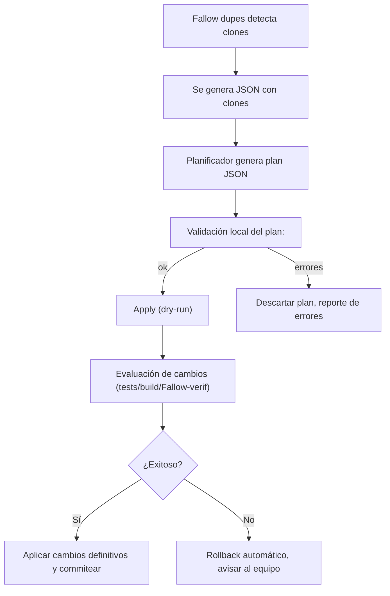

# Resumen Ejecutivo

Proponemos una herramienta CLI en Node.js que use **Fallow** para detectar duplicados y genere “planes” de refactorización en formato JSON. Luego, bibliotecas AST (como **ts-morph**, **jscodeshift**, **ast-grep**) aplican cambios automáticamente. Se define una arquitectura modular: un adaptador JSON ingiere la salida de Fallow; un planificador genera planes (extracción de funciones, unificación de imports, etc.) con precondiciones; un ejecutor los aplica por lotes concurrentes. Se usan contratos JSON versionados para la ingestión y los planes. Integración con **@vue/compiler-sfc** y **MagicString** gestiona `.vue` y `<script setup>`. Se incluyen comandos CLI (`plan`, `apply`, `verify`, `rescan`) con flags (`--dry-run`, `--apply`, `--verify`). La herramienta tiene validación automática de planes (p.ej. que los fragmentos clones sean expresiones completas) y puede deshacer cambios usando Git (branches/worktrees). Se prioriza por heurística (tamaño y dispersión de clones según Fallow). Se propone roadmap por hitos, con criterios de aceptación claros. _Fuentes:_ documentación oficial de Fallow, ts-morph, jscodeshift, ast-grep, @vue/compiler-sfc y MagicString.

## Herramientas y dependencias recomendadas

- **Fallow CLI** (≥v2.100.0): para detectar clones TS/JS. Produce JSON de duplicados (ordenado por tokens y dispersión).
- **TypeScript ≥4.x**: el compilador base.
- **ts-morph (≥18.x)**: wrapper sobre el API de TypeScript para navegar/transformar AST fácil.
- **jscodeshift (≥0.14.x)**: runner de codemods con recast, ideal para aplicar transformaciones masivas.
- **ast-grep CLI (última)**: búsqueda/rewrite de patrones AST (compatible con TypeScript).
- **@vue/compiler-sfc (>=3.x)**: parsea archivos `.vue` en descriptor SFC para extraer código de `<script>` (soporta `<script setup>`).
- **MagicString (≥0.27.x)**: manipular texto fuente y generar sourcemaps; útil para editar bloques de `<script>` manteniendo posición original.
- **Otras**: `fast-glob` o similar para archivos, `commander` o `yargs` para CLI, `promisify`/`worker_threads` para concurrencia.

| Herramienta     | Lenguajes       | Uso principal                                      | Referencia           |
| --------------- | --------------- | -------------------------------------------------- | -------------------- |
| **Fallow CLI**  | TS/JS           | Detección de duplicados (AST); salidas JSON/SARIF. | [Fallow docs]        |
| **ts-morph**    | TS/JS           | Navegación/edición AST de TS/JS.                   | [ts-morph docs]      |
| **jscodeshift** | TS/JS           | Codemods (AST→AST con recast).                     | [jscodeshift docs]   |
| **ast-grep**    | TS/JS/otros     | Búsqueda/reescritura estructural con patrones AST. | [ast-grep GitHub]    |
| **MagicString** | Cualquier texto | Edición de texto con generación de sourcemaps.     | [MagicString README] |

## Estructura del proyecto

- **`/src`**: código de la herramienta (TypeScript con ts-morph y CLI).
- **`/adapter/`**: módulos para leer JSON de Fallow y mapear a objetos internos.
- **`/plan/`**: lógicas para generar planes de refactor (definir acciones AST) según clones detectados.
- **`/transforms/`**: implementaciones de transformaciones AST (usando ts-morph, jscodeshift, ast-grep).
- **`/cli/`**: definición de comandos (`plan`, `apply`, `verify`, `rescan`) con `commander`/`yargs`.
- **`/schemas/`**: esquemas JSON (adaptador Fallow, plan) para validación.
- **`/tests/`**: tests unitarios y de integración (por ejemplo, run sobre fixtures TS/Vue).

Archivos clave:

- `fallow-adapter.ts`: lee salida JSON de `fallow dupes --format json`, valida con `jsonschema`, extrae clone_groups.
- `plan-generator.ts`: crea `Plan` JSON a partir de clones; incluye detalles de la acción a realizar.
- `apply-transform.ts`: aplica un plan: itera planes y ejecuta la transformación AST en cada archivo.
- `verify.ts`: verifica (dry-run) los resultados del plan (ej. recompilación TS, Fallow rescaneo).
- `index.ts` (CLI): define comandos con flags (`--dry-run`, `--apply`, `--verify`, `--batch-size`).

## Contratos JSON

**Entrada (adaptador Fallow):** Consumimos JSON de `fallow dupes --format json`. Ejemplo de esquema (simplificado):

```jsonc
{
  "stats": { "clone_groups": 5, "clone_families": 2 /*...*/ },
  "clone_groups": [
    {
      "fingerprint": "dup:abc123",
      "token_count": 57,
      "instances": [
        {
          "file": "src/foo.ts",
          "start": 597,
          "end": 653,
          "fragment": "function a() { ... }"
        },
        { "file": "src/bar.ts", "start": 818, "end": 874, "fragment": "function a() { ... }" }
      ],
      "spread": 1
    }
    // ...
  ]
}
```

Solo se usan campos: `fingerprint`, `token_count`, lista de `instances` (archivo, rango, código). La propia herramienta puede omitir el campo `"fragment"` con flag `--no-fragments` para reducir payload.

**Plan de refactorización:** Formato JSON versionado. Ejemplo conceptual:

```jsonc
{
  "planId": "20261018-1234",
  "source": "fallow-output.json",
  "rulesVersion": 1,
  "clones": [
    {
      "groupId": "dup:abc123",
      "action": "extractFunction",
      "files": ["src/foo.ts", "src/bar.ts"],
      "target": {
        "functionName": "doThing",
        "params": ["x", "y"],
        "body": "return /* ... */"
      }
    }
    // ...
  ]
}
```

- Cada entrada en `clones[]` indica un grupo Fallow a procesar.
- `"action"` puede ser `extractFunction`, `createModule`, `replaceWithImport`, etc.
- `"target"` incluye detalles de la transformación (por ejemplo, código de la nueva función).
- Se versiona el contrato (`rulesVersion`) para futuros cambios.

Los esquemas JSON deben versionarse (p.ej. con `$schema`) y validarse al iniciar la herramienta.

## Comandos CLI y flags

Ejemplos de uso de CLI:

- **`ts-refactor plan --fallow fallow.json --out plan.json [--min-tokens 50]`**: genera un plan de refactorización desde la salida JSON de Fallow. Opciones: `--min-occurrences`, `--top N` para limitar clones grandes.
- **`ts-refactor apply --plan plan.json [--dry-run] [--batch-size N]`**: aplica las transformaciones. Flag `--dry-run` reporta cambios sin escribir; sin `--dry-run` edita archivos. `--batch-size` (default ~10) controla cuántos clones se aplican en paralelo.
- **`ts-refactor verify --plan plan.json`**: verifica la integridad tras aplicar un plan (ej. recompila, rescan Fallow, compara resultados esperados).
- **`ts-refactor rescan`**: ejecuta `fallow dupes` nuevamente y refresca la base de duplicaciones (útil después de aplicar cambios).

Además, comandos auxiliares: `ts-refactor list` (muestra clones detectados), `ts-refactor reset` (descarta cambios de una plan anterior). Se recomienda flag global `--config path` para apuntar a un archivo de configuración específico.

## Reglas de elegibilidad y precondiciones

- **Solo clones relevantes**: filtrar grupos con tokens/minLines suficientes (ej. mínimo 50 tokens o 5 líneas). Opción de la regla “regla de tres”: aplicar solo si ocurrencia ≥3.
- **Contexto semántico compatible**: verificar que los fragmentos clones tengan tipos/campos similares (usando el AST TS, p. ej. comparar firmaruras de funciones o clases). Rechazar clones con referencia a variables locales diferentes sin fácil abstracción.
- **Sin efectos laterales desconocidos**: descartar clones que incluyan `break`, `return` en medio de loops, ya que extraer podría cambiar el flujo.
- **En SFC Vue**: solo clonas completos dentro de `<script>` o `<script setup>`. Ignorar duplicación en templates o estilos (son detectados por Fallow aparte).

Por ejemplo, antes de extraer función, el AST (ts-morph) puede usarse para: localizar la función completa, comprobar tipos de variables, y decidir parámetros formales. Un pre-check de ts-morph buscaría nodos `FunctionDeclaration` o `ClassMethod` completos, no fragmentos parciales.

## Flujo de validación (diagrama Mermaid)



Este flujo muestra cómo se genera el plan, se valida (por ejemplo, se comprueban los esquemas JSON y precondiciones AST) y se aplica en modo ensayo. Si la verificación falla (tests o re-scan Fallow detecta inconsistencias), se revierte automáticamente a la rama anterior.

## Manejo de conflictos y rollback

- **Conflictos entre planes**: dos planes pueden querer modificar la misma línea. Se recomienda **serializar** planes que afecten archivos superpuestos. Al generar planes, marcar archivos afectados para evitar solapamientos. Si ocurre conflicto de edición (p.ej. `ts-morph` lanza excepción), abortar plan parcial.
- **Branching y worktree**: cada aplicación de plan puede ocurrir en una nueva rama Git (o worktree) para facilitar pruebas independientes. Se pueden usar `git stash`/`checkout -b` antes de aplicar un plan.
- **Rollback**: tras un `apply --dry-run`, se dispara verificación. En fallo, se abandona el branch, sin fusionar. En cambio, al aplicar (sin dry-run), se graban commits incrementales. Si algo falla manualmente, se puede revertir a commit previo.
- **Validación post-aplicación**: correr nuevamente `fallow dupes` para confirmar que clones originales fueron resueltos (o al menos reducidos) y no surgieron duplicados nuevos. También recompilar TS para asegurar que no quedaron errores de import o sintaxis.

## Ejemplos de transformaciones AST

- **Localizar fragmentos y comprobar tipos**: con _ts-morph_ se carga el proyecto y se obtienen los nodos de interés. Ejemplo: localizar una declaración duplicada y chequear sus parámetros:

  ```ts
  const project = new Project({ tsConfigFilePath: 'tsconfig.json' });
  const source = project.getSourceFileOrThrow('src/foo.ts');
  // Suponiendo que clon contenga una función completa
  const func = source.getFunction('myFunc');
  if (func) {
    const params = func.getParameters().map((p) => p.getName());
    // Verificar tipos, etc.
  }
  ```

- **Extraer función**: con _ts-morph_ podemos reemplazar un fragmento repetido por una llamada a nueva función, y generar esa función:

  ```ts
  // Creación de función compartida
  const newFunc = source.addFunction({
      name: "sharedFunc",
      parameters: [ { name: "x" }, { name: "y" } ],
      returnType: "number",
      statements: "return x + y;"
  });
  // Reemplazar llamadas en los sitios duplicados
  cloneInstances.forEach(inst => {
      const call = inst.sourceFile.insertCallExpression(/*posición*/, "sharedFunc(x, y)");
      call.replaceWithText(`sharedFunc(${args.join(", ")})`);
  });
  ```

- **Actualizar imports**: si la función extraída está en otro módulo, _ts-morph_ puede agregar o actualizar la importación:

  ```ts
  source.addImportDeclaration({
    namedImports: ['sharedFunc'],
    moduleSpecifier: './utils/shared'
  });
  ```

- **Manejo de .vue (`<script>` o `<script setup>`)**: usar `@vue/compiler-sfc` para extraer el bloque de script, modificarlo con MagicString, y reescribir:

  ```ts
  import { parse } from '@vue/compiler-sfc';
  const content = fs.readFileSync('Component.vue', 'utf8');
  const { descriptor } = parse(content);
  const script = descriptor.script || descriptor.scriptSetup;
  if (script) {
    const s = new MagicString(content);
    // Reemplazar fragmento duplicado en script.content con llamada a función común
    const frag = script.content.slice(100, 150); // ejemplo
    s.overwrite(script.loc.start.offset + 100, script.loc.start.offset + 150, 'sharedFunc()');
    fs.writeFileSync('Component.vue', s.toString());
  }
  ```

  _MagicString_ garantiza que solo se modifiquen las porciones deseadas manteniendo sourcemap.

## Priorización y métricas

Usamos heurísticas basadas en Fallow y factores internos:

- **Tamaño y frecuencia**: priorizar grupos con mayor número de _tokens_ y de _instancias_. Según Fallow, el “costo” = tokens×instancias + boost de _spread_ (distancia entre archivos). Más clones dispersos (en varios directorios) son más valiosos.
- **“Propagación” (spread)**: se considera la dispersión de las copias en el árbol de directorios.
- **Cobertura de tests o uso**: opcionalmente, dar más peso a código crítico o muy testado.
- **Complejidad**: evitar extraer en clones con lógicas demasiado complejas (p.ej. heurística de complejidad ciclomática alta).
- **Regla del tres**: por defecto planificamos refactor solo si aparecen ≥3 copias, para rentabilizar el cambio.
- **Prioridad de Dead Code**: si Fallow indica que algunos clones están en código muerto (`--include-dupes`), tratarlos primero (lo menciona la doc de Fallow).

Los planes se ordenan por estas métricas antes de aplicar. Se reportan estadísticas (líneas modificadas, funciones creadas, etc.) tras cada batch.

## Llamadas al agente Antigravity

No hay documentación pública sobre límites de **Antigravity**. Se recomienda definir políticas internas: por ejemplo, limitar el tamaño del _prompt_ (especialmente el código relevante, tal vez usando solo fragmentos de clones), restringir las acciones solicitadas (por ejemplo, permitir solo `suggestFunctionName`, `describeCloneContext`, etc.), y especificar campos de retorno esperados (por ejemplo, un nombre de función o un bloque de código). Sin especificación oficial, estos detalles quedan _no especificados_ en la presente solución y deberán definirse en la implementación real.

## Tablas comparativas

| Transformación                         | Automatizable con AST?             | Herramienta sugerida  | Riesgos principales                                                         |
| -------------------------------------- | ---------------------------------- | --------------------- | --------------------------------------------------------------------------- |
| **Extraer función común**              | Sí (buena para patrones repetidos) | ts-morph, jscodeshift | Cambiar contexto de variables, errores semánticos si no se parametriza bien |
| **Unificar imports**                   | Sí                                 | ts-morph              | Import cycles, dependencias rotas                                           |
| **Renombrar variables**                | Parcial (si es global)             | ast-grep, ts-morph    | Colisiones de nombres                                                       |
| **Modificar literales (URLs, textos)** | Sí                                 | ast-grep, jscodeshift | Posible cambio de comportamiento si no se aplica uniformemente              |
| **Eliminar código muerto**             | Sí (junto con duplicación)         | Fallow + ts-morph     | Pérdida de funcionalidad si subestimado                                     |

| Herramienta/Framework | Transformaciones soportadas                         | Ventajas                                            | Contras                                           |
| --------------------- | --------------------------------------------------- | --------------------------------------------------- | ------------------------------------------------- |
| **ts-morph**          | Cualquier refactor TS/JS (funciones, imports, etc.) | Fuerte tipado TS, edita nodos AST concreto          | Curva de aprendizaje, rendimiento moderado        |
| **jscodeshift**       | Codemods en bloque (rename, replace)                | Muy usado, mantiene formato, CLI completo           | Requiere parser TS explícito; no tipado TS nativo |
| **ast-grep**          | Búsqueda/reemplazo con patrones AST                 | Intuitivo (patrón parecido a código), multilenguaje | Menos control fino; formatos YAML para reglas     |
| **@vue/compiler-sfc** | Extracción de bloque `<script>`                     | Parseo oficial de SFC, maneja `<script setup>`      | Sólo parseo, sin API de modificación directo      |
| **MagicString**       | Inserciones/sobrescrituras textuales                | Preserva sourcemaps, muy ligera                     | Operaciones manuales (índices de caracteres)      |

## Roadmap de implementación

1. **Hito 1 – Integración básica Fallow**: Configurar ejecución de `fallow dupes` (vía Node `child_process` o Fallow bindings). Validar lectura de JSON con el adaptador. _Criterios:_ ejecuta sin errores en un repo de prueba; produce listado de clone_groups.
2. **Hito 2 – Generador de planes inicial**: Traducir grupos Fallow a planes simples (p.ej. marcando “extraer función”). Diseño de contrato JSON de plan; probar con casos pequeños. _Criterios:_ plan JSON válido según esquema, incluye acciones para clones.
3. **Hito 3 – Transformaciones con ts-morph**: Implementar transformaciones concretas (extraer función, actualizar imports) para TS puro. Uso de dry-run. Pruebas sobre proyectos de ejemplo. _Criterios:_ los códigos modificados aún compilables; clones originales reducidos.
4. **Hito 4 – Manejo de Vue SFC**: Soporte para `.vue` con `<script>` y `<script setup>`. Usar `compiler-sfc` + `MagicString` para parsear y modificar. _Criterios:_ componentes Vue siguen compilando; duplicados en scripts eliminados.
5. **Hito 5 – Concurrencia y batch**: Añadir capacidad para aplicar varios planes en paralelo (concurrencia N threads). Administrar batch sizes y evitar conflictos (lock de archivos). _Criterios:_ mejora de rendimiento en >1000 archivos; sin intervenciones manuales extra.
6. **Hito 6 – Verificación automatizada**: Integrar pasos de verificación (tests unitarios y re-ejecución Fallow). Habilitar flags `--verify` y `--rescan`. _Criterios:_ fallos en tests provocan rollback; duplicados post-verif ≤ original.
7. **Hito 7 – Integración con Antigravity**: Definir plugin/adapter para invocar el agente en la selección semántica de nombres, confirmación de intenciones, etc. _Criterios:_ prompts validan contextos de clones; respuestas del agente cumplen formato esperado.
8. **Hito 8 – Documentación y métricas**: Redactar guía de uso, detallar contratos JSON. Añadir métricas de priorización basadas en tokens y dispersión (Fallow). Implementar seguimiento de tiempo/errores.

Cada hito tiene pruebas de aceptación claras: por ejemplo, “un plan con 3 duplicados de función extrae una sola función sin romper compilación” o “Vue con `<script setup>` sigue funcionando tras refactor”.

**Fuentes:** La solución se basa en la documentación oficial de las herramientas citadas, adaptando sus ejemplos a un flujo automatizado. Se priorizó la claridad y pasos reproducibles; donde la especificación faltó (e.g. detalles del agente Antigravity) se dejó como _“no especificado”_.
